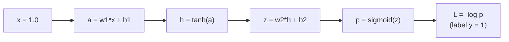
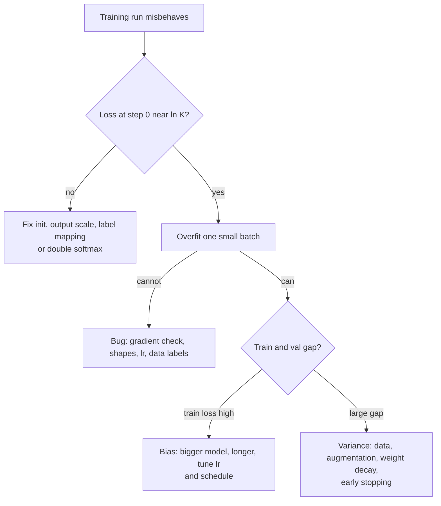

# ML & Deep Learning Foundations - Deep Dive

This is for readers who can already recite the crash course in [README.md](README.md) and want to know why each statement is true. The README gives you the vocabulary, [questions.md](questions.md) drills you on it, and this document derives the mechanisms behind the answers: why the bias-variance decomposition is exact, why cross-entropy and MSE are both maximum likelihood, what backprop does on a graph with real numbers, why Adam needs bias correction, why AdamW exists, why He initialisation has a factor of 2, and how to read ROC-AUC and calibration numbers without fooling yourself. Every part has a worked example you can reproduce by hand or with the exercise code in [exercises/](exercises/README.md).

Suggested order: Parts 1 and 2 (about 2 hours with exercise 1), Part 3 with exercises 2 and 3 (about 3 hours, the most valuable block), Parts 4 and 5 with exercises 4 and 7 (about 3 hours), Parts 6 to 8 with exercises 5 and 6 (about 3 hours), then "Putting it together" and the pen-and-paper exercises. Total: roughly 12 to 14 hours.

## Prerequisites

- Calculus: partial derivatives and the chain rule. Matrix calculus is introduced as needed.
- Linear algebra: matrix products, transposes, norms, dot products.
- Probability: expectation, variance, independence, Gaussian density, Bayes' rule.
- Python and numpy. Every snippet below uses numpy only.
- Helpful but not required: the transformer architecture, covered in [../02-llm-fundamentals/deep-dive.md](../02-llm-fundamentals/deep-dive.md). This document stays at the level of generic networks and points to transformer-specific consequences where they matter.

## Contents

- [Part 1 - Generalisation: bias, variance, and the modern caveat](#part-1---generalisation-bias-variance-and-the-modern-caveat)
- [Part 2 - Loss functions as maximum likelihood](#part-2---loss-functions-as-maximum-likelihood)
- [Part 3 - Backpropagation on a computational graph](#part-3---backpropagation-on-a-computational-graph)
- [Part 4 - Optimisers and learning-rate schedules](#part-4---optimisers-and-learning-rate-schedules)
- [Part 5 - Initialisation and normalisation](#part-5---initialisation-and-normalisation)
- [Part 6 - Regularisation](#part-6---regularisation)
- [Part 7 - Metrics and calibration](#part-7---metrics-and-calibration)
- [Part 8 - Embeddings and representation learning](#part-8---embeddings-and-representation-learning)
- [Putting it together](#putting-it-together)
- [Exercises](#exercises)
- [Further study](#further-study)

---

## Part 1 - Generalisation: bias, variance, and the modern caveat

### The problem

A model is trained on a finite sample but judged on data it has never seen. The training loss is an optimistic estimate of the quantity you care about, the expected loss on new data. Everything in this part is about the gap between the two and what controls it.

### The decomposition, derived

Assume data come from y = f(x) + e, where e has mean 0 and variance s2 (the noise variance), independent of everything else. You train a model on a random training set D, which gives a random predictor fhat_D. Fix a test input x. The expectation below is over both the training set D and the test noise e.

    E[(y - fhat(x))^2]
      = E[(f + e - fhat)^2]
      = s2 + E[(f - fhat)^2]                      (cross term vanishes: e is independent, mean 0)

Now let fbar = E_D[fhat(x)], the average prediction over training sets. Add and subtract it:

    E[(f - fhat)^2] = E[(f - fbar + fbar - fhat)^2]
                    = (f - fbar)^2 + E[(fhat - fbar)^2]     (cross term: E[fbar - fhat] = 0)
                    = bias^2 + variance

So expected squared error at x is exactly:

    noise s2  +  bias^2 (f - fbar)^2  +  variance E[(fhat - fbar)^2]

Three things to hold on to.

- **Noise** is irreducible. No model beats it. If your validation error is near the label noise you are done modelling and should look at the labels.
- **Bias** is systematic: even averaged over infinitely many training sets, the model misses. A straight line fitted to a sine wave has bias however much data you give it.
- **Variance** is sensitivity to the particular sample. A model that changes wildly when you swap 5% of the training set has high variance.

### A measurable example

Exercise 6 runs this experiment. The true function is sin(pi x) on [-1, 1]. Each trial draws 30 noisy points (noise sd 0.3, so s2 = 0.09), fits a polynomial, and records predictions on a fixed grid. 300 trials per degree. Averaged over the grid:

| Degree | Bias^2 | Variance | Expected test MSE (bias^2 + variance + 0.09) |
|---|---|---|---|
| 1 | 0.204 | 0.023 | 0.317 |
| 3 | 0.005 | 0.018 | 0.113 |
| 5 | 0.0002 | 0.049 | 0.139 |
| 9 | 0.009 | ~13.0 | ~13.1 |

Degree 1 is bias-dominated: 0.204 of the 0.317 total. Degree 3 is near the sweet spot. By degree 5 the bias is essentially zero and variance has crept up. At degree 9 the variance is about 13 against noise of 0.09, because a ninth-degree polynomial fitted to 30 random points oscillates wildly near the interval edges. Training error would have fallen monotonically across the whole table, which is why it cannot see variance.

### Diagnosing from curves

The practical version of the decomposition is the train/validation gap. Put the train and validation loss next to the noise floor or a reasonable human/baseline level.

- Train loss high and close to validation loss: the model cannot even fit the training set. High bias (underfitting). Remedies: bigger model, more features, train longer, lower regularisation, better optimiser settings, check for a bug.
- Train loss low, validation loss much higher: the model memorises. High variance (overfitting). Remedies: more data, stronger regularisation, augmentation, smaller model, early stopping.
- Both low and close: done, or limited by noise.
- Validation better than training: usually regularisation active in training only (dropout, augmentation) or a leak or distribution difference between splits.

More data helps variance, not bias. A larger model helps bias, and may increase variance. Learning curves (error versus training set size) tell you which regime you are in: if train and validation error have converged to a high value, more data will not help.

### The modern caveat: double descent

The classical picture is a U-shaped test error curve versus capacity. In heavily overparameterised models, test error often shows a second descent: it peaks near the interpolation threshold (roughly where parameters match the number of training points), then decreases again as the model grows. Past the threshold there are many interpolating solutions and gradient descent tends to pick a low-norm one, an implicit regularisation. Deep Double Descent (Nakkiran et al.) also shows epoch-wise and sample-wise versions.

The caveat does not repeal bias-variance. It says that variance need not grow monotonically with parameter count when the training procedure is biased towards simple interpolants, and that "overfit means worse" is not a law.

### Splits, cross-validation, and leakage

Training data fit the parameters. Validation data choose hyperparameters and checkpoints. Test data are used once. Every time you look at validation results and change something, you leak a little information into the model, so the validation score becomes optimistic. This is why the test set must stay sealed.

**K-fold cross-validation** splits n examples into k folds, trains k times, each time validating on one fold, and averages. It uses data efficiently and gives a spread (the standard deviation across folds) in addition to a mean. In exercise 6 you implement it, and also **group k-fold**, in which every row from the same group (user, patient, document) lands in the same fold. Without grouping, rows from the same user appear in both train and validation, the model learns user identity, and the validation score is inflated. This is the most common real-world leakage failure.

Other leaks worth naming in an interview:

- Fitting a scaler, imputer, vocabulary or feature selector on the full dataset before splitting. The validation fold has then influenced the training transform. Fix: fit inside each fold (a pipeline).
- Time: shuffling a time series lets the model see the future. Use forward-chaining splits.

### Check yourself

1. Why does the cross term vanish when you expand E[(y - fhat)^2]?

Answer

Two cross terms appear. The first is 2 E[e (f - fhat)]. The noise e at the test point is independent of the training set (hence of fhat) and has mean zero, so this is zero. The second is 2 (f - fbar) E[fbar - fhat], and E[fhat] = fbar by definition, so it is zero too. If the test noise were correlated with the training noise (for example a test point that also appears in training), the first term would not vanish and the formula would break. That is why leakage makes the decomposition meaningless.

2. Train MSE is 0.02, validation MSE is 0.31, and you believe label noise is about 0.05. What is the diagnosis and what do you try first?

Answer

The train error is below the noise floor (0.02 < 0.05), which means the model is fitting noise, and the large gap to validation says variance dominates. Try more data or augmentation, stronger regularisation (weight decay, dropout), early stopping at the validation minimum, or a smaller model. Check for a train/validation distribution difference only after those, because a gap of this size with sub-noise training error is the textbook overfit signature.

3. A teammate standardises the whole dataset, then splits it, then runs 5-fold CV. What is wrong and how large is the effect usually?

Answer

The mean and standard deviation used for standardisation include validation rows, so the validation fold influenced the transform. For simple scaling the leakage is typically small, but for target encoding, feature selection by correlation with the label, or PCA on small datasets it can be large. The correct method is to fit the transform on the training portion of each fold only, which is what a scikit-learn style pipeline does automatically.

---

## Part 2 - Loss functions as maximum likelihood

### The problem

A loss function is a choice of what "close" means. The principled way to choose it: write down a probabilistic model of how the labels were generated given the inputs, and minimise the negative log-likelihood (NLL) of the training labels. Most standard losses fall out of this recipe, and the recipe also tells you when a standard loss is the wrong one.

Maximum likelihood estimation (MLE): choose parameters theta maximising prod_i p(y_i | x_i; theta). Taking logs turns the product into a sum, and negating turns maximisation into minimisation:

    minimise  -sum_i log p(y_i | x_i; theta)

### MSE is Gaussian MLE

Assume y = mu(x; theta) + e with e ~ N(0, s2). Then

    log p(y | x) = -(y - mu)^2 / (2 s2) - log(s * sqrt(2 pi))

With s fixed, the second term is a constant and the first is proportional to the squared error. Minimising NLL is minimising mean squared error. Consequences:

- MSE assumes constant-variance Gaussian noise. Outliers are very unlikely under a Gaussian, so they get a huge pull (the gradient grows linearly with the error).

### Cross-entropy is categorical MLE

For a binary label y in {0, 1} with predicted probability p = sigmoid(z):

    log p(y | x) = y log p + (1 - y) log(1 - p)

so NLL is binary cross-entropy (BCE). For K classes with softmax probabilities p_k = exp(z_k) / sum_j exp(z_j) and true class c:

    NLL = -log p_c = -z_c + log sum_j exp(z_j)

This is the cross-entropy between the one-hot label distribution and the predicted distribution. A language model's training loss is exactly this, averaged over tokens. Perplexity is exp(mean NLL in nats): a loss of 2.0 nats per token is perplexity of about 7.4, meaning the model is as uncertain as a uniform choice among ~7.4 tokens.

### The gradient and why it is nice

Differentiate NLL = -z_c + log sum_j exp(z_j) with respect to z_k:

    dNLL/dz_k = -1[k == c] + exp(z_k) / sum_j exp(z_j) = p_k - y_k

The gradient with respect to the logits is predicted probabilities minus the one-hot target. It is bounded in [-1, 1], it is large exactly when the model is wrong, and it needs no extra derivative of the softmax. The same form holds for sigmoid + BCE: p - y.

Compare squared error on a sigmoid output, L = (p - y)^2. The chain rule gives dL/dz = 2 (p - y) p (1 - p). Take a confidently wrong example: y = 1, z = -6, so p = 0.0025.

    cross-entropy gradient:  p - y            = -0.9975
    MSE gradient:            2 (p - y) p (1-p) = 2 * (-0.9975) * 0.0025 * 0.9975 ~ -0.005

The cross-entropy gradient is about 200 times larger, exactly where learning is most needed. MSE on a saturated sigmoid gives a vanishing gradient. That is the real reason not to use MSE for classification, and it is the reasoning interviewers want rather than "MSE is for regression".

### Numerical stability

Computing softmax then log loses precision and overflows. Work with logits and the log-sum-exp trick: log sum_j exp(z_j) = m + log sum_j exp(z_j - m) with m = max_j z_j. Exercise 1 does the binary version: BCE from logits is max(z, 0) - z y + log(1 + exp(-|z|)), which never exponentiates a positive number. Frameworks expose this as a fused "cross-entropy with logits" function. Applying softmax in the model and then feeding probabilities to a loss that expects logits is a classic double-softmax bug: it trains, poorly, and no exception is raised.

### Worked example: softmax and temperature

Logits z = [2.0, 1.0, 0.1]. Subtract the max (2.0) to get [0, -1, -1.9]. Exponentials: [1, 0.3679, 0.1496]. Sum = 1.5175. Probabilities [0.659, 0.242, 0.099]. If the true class is 0, loss = -log 0.659 = 0.417 nats. Gradient on the logits = [0.659 - 1, 0.242, 0.099] = [-0.341, 0.242, 0.099], which sums to zero (logit shifts do not matter).

Divide the logits by a temperature T before the softmax:

| T | p0 | p1 | p2 |
|---|---|---|---|
| 0.5 | 0.864 | 0.117 | 0.019 |
| 1.0 | 0.659 | 0.242 | 0.099 |
| 2.0 | 0.502 | 0.304 | 0.194 |

Low T sharpens towards argmax, high T flattens towards uniform. This is the same knob as LLM sampling temperature, the temperature in knowledge distillation, the temperature in contrastive losses (Part 8), and the temperature used to recalibrate classifiers (Part 7).

### KL divergence and the link to cross-entropy

For distributions P (the truth) and Q (the model):

    H(P) = -sum P log P             entropy
    H(P, Q) = -sum P log Q          cross-entropy
    KL(P || Q) = sum P log(P / Q) = H(P, Q) - H(P)

Since H(P) does not depend on the model, minimising cross-entropy is minimising KL(P || Q). Numbers: P = [0.5, 0.5], Q = [0.9, 0.1]:

    H(P)        = 0.693 nats
    H(P, Q)     = 1.204 nats
    KL(P || Q)  = 0.511 nats       (1.204 - 0.693)
    KL(Q || P)  = 0.368 nats       (not equal: KL is asymmetric)

KL is zero only when P = Q and is never negative. Direction matters. Training with KL(P || Q) where P is data ("forward KL") punishes Q for putting low mass where P has mass, so it covers all modes, even at the price of spreading mass between them. KL(Q || P) ("reverse KL") punishes Q for mass where P has none, so it tends to lock onto a single mode. This distinction shows up in RLHF (a KL penalty to the reference policy), in distillation, and in variational methods.

### Check yourself

1. Show that minimising MSE is MLE under Gaussian noise and say what extra assumption you made.

Answer

With y = mu(x) + e and e ~ N(0, s2), log p(y | x) = -(y - mu)^2 / (2 s2) - log(s sqrt(2 pi)). The second term does not depend on the parameters if s2 is fixed, so maximising the likelihood is minimising the sum of squared errors. The extra assumptions are that the noise variance is constant across inputs (homoscedastic), independent across examples, and Gaussian. If any fails (heavy tails, input-dependent noise), MSE is no longer the maximum likelihood loss.

2. Logits are [1000, 1001, 999]. Why does a naive softmax return NaN, and what is the fix?

Answer

exp(1000) overflows a float64 to infinity, and infinity divided by infinity is NaN. Softmax is invariant to subtracting a constant from all logits, so subtract the max: [-1, 0, -2] gives probabilities [0.245, 0.665, 0.090] with no overflow. For the loss, use the log-sum-exp form directly rather than computing a probability and taking its log.

3. A classifier outputs p = 0.01 for a true positive. Compare the logit gradients of BCE and of squared error.

Answer

BCE: p - y = -0.99. Squared error on the sigmoid output: 2 (p - y) p (1 - p) = 2 * (-0.99) * 0.01 * 0.99 ~ -0.0196, about 50 times smaller. The squared-error gradient is damped by the p(1 - p) factor of the sigmoid, which is tiny whenever the unit is saturated, so confidently wrong examples barely move the weights.

---

## Part 3 - Backpropagation on a computational graph

### The problem

A network is a composition of simple functions with millions to trillions of parameters. We need the gradient of one scalar loss with respect to every parameter, at a cost comparable to a forward pass. Finite differences would need one extra forward pass per parameter, which is impossible. Backpropagation computes all the gradients in about the cost of two more forward passes.

### The mechanism

Write the computation as a directed acyclic graph. Each node is an operation, edges carry values. The forward pass evaluates nodes in topological order and **caches** the inputs and outputs the backward pass will need. The backward pass starts at the loss with dL/dL = 1 and visits nodes in reverse topological order. For each node y = g(x1, x2, ...), given the upstream gradient dL/dy, it computes each input's contribution:

    dL/dx_i  +=  dL/dy * dy/dx_i

Two details carry most of the weight. First, contributions are **accumulated** with +=, because a value used in two places receives the sum of both gradient paths (the multivariate chain rule). Second, each node only needs its local derivative, which depends on cached forward values. So backprop is the chain rule evaluated in the order that reuses shared sub-expressions, which is dynamic programming over the graph.

For a vector function the local derivative is a Jacobian J, and backprop never builds it. It computes the vector-Jacobian product (dL/dy)^T J directly, which for common layers is a small matrix operation.

### A hand-worked example

A one-hidden-unit network with a logistic output and cross-entropy loss. Values: x = 1.0, w1 = 0.5, b1 = 0, w2 = 2.0, b2 = -0.5, label y = 1.

Forward pass, caching each value:

    a = 0.5 * 1.0 + 0 = 0.5
    h = tanh(0.5)           = 0.46212
    z = 2.0 * 0.46212 - 0.5 = 0.42423
    p = sigmoid(0.42423)    = 0.60450
    L = -log(0.60450)       = 0.50336

Backward pass, from the loss down:

    dL/dz  = p - y             = 0.60450 - 1     = -0.39550     (softmax/sigmoid + CE shortcut)
    dL/dw2 = dL/dz * h         = -0.39550 * 0.46212 = -0.18277
    dL/db2 = dL/dz * 1         = -0.39550
    dL/dh  = dL/dz * w2        = -0.39550 * 2.0  = -0.79101
    dL/da  = dL/dh * (1 - h^2) = -0.79101 * 0.78645 = -0.62209     (tanh' = 1 - tanh^2, uses cached h)
    dL/dw1 = dL/da * x         = -0.62209
    dL/db1 = dL/da * 1         = -0.62209

Check with a central finite difference on w1: (L(0.500001) - L(0.499999)) / 0.000002 = -0.622086, matching to six digits. Note what the backward pass needed from the forward pass: h (for both dw2 and tanh') and x. That is the cached-activation cost in miniature.

Exercise 2 builds this as a scalar autograd engine in about 100 lines, and exercise 3 does the same for a matrix network.

### Matrix form

For a linear layer Y = X W + b with X of shape (B, d_in), W of shape (d_in, d_out), and upstream gradient dY of shape (B, d_out):

    dW = X^T @ dY          (d_in, d_out)
    db = dY.sum(axis=0)    (d_out,)
    dX = dY @ W^T          (B, d_in)

Shapes tell you the answer: dW must be the shape of W, and the only way to combine X^T (d_in, B) with dY (B, d_out) is as written. Elementwise activations multiply dY by the local derivative: tanh by (1 - h^2), ReLU by 1[x > 0], GELU by its own derivative. Softmax with cross-entropy and mean over B gives (softmax - onehot) / B at the logits, with the 1/B being the one people forget.

### Cost: why training is about 3x the forward pass

A matmul of (B, d_in) by (d_in, d_out) costs about 2 B d_in d_out FLOPs. The backward pass for that layer has two matmuls of the same size (one for dW, one for dX). So backward is about 2x forward, and forward plus backward is about 3x forward. For a transformer with N parameters trained on D tokens, forward costs roughly 2 N D FLOPs, so training costs roughly 6 N D. This is the rule of thumb you meet in scaling-law discussions.

### Vanishing and exploding gradients

The gradient reaching layer k of an L-layer chain is a product of L - k Jacobians. If their typical norm is below 1, the gradient shrinks exponentially, and above 1 it grows exponentially.

- Sigmoid has maximum derivative 0.25. Ten sigmoid layers, even at the best point, scale gradients by at most 0.25^10 ~ 1e-6.
- tanh has maximum derivative 1 but is below that away from zero, and saturates.
- Weights with too small or too large scale do the same (Part 5 measures this).
- ReLU passes gradient 1 on active units and 0 on dead ones. Dead units are a different failure: a unit whose input is always negative stops learning.

Fixes, with the mechanism for each:

- **Residual connections**: y = x + f(x) has Jacobian I + J_f. The identity term gives the gradient a direct path to early layers, so the product no longer decays.
- **Normalisation layers** keep activations at a stable scale.
- **Variance-preserving initialisation** starts the network in a regime where the Jacobian norms are about 1.
- **Gradient clipping** handles explosion after the fact: if the global norm ||g|| exceeds c, rescale g by c / ||g||. It cures rare spikes without changing the direction.

### Gradient checking

Whenever you write backward code by hand, compare to finite differences:

    num_i = (L(theta + eps e_i) - L(theta - eps e_i)) / (2 eps)

Use float64, eps around 1e-5, and expect a relative error of about 1e-6 or better. Disable dropout, avoid points near ReLU kinks, and check every parameter, since one missing bias gradient hides in an aggregate. This catches a missing 1/B, a transposed matrix, and a gradient overwritten instead of accumulated.

### Check yourself

1. In the worked example, why is dL/dz equal to p - y, and what happens to the result if the label is 0?

Answer

For L = -[y log p + (1 - y) log(1 - p)] with p = sigmoid(z), dL/dp = -y/p + (1 - y)/(1 - p) and dp/dz = p (1 - p). Multiplying gives p - y. With y = 0, dL/dz = p = 0.6045, positive, so gradient descent would push z down, which is right because the model is predicting a positive for a negative example.

2. A node's output feeds two later operations. How does backprop combine the two upstream gradients?

Answer

It adds them. Gradient contributions from every path accumulate at the node (the multivariate chain rule), which is why implementations use += on the grad field. Overwriting instead of accumulating silently drops one path. In exercise 2 the test f = x*x + x checks this: df/dx = 2x + 1 = 7 at x = 3.

3. Why is the backward pass about twice the cost of the forward pass for a dense layer?

Answer

Forward computes one matmul, Y = X W. Backward computes two matmuls of the same size: dW = X^T dY and dX = dY W^T. The first layer needs no dX, and elementwise operations are cheap, so the ratio is close to 2. Together that gives training at about 3x the forward cost, or 6 N D FLOPs for N parameters and D tokens versus 2 N D for inference.

---

## Part 4 - Optimisers and learning-rate schedules

### The problem

Backprop gives a gradient. An optimiser turns gradients into parameter updates. The loss surface of a neural network has directions of very different curvature, noisy gradient estimates (from mini-batches), and, in transformers, parameters whose gradient scales differ by orders of magnitude. Each optimiser below fixes a specific weakness of the previous one.

### SGD and the geometry of a quadratic

Plain gradient descent: w <- w - lr * g. Study it on f(w) = 0.5 * (100 w0^2 + 1 w1^2), a bowl that is 100 times steeper in one direction. The gradient is [100 w0, w1]. Each coordinate evolves independently:

    w_i(t+1) = (1 - lr * h_i) * w_i(t)       with curvature h_0 = 100, h_1 = 1

Convergence needs |1 - lr h_i| < 1 for every i, so lr < 2 / h_max = 0.02. The steep direction forces a small learning rate, and then the flat direction crawls. At lr = 0.015 the steep coordinate multiplies by (1 - 1.5) = -0.5 each step (it flips sign and decays quickly), while the flat coordinate multiplies by 0.985. After 100 steps 0.985^100 = 0.221, giving loss 0.5 * 0.221^2 = 0.0244. The ratio h_max / h_min = 100 is the **condition number**, and it sets how slow plain gradient descent is. Real networks have far worse conditioning.

### Momentum

Keep a running sum of past gradients and step along it:

    v <- beta * v + g
    w <- w - lr * v

This is the form used by PyTorch's SGD. Unrolled, v = g_t + beta g_{t-1} + beta^2 g_{t-2} + ..., an exponentially weighted sum with total weight 1 / (1 - beta). If the gradient is constant, v approaches g / (1 - beta), so beta = 0.9 behaves like a 10x larger step in consistent directions. In an oscillating direction (the steep coordinate above) successive gradients alternate in sign and cancel. So momentum accelerates along the valley floor and damps the zig-zag across it.

Hand example: g = 1 on every step, lr = 0.1, beta = 0.9, w starts at 1. Step 1: v = 1, w = 0.9. Step 2: v = 0.9 + 1 = 1.9, w = 0.9 - 0.19 = 0.71. The second step is almost twice as long as the first.

Exercise 4 results for the quadratic above (lr 0.015, beta 0.9 for momentum; Adam uses lr 0.1):

| Steps | SGD loss | Momentum loss | Adam loss |
|---|---|---|---|
| 10 | 0.370 | 0.341 | 0.294 |
| 50 | 0.110 | 0.295 | 0.0012 |
| 100 | 0.0243 | 0.00006 | 0.0004 |

Momentum is actually worse than SGD at step 50: it overshoots and oscillates before the accumulated velocity settles. By step 100 it is 400 times better. The lesson is that momentum is not monotone, and short comparisons mislead. Adam's final loss of 0.0004 is a noise floor: with a constant learning rate its steps stay about lr in size, so it jitters around the minimum. A decaying schedule removes that.

### Adam, derived

Two ideas combined. Keep an exponential moving average (EMA) of the gradient (first moment m, momentum) and of the squared gradient (second moment v), then divide:

    m <- beta1 * m + (1 - beta1) * g
    v <- beta2 * v + (1 - beta2) * g^2
    w <- w - lr * m_hat / (sqrt(v_hat) + eps)

with defaults beta1 = 0.9, beta2 = 0.999, eps = 1e-8. The division makes the step size per parameter roughly lr regardless of gradient scale. A weight whose gradients are about 1e-4 and one whose gradients are about 10 both move by about lr per step. That is exactly what a transformer needs, since embeddings, attention and norm parameters see very different gradient magnitudes.

**Bias correction.** m and v start at zero, so early in training they are biased towards zero. Unroll the first moment: m_t = (1 - beta1) * sum_{i<=t} beta1^(t-i) g_i. If g has constant expectation, E[m_t] = (1 - beta1^t) E[g]. So divide by (1 - beta1^t) to remove the bias, and likewise v by (1 - beta2^t). Without it the second moment at step 1 is only 0.001 g^2 (for beta2 = 0.999), so sqrt(v) is 0.032 |g|, while the first moment is 0.1 g. The first step would be 0.1 / 0.032 ~ 3.2 times lr * sign(g), and the second-moment estimate would stay too small for hundreds of steps, inflating every early update.

**Worked example.** Gradient sequence g = 1, 1, -1, lr = 0.1, starting at w = 1 (the exercise 4 tests check the first two steps):

| t | g | m | v | m_hat | v_hat | step | w |
|---|---|---|---|---|---|---|---|
| 1 | 1 | 0.1 | 0.001 | 1.000 | 1.000 | 0.1 | 0.900 |
| 2 | 1 | 0.19 | 0.001999 | 1.000 | 1.000 | 0.1 | 0.800 |
| 3 | -1 | 0.071 | 0.002997 | 0.262 | 1.000 | 0.0262 | 0.774 |

Details: at t = 2, m_hat = 0.19 / (1 - 0.81) = 1 and v_hat = 0.001999 / (1 - 0.998001) = 1. At t = 3, m_hat = 0.071 / (1 - 0.729) = 0.262 and v_hat = 0.002997 / (1 - 0.997003) = 1.0. The sign flip in the gradient drags the momentum from 1 toward 0 and shrinks the step by 74%.

Properties worth knowing:

- **First step is about lr * sign(g)**, since m_hat / sqrt(v_hat) = g / |g|. This is why a poorly scaled Adam run can take a huge first step.
- **Scale invariance**: multiply the loss by 1000 and the update is unchanged (up to eps). SGD has no such property.
- **beta2**: 0.999 is the paper default. LLM recipes often use 0.95, because a shorter memory of squared gradients reacts faster after a loss spike and avoids stale, too-large v estimates.

### L2 versus weight decay: why AdamW exists

For SGD, adding an L2 penalty (lambda/2) ||w||^2 to the loss adds lambda * w to the gradient, giving w <- w - lr (g + lambda w) = (1 - lr lambda) w - lr g. This is multiplicative shrinkage, "weight decay", and the two views coincide.

For Adam they do not. If you put lambda * w in the gradient, it passes through the same m / sqrt(v) machinery as everything else, so the decay on each weight is divided by that weight's gradient scale. Weights with large gradient history are barely decayed, and weights with small gradients are decayed heavily. The regulariser is distorted by the optimiser's preconditioner. Test case from exercise 4: g = 100, w = 1, lr = 0.1, lambda = 0.5, first step.

    Adam, no penalty:        w = 1 - 0.1                   = 0.9
    Adam + L2 (g_eff = 100.5): m_hat / sqrt(v_hat) = 1 again, w = 0.9   (penalty erased)
    AdamW (decoupled):       w = 1 - 0.1 - lr*lambda*w     = 0.9 - 0.05 = 0.85

AdamW (Loshchilov and Hutter) applies the decay directly to the weights, outside the adaptive update:

    w <- w - lr * m_hat / (sqrt(v_hat) + eps) - lr * lambda * w

Now every weight shrinks at the same relative rate, whatever its gradient history, and the optimal lambda is also less entangled with the learning rate. Typical LLM settings: lambda ~ 0.1, no decay on biases and norm gains (they are low-dimensional scale parameters, and decaying them hurts), and often no decay on embeddings in some recipes. Note that with a decayed learning-rate schedule the effective decay lr * lambda decays too.

### Learning-rate schedules

**Warmup.** For the first few hundred to few thousand steps the learning rate rises linearly from near zero to its peak. Two reasons. First, early in training the second-moment estimate v is built from very few gradients, so the effective per-parameter step is noisy and can be far too large (the RAdam paper analyses this variance of the adaptive rate). Second, early gradients in a randomly initialised deep network are not representative, and large steps can push activations into regimes (attention logits saturated, norm statistics off) from which the run does not recover. Warmup is cheap insurance and its absence is a frequent cause of early divergence in transformers.

**Decay.** After the peak, lower the learning rate. Early in training you need large steps to travel, and late in training you need small steps to settle into a minimum, since the noise floor of a constant lr is proportional to lr (the Adam jitter above). Cosine decay from peak to about 10% of peak is the common default:

    lr(step) = lr_min + (lr_peak - lr_min) * 0.5 * (1 + cos(pi * progress))

with progress running from 0 to 1 after warmup. Numbers for peak 3e-4, warmup 100 steps, 1000 total, floor 10%: step 0 gives 3e-6, step 49 gives 1.5e-4, step 99 gives 3e-4, step 550 (halfway through the decay) gives 1.65e-4, and step 1000 gives 3e-5. The Chinchilla analysis found that the cosine cycle length should match the actual training length, since stopping a long schedule early leaves a high learning rate and a worse model.

**Gradient clipping** (global norm 1.0) is the companion safety mechanism: g <- g * min(1, c / ||g||). It bounds the update from a rare bad batch. Log the pre-clip norm. A norm that trends upward or spikes is an early warning for instability.

### Check yourself

1. Why is the first Adam update about lr in magnitude whatever the gradient scale?

Answer

At t = 1 the moments start at zero, so after bias correction m_hat = g and v_hat = g^2. The update is lr * g / (|g| + eps) ~ lr * sign(g). The step depends on the sign of the gradient, not its size, which is the scale invariance of Adam. (Exercise 4 checks that g = 0.5 and g = 500 produce the same first step.)

2. State precisely why L2 regularisation in Adam is not weight decay, with a numeric consequence.

Answer

Adam divides the entire gradient, including the lambda * w term, by sqrt(v_hat). For a weight with large gradients (sqrt(v_hat) = 100) the penalty's effect on the update is divided by 100, so it is nearly erased. For a weight with tiny gradients it is amplified. The decay each weight experiences therefore depends on its gradient history rather than on lambda alone. In the example above with g = 100, Adam + L2 moves the weight exactly as plain Adam does (0.9), while AdamW additionally shrinks it to 0.85.

3. Your loss diverges within the first 200 steps of a transformer run and a teammate suggests removing warmup to save time. Respond.

Answer

Removing warmup makes early divergence more likely, not less. Early on Adam's v estimate comes from few samples, the network is far from any good region, and attention and normalisation statistics are fragile. Remedies in order: confirm the peak lr is not too high for this model size, lengthen warmup, lower beta2 (0.95), add or tighten gradient clipping, check the data pipeline for a bad batch, and check initialisation of the output projections. Warmup is cheap compared with a restart.

---

## Part 5 - Initialisation and normalisation

### The problem

A deep network multiplies the signal by a weight matrix at every layer. A per-layer scale of 0.9 gives 0.9^50 = 0.005 after 50 layers. A per-layer scale of 1.1 gives 117. Gradients go through the same product on the way back. Initialisation chooses the starting scale so that signals and gradients start at a sensible size. Normalisation layers then keep them there during training.

### Variance-preserving initialisation

Consider one linear unit y = sum_{i=1}^{n} w_i x_i with independent zero-mean weights and inputs. Then:

    Var(y) = n * Var(w) * E[x^2]

To keep Var(y) equal to E[x^2] you need Var(w) = 1 / n. That is the **forward** condition with n = fan_in. By the same argument on the backward pass the condition is Var(w) = 1 / fan_out. **Xavier/Glorot** initialisation compromises: Var(w) = 2 / (fan_in + fan_out). It was derived for roughly linear or tanh activations near zero.

ReLU sets negative pre-activations to zero, which halves the second moment E[x^2] of the next layer's input. To compensate, double the weight variance: **He initialisation**, Var(w) = 2 / fan_in.

Measured in exercise 7: 30 layers of width 256, standard-normal inputs, std of the post-ReLU activations after layers 1, 10, 19, 28:

| Init | L1 | L10 | L19 | L28 |
|---|---|---|---|---|
| He (var 2/fan_in) | 0.82 | 0.74 | 0.69 | 0.56 |
| Xavier (var 2/(fan_in+fan_out) = 1/256) | 0.58 | 0.023 | 0.0009 | ~6e-5 |
| N(0, 0.01^2) | 0.093 | 2.5e-10 | 7e-19 | 2e-27 |
| N(0, 0.2^2) | 1.9 | 2.6e3 | 3.8e6 | 4.8e9 |

Xavier with ReLU loses a factor of sqrt(2) in std per layer (2^-14 ~ 6e-5 over 28 layers), exactly the missing factor of 2. The small and large fixed scales vanish or explode exponentially. The same exponential growth or decay applies to backward gradients, which is why a wrong init often shows up as a loss that never moves from ln(K) (vanishing) or goes to NaN in the first steps (exploding).

**Sanity check for any new network:** at initialisation, the loss should be about ln(K) for K balanced classes (or ln(vocabulary size) for a language model). A starting loss of 15 on a 50,000-token vocabulary (ln 50000 = 10.8) means the initial logits are too large, and often the output layer needs a smaller init.

### Normalisation: what is normalised over what

Every normalisation layer computes (x - mean) / sqrt(var + eps), then applies a learned scale gamma and shift beta, so the layer can recover the identity if it needs to. The variants differ only in which axes the mean and variance are computed over. Take activations of shape (batch B, features D):

- **BatchNorm**: statistics per feature, over the batch (and spatial positions in a convnet). Output for one example depends on the other examples in the batch.
- **LayerNorm**: statistics per example, over the D features. Independent of the batch.
- **RMSNorm**: x / sqrt(mean(x^2) + eps) * gamma. LayerNorm without mean subtraction (and usually without beta). Cheaper, and works as well in practice for transformers.

Numbers. LayerNorm of the row [1, 2, 3]: mean 2, variance (1 + 0 + 1) / 3 = 0.667, std 0.8165, output [-1.2247, 0, 1.2247]. RMSNorm of [3, 4]: mean square 12.5, rms 3.5355, output [0.8485, 1.1314], not mean-centred. BatchNorm of a single feature across a batch of four values [1, 2, 3, 6]: mean 3, variance (4 + 1 + 0 + 9) / 4 = 3.5, std 1.871, output [-1.069, -0.535, 0, 1.604].

### Why transformers use LayerNorm or RMSNorm

BatchNorm's batch dependence has practical costs that all bite in sequence models:

- **Variable length and padding**: statistics over a batch of padded sequences mix real tokens and padding.
- **Autoregressive decoding**: at generation time each step has a batch of one position per sequence. Batch statistics are not meaningful. Eval mode would use running averages gathered in training, and those are a poor fit for text.
- **Train/eval discrepancy** is a classic bug source: BatchNorm behaves differently in the two modes (batch stats versus running stats), as does dropout. Forgetting `model.eval()` at inference silently changes predictions, and so does leaving it on for fine-tuning with tiny batches.

LayerNorm computes statistics per token, so the same function applies in training, evaluation, batch size one, and generation. Exercise 7 checks both properties: a row normalises identically alone or in a batch under LayerNorm, but not under BatchNorm.

**Pre-norm versus post-norm.** The original transformer normalises after the residual add (post-norm): x <- LN(x + f(x)). Modern models normalise the sublayer input and add the raw output (pre-norm): x <- x + f(LN(x)). In pre-norm the residual stream is an unnormalised highway, so gradients reach early layers through the identity path, which makes training stable without a delicate warmup. QK-norm (normalising queries and keys before the attention dot product) bounds attention logits and prevents a known late-training instability.

### Check yourself

1. Derive why He initialisation uses variance 2 / fan_in.

Answer

For y = sum w_i x_i with independent zero-mean w and x, Var(y) = fan_in * Var(w) * E[x^2]. After ReLU the next layer's input has E[x^2] = Var(y) / 2, because half of a symmetric distribution is zeroed. To keep the second moment constant from layer to layer you need fan_in * Var(w) / 2 = 1, which gives Var(w) = 2 / fan_in.

2. A 12-layer ReLU MLP with N(0, 1) weights (not scaled) produces NaN at step 1. Explain.

Answer

Each layer multiplies the activation scale by about sqrt(fan_in / 2) (since Var(w) = 1 instead of 2 / fan_in). With fan_in = 512 that is a factor of 16 per layer, so after 12 layers activations are about 16^12 ~ 3e14 times larger than inputs. Logits then overflow the softmax or loss computation, or the gradients are so large that a single update sends parameters to infinity. The fix is a proper fan-in-scaled init.

3. Give the three axes: over what are mean and variance computed in BatchNorm, LayerNorm and RMSNorm for a tensor of shape (batch, seq, features) in a transformer?

Answer

LayerNorm and RMSNorm: over the features axis only, separately for every (batch, seq) position. BatchNorm: over batch and sequence positions (and padding unless masked), separately for every feature. RMSNorm differs from LayerNorm by omitting the mean subtraction.

---

## Part 6 - Regularisation

### The problem

Part 1 showed that variance grows when a model has more freedom than the data constrains. Regularisation trades a little bias for a reduction in variance, by restricting what the model can fit or by making fitting noise harder. Each method below encodes a different prior belief.

### L2: shrinkage and a Gaussian prior

Add (lambda / 2) ||w||^2 to the loss. Bayesian reading: the posterior is proportional to likelihood times prior, and its negative log is NLL + (lambda/2)||w||^2 when the prior is a zero-mean Gaussian on w with variance 1/lambda. So L2 regularised training is MAP estimation under a Gaussian prior. Larger lambda means a tighter prior.

Closed form for linear regression: w_ridge = (X^T X + lambda I)^-1 X^T y. If X has orthonormal columns this reduces to w_ols / (1 + lambda): each coefficient is shrunk by the same factor. Ridge also fixes ill-conditioned X^T X, since adding lambda to the diagonal bounds the smallest eigenvalue away from zero. In exercise 6, `poly_fit(..., ridge=...)` shows the coefficient norm shrinking.

For SGD, the gradient step becomes w <- (1 - lr * lambda) w - lr g, which is why people call it weight decay. As Part 4 explained, the equivalence breaks under Adam.

### L1: sparsity and a Laplace prior

Add lambda ||w||_1. The gradient of |w| is sign(w), a constant push towards zero whatever the size of w. The L2 push is proportional to w, so it fades as w shrinks and never quite reaches zero. For orthonormal features, the L1 solution is soft-thresholding:

    w_lasso = sign(w_ols) * max(|w_ols| - lambda, 0)

Take w_ols = 0.3 and lambda = 0.5: lasso gives exactly 0, while ridge (lambda = 0.5 in the 1/(1 + lambda) form) gives 0.2. This is why L1 performs feature selection. Geometrically, the L1 ball has corners on the axes, so the loss contours first touch it at a sparse point. L1 is rare in deep learning training, but it appears in sparse-feature learning and structured pruning.

### Dropout

During training, each activation is zeroed independently with probability p. **Inverted dropout** also scales the survivors by 1 / (1 - p), so the expected value of each activation is unchanged: E[mask * x] = x. At inference the layer is the identity, with no rescaling needed. (The non-inverted version scales at test time instead. Frameworks use inverted.)

Example: p = 0.3, survivors scaled by 1 / 0.7 = 1.4286, and about 30% of entries are zero. The mean over many entries stays near the original, which exercise 7 tests.

Why it works, two views:

- **Co-adaptation**: units cannot rely on a specific other unit being present, so each must be useful in many contexts. This spreads the representation across units.
- **Implicit ensemble**: a network with n droppable units is a shared-weight ensemble of up to 2^n thinned networks, and the full network at test time approximates averaging them.

### Early stopping

Monitor validation loss, keep the best checkpoint, and stop after it has failed to improve for `patience` evaluations. For a quadratic loss trained by gradient descent from zero, stopping after t steps with step size lr behaves much like ridge regression with lambda about 1 / (lr * t): directions of high curvature are fitted first, low-curvature directions (which are noisy and prone to overfitting) are fitted last, and stopping early leaves them unfitted. So early stopping is a regulariser as well as a compute saver, and the stopping time is a hyperparameter that must be chosen on validation data, not test data. Caveat: with double descent, validation loss can rise and then fall again, so a short patience can stop too early.

### Augmentation and other regularisers

Augmentation encodes invariances (crops and flips in vision, back-translation in NLP) and is often the strongest regulariser for the cost, because it supplies new label-preserving data. Label smoothing (soft targets), mixup, weight averaging and ensembling reduce variance too. More data beats all of them when you can get it.

### Check yourself

1. Show that L2 regularisation is MAP estimation with a Gaussian prior.

Answer

The posterior over weights is proportional to p(data | w) p(w). Taking the negative log gives NLL(w) - log p(w). With p(w) = N(0, 1/lambda * I), -log p(w) = (lambda/2) ||w||^2 plus a constant. So minimising NLL + (lambda/2) ||w||^2 is maximising the posterior, a MAP estimate. The regularisation strength lambda is the prior's precision (inverse variance).

2. Why does L1 produce exact zeros and L2 does not?

Answer

The L1 gradient has constant magnitude lambda regardless of how small the weight is, so a weight whose loss gradient is weaker than lambda is driven all the way to zero and held there (soft-thresholding). The L2 gradient lambda * w shrinks proportionally with w, so as w approaches zero the push vanishes and w only decays geometrically. With w_ols = 0.3 and lambda = 0.5, lasso gives 0 and ridge gives 0.2.

3. Why does inverted dropout rescale during training, and what goes wrong if you forget the rescale?

Answer

Zeroing a fraction p of the units reduces the expected activation by a factor (1 - p). Scaling the survivors by 1 / (1 - p) keeps the expectation unchanged, so the next layer sees the same average input in training and at inference, and inference needs no special handling. Without it, train-time activations are smaller on average than test-time ones, which shifts every downstream pre-activation and degrades the model, most visibly through normalisation layers.

---

## Part 7 - Metrics and calibration

### The problem

A single number rarely describes a classifier. The right metric depends on class balance, on the cost of each error type, and on whether you need a ranking, a decision, or a probability. This part separates the three.

### Confusion matrix metrics

For a binary decision rule, count true positives (TP), false positives (FP), false negatives (FN) and true negatives (TN).

    precision = TP / (TP + FP)      of the items flagged, how many were right
    recall    = TP / (TP + FN)      of the real positives, how many were found
    F1        = 2PR / (P + R)       harmonic mean, pulled towards the smaller of the two

The harmonic mean punishes imbalance between P and R: precision 1.0 with recall 0.01 gives F1 = 0.02, whereas the arithmetic mean would say 0.505. F-beta generalises it, with beta > 1 favouring recall. For multi-class, **macro** averaging computes the metric per class and averages (rare classes count equally), **micro** pools all decisions (frequent classes dominate), and **weighted** averages by class support.

**Base rates.** A test with 99% sensitivity (recall) and 99% specificity, applied to a population with 1% prevalence: per 10,000 people, 100 are positive and 99 are caught (TP = 99), while 9,900 are negative and 1% of them (99) are flagged falsely (FP = 99). Precision = 99 / 198 = 50%. This is Bayes' rule in a confusion matrix, and it is why precision, unlike recall and the false positive rate, depends on prevalence.

**Choosing the threshold.** If the model outputs a calibrated probability p, predict positive when the expected cost of doing so is lower. Predicting positive costs (1 - p) * c_FP in expectation, predicting negative costs p * c_FN. So predict positive when

    p > c_FP / (c_FP + c_FN)

With a missed positive ten times worse than a false alarm (c_FN = 10, c_FP = 1) the threshold is 1/11 = 0.09, not 0.5. The 0.5 default is only right when the two costs are equal. This formula assumes calibration. If the probabilities are miscalibrated, you pick the threshold empirically on validation data.

### ROC-AUC: a ranking probability

The ROC curve plots recall (true positive rate) against false positive rate (FPR = FP / (FP + TN)) as the threshold sweeps from high to low. The area under it, AUC, has an exact probabilistic meaning: the probability that a randomly chosen positive gets a higher score than a randomly chosen negative, counting ties as one half. This is the Mann-Whitney U statistic divided by (number of positives times number of negatives), and exercise 5 computes it from ranks:

    AUC = (sum of ranks of positives - P(P + 1)/2) / (P * N)       ranks 1-based, ties averaged

Worked example. Ten items sorted by score, with labels (1 = positive): scores 0.95, 0.90, 0.80, 0.70, 0.60, 0.50, 0.40, 0.30, 0.20, 0.10 and labels 1, 1, 1, 0, 1, 0, 0, 0, 0, 0. There are 4 positives and 6 negatives, so 24 pairs. The positives at 0.95, 0.90, 0.80 each beat all 6 negatives (18 pairs). The positive at 0.60 beats the 5 negatives below it but not the one at 0.70 (5 pairs). AUC = 23 / 24 = 0.958.

### Why ROC-AUC flatters imbalanced problems

FPR divides by the number of negatives. If there are 9,990 negatives, even 500 false positives is an FPR of 5%, which looks small on the ROC curve, though those 500 swamp a handful of true positives. **Precision-recall curves** have precision in the denominator of what matters operationally and respond immediately. **Average precision** (AP) is the area under the PR curve, computed as AP = sum over thresholds of (recall_k - recall_{k-1}) * precision_k. A random classifier's AP equals the prevalence, not 0.5.

On the ten-item example, AP: the positives sit at ranks 1, 2, 3 and 5. Precision at those ranks is 1, 1, 1, 4/5. Each positive adds 1/4 of recall, so AP = 0.25 * (1 + 1 + 1 + 0.8) = 0.95.

Imbalance demonstration from exercise 5: 9,990 negatives with scores spread evenly over [0, 1], and 10 positives scored between 0.95 and 0.99. The positives outrank 97% of negatives, so AUC = 0.970 and the ROC curve looks excellent. But about 500 negatives score above 0.95, so at the threshold that catches the positives, precision is around 10 / 510 = 2%. Average precision is 0.017. Same scores, opposite impressions. The PR view is the one that matches a reviewer drowning in 500 false alerts.

### Calibration

A model is **calibrated** if, among all predictions of probability 0.8, about 80% are positive. Discrimination (AUC) and calibration are independent: a model can rank perfectly and be badly calibrated, since any monotonic distortion of the scores keeps AUC fixed.

**Reliability diagram**: bin predictions by confidence, plot mean predicted probability against observed positive fraction per bin. A calibrated model hugs the diagonal. Modern deep networks trained with cross-entropy tend to be overconfident, with curves below the diagonal at high confidence (Guo et al.).

**Expected calibration error** (binary, equal-width bins):

    ECE = sum over bins of (n_bin / n) * | mean(y in bin) - mean(p in bin) |

Example: ten predictions all at 0.99, of which 7 are positive. One bin contains everything, observed 0.7 versus mean confidence 0.99, ECE = 0.29. If instead the ten predictions were at 0.8 and 8 are positive, ECE = 0.

ECE has weaknesses: it depends on bin count and binning scheme, it ignores the sharpness of predictions (a model that always predicts the base rate has ECE near 0 and is useless), and the top-label version used for multi-class ignores the rest of the distribution. Pair it with proper scoring rules: NLL and the **Brier score** (mean squared error between probability and 0/1 outcome), which reward both calibration and sharpness.

**Temperature scaling** is the simplest post-hoc fix: divide logits by a scalar T fitted on a validation set by minimising NLL. Because dividing by T is monotone, the argmax, the accuracy, and the AUC are unchanged. Exercise 5 generates logits that are three times too large, fits T by grid search, and recovers T of about 3, cutting ECE by more than a factor of three. T > 1 means the model was overconfident. A single scalar cannot fix calibration that varies across the input space, and calibration fitted on one distribution degrades under shift.

### Is the difference real?

Standard error of an accuracy estimate is sqrt(p (1 - p) / n). At p = 0.8 and n = 2,000 that is 0.0089, so a 95% interval is about +/- 1.75 points, and a reported gain of 0.7 points between two models is well inside it. Both models see the same examples, so a **paired** analysis is much tighter: bootstrap the test set and read off the interval for the metric difference, or use McNemar's test on the examples where the two classifiers disagree. Also vary the training seed, since seed-to-seed variance often exceeds the gap between methods.

### Check yourself

1. A fraud model has ROC-AUC 0.98 on a dataset with 0.1% fraud. Why might it be unusable, and what do you report?

Answer

With 0.1% prevalence, even a 2% false positive rate produces about 20 false alerts per real fraud case (999 negatives per positive, 2% of them flagged = about 20 FP against at most 1 TP per 1,000 transactions), giving precision near 5%. ROC-AUC hides this because FPR normalises by the large negative class. Report PR-AUC (compare against the 0.001 baseline), precision and recall at the operating threshold, and the volume of alerts per day against review capacity.

2. You must decide a threshold where a false negative costs 20 times a false positive and your probabilities are calibrated. What threshold?

Answer

Predict positive when p > c_FP / (c_FP + c_FN) = 1 / 21 = 0.048. Roughly: flag anything above a 5% probability. If the model is not calibrated, apply temperature scaling or isotonic regression on validation data first, or choose the threshold directly by minimising total validation cost.

3. Does temperature scaling change accuracy? Does it change ECE? Does it change AUC?

Answer

Accuracy: no, dividing all logits by a positive scalar does not change which class has the largest logit. AUC: no, for the same reason scores keep their order (for binary logits the ordering across examples is preserved because z / T is monotone in z). ECE: yes, that is its purpose. With T > 1 predictions move toward 0.5 and overconfidence shrinks.

---

## Part 8 - Embeddings and representation learning

### The problem

Neural networks work on vectors, while the world supplies discrete symbols (tokens, user ids, products) and raw signals. An **embedding** maps each item to a dense vector so that geometry carries meaning: similar items are near each other. Representation learning is the practice of getting those vectors from data rather than designing features by hand.

### An embedding table is a linear layer on one-hot input

An embedding table E of shape (V, d) maps item i to row E[i], which is the same as multiplying a one-hot vector of length V by E. In backprop only the rows of items present in the batch get a gradient, so rare items train slowly. Their vectors come from the training task: next-token prediction pulls tokens with similar contexts together, and contrastive training pulls paired items together.

### Similarity measures

- **Dot product** a . b = |a| |b| cos(theta): rewards both direction and magnitude. In recommender and retrieval systems magnitude can encode popularity or confidence.
- **Cosine** a . b / (|a||b|): direction only.
- **Euclidean** distance. For unit-length vectors, |a - b|^2 = |a|^2 + |b|^2 - 2 a.b = 2 - 2 cos(theta). Check with a = [1, 0], b = [0.6, 0.8]: cos = 0.6, squared distance = 0.16 + 0.64 = 0.8 = 2 - 1.2. So on normalised vectors, the nearest neighbour by L2 is the one with the highest cosine, and inner product ranks identically.

The practical rule: use the similarity the model was trained with. Mixing them produces silently wrong rankings. If an approximate nearest neighbour index uses inner product but the encoder is trained for cosine and you did not normalise, long vectors win regardless of direction. Normalise at ingestion, then the three metrics agree.

### Contrastive learning and InfoNCE

Take a batch of N paired items (q_i, k_i): a query with its positive, like an image with its caption, or a question with its relevant passage. Encode both, normalise, and compute the matrix of similarities s_ij = q_i . k_j / tau, with temperature tau. Treat row i as an N-way classification where the right answer is column i, with the other columns acting as negatives:

    L_i = -log( exp(s_ii) / sum_j exp(s_ij) )

This is softmax cross-entropy (Part 2) over similarity scores. The gradient with respect to the scores is (p_ij - 1[i == j]) / tau, the same "probabilities minus target" form: it raises the positive's score and lowers each negative's in proportion to how much probability the model gives it.

Worked checks from exercise 7:

- With identity queries and keys and tau = 1: row 0 has scores [1, 0], so L = -log(e / (e + 1)) = log(1 + e^-1) = 0.3133.
- If the keys carry no information about which query they pair with (all identical), every row has uniform probabilities and the loss is log N. With N = 8 that is 2.08. A loss stuck at log N means the model has learned nothing.
- InfoNCE also bounds mutual information: I(q; k) >= log N - L (Oord et al., the CPC paper), one reason contrastive pretraining uses large batches or memory banks.

**Temperature.** Take cosine similarities of the positive and three negatives [0.9, 0.5, 0.4, 0.1] with the positive first.

| tau | P(positive) | Loss |
|---|---|---|
| 1.0 | 0.367 | 1.003 |
| 0.1 | 0.975 | 0.025 |

A low tau magnifies score differences, so the softmax is sharp and the gradient concentrates on the hardest negatives: at tau = 0.1 the negative at 0.5 carries probability 0.018 and the one at 0.1 about 0.0003. A high tau spreads the gradient across all negatives and gives a weaker signal. A tau that is too low overweights false negatives (relevant items treated as negatives) and destabilises training. Many recipes use tau around 0.01 to 0.1, and some learn it.

### Check yourself

1. Show that ranking by L2 distance equals ranking by cosine for unit vectors.

Answer

For unit vectors |a - b|^2 = |a|^2 + |b|^2 - 2 a.b = 2 - 2 cos(theta). The distance is a decreasing function of the cosine, so sorting by ascending distance equals sorting by descending cosine. It does not hold for unnormalised vectors, where magnitudes enter the distance.

2. What does an InfoNCE loss of exactly log(N) tell you?

Answer

The model assigns equal probability to every candidate in the batch, so it carries no information about which key pairs with which query. It is chance-level. It occurs at initialisation with near-identical embeddings, or after collapse, where all inputs map to the same vector. For N = 128 the value is 4.85.

3. Lowering the temperature in a contrastive loss from 0.1 to 0.01 makes training unstable. Why?

Answer

A very low temperature scales the similarity logits by 100, which makes the softmax nearly one-hot on the hardest candidate. Gradients concentrate on one or two negatives, which are often false negatives (relevant items mislabelled as negatives) or noisy labels. Gradient magnitudes also scale with 1 / tau. The result is high-variance updates and a tendency to fit label noise. Fix by raising tau, cleaning negatives, or using a warm start.

---

## Putting it together

The parts are one pipeline. A model is a graph of differentiable operations (Part 3), fitted by minimising a negative log-likelihood (Part 2) with an adaptive optimiser on a schedule (Part 4), from a variance-preserving start kept stable by normalisation (Part 5). Generalisation is judged by the train/validation gap and controlled by regularisation (Parts 1 and 6). Success is measured with metrics matched to class balance and error costs, using probabilities whose calibration has been checked (Part 7). Embeddings reuse the learned geometry (Part 8).

When training misbehaves, work through the same chain in order. A diagnostic flow that fits on a whiteboard:

Next, a model answer for the frequent interview prompt, "You fine-tuned a transformer. Why AdamW, why warmup, why layer norm?"

- **AdamW**: Adam's per-parameter step normalisation handles the large spread of gradient scales across embeddings, attention and norm parameters. Plain L2 inside Adam is divided by sqrt(v), so decay becomes inconsistent across weights. AdamW applies decay directly to the weights, so each weight shrinks at rate lr * lambda. Biases and norm gains are excluded.
- **Warmup**: at the start the second-moment estimate is built from a few noisy gradients and the network is far from a good region, so full-size steps risk divergence. Linear warmup over a few hundred to thousands of steps, then cosine decay to about 10% of the peak.
- **Layer norm**: statistics per token, so no dependence on batch size, padding, or decode-time batches of one. Pre-norm keeps an identity gradient path through the residual stream. Modern models use RMSNorm.
- **Loss**: token-level cross-entropy, which is the MLE for a categorical next-token distribution, with gradient softmax minus onehot at the logits. Perplexity is exp of the average loss.
- **Checks**: starting loss near ln(vocab size), gradient clipping at norm 1.0, the pre-clip norm logged, train and validation loss tracked, and evaluation on a held-out set that has been checked for contamination.

---

## Exercises

Seven coding exercises and eight pen-and-paper exercises are in [exercises/README.md](exercises/README.md). Attempt each stub file, run it, and compare with `exercises/solutions/`.

| # | File | Topic | Difficulty |
|---|---|---|---|
| 1 | `ex01_logistic_regression.py` | Logistic regression, stable BCE, gradient check | Easy |
| 2 | `ex02_scalar_autograd.py` | Scalar autograd engine | Medium |
| 3 | `ex03_mlp_backprop.py` | MLP backprop with finite-difference check | Medium |
| 4 | `ex04_optimisers.py` | Momentum, Adam, AdamW, warmup + cosine | Medium |
| 5 | `ex05_metrics.py` | ROC-AUC, AP, ECE, temperature scaling | Medium |
| 6 | `ex06_cv_bias_variance.py` | K-fold, group k-fold, bias-variance experiment | Medium |
| 7 | `ex07_norms_init_dropout.py` | Init scale, LayerNorm/BatchNorm, dropout, InfoNCE | Hard |

For further coding practice that continues into transformer territory, see [../12-coding-challenges/README.md](../12-coding-challenges/README.md).

## Further study

Primary sources and canonical references.

- [Deep Learning (Goodfellow, Bengio, Courville)](https://www.deeplearningbook.org/) - chapters on regularisation, optimisation, and the early-stopping and L2 equivalence.
- [A Recipe for Training Neural Networks - Andrej Karpathy](https://karpathy.github.io/2019/04/25/recipe/) - overfit one batch, check the initial loss, and other debugging habits.
- [Yes you should understand backprop - Andrej Karpathy](https://karpathy.medium.com/yes-you-should-understand-backprop-e2f06eab496b) - why the details of the backward pass matter.
- [micrograd - Andrej Karpathy](https://github.com/karpathy/micrograd) - the scalar autograd engine that exercise 2 is modelled on.
- [Adam: A Method for Stochastic Optimization](https://arxiv.org/abs/1412.6980) - Kingma and Ba, including bias correction.
- [Decoupled Weight Decay Regularization](https://arxiv.org/abs/1711.05101) - Loshchilov and Hutter, AdamW.
- [On the Variance of the Adaptive Learning Rate and Beyond](https://arxiv.org/abs/1908.03265) - the RAdam paper, an analysis of why warmup helps Adam.
- [Accurate, Large Minibatch SGD](https://arxiv.org/abs/1706.02677) - Goyal et al., linear learning-rate scaling and warmup.
- [Training Compute-Optimal Large Language Models](https://arxiv.org/abs/2203.15556) - Hoffmann et al. (Chinchilla), including the schedule-length finding.
- [Delving Deep into Rectifiers](https://arxiv.org/abs/1502.01852) - He et al., He initialisation.
- [Batch Normalization](https://arxiv.org/abs/1502.03167) - Ioffe and Szegedy.
- [How Does Batch Normalization Help Optimization?](https://arxiv.org/abs/1805.11604) - Santurkar et al.
- [Layer Normalization](https://arxiv.org/abs/1607.06450) - Ba, Kiros, Hinton.
- [Root Mean Square Layer Normalization](https://arxiv.org/abs/1910.07467) - Zhang and Sennrich.
- [On Layer Normalization in the Transformer Architecture](https://arxiv.org/abs/2002.04745) - Xiong et al., pre-norm versus post-norm.
- [Improving neural networks by preventing co-adaptation of feature detectors](https://arxiv.org/abs/1207.0580) - Hinton et al., the original dropout paper.
- [Deep Double Descent](https://arxiv.org/abs/1912.02292) - Nakkiran et al.
- [On Calibration of Modern Neural Networks](https://arxiv.org/abs/1706.04599) - Guo et al., ECE and temperature scaling.
- [Representation Learning with Contrastive Predictive Coding](https://arxiv.org/abs/1807.03748) - Oord et al., InfoNCE and its mutual-information bound.
- [scikit-learn: cross-validation](https://scikit-learn.org/stable/modules/cross_validation.html) and [probability calibration](https://scikit-learn.org/stable/modules/calibration.html) - practical references for group k-fold, pipelines and reliability curves.
