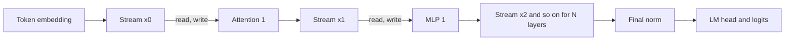
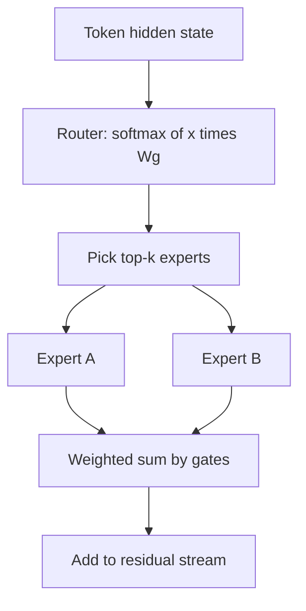
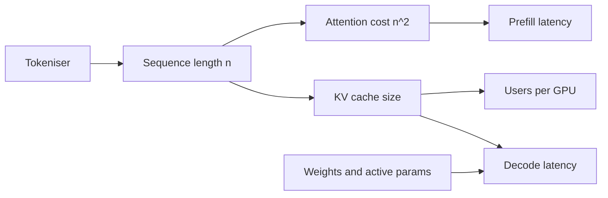

# LLM and Transformer Fundamentals - Deep Dive

This is for someone who has read the [crash course](README.md), can follow the [interview questions](questions.md), and now wants to be able to derive things on a whiteboard: why attention divides by the square root of the head size, what RoPE really does to a dot product, how many parameters a model has before anyone tells you, how big the KV cache is for a given deployment, and what the scaling laws actually say. The README states conclusions. This document builds them from the ground up, with numbers you can check by hand or with the code in [exercises/](exercises/README.md).

Suggested study order and time: read Parts 1 to 3 in one sitting (about 2 hours, tokenisation, embeddings and attention are the core). Parts 4 and 5 are the second sitting (about 2 hours, positional encoding and parameter counting). Parts 6 to 8 are a third sitting (about 2 hours, training objective, serving memory, MoE). Then do the exercises (about 3 hours) and finally drill with [questions.md](questions.md). Budget about 9 hours in total. Work the "Check yourself" questions before opening the answers.

## Prerequisites

- Linear algebra: matrix products, dot products, orthogonality, rotations. Calculus: the chain rule. Probability: expectation, variance, softmax as a distribution. All covered in [01-ml-and-dl-foundations](../01-ml-and-dl-foundations/deep-dive.md).
- Python and numpy. Every snippet below runs as written with numpy 1.26.
- Helpful for later parts: the serving side of the KV cache in [08-inference-and-production](../08-inference-and-production/deep-dive.md) and parameter-efficient adaptation in [05-fine-tuning-and-alignment](../05-fine-tuning-and-alignment/deep-dive.md).
- Already-written implementations of attention, BPE, sampling, RoPE, layer norm, KV cache and a mini GPT live in [12-coding-challenges](../12-coding-challenges/README.md). This deep dive does not repeat them. The exercises here cover the arithmetic around them.

## Contents

- [Part 1 - Tokenisation: what the model actually sees](#part-1---tokenisation-what-the-model-actually-sees)
- [Part 2 - Embeddings and the residual stream](#part-2---embeddings-and-the-residual-stream)
- [Part 3 - Attention in full detail](#part-3---attention-in-full-detail)
- [Part 4 - Positional encoding and context extension](#part-4---positional-encoding-and-context-extension)
- [Part 5 - The transformer block and counting parameters and FLOPs](#part-5---the-transformer-block-and-counting-parameters-and-flops)
- [Part 6 - The pretraining objective and scaling laws](#part-6---the-pretraining-objective-and-scaling-laws)
- [Part 7 - Decoding, sampling and KV cache memory](#part-7---decoding-sampling-and-kv-cache-memory)
- [Part 8 - Mixture of experts](#part-8---mixture-of-experts)
- [Putting it together](#putting-it-together)
- [Exercises](#exercises)
- [Further study](#further-study)

---

## Part 1 - Tokenisation: what the model actually sees

### The problem

A neural network consumes integers. We need a map from text to a sequence of integer IDs and back. Three designs exist:

- Characters or bytes: tiny vocabulary (256 for bytes), no unknown inputs, but sequences are 4 to 5 times longer than with subwords. Attention costs grow with the square of length, and each position has to learn spelling-level patterns before it can do anything semantic.
- Whole words: short sequences, but a vocabulary of millions, no way to represent a new word, and rare words get embeddings that are barely trained.
- Subwords: a vocabulary of roughly 30,000 to 260,000 pieces chosen so that common words are one token and rare words are split into reusable fragments. This is the compromise every production LLM uses.

### Byte-pair encoding, mechanically

BPE (Sennrich et al., 2016, adapted from a data compression method) learns a merge list from a corpus:

1. Start with each word as a sequence of base symbols (characters, or bytes), plus an end-of-word marker if the scheme uses one.
2. Count every adjacent symbol pair across the corpus, weighted by word frequency.
3. Merge the most frequent pair into a new symbol, add it to the vocabulary, and record the merge.
4. Repeat until the vocabulary reaches the target size.

Encoding new text replays the recorded merges in the order they were learned. Training is the expensive step, encoding is deterministic. Here is the whole algorithm on the classic toy corpus (low $\times 5$, lower $\times 2$, newest $\times 6$, widest $\times 3$). Ties are broken by taking the lexicographically largest pair, which is arbitrary but deterministic.

```python
from collections import Counter

def learn_bpe(word_counts, n_merges):
    seqs = {tuple(w) + ("</w>",): c for w, c in word_counts.items()}
    merges = []
    for _ in range(n_merges):
        pairs = Counter()
        for s, c in seqs.items():
            for a, b in zip(s, s[1:]):
                pairs[(a, b)] += c
        if not pairs:
            break
        best = max(pairs, key=lambda p: (pairs[p], p))
        merges.append(best)
        new = {}
        for s, c in seqs.items():
            out, i = [], 0
            while i < len(s):
                if i < len(s) - 1 and (s[i], s[i + 1]) == best:
                    out.append(s[i] + s[i + 1]); i += 2
                else:
                    out.append(s[i]); i += 1
            new[tuple(out)] = new.get(tuple(out), 0) + c
        seqs = new
    return merges

def encode(word, merges):
    s = list(word) + ["</w>"]
    for a, b in merges:
        out, i = [], 0
        while i < len(s):
            if i < len(s) - 1 and (s[i], s[i + 1]) == (a, b):
                out.append(a + b); i += 2
            else:
                out.append(s[i]); i += 1
        s = out
    return s

merges = learn_bpe({"low": 5, "lower": 2, "newest": 6, "widest": 3}, 6)
print(merges)
# [('t','</w>'), ('s','t</w>'), ('e','st</w>'), ('o','w'), ('l','ow'), ('w','est</w>')]
print(encode("lowest", merges))   # ['low', 'est</w>']
```

Walk through the first merge by hand. The pairs (e, s), (s, t) and (t, `</w>`) each occur 9 times (6 from "newest", 3 from "widest"). After the tie-break, (t, `</w>`) wins. Now every word ending in t has a single symbol `t</w>`, and the pair (s, `t</w>`) has count 9. The third merge builds `est</w>`. The word "lowest" was never in the corpus, yet it encodes as two familiar pieces, `low` and `est</w>`. That is the point of BPE: unseen words are composed from seen fragments.

### Byte-level BPE and pre-tokenisation

Character-level BPE still has an unknown-symbol problem, because Unicode has over 150,000 characters and a corpus never covers them all. GPT-2 introduced **byte-level BPE**: the base alphabet is the 256 byte values of the UTF-8 encoding. Any string, in any script, including emoji and binary garbage, is representable. The price is that a rare character costs 2 to 4 base tokens until merges cover it.

Production tokenisers also run a **pre-tokenisation** step before BPE: a regular expression splits text into chunks (words with their leading space, runs of digits, punctuation, whitespace runs). BPE merges never cross chunk boundaries. This is why " the" (with the leading space) is a different token from "the", why a newline plus indentation is handled as a unit in code, and why many tokenisers cap digit chunks at three digits or split digits individually. Without pre-tokenisation, BPE would happily learn merges like "dog." and "dog," as separate tokens and waste vocabulary on punctuation combinations.

### Token counts have consequences

Everything priced or limited in tokens is really priced in your tokeniser's compression ratio:

- **Cost and context.** English prose averages roughly 4 characters or about 0.75 words per token for modern vocabularies, so ~1.3 tokens per word. Text in scripts that were rare in the tokeniser's training data can cost 2 to 5 times more tokens for the same meaning. The same document is therefore more expensive, uses more of the context window, and the model sees less of it, in those languages.
- **Quadratic cost.** Doubling tokens per document roughly quadruples the attention FLOPs for that document and doubles the KV cache.
- **Tokeniser versions.** A new generation of a model family can ship a new tokeniser. The README notes a vendor reporting about 30% more tokens for the same text after a tokeniser change. Anything measured in tokens, such as chunk sizes, budgets, rate limits and cost forecasts, needs re-measuring. Never hard-code "1 token = 4 characters" when you can count with the actual tokeniser.
- **Embedding table size.** Vocabulary $V$ times width $d$. At $V = 128{,}256$ and $d = 4096$ in fp16, the table is $128{,}256 \times 4096 \times 2\ \text{bytes} \approx 1.05\ \text{GB}$, and an untied output head doubles it. Roughly 13% of an 8B-parameter model is embedding tables (Part 5 does the exact count).
- **Under-trained tokens.** Tokens that exist in the vocabulary but almost never appear in training data keep near-random embeddings. Prompting with them produces erratic behaviour. These are often called glitch tokens. They arise when the tokeniser was trained on different data than the model.
- **Spelling and arithmetic.** The model receives "strawberry" as 2 or 3 opaque IDs. Letter counting needs memorised spelling knowledge, not perception. Numbers split inconsistently ("1234" as "12"+"34" but "1235" as "123"+"5") make digit alignment for addition harder, which is why modern tokenisers split digits into fixed groups.

The vocabulary-size trade-off in one sentence: more merges means fewer tokens per text (cheaper, longer effective context, shorter attention) at the cost of a bigger embedding matrix, a bigger softmax over the output vocabulary at every step, and more rarely-seen tokens.

### Check yourself

1. In the toy corpus above, what are the pair counts for (o,w) and (l,o) after the third merge, and why does (o,w) win?

<details><summary>Answer</summary>

Both are 7: "low" contributes 5 and "lower" contributes 2. They tie, and the tie-break (lexicographically largest pair) chooses ("o","w"). Real implementations use some other deterministic rule, often first-seen order. The tie-break does not matter for correctness, only for reproducibility, which is why tokeniser files ship the explicit merge list.

</details>

2. Why does byte-level BPE guarantee no out-of-vocabulary input, and what does it cost?

<details><summary>Answer</summary>

Every string is a sequence of UTF-8 bytes, and all 256 byte values are in the base alphabet, so any input encodes. The cost is length: characters outside the merged vocabulary fall back to 2 to 4 byte tokens each, so rare scripts and emoji take more tokens.

</details>

3. A tokeniser change reduces average tokens per English document from 1,000 to 850 but the vocabulary grows from 32k to 128k with $d = 4096$ in fp16. Quantify both sides.

<details><summary>Answer</summary>

Sequence length falls 15%, so attention FLOPs for that document fall by about $1 - 0.85^2 \approx 0.28$, that is 28%, and the per-document KV cache falls 15%. The input embedding table grows by $(128{,}000 - 32{,}000) \times 4096 \times 2\ \text{bytes} \approx 786\ \text{MB}$, and an untied output head grows by the same amount. For a multi-billion-parameter model the extra memory is small compared with the weights, which is why larger vocabularies are usually worth it.

</details>

4. Why do tokenisers use a pre-tokenisation regex before BPE?

<details><summary>Answer</summary>

It stops merges from crossing word, digit and punctuation boundaries, so the vocabulary is not wasted on combinations like "dog." or "dog,", digit grouping can be controlled, and whitespace in code is handled predictably.

</details>

---

## Part 2 - Embeddings and the residual stream

### From IDs to vectors

The embedding layer is a matrix $E$ of shape $V \times d$. Looking up token $t$ returns row $E[t]$. That is the same as multiplying a one-hot vector by $E$, but implemented as an index. The vectors start random and are trained by backpropagation, so tokens that play similar roles in predicting the next token end up with similar vectors.

At the other end, the **LM head** maps the final hidden state $h$ (a vector of size $d$) to $V$ logits: $z = h W_{\text{out}}$, with $W_{\text{out}}$ of shape $d \times V$. **Weight tying** sets $W_{\text{out}} = E^\top$, so $z_t = h \cdot E[t]$. The logit of token $t$ is the dot product between the final hidden state and the token's embedding. Intuitively, the model's last act is to produce a vector that points toward the embedding of the token it wants to emit. Tying saves $V \times d$ parameters (significant in small models, less so in large ones) and acts as a mild regulariser. Many large models leave the head untied because the input and output roles pull the shared matrix in different directions.

### The residual stream view

A transformer block has the form $x \leftarrow x + \operatorname{Attn}(\operatorname{Norm}(x))$, then $x \leftarrow x + \operatorname{MLP}(\operatorname{Norm}(x))$. Unroll $L$ layers and the final hidden state is:

```math
h_{\text{final}} = \text{embedding}(\text{token}) + \sum_{l=1}^{L} \big(\text{attn}_l \text{ output} + \text{mlp}_l \text{ output}\big)
```

This sum is the main design idea of the architecture. Think of the **residual stream** as a shared communication channel of width $d$ at each position:

- The embedding writes the initial content.
- Each attention head **reads** from the stream (through a norm and its Q, K, V projections), and **writes** its result back by adding a vector.
- Each MLP reads the stream at its own position, and writes an addition.
- The final norm and LM head read the sum.

Nothing overwrites. Layers add. Information written by layer 3 is still present in layer 30 unless something later actively cancels it. This is why very deep transformers train and why you can "read out" intermediate predictions by applying the LM head to a middle layer (the logit lens technique), which usually gives sensible if blurry guesses that sharpen with depth.



### Attention heads as read-write operations

Inside attention, a head has four matrices: $W_Q$, $W_K$, $W_V$, each $d \times d_{\text{head}}$, and its slice of the output projection $W_O$, which is $d_{\text{head}} \times d$. Two products matter:

- **QK circuit**: $W_Q W_K^\top$, a $d \times d$ matrix of rank at most $d_{\text{head}}$, decides *where* to attend: which positions' stream contents match this position's query.
- **OV circuit**: $W_V W_O$, also of rank at most $d_{\text{head}}$, decides *what to copy*: given a source position's stream content, what vector gets written to the destination.

Because both are low-rank, a head has a small, specific function: for example "attend to the previous token and copy its identity into a subspace", which is the first half of an induction head. A pair of heads in different layers composing (the second reading what the first wrote) can implement "find earlier occurrences of the current token, and copy what followed". That mechanism explains much of in-context learning behaviour and is an example of why the residual stream framing is useful: heads communicate through shared subspaces of the stream.

### Check yourself

1. State the logit of token $t$ under weight tying.

<details><summary>Answer</summary>

$z_t = h \cdot E[t]$, the dot product of the final normalised hidden state with row $t$ of the embedding matrix (plus a bias in the rare models that have one). All $V$ logits are $h E^\top$.

</details>

2. Why can a middle layer's stream be decoded with the LM head at all?

<details><summary>Answer</summary>

Because the stream is a running sum. Later layers add to it rather than rewriting it, so its direction at layer $l$ is already partly aligned with the final answer. The logit lens applies the final norm and head to that partial sum.

</details>

3. Why is the QK matrix of a head at most rank $d_{\text{head}}$, and why does that matter?

<details><summary>Answer</summary>

$W_Q$ and $W_K$ each map $d$ to $d_{\text{head}}$, so $W_Q W_K^\top$ passes through a $d_{\text{head}}$-dimensional bottleneck. A head can therefore only compare positions along $d_{\text{head}}$ directions. It limits what each head can express and is part of why many heads are used.

</details>

---

## Part 3 - Attention in full detail

### The mechanism, with numbers

For a sequence of $n$ tokens with hidden states $X \in \mathbb{R}^{n \times d}$, one head computes:

```math
\begin{aligned}
Q &= X W_Q && \in \mathbb{R}^{n \times d_k} && \text{what am I looking for} \\
K &= X W_K && \in \mathbb{R}^{n \times d_k} && \text{what do I offer for matching} \\
V &= X W_V && \in \mathbb{R}^{n \times d_v} && \text{what do I hand over if selected} \\
S &= \frac{Q K^\top}{\sqrt{d_k}} && \in \mathbb{R}^{n \times n} && \text{scores} \\
P &= \operatorname{softmax}(S) && \in \mathbb{R}^{n \times n} && \text{row-wise, each row sums to 1} \\
O &= P V && \in \mathbb{R}^{n \times d_v}
\end{aligned}
```

Row $i$ of $P$ says how much token $i$ draws from each token $j$. The output at position $i$ is a weighted average of value vectors. A tiny numeric example for one row. Suppose token 3's scaled scores against tokens 1, 2, 3 are [2, 1, 0]. Then $\exp$ gives [7.389, 2.718, 1.000], the sum is 11.107, and the weights are [0.665, 0.245, 0.090]. The output is $0.665 v_1 + 0.245 v_2 + 0.090 v_3$.

### Why divide by sqrt(d_k): the derivation

Assume the entries of $q$ and $k$ at initialisation are independent with mean 0 and variance 1. The score is $q \cdot k = \sum_{i=1}^{d_k} q_i k_i$. Each term $q_i k_i$ has mean 0 and variance $\mathbb{E}[q_i^2] \thinspace \mathbb{E}[k_i^2] = 1$. The terms are independent, so variances add:

```math
\operatorname{Var}(q \cdot k) = d_k, \qquad \text{standard deviation} = \sqrt{d_k}
```

A quick simulation with 20,000 random pairs gives variance 15.97 at $d_k = 16$, 63.3 at $d_k = 64$ and 257.8 at $d_k = 256$. Dividing by $\sqrt{d_k}$ gives variance $\approx 1$ in every case (0.998, 0.989, 1.007).

Now see what large variance does. With $d_k = 64$ the unscaled standard deviation is 8. Take logits [8, 0, 0, 0], a perfectly ordinary draw at that scale:

- Unscaled: softmax gives $p = [0.99899, 0.000335, 0.000335, 0.000335]$. The gradient of a softmax output with respect to its own logit is $p(1 - p) = 0.999 \times 0.001 \approx 0.001$. The distribution is nearly one-hot and learning signals through it are vanishingly small.
- Scaled by $1/8$: logits [1, 0, 0, 0] give $p = [0.475, 0.175, 0.175, 0.175]$ and $p(1 - p) \approx 0.249$, which is the near-maximum of 0.25.

So the factor is not a normalisation of the output scale. It keeps the softmax operating in its sensitive range at initialisation, so gradients reach $W_Q$ and $W_K$. The Jacobian of softmax is $\partial p_i / \partial z_j = p_i (\delta_{ij} - p_j)$. When $p$ is one-hot, every entry is zero. Note the argument is about initialisation and the early training. Trained models can and do learn sharp attention, and some large models add QK-normalisation (a norm on Q and K) because attention logits can grow unstable at scale.

### Masking

A decoder must not let position $i$ see $j \gt i$. Add $-\infty$ to the scores at those entries before the softmax, so $\exp(-\infty) = 0$ and the row is renormalised over the visible positions:

```python
import numpy as np

def masked_softmax_rows(S):
    n = S.shape[0]
    S = np.where(np.triu(np.ones((n, n), dtype=bool), k=1), -np.inf, S)
    S = S - S.max(axis=-1, keepdims=True)    # subtract row max for numerical stability
    P = np.exp(S)
    return P / P.sum(axis=-1, keepdims=True)

P = masked_softmax_rows(np.array([[2., 1., 0.], [2., 1., 0.], [2., 1., 0.]]))
print(P.round(3))
# [[1.    0.    0.   ]
#  [0.731 0.269 0.   ]
#  [0.665 0.245 0.09 ]]
```

Row 0 can only attend to itself. Row 1 renormalises [2, 1] to [0.731, 0.269]. Row 2 is the unmasked example above.

Why this matters for training: with a causal mask, a single forward pass over a sequence of length $n$ yields $n$ next-token predictions, one per position, all valid because no position saw its own target. That is what makes decoder-only pretraining so efficient.

Failure modes of masking:

- A fully masked row (all $-\infty$) gives $0/0$ and NaN after the softmax. This occurs with left padding handled badly or with attention to an empty context. Implementations guard with a large finite negative number or an explicit check.
- Padding masks and causal masks combine by taking the union.
- In half precision, $-\infty$ is safe in the softmax if a row has at least one finite entry. A hard-coded `-1e9` overflows fp16's range (max $\approx 65{,}504$), so use the dtype's minimum value instead.

### Multi-head attention

One head with width d would compute one set of attention weights per position. Real language needs several relations at once (the subject of this verb, the antecedent of this pronoun, the previous token). Multi-head attention runs $h$ independent heads with $d_k = d / h$ and concatenates:

```math
O = \operatorname{concat}(\text{head}_1, \ldots, \text{head}_h)\, W_O, \qquad W_O \in \mathbb{R}^{h d_v \times d}
```

Counting cost, with $d = 4096$ and $h = 32$ so $d_k = 128$:

- Parameters: $W_Q$, $W_K$, $W_V$, $W_O$ each $4096 \times 4096$, total $4 d^2 = 67.1\text{M}$ per layer, the same as a single head of full width.
- Score FLOPs: each head computes an $n \times n$ matrix with $2 n^2 d_k$ FLOPs, times $h$ heads gives $2 n^2 d$. Splitting into heads does not change cost.

What heads buy is **diversity of attention patterns** at equal compute. The cost is that each head's score is a comparison of rank $d_k$, as noted in Part 2.

### Cost of attention compared with the rest

Per layer and per sequence of $n$ tokens, MHA needs about $8 n d^2$ FLOPs for the four projections and $4 n^2 d$ FLOPs for scores plus the weighted sum ($2 n^2 d$ each). The two are equal when $4 n^2 d = 8 n d^2$, so $n = 2d$. At $d = 4096$ that crossover is $n = 8192$. Below it, projections and MLPs dominate. Above it, the $n^2$ term takes over, which is why long-context prefill gets expensive. This is the cost FlashAttention reduces in practice by avoiding memory traffic, though not the FLOP count (see the README for the exactness point).

### MQA and GQA

At decode time the model generates one token and must attend to all previous tokens, whose K and V vectors are cached (Part 7). The cache holds, per token per layer, $2 \times n_{\text{kv}} \times d_{\text{head}}$ values, where $n_{\text{kv}}$ is the number of KV heads. In MHA, $n_{\text{kv}} = h$. The two reductions are:

- **Multi-query attention (MQA)**: one K/V head shared by all query heads. Cache shrinks by a factor of $h$.
- **Grouped-query attention (GQA)**: $n_{\text{kv}}$ between 1 and $h$. The $h$ query heads are divided into $g = n_{\text{kv}}$ groups, and query head $i$ uses K/V head $\lfloor i / (h / g) \rfloor$. With $h = 64$ and $g = 8$, each group of 8 query heads shares one K/V head, an $8\times$ cache reduction.

Implementation is a few lines: project K and V to g heads, then repeat each group $h/g$ times along the head axis (or index into it, which is how efficient kernels avoid the copy). GQA with $g = h$ is exactly MHA and with $g = 1$ is exactly MQA, so these are the two ends of one dial. [Exercise 4](exercises/README.md) has you build it and verify both claims.

What you give up: fewer distinct K/V projections means less expressive attention. Empirically, going from MHA to GQA with 4 to 8 groups loses very little quality, and going to full MQA loses a bit more. A model can also be converted after training: mean-pool the K/V heads within each group and fine-tune briefly.

Parameter side effect: with GQA at $h = 32$, $g = 8$, $d_{\text{head}} = 128$, $d = 4096$, the K and V projections are $4096 \times 1024$ each instead of $4096 \times 4096$, so attention parameters per layer fall from 67.1M to 41.9M. The saving is small relative to the MLP but the cache saving is large.

MLA (multi-head latent attention) takes a different route, caching a compressed latent per token and expanding it to per-head K and V when needed. Part 7 quantifies it.

### Check yourself

1. Derive the variance of a dot product of two independent $d_k$-dimensional vectors with unit-variance entries.

<details><summary>Answer</summary>

Each product $q_i k_i$ has variance 1 (independent, zero mean, unit variance each). The $d_k$ products are independent, so the variance of the sum is $d_k$ and the standard deviation is $\sqrt{d_k}$. Dividing by $\sqrt{d_k}$ restores variance 1.

</details>

2. For logits [8, 0, 0, 0], compute softmax and the gradient factor $p(1 - p)$ for the top entry, and again after dividing by 8.

<details><summary>Answer</summary>

Unscaled: $p_{\text{top}} = e^8 / (e^8 + 3) = 0.99899$, $p(1 - p) \approx 0.001$. Scaled: logits [1, 0, 0, 0], $p_{\text{top}} = e / (e + 3) = 0.475$, $p(1 - p) \approx 0.249$.

</details>

3. At what sequence length do attention score FLOPs equal projection FLOPs in MHA, and what is it for $d = 8192$?

<details><summary>Answer</summary>

$4 n^2 d = 8 n d^2$ gives $n = 2d$, so $n = 16{,}384$ for $d = 8192$.

</details>

4. With 64 query heads and 8 KV heads, which KV head does query head 37 use, and how big is the cache relative to MHA?

<details><summary>Answer</summary>

Group size is $64 / 8 = 8$, and $\lfloor 37 / 8 \rfloor = 4$, so KV head 4. The cache is $8 / 64 = 1/8$ of MHA.

</details>

5. Why does adding a causal mask make training efficient?

<details><summary>Answer</summary>

Every position can be scored against its own next token in one pass, because no position sees the future. A sequence of length $n$ gives $n$ training targets per forward pass instead of one.

</details>

---

## Part 4 - Positional encoding and context extension

### The problem

Attention treats its input as a set. Swap two tokens in the input and, absent position information, the outputs just swap too (the function is permutation-equivariant). "Dog bites man" and "man bites dog" would be indistinguishable. Position must be injected somehow.

### Sinusoidal encodings

The original transformer adds a fixed vector to each embedding. For position $\text{pos}$ and pair index $i = 0, \ldots, d/2 - 1$:

```math
\begin{aligned}
\mathrm{PE}(\text{pos}, 2i) &= \sin\left(\text{pos} / 10000^{2i/d}\right) \\
\mathrm{PE}(\text{pos}, 2i+1) &= \cos\left(\text{pos} / 10000^{2i/d}\right)
\end{aligned}
```

Each pair is a sine and cosine at a different frequency, from period $2\pi$ (fastest) to about $10000 \times 2\pi$ (slowest), like the digits of a clock where each hand moves at a different speed. With $d = 8$ the frequencies are 1, 0.1, 0.01, 0.001, and position 1 encodes as [0.8415, 0.5403, 0.0998, 0.9950, 0.0100, 1.0000, 0.0010, 1.0000].

A useful property: $\mathrm{PE}(\text{pos} + k)$ is a linear function of $\mathrm{PE}(\text{pos})$, because a sine and cosine at a fixed frequency rotate by a fixed angle when position shifts by $k$. So relative offsets are learnable by a linear map. In practice sinusoidal encodings extrapolate to longer lengths poorly, and the position signal can be diluted by the content signal as it passes through layers.

### Learned absolute and ALiBi

Learned absolute embeddings (GPT-2, BERT) are a table of one vector per position. Simple, but there is no row for positions beyond the trained length, and nothing generalises to them.

ALiBi adds no vectors at all. It adds a penalty to scores, $-m_{\text{head}} \cdot (i - j)$, with a fixed slope per head, biasing attention toward nearby tokens. It extrapolates reasonably past the training length because the penalty is defined for any distance, but it hard-wires a recency preference and is less used in recent models.

### RoPE: the derivation

RoPE (rotary position embedding) puts position into the geometry of Q and K instead of adding to the input. Take a pair of dimensions $(x_1, x_2)$ of a query or key, and rotate it by an angle proportional to the position:

```math
R(m, \theta) = \begin{bmatrix} \cos m\theta & -\sin m\theta \\ \sin m\theta & \cos m\theta \end{bmatrix}, \qquad q_m = R(m, \theta)\, q, \qquad k_n = R(n, \theta)\, k
```

The score is $q_m \cdot k_n = q^\top R(m)^\top R(n) \thinspace k$. Rotation matrices satisfy $R(m)^\top = R(-m)$ and $R(-m) R(n) = R(n - m)$, so:

```math
q_m \cdot k_n = q^\top R(n - m, \theta)\, k
```

The score depends only on the content $q$, $k$ and the relative offset $n - m$. Absolute positions cancel. No extra parameters and no added vectors, and relative position arises from a multiplicative rotation.

For a head of dimension $d_{\text{head}}$, split into $d_{\text{head}} / 2$ pairs. Pair $i$ rotates at frequency:

```math
\theta_i = \text{base}^{-2i / d_{\text{head}}}, \qquad i = 0, \ldots, d_{\text{head}}/2 - 1, \qquad \text{base} = 10000 \text{ originally}
```

Fast pairs ($\theta_0 = 1$ radian per token) distinguish adjacent tokens. Slow pairs rotate so little across a long span that they track coarse distance. Here is an implementation and a check of the relative-position property:

```python
import numpy as np

def rope(x, pos, base=10000.0):
    d = x.shape[-1]
    theta = base ** (-np.arange(0, d, 2) / d)       # one frequency per pair
    ang = pos * theta
    c, s = np.cos(ang), np.sin(ang)
    x1, x2 = x[..., 0::2], x[..., 1::2]
    out = np.empty_like(x)
    out[..., 0::2] = x1 * c - x2 * s
    out[..., 1::2] = x1 * s + x2 * c
    return out

rng = np.random.default_rng(0)
q, k = rng.normal(size=8), rng.normal(size=8)
print(rope(q, 5) @ rope(k, 2))        # -1.5864753...
print(rope(q, 105) @ rope(k, 102))    # -1.5864753...  same offset (3), same score
print(rope(q, 3) @ rope(k, 0))        # -1.5864753...
```

A hand-checkable case: for a single pair with $\theta = 1$ and $q = k = (1, 0)$, the score at positions (5, 2) is $\cos(3 \times 1) = -0.98999$, which the code reproduces. Note RoPE is applied to Q and K only, not V, because the position effect must enter the score and the values only carry content.

Frequencies and wavelengths for $d_{\text{head}} = 128$ (64 pairs), where a pair of frequency $\theta$ completes one rotation every $2\pi / \theta$ tokens:

| Pair | $\theta$ (base 10,000) | Wavelength |
|---|---|---|
| 0 | 1 | ~6.3 tokens |
| 32 | 0.01 | ~628 tokens |
| 63 | $\approx 1.15 \times 10^{-4}$ | ~54,000 tokens |

Changing the base to 500,000 stretches the slowest pair to a wavelength of about 2.6 million tokens. That is why raising the base is one of the levers for long context: the slow pairs need to stay distinguishable across the whole window.

### Why naive extension fails

Suppose a model is trained to 4,096 tokens and run at 8,000. The fast pairs have wrapped around many times, so they are fine: every angle mod $2\pi$ was seen in training. But the slow pairs have never rotated through certain angles. At position 8,000 a low-frequency pair sits at an angle the model never saw during training, so Q-K scores involving it are out-of-distribution. Output quality degrades sharply past the trained length.

### Context extension methods

- **Position interpolation (PI)**: to extend from $L$ to $L' = sL$, divide every position by $s$ before computing angles. All angles stay inside the trained range. The cost is resolution: neighbouring tokens now differ by $1/s$ of the original angle, so fast pairs lose their ability to discriminate adjacent positions. A short fine-tune recovers most of it.
- **NTK-aware scaling** and its refinement **YaRN**: treat frequency bands differently. High-frequency pairs (wavelength much shorter than $L$) are left alone because they already wrap many times and carry local detail. Low-frequency pairs (wavelength longer than $L$) are interpolated by the full factor, because they are the ones that go out of range. A ramp blends the bands in between. YaRN also rescales attention logits by a temperature factor that grows with the extension factor (roughly $0.1 \ln s + 1$ applied to the scale of $q$ and $k$) to compensate for entropy shift of the softmax. It needs much less fine-tuning than plain interpolation.
- **Base scaling**: raise base from 10,000 to a larger value (Llama 3 uses 500,000) and continue pretraining on long documents. All wavelengths stretch, so a longer window fits inside the trained angle range.
### Check yourself

1. Show in two lines why the RoPE score depends only on $n - m$.

<details><summary>Answer</summary>

$q_m \cdot k_n = (R(m) q)^\top (R(n) k) = q^\top R(m)^\top R(n) \thinspace k$. Since $R(m)^\top = R(-m)$ and rotations compose by adding angles, $R(-m) R(n) = R(n - m)$, so the score is $q^\top R(n - m) \thinspace k$.

</details>

2. For $d_{\text{head}} = 128$ and base 10,000, what is the rotation per token of the slowest pair, and what does that imply for a 4k-trained model run at 32k?

<details><summary>Answer</summary>

$\theta_{63} = 10000^{-126/128} \approx 1.15 \times 10^{-4}$ rad per token, so a 4k window covers only $4096 \times 1.15 \times 10^{-4} \approx 0.47$ rad of that pair's rotation. At 32k it reaches $\approx 3.8$ rad, a range never seen in training. This is why low-frequency pairs break first and why interpolating or rescaling them is the targeted fix.

</details>

3. Position interpolation by factor 8 on a 4k model. What happens to the angle difference between adjacent tokens on the fastest pair?

<details><summary>Answer</summary>

It drops from 1 radian to $1/8$ radian. Adjacent tokens become harder to tell apart on that pair, which is why PI needs fine-tuning and why YaRN leaves high-frequency pairs alone.

</details>

4. Why is RoPE applied to Q and K but not V?

<details><summary>Answer</summary>

Position matters in deciding *where* to attend, which is determined by the Q-K score. V is the content that gets copied. Rotating V would corrupt the content that is mixed into the output.

</details>

---

## Part 5 - The transformer block and counting parameters and FLOPs

### The block

A modern decoder block is two residual sublayers:

```math
\begin{aligned}
x &\leftarrow x + \operatorname{Attention}(\operatorname{RMSNorm}(x)) \\
x &\leftarrow x + \operatorname{MLP}(\operatorname{RMSNorm}(x))
\end{aligned}
```

**Pre-norm versus post-norm.** The 2017 design computes $\operatorname{LayerNorm}(x + \operatorname{Sublayer}(x))$. Every layer's gradient has to pass through a norm on the way back. With post-norm, gradients near the output are large and shrink with depth, so training needs a careful learning-rate warmup and is fragile when deep. Pre-norm computes $x + \operatorname{Sublayer}(\operatorname{Norm}(x))$. The derivative of the block output with respect to its input is $I + (\text{something})$, so there is always an identity path from the loss to every layer, and training at 80 or more layers is stable. The cost: the stream grows with depth, so deep layers' contributions are relatively smaller, and a final norm is needed before the head.

**RMSNorm** is $y = g \cdot x / \sqrt{\operatorname{mean}(x^2) + \epsilon}$ with a learned gain $g$, no mean subtraction and no bias. It is slightly cheaper than LayerNorm and works equally well in large models. Its parameter count is $d$ per norm.

**MLP and SwiGLU.** The classic MLP is $\operatorname{down}(\operatorname{act}(\operatorname{up}(x)))$ with up: $d$ to $4d$, down: $4d$ to $d$, which has $2 \times d \times 4d = 8 d^2$ parameters. SwiGLU adds a gate: $\operatorname{down}(\operatorname{silu}(\operatorname{gate}(x)) \odot \operatorname{up}(x))$, with three matrices of shape $d \times f$, $d \times f$ and $f \times d$, so $3df$ parameters. To match the $8 d^2$ budget, $f = 8d/3 \approx 2.67d$. Real models vary: Llama-3-8B has $d = 4096$ and $f = 14336 = 3.5d$, which spends more of the budget on the MLP. The gate lets the layer multiply one linear projection of $x$ by a learned, input-dependent mask from another, and empirically this beats a plain activation at equal parameters.

### Counting parameters: a worked example

Take a Llama-3-8B-shaped model: $V = 128{,}256$, $d = 4096$, $L = 32$ layers, 32 query heads, 8 KV heads, $d_{\text{head}} = 128$, $f = 14336$, untied head. No biases.

```math
\begin{aligned}
&\text{Attention per layer} \\
&\quad W_Q: 4096 \times 4096 &&= 16{,}777{,}216 \\
&\quad W_K: 4096 \times (8 \times 128 = 1024) &&= 4{,}194{,}304 \\
&\quad W_V: 4096 \times 1024 &&= 4{,}194{,}304 \\
&\quad W_O: 4096 \times 4096 &&= 16{,}777{,}216 \\
&\quad \text{total} &&= 41{,}943{,}040 \\[4pt]
&\text{MLP per layer (SwiGLU): } 3 \times 4096 \times 14336 &&= 176{,}160{,}768 \\
&\text{Norms per layer: } 2 \times 4096 &&= 8{,}192 \\[4pt]
&\text{One layer} &&= 218{,}112{,}000 \\
&\text{32 layers} &&= 6{,}979{,}584{,}000 \\
&\text{Embedding: } 128{,}256 \times 4096 &&= 525{,}336{,}576 \\
&\text{LM head (untied): same} &&= 525{,}336{,}576 \\
&\text{Final norm} &&= 4{,}096 \\[4pt]
&\text{Total} &&= 8{,}030{,}261{,}248
\end{aligned}
```

So ~8.03B. The shares are informative. In each layer the MLP holds 80.8% of the parameters and attention only 19.2% (GQA shrank K and V). Across the model, each embedding table is 6.5% and the two together are 13%. A rule worth remembering: **non-embedding parameters $\approx 12 d^2 L$ for a classic MHA plus $4d$-MLP design** ($4 d^2$ attention plus $8 d^2$ MLP per layer). The exercise code ([Exercise 1](exercises/README.md)) implements this exactly and asserts the 8,030,261,248 figure.

### Counting FLOPs

One multiply-accumulate is 2 FLOPs, so a matrix multiply of an $n \times a$ matrix with an $a \times b$ matrix costs $2nab$. For a token passing through a weight matrix with $P$ parameters, the forward cost is $2P$ FLOPs. Summing over every matmul weight gives the first-order forward cost per token:

```math
\begin{aligned}
\text{forward FLOPs per token} &\approx 2 \times (\text{matmul parameters}) + \text{attention term} \\
\text{attention term} &= 4 \times L \times \text{ctx} \times n_{\text{heads}} \times d_{\text{head}} && (QK^\top \text{ and } AV \text{, per token at context length ctx})
\end{aligned}
```

The embedding lookup does no multiplications, but the LM head does. For the 8B model at $\text{ctx} = 0$:

```math
2 \times \big(32 \times (41{,}943{,}040 + 176{,}160{,}768) + 525{,}336{,}576\big) = 15{,}009{,}316{,}864 \approx 15.0\ \text{GFLOPs per token}
```

At $\text{ctx} = 8{,}192$ the attention term adds $4 \times 32 \times 8192 \times 4096 \approx 4.3$ GFLOPs, a 29% increase (this counts the full square, not the causal half).

Training adds the backward pass. For each weight matrix, backward computes a gradient with respect to the input (about the same cost as forward) and with respect to the weights (about the same again). So backward is about $2\times$ forward and training is **about three times forward**, or $6P$ FLOPs per token. This is the **6ND rule**: training FLOPs $\approx 6 \times N \times D$ for $N$ parameters and $D$ tokens.

Worked check: $N = 8.03 \times 10^9$, $D = 15 \times 10^{12}$ tokens gives $6ND = 7.23 \times 10^{23}$ FLOPs. The detailed count ($3 \times$ forward at ctx 0 $\times D$) gives $6.75 \times 10^{23}$, so $6ND$ is 7% high because it counts embedding-table parameters as if they were matmuls. At ctx 8k the attention term pushes the true cost above 6ND. At an assumed 40% utilisation of an accelerator rated at $10^{15}$ FLOP/s (so $4 \times 10^{14}$ effective), $7.23 \times 10^{23}$ FLOPs takes $1.8 \times 10^9$ accelerator-seconds, which is ~500,000 accelerator-hours. The assumption matters: real utilisation numbers are often lower, and the point is the order of magnitude.

Inference costs $2N$ FLOPs per generated token, which is $3\times$ cheaper than a training token. The ratio is why "train once, serve forever" shifts the economics (Part 6).

### Check yourself

1. How many parameters does a SwiGLU MLP with $d = 2048$ and $f = 8192$ have?

<details><summary>Answer</summary>

$3 \times 2048 \times 8192 = 50{,}331{,}648$.

</details>

2. What $f$ makes a SwiGLU MLP match the parameter count of a standard $4d$ MLP?

<details><summary>Answer</summary>

Standard: $2 \times d \times 4d = 8 d^2$. SwiGLU: $3df$. Setting equal gives $f = 8d/3 \approx 2.67 d$.

</details>

3. Why is training 6 FLOPs per parameter per token while inference is 2?

<details><summary>Answer</summary>

Forward is 2 (multiply plus add). Backward computes the gradient with respect to activations and the gradient with respect to weights, each costing about as much as the forward pass, so backward is about 4. Total $2 + 4 = 6$.

</details>

4. A 70B dense model is trained on 15T tokens. Estimate total FLOPs, and the FLOPs to generate a 1,000-token reply.

<details><summary>Answer</summary>

Training: $6 \times 70 \times 10^9 \times 15 \times 10^{12} = 6.3 \times 10^{24}$ FLOPs. Reply: $2 \times 70 \times 10^9 \times 1000 = 1.4 \times 10^{14}$ FLOPs (plus attention over the context, and note that decoding is bound by memory bandwidth rather than FLOPs, see Part 7).

</details>

5. For the 8B model, why does the MLP hold such a large share of per-layer parameters?

<details><summary>Answer</summary>

$f = 3.5 d$ with three matrices gives $10.5 d^2$, while GQA shrinks attention to $2 d^2$ (Q, O) $+ 0.5 d^2$ (K, V at $1/4$ width) $= 2.5 d^2$. The MLP share is $10.5 / 13 \approx 0.808$, or about 80.8%.

</details>

---

## Part 6 - The pretraining objective and scaling laws

### The objective

Pretraining maximises the likelihood of text under the model, factorised autoregressively:

```math
\text{loss} = -\frac{1}{T} \sum_{t=1}^{T} \log p_{\text{model}}(x_t \mid x_{<t})
```

At each position, the model emits logits $z$ over $V$ tokens. The loss for the true next token $y$ is the **cross-entropy** $-\log \operatorname{softmax}(z) _y = -z_y + \log \sum_j \exp(z_j)$. With the causal mask, all $T$ positions are scored in one pass (teacher forcing: the true prefix is fed in, not the model's own samples).

Numerical care: compute log-softmax as $(z - \max z) - \log \sum_j \exp(z_j - \max z)$. Taking softmax first and then the log fails for confident wrong predictions because the probability underflows to 0 and $\log 0 = -\infty$. [Exercise 3](exercises/README.md) implements this and the clean gradient: $\partial \text{loss} / \partial z = \operatorname{softmax}(z) - \operatorname{onehot}(y)$, divided by the number of scored positions.

Three quantities describe the same number:

- **Loss** in nats per token, $L$.
- **Perplexity** $= \exp(L)$: the effective number of equally likely tokens the model is choosing among. A uniform model over $V = 50$ tokens has $L = \ln 50 = 3.912$ and perplexity exactly 50. $L = 2.0$ nats is perplexity 7.39.
- **Bits per byte**: $\text{total NLL in nats} / (n_{\text{bytes}} \times \ln 2)$. It is tokeniser independent. Take two tokenisers on 4,000 bytes of text. One gives 1,000 tokens at 2.0 nats ($\text{bpb} = 2000 / (4000 \times 0.693) = 0.721$). The other gives 2,000 tokens at 1.0 nats each, with the same total NLL and therefore the same bpb. Per-token loss and perplexity are not comparable across tokenisers, bits per byte is.

A loss of 2.0 nats per token with ~4 bytes per token corresponds to 2.885 bits per token, or ~0.72 bits per byte.

### What the model learns from this objective

Predicting the next token well requires modelling syntax, facts, style, code semantics and some reasoning, because all of those make text more predictable. That is why a single objective produces broad capability. It is also why hallucination is structural: the objective rewards plausible continuations, whether or not they are true.

### Scaling laws

Empirically, pretraining loss follows smooth power laws in three quantities: parameters $N$, training tokens $D$ and compute $C$. Kaplan et al. (2020) fitted these and concluded that, for a fixed compute budget, it is better to grow parameters faster than data. Hoffmann et al. (2022, "Chinchilla") re-ran the study with proper learning-rate schedules for each run length and found otherwise.

Chinchilla models the loss as:

```math
L(N, D) = E + \frac{A}{N^{\alpha}} + \frac{B}{D^{\beta}}
```

$E$ is the irreducible loss (the entropy of text itself), the second term is the penalty for a finite model, the third the penalty for finite data. Approximate fitted constants from the paper are $E = 1.69$, $A = 406.4$, $B = 410.7$, $\alpha = 0.34$, $\beta = 0.28$.

**Compute-optimal allocation.** Fix $C = 6ND$, so $D = C / (6N)$. Substitute and minimise over $N$:

```math
\begin{aligned}
L(N) &= E + A N^{-\alpha} + B \left(\tfrac{C}{6}\right)^{-\beta} N^{\beta} \\
\frac{dL}{dN} &= -\alpha A N^{-\alpha-1} + \beta B \left(\tfrac{C}{6}\right)^{-\beta} N^{\beta-1} = 0 \\
\Rightarrow\quad N^{\alpha+\beta} &= \frac{\alpha A}{\beta B} \left(\tfrac{C}{6}\right)^{\beta} \\
\Rightarrow\quad N_{\text{opt}} &= \left(\frac{\alpha A}{\beta B}\right)^{1/(\alpha+\beta)} \left(\frac{C}{6}\right)^{\beta/(\alpha+\beta)} \\
D_{\text{opt}} &= \frac{C}{6 N_{\text{opt}}}
\end{aligned}
```

$N$ grows as $C^{\beta/(\alpha+\beta)} = C^{0.45}$ and $D$ as $C^{0.55}$. Both scale as roughly the square root of compute, which is the "scale them together" result. A hundredfold compute increase gives $\approx 8\times$ parameters and $\approx 12.5\times$ tokens.

Worked numbers from these constants (they are the code in [Exercise 5](exercises/README.md)): at $C = 10^{23}$, $N_{\text{opt}} \approx 14.6\text{B}$ and $D_{\text{opt}} \approx 1.14\text{T}$ tokens, with predicted loss $\approx 2.005$. At $C = 5.76 \times 10^{23}$ (about the budget of the 70B-parameter, 1.4T-token Chinchilla run) the formula gives $N_{\text{opt}} \approx 32\text{B}$ and $D_{\text{opt}} \approx 3.0\text{T}$.

Notice that this does *not* reproduce the headline "70B and 1.4T, about 20 tokens per parameter". With the quoted constants the optimal tokens-per-parameter ratio is ~50 at $C = 10^{21}$ and ~120 at $C = 10^{25}$, and it drifts upward as $C^{0.097}$ rather than staying fixed. The paper reports three estimation methods, and the commonly quoted ~20 tokens per parameter comes from the approaches that fit the optimum directly, while this parametric fit is a third approach. Later replication work (see Further study) found problems with the published parametric fit. The sound takeaway is the qualitative one: parameters and tokens should grow together, a rule of thumb of order 20 tokens per parameter is a reasonable *rough* guide at the scales studied, and you should not treat any single constant as a law. If an interviewer asks, say that the ratio depends on the fit and the regime, and show the derivation.

### Compute-optimal is not deployment-optimal

Chinchilla minimises loss for a fixed *training* budget. It ignores the cost of serving. Total cost = training (once) + inference (per token, forever). A smaller model trained on more tokens reaches the same loss at higher training cost but with a smaller $N$, so every inference token is cheaper.

Use the parametric model to see the trade. Take $C = 10^{23}$ and its optimum, $N = 14.6\text{B}$, $D = 1.14\text{T}$, loss 2.005. A model $4\times$ smaller (3.65B) needs $D \approx 13.2\text{T}$ tokens to reach the same loss, which is $11.5\times$ more data. Its training compute is $6 \times 3.65 \times 10^9 \times 13.2 \times 10^{12} \approx 2.9 \times 10^{23}$, about $2.9\times$ more than the optimal run. Inference per token is $4\times$ cheaper. If the model will serve more than roughly $\tfrac{\text{extra training FLOPs}}{\text{savings per token}}$ tokens, over-training wins. Applying inference cost of $2N$ per token:

```math
\begin{aligned}
\text{extra training} &\approx 1.9 \times 10^{23}\ \text{FLOPs} \\
\text{saving per token} &= 2 \times (14.6 \times 10^9 - 3.65 \times 10^9) \approx 2.2 \times 10^{10}\ \text{FLOPs} \\
\text{break-even} &= \frac{1.9 \times 10^{23}}{2.2 \times 10^{10}} \approx 8.6 \times 10^{12}\ \text{served tokens}
\end{aligned}
```

That break-even is small for a widely deployed model. That is why deployed models train at hundreds to thousands of tokens per parameter (the README gives Llama 3 8B at ~15T tokens, roughly 1,900 tokens per parameter).

A floor appears too. If the model-size term $A / N^{\alpha}$ alone exceeds the target loss minus $E$, no amount of data reaches it. Exercise 5 returns infinity for this case.

### Check yourself

1. A model assigns probability 0.25 to the correct token at every position. What are its loss and perplexity?

<details><summary>Answer</summary>

Loss $= -\ln 0.25 = 1.386$ nats. Perplexity $= \exp(1.386) = 4$: it is as uncertain as a uniform choice among 4 tokens.

</details>

2. Why must you subtract the max before exponentiating, and what does it not change?

<details><summary>Answer</summary>

exp of a large logit overflows (fp32 overflows near 88, fp16 near 11). Subtracting the max keeps all exponents at or below 0. It does not change the softmax, because the shift cancels in numerator and denominator.

</details>

3. Using $N_{\text{opt}} = \left(\tfrac{\alpha A}{\beta B}\right)^{1/(\alpha+\beta)} (C/6)^{\beta/(\alpha+\beta)}$, how does optimal $N$ change if compute grows $10\times$ with $\alpha = 0.34$, $\beta = 0.28$?

<details><summary>Answer</summary>

By $10^{0.28 / 0.62} = 10^{0.4516} \approx 2.83\times$. $D$ grows by $10 / 2.83 \approx 3.5\times$, so tokens per parameter rise slightly.

</details>

4. Why do labs train a model far past its compute-optimal token count?

<details><summary>Answer</summary>

Training cost is paid once and inference cost scales with the number of tokens served and with $N$. A smaller model trained longer matches the loss of a larger one at a higher one-off cost but a lower per-token serving cost, which wins when expected usage is large.

</details>

5. Two models report perplexity 5.1 and 4.8 on the same text with different tokenisers. Which is better?

<details><summary>Answer</summary>

Not determinable. Per-token perplexity depends on how many tokens the tokeniser makes. Compare bits per byte on the same text.

</details>

---

## Part 7 - Decoding, sampling and KV cache memory

### Autoregressive generation and the two phases

Generation repeats: run the model on the tokens so far, take the logits at the last position, choose a token, append it. Without caching, step $t$ recomputes attention over all $t$ earlier tokens for every layer, so the cost of generating $n$ tokens grows as $n^2$ in projections too. The fix is the KV cache: K and V for earlier tokens never change (causal mask, the past does not depend on the future), so store them once.

Two phases with different bottlenecks:

- **Prefill**: process the whole prompt in parallel. Large matrix multiplications, compute-bound. Cost per prompt token $\approx 2N$ FLOPs plus the attention term.
- **Decode**: one token per step. Each step must read *all* the weights and the whole KV cache from GPU memory to produce a single token's worth of math, so it is memory-bandwidth-bound.

Worked example for the decode bound. An 8B model in bf16 is 16 GB. At a nominal memory bandwidth of ~3.35 TB/s, reading the weights once takes $16 \times 10^9 / (3.35 \times 10^{12}) \approx 4.8\ \text{ms}$, so a single stream cannot exceed ~210 tokens/s however many FLOPs the chip has. Batching amortises the weight read across sequences, which is why serving throughput rises with batch size until the KV cache or compute becomes the limit. Time per output token and time to first token are different numbers, set by decode and prefill respectively.

### KV cache memory

Per token, per layer, the cache stores one K and one V vector for each KV head:

```math
\text{bytes per token} = 2 \times n_{\text{layers}} \times n_{\text{kv}} \times d_{\text{head}} \times \text{bytes per element}
```

Worked examples (fp16, 2 bytes):

| Model shape | Per token | 8k context | 128k context |
|---|---|---|---|
| 8B-class: 32 layers, 8 KV heads, $d_{\text{head}}$ 128 | $2 \times 32 \times 8 \times 128 \times 2 = 131{,}072$ B = 128 KiB | 1 GiB | 16 GiB |
| 70B-class GQA: 80 layers, 8 KV heads | 327,680 B = 320 KiB | 2.5 GiB | 40 GiB |
| 70B-class if MHA (64 KV heads) | 2,621,440 B = 2.5 MiB | 20 GiB | 320 GiB |

A deployment calculation: two 80 GiB accelerators hold the 70B model in bf16 (140 GB for weights). Reserve 10% for activations and fragmentation. Free memory is $160 \times 1.0737 \times 10^9 \times 0.9 - 140 \times 10^9 \approx 14.6\ \text{GB}$. At 8k context each sequence needs $8192 \times 327{,}680 = 2.68\ \text{GB}$, so about 5 concurrent sequences fit. Double the context and you serve half as many. This is the shape of the long-context serving problem: the weights are fixed, and the cache decides how many users share the hardware.

Levers, each attacking a different factor of the formula:

- **GQA/MQA** reduce $n_{\text{kv}}$ ($8\times$ in the 70B example).
- **Cache quantisation** reduces bytes per element: fp8 or int8 halves it, 4-bit quarters it, with some quality risk.
- **Sliding-window layers** cap the cached length of local layers at the window $w$. With 6 global and 30 local layers (window 1,024) over a 100k-token sequence, the cache is roughly $\tfrac{6 \times 100{,}000 + 30 \times 1{,}024}{36 \times 100{,}000} \approx 0.18$ of the all-global cache, a $5.7\times$ reduction.
- **MLA** stores a compressed latent per token and layer instead of per-head K and V. With a 512-dimensional latent plus a 64-dimensional rotary key part, 61 layers and fp16, that is $61 \times 576 \times 2 = 70{,}272$ bytes per token, about $3.6\times$ smaller than an 8-KV-head GQA model with the same layer count (249,856 bytes). [Exercise 2](exercises/README.md) implements all of these.
- **Paged allocation** (PagedAttention-style) does not shrink the cache but removes fragmentation and over-reservation, so the memory you have is usable by more sequences.
- **Prefix caching** shares the cache of identical prompt prefixes across requests.

### Sampling, with numbers

The logits $z$ become probabilities $p_i = \exp(z_i / T) / \sum_j \exp(z_j / T)$. Take $z = [2, 1, 0]$:

| Setting | Probabilities |
|---|---|
| $T = 1$ | 0.665, 0.245, 0.090 |
| $T = 0.5$ (logits become [4, 2, 0]) | 0.867, 0.117, 0.016 |
| $T = 2$ (logits become [1, 0.5, 0]) | 0.506, 0.307, 0.186 |
| $T = 1$, top-p 0.9 | 0.731, 0.269, 0 |

Temperature divides logits, so lowering $T$ sharpens toward greedy, raising it flattens toward uniform. Truncation methods then cut the tail:

- **Top-k** keeps the $k$ most likely tokens, regardless of confidence. With $k = 2$ here the kept set is the same as top-p 0.9.
- **Top-p (nucleus)** keeps the smallest set whose cumulative probability reaches $p$. Cumulative probabilities are 0.665 and then 0.910 (which crosses 0.9), so two tokens are kept and renormalised to $0.665/0.910 = 0.731$ and $0.245/0.910 = 0.269$. When the model is confident, the set is small, and when it is unsure, the set is large.
- **Min-p** keeps tokens with $p \ge p_{\min} \cdot p_{\max}$. With $p_{\min} = 0.15$ the threshold is $0.15 \times 0.665 = 0.0998$, which removes the third token (0.090). Its threshold scales with the top probability, so it stays sensible at high temperature.

```python
import numpy as np

def sample_probs(z, T=1.0, top_p=1.0):
    z = np.asarray(z, float) / T
    p = np.exp(z - z.max()); p /= p.sum()
    order = np.argsort(-p)
    keep = order[: int(np.searchsorted(np.cumsum(p[order]), top_p) + 1)]
    out = np.zeros_like(p); out[keep] = p[keep]
    return out / out.sum()

print(sample_probs([2, 1, 0], T=1, top_p=0.9).round(3))   # [0.731 0.269 0.   ]
```

Order matters: apply penalties and temperature first, then truncation, then renormalise and sample. Truncation after temperature means a high temperature cannot rescue tokens that top-k already removed. Beam search is different: it keeps the $b$ best partial sequences by total log-probability. It suits tasks with one right answer (translation, transcription) and degenerates into repetitive, generic output for open-ended text, because high-likelihood sequences are not the same as typical ones.

Even at temperature 0, outputs can differ between runs. Floating-point addition is not associative, so batch composition and kernel choice change the last bits of the logits, which can flip an argmax between nearly tied tokens. Do not assume bitwise determinism from a hosted API.

### Speculative decoding

Because decode is bandwidth-bound, verifying several tokens in one forward pass costs about the same as generating one. A cheap draft proposes $k$ tokens. The target model scores all of them in a single pass, and a rejection-sampling rule accepts a prefix and resamples at the first rejection so the output distribution is *exactly* the target's. If each draft token is accepted independently with probability $a$, the expected tokens produced per target pass is $\tfrac{1 - a^{k+1}}{1 - a}$. With $a = 0.8$ and $k = 4$ that is $(1 - 0.32768) / 0.2 = 3.36$ tokens per pass. The speed-up is real only when drafting is cheap and acceptance is high, and it shrinks at large batch sizes where decode is no longer bandwidth-bound.

### Check yourself

1. Compute the KV cache per token for 48 layers, 8 KV heads, $d_{\text{head}}$ 128, fp16.

<details><summary>Answer</summary>

$2 \times 48 \times 8 \times 128 \times 2 = 196{,}608$ bytes = 192 KiB per token.

</details>

2. A single 100k-token sequence on that model: how much cache, and how many such sequences fit in 60 GB of free memory?

<details><summary>Answer</summary>

$100{,}000 \times 196{,}608 = 19.66\ \text{GB}$ per sequence. $60 / 19.66 = 3.05$, so 3 sequences.

</details>

3. For logits [3, 1, 0], compute the $T = 1$ probabilities and say which tokens top-p 0.9 keeps.

<details><summary>Answer</summary>

$\exp$ values are 20.09, 2.718 and 1, sum 23.80, so $p = (0.844, 0.114, 0.042)$. Cumulative: 0.844, 0.958. The second token pushes it past 0.9, so top-p keeps the top two tokens, renormalised to 0.881 and 0.119.

</details>

4. Why does batch size raise decode throughput but also raise latency per request eventually?

<details><summary>Answer</summary>

The weight read is shared across the batch, so tokens per second rises. But each step also reads every sequence's KV cache and does more math, so step time grows with batch size, and past the point where it is compute-bound or the cache fills memory, per-request latency worsens with no throughput gain.

</details>

5. With acceptance $a = 0.6$ and $k = 4$, expected tokens per target pass?

<details><summary>Answer</summary>

$(1 - 0.6^5) / (1 - 0.6) = (1 - 0.07776) / 0.4 = 2.31$.

</details>

---

## Part 8 - Mixture of experts

### The idea

In a dense transformer every token uses every parameter. In a **mixture of experts** layer the MLP is replaced by $E$ expert MLPs and a **router**. For each token the router picks the top $k$ experts, and the layer output is the gate-weighted sum of their outputs. Attention stays dense and shared. Capacity (total parameters) grows with $E$ while per-token compute grows only with $k$.



The router is one linear layer, $d \times E$. Probabilities are $\operatorname{softmax}(x W_g)$. The top $k$ indices are kept and their probabilities renormalised to sum to 1 to give the gates. (Variants apply softmax over only the selected logits, or use a sigmoid per expert.)

### Parameter accounting: total versus active

Mixtral-style shape: $d = 4096$, $f = 14336$, 32 layers, 8 experts, top-2, GQA attention as in the 8B model, vocabulary 32,000 untied.

```math
\begin{aligned}
\text{One expert (SwiGLU): } 3 \times 4096 \times 14336 &= 176{,}160{,}768 \\
\text{Experts per layer: } 8 \times 176{,}160{,}768 &= 1{,}409{,}286{,}144 \\
\text{Over 32 layers} &= 45{,}097{,}156{,}608 \\
\text{Attention over 32 layers: } 32 \times 41{,}943{,}040 &= 1{,}342{,}177{,}280 \\
\text{Embedding + untied head: } 2 \times 32{,}000 \times 4{,}096 &= 262{,}144{,}000 \\
\text{Router and norms} &: \text{small } (\approx 1.1\text{M and } \approx 0.3\text{M}) \\
\text{Total} &\approx 46.7\text{B} \\
\text{Active per token: } \tfrac{2}{8} \text{ of experts} &= 11.27\text{B} + 1.34\text{B} + 0.26\text{B} \approx 12.9\text{B}
\end{aligned}
```

So a model with ~46.7B parameters does the per-token FLOPs of a ~13B dense model: forward cost is $2 \times$ active parameters. DeepSeek-V3's published shape (671B total, ~37B active) pushes the ratio further using many small experts. With 256 routed experts, top-8, one shared expert, the layer in [Exercise 6](exercises/README.md) has a total-to-active expert-parameter ratio of ~28.

Two memory facts follow. All experts must be resident in memory, because any token may need any of them, so memory scales with total parameters. And weight reads at decode scale with how many distinct experts the batch touches. At batch 1, only k experts are read per layer. But with 64 tokens routed independently at top-2 of 8, the chance that a given expert is unused is $(6/8)^{64} \approx 10^{-8}$, so essentially every expert is read each step. MoE saves FLOPs, not decode memory traffic at moderate batch sizes. That is why MoE favours large-batch serving on multi-device deployments and is awkward on a single small GPU.

### Load balancing

If left alone, the router collapses: a few experts get most tokens, they train faster and get better, so they get still more tokens, and the rest atrophy. Remedies:

**Auxiliary balance loss** (Switch Transformer style). Let $f_i$ be the fraction of routing assignments sent to expert $i$, and $P_i$ the mean router probability for expert $i$ over the batch. The loss is:

```math
L_{\text{aux}} = E \cdot \sum_{i=1}^{E} f_i \, P_i
```

$f_i$ is a hard count and carries no gradient. $P_i$ is smooth and carries it. Their product pushes down the probability of overloaded experts. For perfectly uniform routing $f_i = P_i = 1/E$ and the loss is $E \times (E \times 1/E^2) = 1$. At total collapse ($k = 1$, everything to expert 0), $f_0 = P_0 = 1$ and the loss is $E$. So 1 is the minimum and $E$ the worst case, and it is added to the main loss with a small coefficient (often ~0.01). The auxiliary term competes with the main objective, so too large a coefficient hurts quality.

**Router z-loss** penalises large router logits (mean over tokens of $(\operatorname{logsumexp}(z))^2$ for router logits $z$) to keep the routing softmax numerically stable.

**Auxiliary-loss-free balancing** (DeepSeek-V3): add a per-expert bias to the affinity scores *only when selecting* the top-k, and nudge the bias down for overloaded experts and up for underloaded ones after each step. The gate values still come from unbiased scores, so there is no gradient interference.

**Capacity limits.** Each expert processes at most $\text{capacity} = \text{capacity factor} \times (\text{tokens} \times k / E)$ tokens per batch. Overflowing tokens are dropped (they pass through the residual only) or rerouted. Dropped tokens make training noisier and need careful handling at inference.

### Check yourself

1. 16 experts, top-4 routing, each expert has 100M parameters, non-expert parameters 2B. Total and active parameters?

<details><summary>Answer</summary>

Total $= 2\text{B} + 16 \times 0.1\text{B} = 3.6\text{B}$. Active $= 2\text{B} + 4 \times 0.1\text{B} = 2.4\text{B}$.

</details>

2. Compute the Switch auxiliary loss for $E = 4$, $k = 1$, 8 tokens, where tokens go 4, 2, 1, 1 to experts 0..3 and the mean router probabilities are 0.4, 0.3, 0.2, 0.1.

<details><summary>Answer</summary>

$f = [0.5, 0.25, 0.125, 0.125]$. $\sum_i f_i P_i = 0.2 + 0.075 + 0.025 + 0.0125 = 0.3125$. Times $E = 4$ gives 1.25. Uniform would be 1.0.

</details>

3. Why does the balance loss use a hard fraction $f_i$ together with a soft $P_i$?

<details><summary>Answer</summary>

The loss should measure actual load (hard counts), but counts are not differentiable. $P_i$ is the differentiable proxy. Their product has gradient with respect to $P_i$ scaled by the actual load, so heavily loaded experts have their router probability pushed down.

</details>

4. Why does a batch of 64 tokens defeat the "only read k experts" saving at decode?

<details><summary>Answer</summary>

Each token picks experts independently, so the union of selected experts across 64 tokens covers nearly all of them (an expert is unused with probability $(1 - k/E)^{64}$, about $10^{-8}$ for 2 of 8). Every expert's weights are read each step, so memory traffic is that of the full model.

</details>

---

## Putting it together

A strong interview answer connects these parts rather than reciting them. Take the prompt: "You need to serve a 70B open-weight model with 128k context for 50 concurrent users. What do you worry about?"

1. **Tokens first.** Measure real prompt lengths with the model's own tokeniser. If your users write in a script the tokeniser fragments, your effective context and cost are worse than English-based estimates (Part 1).
2. **Weights.** 70B in bf16 is 140 GB, two 80 GiB devices at minimum, so tensor parallelism across several is needed to leave room for cache (Part 5, Part 7).
3. **Cache.** 320 KiB per token with GQA, 40 GiB per full 128k sequence. 50 users at that length is 2 TB. You must reduce: cache quantisation, shorter typical contexts, prefix caching, sliding-window or hybrid architectures, MLA-style models, or admission control (Part 3, Part 7).
4. **Latency.** Decode is bandwidth-bound, so time per output token is set by weight and cache reads. Prefill of a long prompt is compute-bound and quadratic in the attention term, so time to first token grows quickly past $n = 2d$ (Part 3, Part 7).
5. **Quality at length.** The model must have been extended with a technique such as base scaling or YaRN and then trained on long data. A window that fits is not a window that is used reliably, so test retrieval at the lengths you will serve (Part 4).
6. **Cost model.** Inference costs $\approx 2N$ FLOPs per token and is limited by memory more than FLOPs. If volume is high, a smaller, longer-trained model, or an MoE with fewer active parameters, may be cheaper per token, with the memory caveats of Part 8 (Part 6, Part 8).

The same web of ideas answers "why does this model do poorly at counting letters" (Part 1), "why did it fail past its trained length" (Part 4), "estimate training cost" (Part 5) and "why not just make it bigger" (Part 6).



---

## Exercises

Six coding exercises and eight pen-and-paper exercises are in [exercises/README.md](exercises/README.md). Attempt each stub, run it, and compare with the solution.

| # | File | Topic |
|---|---|---|
| 1 | `ex01_param_flop_counter.py` | Parameters and FLOPs of a config (Part 5) |
| 2 | `ex02_kv_cache_calculator.py` | KV cache for MHA, GQA, MQA, hybrid, MLA (Part 7) |
| 3 | `ex03_cross_entropy_perplexity.py` | Stable cross-entropy, perplexity, bits per byte (Part 6) |
| 4 | `ex04_gqa_attention.py` | Grouped-query attention checked against MHA (Part 3) |
| 5 | `ex05_chinchilla_solver.py` | Compute-optimal allocation (Part 6) |
| 6 | `ex06_moe_router.py` | Top-k router and balance loss (Part 8) |

For more implementation practice, [12-coding-challenges](../12-coding-challenges/README.md) covers attention, BPE, sampling, positional encodings, layer norm, the KV cache and a mini GPT forward pass.

---

## Further study

Primary sources (arXiv abstract pages and canonical posts). Figures given above with `~` are approximate.

- [Attention Is All You Need (Vaswani et al., 2017)](https://arxiv.org/abs/1706.03762) - the original architecture, scaled dot-product attention and sinusoidal encodings.
- [Neural Machine Translation of Rare Words with Subword Units (Sennrich et al., 2015)](https://arxiv.org/abs/1508.07909) - BPE for NLP.
- [Fast Transformer Decoding: One Write-Head is All You Need (Shazeer, 2019)](https://arxiv.org/abs/1911.02150) - multi-query attention.
- [GQA: Training Generalized Multi-Query Transformer Models from Multi-Head Checkpoints (Ainslie et al., 2023)](https://arxiv.org/abs/2305.13245)
- [RoFormer: Enhanced Transformer with Rotary Position Embedding (Su et al., 2021)](https://arxiv.org/abs/2104.09864)
- [Extending Context Window of Large Language Models via Positional Interpolation (Chen et al., 2023)](https://arxiv.org/abs/2306.15595)
- [YaRN: Efficient Context Window Extension of Large Language Models (Peng et al., 2023)](https://arxiv.org/abs/2309.00071)
- [On Layer Normalization in the Transformer Architecture (Xiong et al., 2020)](https://arxiv.org/abs/2002.04745) - why pre-norm trains more stably.
- [Root Mean Square Layer Normalization (Zhang and Sennrich, 2019)](https://arxiv.org/abs/1910.07467)
- [GLU Variants Improve Transformer (Shazeer, 2020)](https://arxiv.org/abs/2002.05202) - SwiGLU.
- [A Mathematical Framework for Transformer Circuits (Elhage et al., 2021)](https://transformer-circuits.pub/2021/framework/index.html) - the residual stream view, QK and OV circuits.
- [Scaling Laws for Neural Language Models (Kaplan et al., 2020)](https://arxiv.org/abs/2001.08361)
- [Training Compute-Optimal Large Language Models (Hoffmann et al., 2022)](https://arxiv.org/abs/2203.15556)
- [Chinchilla Scaling: A replication attempt (Besiroglu et al., 2024)](https://arxiv.org/abs/2404.10102) - on problems with the published parametric fit.
- [The Llama 3 Herd of Models (Llama team, 2024)](https://arxiv.org/abs/2407.21783) - a detailed open account of an 8B to 405B family, including long-context training.
- [FlashAttention: Fast and Memory-Efficient Exact Attention with IO-Awareness (Dao et al., 2022)](https://arxiv.org/abs/2205.14135)
- [Efficient Memory Management for Large Language Model Serving with PagedAttention (Kwon et al., 2023)](https://arxiv.org/abs/2309.06180)
- [The Curious Case of Neural Text Degeneration (Holtzman et al., 2019)](https://arxiv.org/abs/1904.09751) - nucleus sampling.
- [Fast Inference from Transformers via Speculative Decoding (Leviathan et al., 2022)](https://arxiv.org/abs/2211.17192)
- [Switch Transformers (Fedus et al., 2021)](https://arxiv.org/abs/2101.03961) - the auxiliary balance loss.
- [Mixtral of Experts (Jiang et al., 2024)](https://arxiv.org/abs/2401.04088)
- [DeepSeek-V3 Technical Report (DeepSeek-AI, 2024)](https://arxiv.org/abs/2412.19437) - MLA, fine-grained MoE and auxiliary-loss-free balancing.
- [Let's build GPT: from scratch, in code (Karpathy)](https://www.youtube.com/watch?v=kCc8FmEb1nY)
