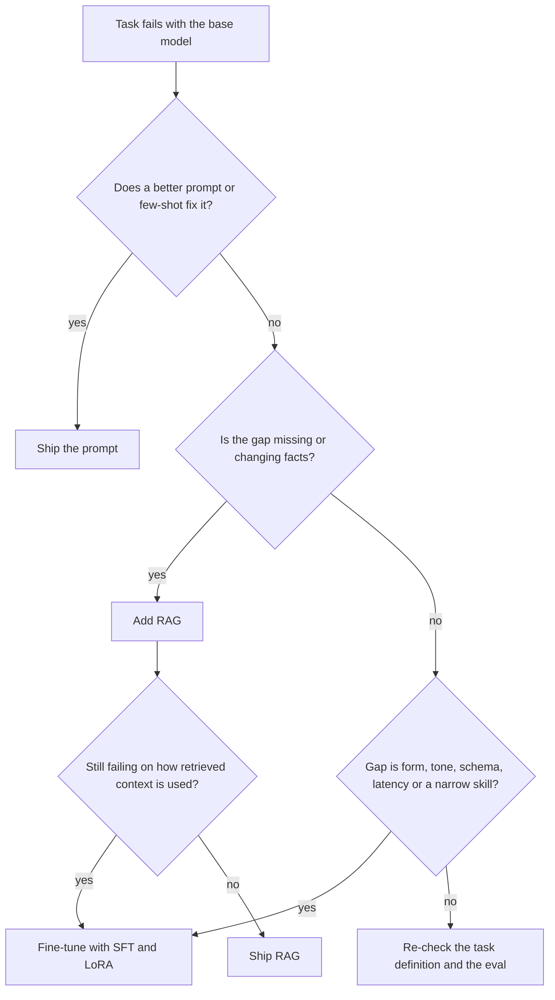
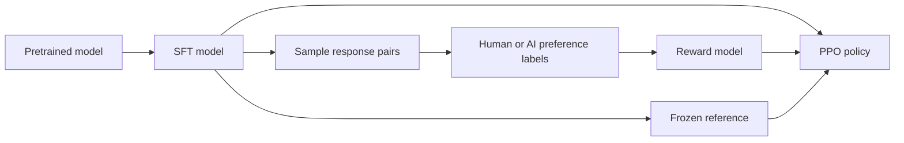

# Fine-tuning and Alignment - Deep Dive

This guide is for engineers who can already say "LoRA", "DPO" and "KL penalty" and now want to derive the numbers and equations behind them: how many bytes training really costs, what LoRA does to a gradient, where NF4 levels come from, why the DPO loss falls out of the RLHF objective, and what GRPO changes relative to PPO. [README.md](README.md) is the crash course (decision framework, vocabulary, red flags) and [questions.md](questions.md) is the drill. This file supplies the mechanisms, derivations and worked arithmetic behind those answers, so you can reconstruct a result in an interview instead of reciting it.

Suggested study order, roughly 14-18 hours in total:

| Block | Parts | Hours |
|---|---|---|
| Deciding and SFT basics | 1, 2 | 2-3 |
| Training cost and parameter-efficient methods | 3, 4, 5 | 4-5 |
| Data | 6 | 1-2 |
| Preference optimisation and RL | 7, 8, 9 | 4-5 |
| Forgetting, evaluation, merging | 10 | 1-2 |
| Exercises | see [exercises/README.md](exercises/README.md) | 5-7 (overlaps) |

Do the "Check yourself" questions after each part and run the matching exercise before moving on.

## Prerequisites

- Cross-entropy, softmax, gradients and Adam. See [../01-ml-and-dl-foundations/deep-dive.md](../01-ml-and-dl-foundations/deep-dive.md).
- Transformer layer shapes, tokenisation and what a context window costs. See [../02-llm-fundamentals/deep-dive.md](../02-llm-fundamentals/deep-dive.md).
- Prompting as the first lever. See [../03-prompt-engineering-and-context/deep-dive.md](../03-prompt-engineering-and-context/deep-dive.md).
- RAG as the knowledge lever. See [../04-rag-and-retrieval/deep-dive.md](../04-rag-and-retrieval/deep-dive.md).
- Evaluation habits (golden sets, LLM judges, significance). See [../07-evaluation-and-observability/deep-dive.md](../07-evaluation-and-observability/deep-dive.md).
- Serving adapters and quantised models. See [../08-inference-and-production/deep-dive.md](../08-inference-and-production/deep-dive.md).
- Python and numpy. The exercises use nothing else. For the basic LoRA layer, see [../12-coding-challenges/14_lora_adapter.py](../12-coding-challenges/14_lora_adapter.py).

## Contents

1. [Part 1 - Fine-tune, prompt or retrieve: the decision](#part-1---fine-tune-prompt-or-retrieve-the-decision)
2. [Part 2 - SFT mechanics: templates, masking, packing](#part-2---sft-mechanics-templates-masking-packing)
3. [Part 3 - Training memory and compute arithmetic](#part-3---training-memory-and-compute-arithmetic)
4. [Part 4 - LoRA: the math and the knobs](#part-4---lora-the-math-and-the-knobs)
5. [Part 5 - QLoRA: NF4, double quantisation, paged optimisers](#part-5---qlora-nf4-double-quantisation-paged-optimisers)
6. [Part 6 - Data curation, synthetic data and distillation](#part-6---data-curation-synthetic-data-and-distillation)
7. [Part 7 - RLHF: reward model, PPO and the KL leash](#part-7---rlhf-reward-model-ppo-and-the-kl-leash)
8. [Part 8 - DPO: derivation and variants](#part-8---dpo-derivation-and-variants)
9. [Part 9 - GRPO and reinforcement learning with verifiable rewards](#part-9---grpo-and-reinforcement-learning-with-verifiable-rewards)
10. [Part 10 - Forgetting, evaluation and merging](#part-10---forgetting-evaluation-and-merging)
11. [Putting it together](#putting-it-together)
12. [Exercises](#exercises)
13. [Further study](#further-study)

---

## Part 1 - Fine-tune, prompt or retrieve: the decision

### The problem

Fine-tuning is the most expensive lever you have: it needs data, GPU time, an evaluation harness, and a plan for every future base-model upgrade. The question "should we fine-tune" is mostly a question about which of three things is missing from the model: instructions, knowledge or skill.

| Missing piece | Symptom | Lever |
|---|---|---|
| Instructions or examples | Model can do it but you have not told it how | Prompting, few-shot, structured outputs |
| Knowledge (private, fresh, large) | Wrong or invented facts, stale answers | RAG (see [../04-rag-and-retrieval/deep-dive.md](../04-rag-and-retrieval/deep-dive.md)) |
| Behaviour or skill (form, tone, a narrow task, latency) | Right content, wrong shape. Prompts grow longer and still fail 10% of the time | Fine-tuning |

The shorthand "fine-tuning changes form, RAG changes knowledge" is accurate enough to start from, and the rest of this part is about the exceptions.

### Why fine-tuning is a poor way to add facts

Gradient descent on a few thousand documents does not write facts into weights the way a database insert does. Three mechanisms work against you:

1. **Sparse exposure.** A fact seen once or twice in training is stored weakly. Pretraining stores facts through many paraphrased exposures. Fine-tuning data rarely has that redundancy.
2. **Hallucination pressure.** Training on answers that contain facts the base model does not know teaches the model to produce confident, plausible-looking answers in that style, which includes guessing when it does not know. Several studies on fine-tuning with new knowledge report that unknown-fact examples are learned slowly and increase hallucination on known facts. Treat this as a direction of risk, not a precise number.
3. **Staleness and provenance.** The fact is frozen at training time, has no citation, and cannot be access-controlled per user. RAG gives you all three for free.

Continued pretraining (more next-token training on raw domain text, at pretraining-like scale) is the legitimate route when the *language* of a domain is foreign (clinical notes, a programming language the base model barely saw). It needs billions of tokens, not thousands of examples.

### The decision flow



Real systems combine the levers. A common end state is RAG for facts plus a small fine-tuned model that is good at using retrieved context in a fixed format.

### A cost model you can do on the back of an envelope

Assume a classification-and-extraction feature currently uses a 2,000-token prompt (instructions plus few-shot examples) on a large hosted model, and 1,000,000 requests per month. Input tokens per month: 2,000 x 1,000,000 = 2 x 10^9. A fine-tuned small model might need only a 150-token prompt: 1.5 x 10^8 tokens, a 13x reduction in input tokens before you even count that a smaller model costs less per token. Illustrative arithmetic (prices are placeholders, replace them with your own): at a hypothetical $1.00 per million input tokens the first design spends $2,000 per month on input and the second $150, plus whatever you pay to host the small model. Break-even against training cost, data-labelling effort and maintenance is a spreadsheet exercise, and the answer flips with volume. At 10,000 requests per month, fine-tuning for cost reasons rarely pays back. At 100 million requests per month, not fine-tuning is the choice that needs justifying.

Costs that people forget:

- **Data**: a few thousand examples that a domain expert has read. This is usually the largest line item.
- **Evaluation**: a held-out set and a general-capability regression suite (Part 10).
- **Re-training**: the base model gets a new version, your adapter does not transfer, and you re-run the whole pipeline.
- **Serving**: a custom model means you host it, or you pay a provider's fine-tuned-model premium.

### Where people go wrong

- Fine-tuning before measuring a strong prompt baseline with a proper eval. Many fine-tuning projects are rescued by a 10-line prompt change.
- Fine-tuning on the eval set's distribution and then reporting the eval as success.
- Believing fine-tuning "removes the need" for guardrails. It shifts behaviour on average. It does not give guarantees.

### Check yourself

1. A legal team wants answers that cite the current version of internal policies, written in a formal house style. Which lever handles which requirement?
2. Why is "we fine-tuned on our wiki so the model knows our products" a weak design?
3. When is continued pretraining a better answer than SFT?

<details><summary>Answer</summary>

1. Current policy text is knowledge, so RAG (with citations). House style is form, so a prompt first and then SFT if the prompt cannot hold it reliably or becomes too long. They compose: retrieval supplies the content, the tuned model controls shape.
2. A few exposures per fact give weak storage, the model learns to answer confidently in that style even when it does not know, there is no citation, the knowledge goes stale at the next policy change and it cannot respect per-user access control.
3. When the domain's vocabulary or syntax is largely absent from the base model's pretraining (a rare language, specialised notation), and you have a large raw corpus (billions of tokens). SFT with thousands of examples cannot teach a language.

</details>

---

## Part 2 - SFT mechanics: templates, masking, packing

### The problem

Supervised fine-tuning (SFT) looks like ordinary language-model training, and the bugs are almost all in the data plumbing. Four mechanics decide whether a fine-tune works: the **chat template**, the **loss mask**, **packing** and the **loss normalisation**.

### The objective

For a training example with prompt tokens x and response tokens y, SFT minimises the negative log-likelihood of the response given the prompt:

```
L = - (1 / |y|) * sum_{t in response} log p_theta(y_t | x, y_<t)
```

The sum runs only over response positions. The prompt is still in the input, because the model needs it as context. It just carries no loss. Implementation: build `labels = input_ids.copy()`, set prompt positions to `-100` (the index PyTorch's `cross_entropy` ignores), and shift by one so position t predicts token t+1.

### Chat templates

A chat model is trained on text where roles are marked by special tokens. A ChatML-style rendering looks like:

```
<|im_start|>system
You are a helpful assistant.<|im_end|>
<|im_start|>user
What is 2+2?<|im_end|>
<|im_start|>assistant
4<|im_end|>
```

Different model families use different markup (header tokens, `[INST]` blocks, BOS and EOS conventions). Three rules follow:

1. **Use the template shipped with the tokenizer** (`apply_chat_template` in Hugging Face tokenizers) for training and inference. Do not hand-write it.
2. **The end-of-turn token must be a training target.** If the assistant turn has no EOS label, the model never learns to stop and rambles until the token limit. This is the most common symptom of broken SFT data.
3. **At inference add the generation prompt** (the opening assistant header) so the model starts in the position it was trained to answer from. A mismatch here (missing header, doubled BOS, different system-prompt placement) gives outputs that look slightly off with a perfectly normal training loss, which is why it is the silent failure interviewers ask about.

### Loss masking in detail

Worked example. Tokens (ids invented): prompt `[5, 6, 7]`, response `[8, 9]`, EOS `2`.

```
position:   0   1   2   3   4   5
input_ids:  5   6   7   8   9   2
labels:    -100 -100 -100 8   9   2
```

After the next-token shift, the model's output at position t is compared with `labels[t+1]`:

```
position of logits:   0     1     2    3   4   (5 predicts nothing)
target:             -100  -100    8    9   2
```

Positions 0 and 1 are predicting prompt tokens, so they carry no loss. Position 2 sees the full prompt and predicts the first response token. Only three of the six positions are trained.

Why mask the prompt at all?

- The prompt contains user text, tool outputs and system instructions that you do not want to imitate. Training on them teaches the model to generate user turns.
- With long prompts (retrieved documents) and short answers, unmasked loss is dominated by prompt tokens, which dilutes the signal you care about.
- Evidence is mixed that masking changes final quality much when responses are long. It matters most when prompts are long relative to answers. The safe default is to mask.

Multi-turn conversations: train on **every assistant turn** and mask user, system and tool turns. A single forward pass over the whole conversation computes all assistant-turn losses at once, which is far cheaper than splitting the conversation into one example per turn.

### Loss normalisation: the quiet bug

Suppose a batch holds two examples with 10 and 990 response tokens, and per-token losses average 1.0 and 3.0.

- **Mean of per-example means**: (1.0 + 3.0) / 2 = 2.0. Each example gets equal weight, so a token in the short example has 99x the weight of a token in the long one.
- **Token-level mean**: (10 x 1.0 + 990 x 3.0) / 1000 = 2.98. Every token counts equally.

Neither is wrong, but you must know which one you have. A related trap arises with **gradient accumulation**: averaging each micro-batch's mean loss weights micro-batches equally even when they contain different numbers of unmasked tokens. The correct token-level result divides the summed loss by the total number of unmasked tokens across all accumulation steps. Frameworks had to fix exactly this in 2024, and a team that logs loss from a custom loop can reproduce the bug. [Exercise 1](exercises/ex01_sft_masking_packing.py) has you compute both weightings.

### Packing

Padding every example to the longest in its batch wastes compute. Eight examples with lengths 120, 300, 80, 640, 200, 150, 900 and 410 total 2,800 tokens. Padded to 900 they occupy 8 x 900 = 7,200 slots, so 38.9% of the compute is real tokens. Packed into a 4,096-token row, the same examples occupy one row at 68.4% (and exactly fit a shorter row, which is how you reach 90%+ in practice).

Packing concatenates several examples in one row. Three details keep it correct:

1. **Targets must not cross a boundary.** The last token of example A must not be trained to predict the first token of example B.
2. **Position ids restart at 0** for each example, so rotary or learned positions look as they did in unpacked training.
3. **Attention must be block-diagonal causal.** With plain causal attention, example B can attend to example A. Many frameworks support this through variable-length attention kernels that take per-example boundaries. Some skip it and rely on the model ignoring the unrelated prefix. That is called "cross-contamination" and it is a small, measurable quality loss, not a catastrophe, but you should know which one your stack does.

```python
import numpy as np

def block_diag_causal(segment_ids):
    causal = np.tril(np.ones((len(segment_ids),) * 2, bool))
    same = segment_ids[:, None] == segment_ids[None, :]
    return causal & same & (segment_ids[:, None] != 0)

seg = np.array([1, 1, 1, 2, 2, 0])   # two packed examples and one padding slot
print(block_diag_causal(seg).astype(int))
```

Token 3 (the first token of example 2) attends only to itself. Token 5 (padding) attends to nothing.

### Hyperparameters that matter

| Knob | Full FT | LoRA | Notes |
|---|---|---|---|
| Learning rate | 1e-5 to 5e-5 | 1e-4 to 2e-4 | Too high is the most common cause of forgetting |
| Epochs | 1-3 | 1-5 | Watch eval loss, not train loss |
| Warmup | ~3% of steps | ~3% | Protects the first steps |
| Schedule | cosine or linear decay | same | |
| Effective batch | 32-128 sequences | 16-64 | Use gradient accumulation to reach it |
| Max length | cover the 99th percentile of your examples | same | Truncation silently drops EOS labels |

Data size shifts the optimum. Small datasets (hundreds of examples) tolerate more epochs but overfit quickly. Large datasets get one or two passes.

### Where people go wrong

- Training with a template different from the one used at inference.
- Truncating sequences so the EOS target is cut off.
- Reading train loss as quality. SFT loss on one fixed answer penalises valid paraphrases, so a loss floor of 0.5-1.0 nats per token is normal and not a sign of failure.
- Packing without boundary masking and then wondering why per-example evals differ from batch evals.

### Check yourself

1. Why is the label of the very last position in a row never trained, and why must the last token of packed example A not predict example B's first token?
2. The model never stops generating after SFT. What do you check first?
3. Per-example mean versus token-level mean: which one up-weights short answers, and by how much for answers of 10 and 990 tokens?
4. Why train all assistant turns of a conversation in one sequence?

<details><summary>Answer</summary>

1. There is no next token to predict at the last position. At a packed boundary, the "next token" belongs to an unrelated example, so training on it teaches the model a fake dependency. The target there must be ignored.
2. Whether the end-of-turn token is present in the labels (not masked, not truncated) and whether inference stops on the same token the template defines.
3. The per-example mean up-weights short answers. A token in the 10-token answer has 99x the weight of a token in the 990-token answer.
4. One forward pass produces predictions for all positions, so every assistant turn's loss is computed at once, with earlier turns serving as context. Splitting it into one example per turn repeats the shared prefix many times.

</details>

---

## Part 3 - Training memory and compute arithmetic

### The problem

"Will it fit on this GPU" is the first question of any fine-tuning plan, and it is arithmetic. Four things occupy memory: weights, gradients, optimiser states and activations. Each has a formula.

### Mixed-precision Adam: 16 bytes per parameter

Standard mixed-precision training with Adam keeps, for every trainable parameter:

| Item | Precision | Bytes |
|---|---|---|
| Weights used in forward and backward | bf16 | 2 |
| Gradients | bf16 | 2 |
| Master copy of weights | fp32 | 4 |
| Adam first moment m | fp32 | 4 |
| Adam second moment v | fp32 | 4 |
| **Total** | | **16** |

The fp32 master copy exists because bf16 has only ~8 bits of mantissa: a learning-rate-sized update of 1e-5 added to a weight of magnitude 0.02 falls below bf16's resolution and rounds away, so updates accumulate in fp32 and are then cast down.

Worked numbers (decimal GB, 1 GB = 10^9 bytes):

| Model | Parameters | Full fine-tune (16 B) |
|---|---|---|
| 7B | 7 x 10^9 | 112 GB |
| 13B | 13 x 10^9 | 208 GB |
| 70B | 70 x 10^9 | 1,120 GB |

So a 7B model cannot be fully fine-tuned on a single 80 GB GPU with plain Adam, before counting activations. Levers:

- **8-bit optimisers** quantise m and v to 1 byte each, cutting 8 B to ~2 B per parameter: 7B drops from 112 to 70 GB.
- **ZeRO / FSDP** shard optimiser states (ZeRO-1), gradients (ZeRO-2) and parameters (ZeRO-3) across N GPUs. At ZeRO-3 the per-GPU cost is about 16 B x params / N, plus communication. 112 GB across 8 GPUs is 14 GB each.
- **Lower-precision master weights** or pure-bf16 training, at some stability risk.
- **PEFT** (Parts 4 and 5): no grads, master copies or optimiser states for frozen weights.

### Activations

Activations are the intermediate tensors saved in the forward pass for use in backward. Unlike the 16 B/parameter terms, they scale with batch size and sequence length. A rough rule for a transformer layer in bf16 with fused attention (no sequence-squared term) is about 34 x s x b x h bytes per layer, for sequence length s, batch b and hidden size h. For a 7B-class model (h = 4096, 32 layers) at b = 1 and s = 4,096:

```
34 * 4096 * 1 * 4096 * 32 = 18.25 GB
```

That is 18 GB for a single 4k sequence. At batch 4 it is 73 GB. Activations, not weights, are why long-context fine-tuning runs out of memory even with LoRA.

**Gradient checkpointing** stores only each layer's input (2 x s x b x h bytes per layer) and recomputes the rest during backward:

```
(2 * 32 + 34) * 4096 * 4096 = 1.64 GB   (vs 18.25 GB)
```

The price is one extra forward pass: about 30% more compute per step. It is almost always worth it when memory is the binding constraint.

**Gradient accumulation** gives a large effective batch with a small micro-batch: run k micro-batches, sum the gradients, then step once. It costs time, not memory. (See the loss-normalisation warning in Part 2.)

### Compute: the 6ND rule

Training compute for a dense transformer is approximately 6 x N x D FLOPs for N parameters and D tokens (2ND for the forward pass, 4ND for backward). Fine-tuning 7B on 10 million tokens:

```
6 * 7e9 * 1e7 = 4.2e17 FLOPs
```

On a GPU sustaining ~125 TFLOPs (roughly 40% utilisation of a ~312 TFLOPs bf16 peak):

```
4.2e17 / 1.25e14 = 3,360 s = ~56 minutes
```

LoRA skips the weight-gradient matmuls of frozen layers (still needs activation gradients), so it costs roughly 4ND instead of 6ND, about a third less compute. In practice the wall-clock saving is smaller than the memory saving, and gradient checkpointing and dequantisation (QLoRA) add some of it back. This is why "LoRA is cheap" is true for memory and only moderately true for time. Treat these as order-of-magnitude figures.

### A memory estimator, in code

```python
def full_ft_gb(n_params, optimizer_bytes=8):
    return (2 + 2 + 4 + optimizer_bytes) * n_params / 1e9

def lora_gb(n_params, n_adapter, optimizer_bytes=8):
    return (2 * n_params + (2 + 2 + 4 + optimizer_bytes) * n_adapter) / 1e9

print(full_ft_gb(7e9), full_ft_gb(70e9))   # 112.0 1120.0
print(lora_gb(7e9, 40e6))                  # 14.64
```

[Exercise 2](exercises/ex02_memory_estimator.py) builds the full estimator including QLoRA and activations.

### Where people go wrong

- Quoting "14 GB for a 7B model" (weights only, inference) as the training requirement.
- Forgetting that LoRA still stores the full frozen model, so a 70B LoRA run in bf16 needs 140 GB for weights alone.
- Ignoring activations, then being surprised that batch size 1 at 8k context still runs out of memory.
- Counting parameters in billions but memory in GiB. A few percent of discrepancy is normal, an order of magnitude is not.

### Check yourself

1. Where do the 16 bytes per parameter go, and which are removed for a frozen weight?
2. Compute the full fine-tuning memory for a 13B model with an 8-bit optimiser (2 B of optimiser state).
3. Why is a master fp32 copy needed when weights are bf16?
4. What does gradient checkpointing trade, and by how much?

<details><summary>Answer</summary>

1. 2 (bf16 weights) + 2 (grads) + 4 (fp32 master) + 8 (Adam m and v). For a frozen weight you keep only the 2 B of weights (or less if quantised): no grads, no master, no optimiser states.
2. (2 + 2 + 4 + 2) = 10 B per parameter. 13e9 x 10 = 130 GB.
3. Small updates fall below bf16 resolution and round to nothing. fp32 accumulates them. The bf16 copy is then regenerated from the master.
4. It stores fewer activations (roughly one tensor per layer instead of ~34 hidden-sized tensors) and recomputes them in backward. Memory for activations drops by about an order of magnitude and compute rises ~30%.

</details>

---

## Part 4 - LoRA: the math and the knobs

### The problem

Full fine-tuning updates every weight, so every weight needs a gradient and optimiser state. The LoRA hypothesis is that the *change* needed to adapt a pretrained model to a task has low intrinsic rank, so it can be parameterised by two thin matrices.

### The parameterisation

For a frozen weight W (d_out x d_in), LoRA learns:

```
W' = W + (alpha / r) * B @ A        B: d_out x r,   A: r x d_in,   r << min(d_out, d_in)
```

The forward pass for input x (as a row vector or batch) is `y = x W^T + (alpha / r) * x A^T B^T`, computed as two thin matmuls, without ever forming BA.

Initialisation: A gets a random (Kaiming-uniform or Gaussian) initialisation, and **B is zero**, so BA = 0 and the model starts exactly at the base model.

Parameter count for one matrix: r x (d_in + d_out). For a single 4096 x 4096 projection with r = 16:

```
full:  4096 * 4096 = 16,777,216
LoRA:  16 * (4096 + 4096) = 131,072   (0.78% of the matrix)
```

Whole-model count for a Llama-style 7B (hidden 4096, FFN 11008, 32 layers, q/k/v/o and gate/up/down adapted) at r = 16:

```
per layer: 4 attention matrices:  4 * 16 * 8192            =   524,288
           3 MLP matrices:        3 * 16 * (4096 + 11008)  =   724,992
```

Per layer: 524,288 + 724,992 = 1,249,280 (each MLP matrix has d_in + d_out = 15,104, so 16 x 15,104 = 241,664). Over 32 layers: **39,976,960**, about 40M parameters or 0.57% of 7B. For a 70B model (hidden 8192, FFN 28672, 80 layers, grouped-query attention with a 1024-wide K and V) the same recipe gives 207,093,760, about 207M or 0.30%. Adapter size grows with width and depth, but much more slowly than the base model.

### Why the gradient behaves the way it does

Let s = alpha / r and let G = dLoss/dW' be the gradient with respect to the effective weight (the same tensor full fine-tuning would get). By the chain rule:

```
dLoss/dB = s * G @ A^T        (d_out x r)
dLoss/dA = s * B^T @ G        (r x d_in)
```

At initialisation B = 0, so dLoss/dA = 0 and only B moves on the first step. After B becomes nonzero, A starts learning. Two consequences:

1. One gradient step changes W' by -lr x s^2 x (G A^T A + B B^T G): it projects the full gradient G onto the subspace spanned by the current A and B. The adapter learns the part of the full-fine-tuning gradient that lives in a rank-r subspace.
2. A and B play asymmetric roles. B starts at zero and A is random, so A is initially a fixed random projection and B learns to read from it. This is the basis of **LoRA+**, which uses a larger learning rate for B than for A (ratios of ~16 are reported in the paper) to speed up convergence.

### What r and alpha control

- **Rank r** is the capacity: the maximum rank of the update. Tasks that need new surface behaviour (format, style, tone) work with r = 8-16. Tasks that must absorb more (a new coding language, long reasoning traces) benefit from r = 64 or higher, with diminishing returns. Information-theory intuition: a rank-r update to a d x d matrix has about 2dr degrees of freedom, versus d^2.
- **Alpha** sets the scale s = alpha / r. Because the update is multiplied by s, alpha behaves like a learning-rate multiplier on the adapter: doubling alpha at fixed LR roughly doubles the effective step in function space. A common default is alpha = 2r (s = 2) or alpha = r (s = 1). The point of the 1/r in the formula is that, when you change r with alpha fixed, the update magnitude changes by a controlled factor so you do not retune the LR for every rank. Later work showed that 1/r over-damps high ranks, hence **rsLoRA** with alpha / sqrt(r).

Worked example: (r = 8, alpha = 16) has s = 2. (r = 64, alpha = 16) has s = 0.25: eight times lower scale on a much larger adapter, and it will learn slowly at the same LR. With rsLoRA the scales are 5.66 and 2.0.

### Which matrices to adapt

The original paper adapted only the attention query and value projections. Later practice (and the QLoRA paper's ablations) favours adapting **all linear layers**: attention q, k, v, o and MLP gate, up, down. Reasons: the MLP holds most of the parameters, and QLoRA found that matching full fine-tuning quality required adapters on all linear layers, with rank mattering less than coverage. Cost: roughly three times the adapter parameters of q and v alone, still under 1% of the model. Embeddings and the LM head are usually left frozen unless you add new tokens, which requires training those rows.

### Merging and serving

Because the update is linear, you can fold it into the base weight once:

```
W_merged = W + (alpha / r) * B @ A
```

and serve a plain model with no inference overhead. Alternatively keep adapters separate. An unmerged adapter adds two extra thin matmuls per adapted layer (small FLOPs but extra kernel launches and memory traffic), which is why it is a minor but non-zero latency cost. Kept separate, one base model can serve many tasks or tenants, swapping adapters per request (multi-LoRA serving in vLLM and S-LoRA-style systems). That trade is the main architectural reason to prefer LoRA in production: ten tenants cost one base model plus ten small adapters, not ten model copies.

Merging into a **quantised** base is lossy: you must dequantise, add the update, and re-quantise, and the quantisation error can swamp a small update. Common practice is to merge into a bf16 copy of the base and then quantise the result for deployment, and to evaluate the merged model.

### LoRA versus full fine-tuning in quality

The findings worth knowing, stated at the level of confidence the evidence supports:

- On instruction-style tasks with modest data, well-configured LoRA (all linear layers, enough rank, the right LR) comes close to full fine-tuning.
- On tasks that require learning a lot of new content (continued pretraining style, hard code or math adaptation), full fine-tuning tends to win, and a gap can remain even at high rank.
- LoRA tends to **forget less and learn less** than full fine-tuning (the "LoRA Learns Less and Forgets Less" study). That is a trade-off, not a free win.
- LoRA's best learning rate is typically about 10x that of full fine-tuning, and it is more sensitive to the LR than to the rank.

### DoRA and friends

**DoRA** decomposes each weight into a magnitude (per-output-column norm) and a direction. It applies LoRA to the direction and trains the magnitude as a separate small vector. The motivation is that full fine-tuning changes magnitude and direction in a decoupled way and LoRA couples them. It improves quality at low rank for a small training-time overhead. Mergeable, like LoRA. Treat variants as second-order. Data quality and target-module coverage move results far more.

### Where people go wrong

- Treating `alpha` as independent of the LR. Both scale the update.
- Adapting only q and v and concluding "LoRA can't learn this".
- Expecting unmerged LoRA to speed up inference. It is the same compute as the base plus a little extra.
- Merging into a 4-bit model and not re-evaluating.
- Running multiple LoRA experiments without fixing the seed and the data order, then comparing small differences.

### Check yourself

1. Why does zero-initialising B (and not A) give "start at the base model" while still allowing learning?
2. Compute the adapter parameter count for a 8192 x 28672 matrix at r = 32.
3. Why does the 1/r in alpha / r exist, and what does rsLoRA change?
4. What is the serving benefit of not merging?

<details><summary>Answer</summary>

1. BA = 0 when B = 0, so W' = W initially. The gradient to B is s G A^T, which is nonzero because A is random, so B moves on step one, and A then receives gradient as B grows. If both were zero, both gradients would vanish and nothing would train.
2. r x (d_in + d_out) = 32 x (8192 + 28672) = 32 x 36,864 = 1,179,648, versus 234,881,024 for the full matrix (0.50%).
3. It keeps the update magnitude roughly comparable when you change r with alpha fixed, so the LR does not need retuning for each rank. It over-damps large ranks, so rsLoRA divides by sqrt(r), keeping learning stable and letting larger ranks use their capacity.
4. One resident base model serves many fine-tunes by swapping small adapters per request, rather than holding one full model copy per tenant or task.

</details>

---

## Part 5 - QLoRA: NF4, double quantisation, paged optimisers

### The problem

LoRA removes the 14 B/parameter of gradient and optimiser state, but the frozen base still costs 2 B/parameter: 140 GB for a 70B model. QLoRA shrinks the frozen base to ~0.5 B/parameter by storing it in 4 bits and dequantising on the fly, while the LoRA adapters stay in bf16 and receive gradients through the dequantised weights.

### Blockwise absmax quantisation

To quantise a tensor to 4 bits (16 levels) you need a map from real values to level indices. Quantising a whole tensor with one scale is fragile: one outlier sets the scale and squeezes everyone else into a few levels. So split the tensor into **blocks** (64 values in QLoRA), and give each block its own scale:

```
absmax_b   = max |w_i| over the block
normalised = w_i / absmax_b                  # now in [-1, 1]
code_i     = index of nearest level to normalised   # 4 bits
dequant    = level[code_i] * absmax_b
```

Storage per weight: 4 bits for the code plus 32 bits / 64 = 0.5 bits for the fp32 absmax of its block = **4.5 bits**. A smaller block lowers error and raises overhead (block 16 would cost 6 bits).

### Why NF4 and not evenly spaced levels

Trained network weights are roughly zero-mean and bell-shaped. After dividing by the block's absmax, most values sit near zero and few near plus or minus 1. Evenly spaced levels waste codes on the sparse tails. **NormalFloat-4 (NF4)** places its 16 levels at quantiles of a standard normal distribution so that, for normally distributed inputs, each level is used about equally often. That is an information-theoretically optimal 4-bit code *for that distribution*. Details of the QLoRA construction:

- 8 levels from positive quantiles and 7 from negative ones, plus an exact **zero** (so padding and zero-valued weights are represented exactly). The asymmetry (8 versus 7) is what lets both 0 and the extremes plus and minus 1 exist in 16 codes.
- Levels are normalised by their largest absolute value so they lie in [-1, 1].

The resulting NF4 levels, to four decimals:

```
-1.0000 -0.6962 -0.5251 -0.3949 -0.2844 -0.1848 -0.0910  0.0000
 0.0796  0.1609  0.2461  0.3379  0.4407  0.5626  0.7230  1.0000
```

Notice the spacing: about 0.09 between levels near zero, about 0.28 between the outer two positive levels (0.7230 to 1.0). Evenly spaced 16-level codes would step 2/15 = 0.133 everywhere.

Measured on 128,000 standard normal values with block size 64 (this is what [Exercise 6](exercises/ex06_nf4_quantization.py) reproduces, same seed):

| Format | MSE |
|---|---|
| NF4 | ~0.0085 |
| Uniform 4-bit (16 evenly spaced levels) | ~0.0102 |

That is about 17% lower error at the same storage. The gain is real but modest, which matches the QLoRA paper's finding that NF4 is better than FP4 and INT4 in downstream accuracy, by amounts that matter at the margin and not by orders of magnitude.

### Block size and outliers

Error falls as blocks shrink, because each block's absmax is closer to its values' typical scale. On the same Gaussian data the MSE ordering is block 16 < 64 < 256 < 1024. The cost is storage: bits per weight are 4 + 32/block, so block 16 costs 6.0 bits and block 1024 costs 4.03.

Outliers are the failure mode of absmax. Put a single value of 50 in a block of N(0,1) weights and its absmax is 50, so every other weight in that block is divided by 50 and rounds to the zero level whenever its magnitude is below about 2 (half the first level 0.0796 times 50), and to +-4 otherwise: the block's ordinary weights collapse onto two or three values. Other blocks are unaffected, which is exactly why blockwise scaling helps. LLM weight matrices and, much more so, activations contain outlier channels, which is why weight-only 4-bit quantisation works well, and quantising activations needs extra techniques.

### Double quantisation

The 32-bit absmax per block of 64 costs 0.5 bits per weight. QLoRA quantises those constants again: take the absmax values of 256 blocks, quantise them to 8 bits with their own fp32 scale. Cost:

```
4 + 8/64 + 32/(64*256) = 4 + 0.125 + 0.00195 = 4.127 bits per weight
```

A saving of 0.373 bits per weight, about 0.37 bits x 65e9 / 8 = 3 GB for a 65B model. It is a small, free-ish gain.

### Paged optimisers

Long sequences or a rare large batch can spike memory briefly (gradient checkpointing boundaries, a batch with many long examples). Paged optimisers allocate optimiser states in unified memory, so the driver pages them to CPU RAM under pressure and back when needed, the way an operating system pages virtual memory. They convert out-of-memory crashes into a slowdown. They do not reduce steady-state usage.

### Putting the memory together

| | 7B | 70B |
|---|---|---|
| Full fine-tune, Adam, mixed precision | 112 GB | 1,120 GB |
| LoRA r=16, bf16 base | 14 + 0.64 = 14.6 GB | 140 + 3.3 = 143.3 GB |
| QLoRA r=16, NF4 + double quant | 3.61 + 0.64 = 4.25 GB | 36.1 + 3.3 = 39.4 GB |

(The adapter state costs 16 B x 40M = 0.64 GB for 7B and 16 B x 207M = 3.3 GB for 70B.) All exclude activations. 39.4 GB for 70B leaves under 9 GB on a 48 GB card for activations, which is why QLoRA 70B on one 48 GB GPU needs a short sequence, a small micro-batch and gradient checkpointing.

### What QLoRA gives up

- **Speed**: every forward and backward pass dequantises each weight to bf16 on the fly, so a QLoRA step is slower than a LoRA step on the same hardware, often noticeably.
- **A small quality gap**: the QLoRA paper reports matching 16-bit LoRA on its benchmarks. The quantisation noise is partly compensated by the adapter learning around it. For tasks sensitive to small numerical differences, verify on your own eval.
- **Merge fidelity**: see Part 4.

### Check yourself

1. Why is block-wise scaling better than one scale for the whole tensor?
2. Why does NF4 have both an exact zero and the extremes at plus and minus 1?
3. Compute bits per weight for block size 128 with and without double quantisation (second block 256).
4. What do paged optimisers fix and what do they not fix?

<details><summary>Answer</summary>

1. An outlier only damages the block it lives in. With one global scale it would compress every weight in the tensor into a few levels.
2. 16 codes are split asymmetrically: 8 positive levels, 7 negative levels and one zero. That layout includes both +1 and -1 as exact endpoints (after normalising by the largest magnitude) and represents zero weights exactly.
3. Without: 4 + 32/128 = 4.25 bits. With: 4 + 8/128 + 32/(128 x 256) = 4 + 0.0625 + 0.00098 = 4.0635 bits.
4. They fix transient memory spikes by paging optimiser state to CPU memory, turning an out-of-memory error into a slowdown. They do not lower steady-state memory use.

</details>

---


## Part 6 - Data curation, synthetic data and distillation

### The problem

After the decision to fine-tune, data quality sets the ceiling. Compute and method choices settle the last few points. Data decides the first twenty.

### Quality over quantity, with numbers

The LIMA result is the canonical reference: about 1,000 carefully selected prompt and response pairs were enough to give a 65B base model strong instruction-following behaviour in human preference tests. The authors' reading is the **superficial alignment hypothesis**: pretraining supplies knowledge and capability, and alignment mainly teaches the *format and style* of a helpful answer, which needs few examples. Practical corollaries:

- For style, format and tone, hundreds to a few thousand excellent examples often suffice.
- For a narrow skill with a measurable metric (extraction, classification, SQL in your dialect), thousands to tens of thousands, and the curve flattens early. Plot a learning curve at 25%, 50% and 100% of the data before paying to label more.
- For genuinely new capability (reasoning, a new language), no small data set will do it. That is RL or pretraining-scale work.

### A curation pipeline

1. **Define the target behaviour** in one page: what a good answer looks like, what to refuse, what format. Annotators and synthetic generators both need this spec.
2. **Collect** from real traffic (best, with consent and PII handling), expert writing, or synthetic generation.
3. **Filter by rules**: length bounds, language ID, schema validity, no truncated responses, no leaked system prompts.
4. **Deduplicate**: exact hash first, then near-duplicate. MinHash with locality-sensitive hashing over shingles catches reworded copies. Embedding similarity with a threshold catches paraphrases. Duplicates silently upweight a pattern and inflate eval scores when they straddle the train and test split.
5. **Decontaminate** against every eval set you will report on: n-gram overlap (for example 13-gram) between training examples and test items.
6. **Score quality**: a rubric-based LLM judge for scale, plus human review of a random sample (50-100 examples, read by someone who knows the domain). The sample read will find systematic problems that no metric does.
7. **Balance**: check the distribution over task types, lengths, languages and difficulty. Over-represented easy cases teach a model to be lazy.
8. **Split** before any synthetic augmentation. Held-out data must never be seen by the generator.

Label noise matters more than people assume. If 10% of your labels are wrong in a consistent direction, the model learns the wrong behaviour on those cases with confidence. Disagreeing annotators are a signal that the spec is ambiguous. Fix the spec before adding more labels.

### Synthetic data

Using a stronger model to generate or rewrite training data is now the default for SFT sets. Patterns:

- **Self-Instruct style**: seed with a few hundred hand-written tasks, have a model generate new instructions and answers, filter and deduplicate.
- **Distillation from a teacher**: prompt a strong model on your real inputs, keep the answers as targets (black-box distillation).
- **Rejection sampling**: generate N candidates per prompt, keep only those that pass a verifier (unit tests, an answer checker, a judge threshold). The model then trains on its own filtered outputs, which is a simple form of RL.
- **Rewriting**: take human answers and have a model fix style, add reasoning or normalise the format.

Failure modes:

| Failure | Mechanism | Mitigation |
|---|---|---|
| Mode collapse | The teacher's stylistic habits ("Certainly! Here is...") dominate and output diversity falls | Vary prompts and personas, sample at several temperatures, mix in human data, measure n-gram diversity |
| Error amplification | Teacher mistakes become ground truth, and verification is weaker than generation | Verifiers where possible (tests, checkers), judge with a different model, human spot checks |
| Eval contamination | The teacher has seen public benchmarks, and generators may reproduce items | Decontaminate synthetic data too |
| Model collapse | Repeated training on model outputs across generations shrinks the tails of the distribution | Keep fresh human data in each round, do not recycle indefinitely |
| Licence and terms | Provider terms may restrict training models on their outputs | Read the terms. Prefer open-weight teachers with permissive licences when it matters |

### Distillation

Black-box distillation (above) only sees the teacher's sampled text. **Logit distillation** trains the student to match the teacher's full token distribution at each position, which carries far more information per example: the relative probabilities of wrong answers ("dark knowledge").

Hinton's formulation uses temperature T to soften the distributions. Teacher logits [4, 2, 0]:

```
T = 1: softmax = [0.867, 0.117, 0.016]
T = 4: softmax = [0.506, 0.307, 0.186]
```

At T = 1 the teacher is almost a one-hot label. At T = 4 the relative ordering and spacing of the wrong answers is visible, and the student can learn from it. The loss is:

```
L = alpha * CE(student, hard label)  +  (1 - alpha) * T^2 * KL(teacher_T || student_T)
```

The T^2 factor keeps gradient magnitudes comparable across temperatures. Requirements: you need the teacher's logits (so, open weights or your own model) and a shared tokenizer, or an alignment trick when tokenizers differ. Reasoning-model distillation in the DeepSeek-R1 release, by contrast, was plain SFT on teacher-generated reasoning traces (black-box style) and still transferred substantial reasoning ability to small models, which is a practical datapoint for choosing the cheap route first.

### Check yourself

1. Why does near-duplicate removal affect evaluation reliability and not only training efficiency?
2. What is rejection sampling and why is it not "free" supervision?
3. Why does temperature in logit distillation help the student?
4. Name two risks specific to training on teacher outputs.

<details><summary>Answer</summary>

1. If near-duplicates sit on both sides of the train and test split, the model has effectively seen the test items and the metric measures memorisation. Duplicates also overweight the repeated pattern during training.
2. You sample several candidates per prompt and keep only those that pass a checker or judge. It is only as good as the checker: a weak verifier lets wrong or hacky answers through and you train the model to produce them with higher confidence. It also costs N times the generation compute.
3. Softening the teacher distribution exposes the relative probabilities of incorrect tokens, which are the extra information beyond the hard label. At T = 1 a confident teacher looks like a one-hot label.
4. Any two of: mode collapse to the teacher's style, copying teacher errors, benchmark contamination inherited from the teacher, and terms-of-service restrictions on training on its outputs.

</details>

---

## Part 7 - RLHF: reward model, PPO and the KL leash

### The problem

SFT teaches the model to imitate a single good answer. But humans find it much easier to say which of two answers is better than to write the best answer, and imitation does not penalise bad behaviours that never appear in the data. RLHF turns comparisons into a training signal in three stages:



### Stage 1: SFT

The policy starts as an SFT model. This matters twice: it gives reasonable outputs to compare, and it is the reference policy for the KL penalty below.

### Stage 2: the reward model and the Bradley-Terry loss

Collect prompts x, sample two or more responses per prompt, and have annotators pick the better. We want a scalar reward r(x, y). The **Bradley-Terry model** says the probability that y_w beats y_l is:

```
P(y_w > y_l | x) = sigmoid( r(x, y_w) - r(x, y_l) )
```

Only the *difference* of scores matters. Fit r by maximum likelihood over the preference dataset, which gives the pairwise logistic loss:

```
L_RM = - E[ log sigmoid( r(x, y_w) - r(x, y_l) ) ]
```

Practical facts:

- The reward model is usually the SFT model (or a similar-size model) with the LM head replaced by a scalar head reading the final token's hidden state.
- Gradient: dL/dr_w = -sigmoid(-d), dL/dr_l = +sigmoid(-d), with d = r_w - r_l. A confidently correct pair (d large) has almost no gradient. A confidently wrong pair has a gradient of magnitude near 1. At d = 0 each side gets 0.5.
- Calibration reading: a gap of 1.0 means a modelled 73% preference, a gap of 2.0 means 88%, a gap of 3.0 means 95%. Check that the reward gaps your model produces are consistent with actual annotator agreement on held-out pairs.
- Human preference labels are noisy: annotators on the same pair often agree only around 70-75% of the time in published work (approximate). A reward model's held-out accuracy of 65-75% is normal, and the ceiling is the label noise.
- Reward models overfit fast, typically within one epoch.
- Only differences within one prompt are identifiable. Adding any function c(x) to r leaves the loss unchanged.

[Exercise 3](exercises/ex03_bradley_terry_reward_model.py) trains a linear Bradley-Terry model and shows why separable data makes the weights grow without bound unless you regularise, a miniature of reward model over-fitting.

The same math ranks chess players (Elo) and LLMs in arena-style leaderboards: fit one score per item from pairwise outcomes.

### Stage 3: policy optimisation with a KL leash

The RL objective, for policy pi, reference pi_ref and reward model r:

```
maximise   E_{x ~ D, y ~ pi(.|x)} [ r(x, y) ]  -  beta * KL( pi(.|x) || pi_ref(.|x) )
```

In implementation, the KL term is expanded per token and folded into the reward. For a response with tokens y_1..y_T, the reward at token t is:

```
r_t = - beta * ( log pi(y_t | x, y_<t) - log pi_ref(y_t | x, y_<t) )      for t < T
r_T = - beta * ( ... same ... ) + r_RM(x, y)                              at the last token
```

The reward-model score arrives only at the last token, and the KL penalty is dense. Summing the per-token terms gives exactly the sequence-level log-ratio. [Exercise 7](exercises/ex07_kl_penalty_and_optimal_policy.py) implements this shaping.

**Why the KL leash exists.** The reward model is a learned proxy trained on a finite sample of responses near the SFT distribution. Away from that distribution it extrapolates arbitrarily, and the policy is an optimiser that will find the extrapolation errors: unusual phrasing, long confident answers, flattery, repetition, sometimes gibberish that scores high. This is **reward hacking**, an instance of Goodhart's law. Studies of reward-model over-optimisation (Gao et al.) show the pattern: as the policy moves further from the reference (measured by KL), the proxy reward keeps rising while a held-out "gold" reward first rises and then falls. The KL penalty keeps the policy where the reward model is trustworthy. Beta trades reward gained against drift:

| beta | Behaviour |
|---|---|
| Too small | Reward hacking, degenerate text, loss of diversity |
| Reasonable (often ~0.01-0.1 in practice) | Gains in preference with controlled drift |
| Too large | The policy barely moves from SFT |

### The KL estimators in practice

Computing the exact KL over the vocabulary at every token is expensive, so implementations estimate it from the sampled tokens. With log_r = log pi_ref(y) - log pi(y) for y sampled from pi, three standard estimators of KL(pi || pi_ref) are:

```
k1 = -log_r                  unbiased, high variance, can be negative on a sample
k2 = 0.5 * log_r^2           biased, low variance, always >= 0
k3 = exp(log_r) - 1 - log_r  unbiased, low variance, always >= 0
```

Worked example for one token where pi gives 0.5 and pi_ref gives 0.4: log_r = ln(0.8) = -0.2231. Then k1 = 0.2231, k2 = 0.0249, k3 = 0.0231. All three are positive here. In a batch, k1 values occasionally go negative (a token where pi gives less probability than pi_ref) and average out to the true KL. k3 is a control-variate version of k1: it adds exp(log_r) - 1, which has expectation zero under pi, and this makes every sample non-negative. That is why recent GRPO-style implementations use k3 for the KL term. The exercise verifies unbiasedness of k1 and k3 and the bias of k2 on a toy distribution.

### PPO in one page

The policy gradient update uses an **advantage** A_t, which is how much better token t's outcome was than expected. PPO adds two pieces:

- A **value function** V (a critic network, usually the same size as the policy) that predicts return from each state, used to compute advantages via generalised advantage estimation:

```
delta_t = r_t + gamma * V(s_{t+1}) - V(s_t)
A_t     = sum_{l >= 0} (gamma * lambda)^l * delta_{t+l}
```

- A **clipped surrogate objective** that stops a single batch from moving the policy too far:

```
rho_t = pi_new(y_t | ...) / pi_old(y_t | ...)
L = E[ min( rho_t * A_t,  clip(rho_t, 1 - eps, 1 + eps) * A_t ) ]
```

Clipping is one-sided. With A > 0 and rho = 1.5, eps = 0.2, the objective uses 1.2 A (no incentive to push the ratio past 1.2). With A > 0 and rho = 0.5 it uses 0.5 A (the policy already moved the wrong way, so the full gradient remains). The mirrored cases apply for A < 0. [Exercise 5](exercises/ex05_grpo_advantages.py) checks all four regimes.

### The cost of PPO-based RLHF

Four models are live: the **policy** (trainable), the **critic** (trainable), the **reference** (frozen) and the **reward model** (frozen). For a 7B policy with a 7B critic, full fine-tuning both with Adam in mixed precision costs 112 GB each, plus 14 GB each for the frozen reference and reward model in bf16:

```
112 + 112 + 14 + 14 = 252 GB     (before activations and generation buffers)
```

On top of that, every step needs **generation** (sampling responses from the current policy), which is slow and memory-hungry (KV cache), and is why RLHF systems separate rollout workers from training workers. Also, PPO is notoriously sensitive: value-function quality, advantage normalisation, KL coefficient schedule and learning rate interact. A large share of the interest in DPO and GRPO is simply that they remove parts of this machine.

### Where people go wrong

- Describing RLHF as "training on thumbs up and down" and omitting the reward model and the KL term.
- Believing the reward model is ground truth rather than a proxy.
- Looking at rising reward as success. Always track KL to reference, response length and a held-out evaluation.
- Using different tokenisation or templates for the policy and reference, which makes the KL meaningless.

### Check yourself

1. The reward model gives A a score of 2.1 and B a score of 0.6. What is the modelled probability that A is preferred?
2. Why is the KL penalty added per token rather than only at the end of the sequence?
3. Why can the same reward model be trusted for a lightly tuned policy and not for a heavily tuned one?
4. Give the memory cost of the four models in PPO-RLHF for 7B models, full fine-tuning.

<details><summary>Answer</summary>

1. The gap is 1.5, so sigmoid(1.5) = 0.818.
2. It gives a dense per-token signal about how far each step drifts, which is easier for credit assignment, and the sum equals the sequence-level log-ratio, so the objective is unchanged. Only the reward-model score is sparse (last token).
3. The reward model was trained on samples near the SFT distribution. A lightly tuned policy stays there. A heavily tuned policy samples out-of-distribution responses where the reward model extrapolates and can be exploited. Held-out gold reward drops while proxy reward keeps climbing.
4. Policy 112 GB + critic 112 GB + frozen reference 14 GB + frozen reward model 14 GB = 252 GB, before activations.

</details>

---

## Part 8 - DPO: derivation and variants

### The problem

The RLHF pipeline needs a reward model, an RL loop, a critic and online sampling. DPO asks: the RLHF objective has a known closed-form optimum. Can we train the policy to that optimum directly from preference pairs?

### Step 1: the optimum of the KL-regularised objective

For one prompt x, maximise over policies pi:

```
J(pi) = E_{y ~ pi}[ r(x, y) ] - beta * KL( pi || pi_ref )
      = E_{y ~ pi}[ r(x, y) - beta * log( pi(y) / pi_ref(y) ) ]
```

The solution is the reference policy reweighted by exponentiated reward:

```
pi*(y | x) = (1 / Z(x)) * pi_ref(y | x) * exp( r(x, y) / beta ),
Z(x) = sum_y pi_ref(y | x) * exp( r(x, y) / beta )
```

Proof sketch: rewrite J as -beta * KL( pi || pi* ) + beta * log Z(x). The KL term is minimised (zero) at pi = pi*, so J is maximised there, and its maximum value is beta * log Z(x).

A quick sanity check with numbers: pi_ref = [0.5, 0.3, 0.2], r = [0, 1, 2], beta = 1. Unnormalised: [0.5, 0.3 x 2.718, 0.2 x 7.389] = [0.5, 0.815, 1.478], Z = 2.793, pi* = [0.179, 0.292, 0.529]. The high-reward response gained probability from 0.2 to 0.529. With beta = 0.01 nearly all mass moves to the argmax. With beta = 10^6 pi* stays at the reference. [Exercise 7](exercises/ex07_kl_penalty_and_optimal_policy.py) checks all three.

### Step 2: invert the relationship

Take logs and solve for the reward:

```
r(x, y) = beta * log( pi*(y | x) / pi_ref(y | x) ) + beta * log Z(x)
```

Any policy pi can be read as defining a reward this way. The troublesome term Z(x) depends only on the prompt, not on y.

### Step 3: plug into Bradley-Terry

Bradley-Terry depends only on r(x, y_w) - r(x, y_l), and Z(x) cancels:

```
r_w - r_l = beta * log( pi(y_w) / pi_ref(y_w) ) - beta * log( pi(y_l) / pi_ref(y_l) )
```

So maximum-likelihood on preference pairs, with the reward parameterised by the policy, gives the **DPO loss**:

```
L_DPO = - E[ log sigmoid( beta * ( log(pi(y_w|x)/pi_ref(y_w|x)) - log(pi(y_l|x)/pi_ref(y_l|x)) ) ) ]
```

Define the **implicit reward** r_hat(y) = beta * log( pi(y|x) / pi_ref(y|x) ) and z = r_hat(y_w) - r_hat(y_l). Then L = -log sigmoid(z): a binary classifier over a difference of log-ratios. The policy is trained to be, in effect, its own reward model. No sampling, no critic, no separate reward model. The reference log-probs are constants you can precompute once. [Exercise 4](exercises/ex04_dpo_loss.py) implements the loss, its gradients and a tabular policy, and checks the implicit reward of the KL-optimal policy against the true reward differences.

### Gradient: what the update actually does

```
grad L = - beta * sigmoid(-z) * ( grad log pi(y_w) - grad log pi(y_l) )
```

Raise the chosen log-prob, lower the rejected one, weighted by sigmoid(-z): how wrong the implicit reward currently is. Worked example: beta = 0.1, chosen policy log-prob -12 versus reference -14, rejected policy log-prob -20 versus reference -19.

```
r_hat(chosen)   = 0.1 * (-12 + 14) = +0.2
r_hat(rejected) = 0.1 * (-20 + 19) = -0.1
z = 0.3,  loss = -ln sigmoid(0.3) = 0.554,  weight = sigmoid(-0.3) = 0.426
```

At the start of training the policy equals the reference, so z = 0, the loss is ln 2 = 0.693 and the weight is 0.5. As a sanity check on a training run, the DPO loss should start at 0.693 and drift down, and reward accuracy (fraction of pairs with z > 0) should start at 50%.

```python
import numpy as np

def dpo_loss(pi_w, pi_l, ref_w, ref_l, beta):
    z = beta * ((pi_w - ref_w) - (pi_l - ref_l))
    return np.mean(np.logaddexp(0.0, -z))          # -log sigmoid(z), stable

print(dpo_loss(np.array([-12.0]), np.array([-20.0]),
               np.array([-14.0]), np.array([-19.0]), 0.1))   # ~0.554
```

### What beta means

Beta is the same KL coefficient as in RLHF, now acting as an inverse temperature on the log-ratios. Small beta (0.01-0.05) lets the policy move far and fits the preference data aggressively. Large beta (0.3-0.5) keeps it close to the reference. A common default is 0.1. It is a hyperparameter to sweep against a held-out preference win rate and a general regression suite.

### Failure modes of DPO

- **Likelihood displacement.** The loss only constrains the *difference* of log-ratios. It can be reduced by pushing the rejected log-prob down faster than the chosen one, so the chosen response's absolute probability can fall. The probability mass can then move to a third response that is neither. Watch the chosen implicit reward, not just the margin. Mitigations: an SFT term on the chosen responses, or variants like ORPO.
- **Length exploitation.** Preferred answers in the data are often longer, and the sum of token log-ratios grows with length. Models learn to be verbose. Length-normalised variants (SimPO) and length-controlled evaluation counter it.
- **Off-policy data.** Preference pairs generated by other models mean the policy is trained on responses it would never produce, and the gradients can be uninformative. Using on-policy samples (sample from your SFT model, label them, train) works better, and iterating that loop is "online DPO".
- **Overfitting.** With a single epoch over millions of pairs it is fine, but small datasets over multiple epochs can drive the margin up without bound, the same story as a separable Bradley-Terry fit. IPO addresses it directly.
- **Reference mismatch.** The reference should be the SFT model the data was (ideally) generated from. A reference trained differently from the policy's starting point makes the log-ratios meaningless.

### Variants, each fixing one weakness

| Method | Change | Fixes / trades |
|---|---|---|
| **IPO** | Replace the log-sigmoid with a squared loss pulling the log-ratio gap toward a fixed target 1/(2 beta) | A bounded objective: it cannot be reduced by pushing the margin to infinity, so it resists overfitting when preferences are near-deterministic |
| **KTO** | Use single responses labelled good or bad (not pairs), with a prospect-theory-inspired utility around a reference point | Works with thumbs-up and thumbs-down logs. Data is cheap, signal per example is weaker |
| **ORPO** | Add an odds-ratio penalty on the rejected response to the SFT loss on the chosen one | One stage, no reference model. Less memory, less controlled drift |
| **SimPO** | Use length-normalised average log-prob as the implicit reward, no reference model, plus a target margin | Reference-free and length-aware. Needs tuning of margin and beta |
| **Online or iterative DPO** | Re-sample from the current policy and relabel each round | Closes much of the gap to RL by fixing distribution shift. Costs sampling and labelling |

### DPO versus PPO, honestly

DPO is simpler, cheaper and stable: classification loss, pairs on disk, two forward passes per pair (policy and, precomputed, the reference). It is the default for preference tuning of open models with fixed preference data. PPO and its descendants are **online**: they sample from the current policy, so the training distribution follows the policy, and they can optimise against a reward you can compute on fresh samples. Evidence from comparative studies is mixed and task-dependent: well-tuned online RL tends to win on hard reasoning and code, while DPO is competitive on chat-style preference data. "DPO is strictly better" and "PPO is strictly better" are both wrong answers.

### Check yourself

1. Which term cancels in the DPO derivation, and why does that matter?
2. At initialisation (pi = pi_ref) what are the DPO loss and gradient weight?
3. Why can DPO reduce the probability of the chosen response while the loss falls?
4. What does IPO change and what problem does that target?

<details><summary>Answer</summary>

1. The partition function Z(x), which depends only on the prompt. It is intractable (a sum over all responses). It cancels because Bradley-Terry uses a difference of two rewards for the same prompt, which is what lets DPO avoid a reward model.
2. z = 0, so the loss is ln 2 = 0.693 and the weight sigmoid(0) = 0.5, so the gradient on the chosen log-prob is -beta/2.
3. The loss depends on the *difference* of the two log-ratios. If the rejected log-prob drops by more than the chosen drops, z grows and the loss falls even though the chosen response lost probability.
4. It replaces the logistic loss with a squared error toward a finite target margin of 1/(2 beta), so near-deterministic preference labels cannot drive the margin to infinity, which reduces overfitting.

</details>

---

## Part 9 - GRPO and reinforcement learning with verifiable rewards

### The problem

PPO needs a critic as large as the policy, and a learned reward model that can be hacked. For tasks whose answers can be checked automatically (a math answer, a unit test, a regex-checkable format), you can skip the learned reward model, and **Group Relative Policy Optimisation (GRPO)** removes the critic.

### Verifiable rewards

A **verifiable reward** is a function you can compute exactly: 1 if the final math answer matches the reference, 1 if all unit tests pass, 0 otherwise, plus optionally a small format reward for following an output structure. Properties:

- **No learned reward model** to exploit: the signal is as good as the checker.
- **Cheap labels**: you need prompts with known answers, not preference annotations.
- **Sparse**: a hard problem that the model never solves gives reward 0 for all samples, and nothing to learn from.

Where it applies: mathematics, code with tests, formal proofs, constrained formatting, some games and puzzles, and structured tool-use tasks with checkable outcomes. Open-ended writing and helpfulness need learned reward models or rubrics.

### From PPO to GRPO

PPO's critic exists to give a baseline: it estimates how good a state is so that the advantage A = return - V(s) has low variance. GRPO instead gets the baseline from **the other samples for the same prompt**. For each prompt x, sample a group of G responses from the current policy (old policy), score each with the reward function to get r_1..r_G, and compute:

```
A_i = ( r_i - mean(r_1..r_G) ) / ( std(r_1..r_G) + eps )
```

Every token in response i receives the same advantage A_i. There is no value network. The objective keeps PPO's clipped ratio and a KL term to the reference:

```
J = E[ (1/G) sum_i (1/|o_i|) sum_t ( min( rho_{i,t} A_i, clip(rho_{i,t}, 1-eps, 1+eps) A_i ) - beta * KL_{i,t} ) ]
```

Worked example. Eight samples, three correct:

```
rewards = [1, 1, 1, 0, 0, 0, 0, 0]
mean = 0.375, std = sqrt(0.375 * 0.625) = 0.484
A(correct) = (1 - 0.375) / 0.484 = +1.291
A(wrong)   = (0 - 0.375) / 0.484 = -0.775
```

With one success in four samples (p = 0.25), std = 0.433, a correct sample gets +sqrt((1 - p)/p) = +1.732 and each wrong one gets -0.577. Rare successes receive big positive advantages, and the update pushes up the probability of whatever the successful path did. If all samples are right or all are wrong, std = 0, advantages are all zero and the prompt contributes nothing. [Exercise 5](exercises/ex05_grpo_advantages.py) implements these cases.

Memory comparison with the PPO setup in Part 7: drop the 7B critic (112 GB), keep policy and reference, and keep a reward model only if the reward is learned. With a verifiable reward there is no reward model, so you hold the policy plus a frozen reference: 112 + 14 = 126 GB for 7B, versus 252 GB for PPO with a learned reward model. The cost moves to generation: G samples per prompt, typically 8 to 64.

### Biases and the fixes

GRPO is simple, and its normalisations have side effects that later variants address.

| Issue | Mechanism | Fix |
|---|---|---|
| **Std normalisation bias** | Dividing by std up-weights prompts with low reward variance (almost always right or almost always wrong) | Dr. GRPO drops the std division, using r_i - mean only |
| **Length bias** | Averaging over tokens per sample (1/length) gives each token in a short answer more weight. With negative advantages, long wrong answers are penalised less per token, so response length can grow without improving accuracy | Dr. GRPO and DAPO use a constant or token-level normalisation. [Exercise 5](exercises/ex05_grpo_advantages.py) shows the weights |
| **Zero-variance groups** | All samples score the same, so no gradient, wasted generation | DAPO's dynamic sampling filters and resamples these groups |
| **Clip too tight** | A symmetric clip range stops low-probability tokens from growing, which collapses exploration | DAPO's decoupled clip range (a higher upper bound) |
| **Instability on large or MoE models** | Token-level importance ratios are noisy | GSPO clips at the sequence level |

### The recipe at scale

DeepSeek-R1-Zero applied GRPO directly to a base model with rule-based rewards (answer correctness plus a format reward), with no SFT stage. Reported behaviours: response length grew during training, with the model learning to verify and backtrack within its chain of thought. The released R1 recipe adds stages around that core: a small cold-start SFT set to fix readability, reasoning-oriented RL, rejection sampling to build a larger SFT set, and a final RL stage covering general helpfulness and safety with learned rewards. The lesson for interviews is the *shape*: SFT or cold start, RL on verifiable tasks, rejection-sampled SFT, then a broader preference stage.

### What RL for reasoning does and does not do

- It reliably raises **pass@1** (probability that one sample is correct) on the training distribution and transfers to held-out problems of the same kind.
- Whether it adds *new* capability or sharpens what the base model could already sample is debated. Analyses comparing pass@k at large k suggest that for some setups the base model's pass@k is comparable, meaning RL mostly concentrates probability on solutions the model could already find. Read this as an active research question and avoid stating either side as settled.
- A reward you can game will be gamed: in code tasks, models learn to special-case tests or edit them if the sandbox allows it. Verifiers need to be as adversarially tested as the model.
- Reward hacking in verifiable settings looks like format exploitation (answer extraction regexes matching the wrong number), spurious length growth and language mixing in chain of thought. Add a format reward and length and language checks, and keep a human-readable sample log.

### When the task is not verifiable

You need a learned reward. An **outcome reward model (ORM)** scores the whole answer: cheap labels, no credit assignment. A **process reward model (PRM)** scores each reasoning step: dense signal, expensive step-level labels (or labels derived from rollouts: does a continuation from this step reach a correct answer?). PRMs are most often used to rerank samples and guide search at inference time, and are less used as a training reward because the model learns to exploit them. **RLAIF and Constitutional AI** generate preference labels from a model that follows written principles, trading human annotation cost for the judge's biases.

### Where people go wrong

- Applying RLVR to a model that cannot solve the problems at all. If the success rate is near 0 every group has zero variance. First SFT or use a curriculum so that the success rate is in the 10-90% range.
- Reporting training reward as the result. Evaluate on held-out problems, with a different checker implementation if possible.
- Treating GRPO as "PPO but better". It trades critic variance reduction for sampling cost and a few new biases.
- Forgetting the KL term, or setting it to zero for long runs without monitoring drift (some recent recipes drop it deliberately and rely on clipping and short runs, which is a choice to make with eyes open).

### Check yourself

1. Eight samples, two correct. Compute the normalised advantage of a correct and of a wrong sample.
2. What replaces the critic in GRPO and what does this cost?
3. Why can sample-level length normalisation cause long, wrong responses?
4. Why does a group with all-equal rewards teach nothing?

<details><summary>Answer</summary>

1. p = 0.25, mean 0.25, std = sqrt(0.25 x 0.75) = 0.433. Correct: 0.75 / 0.433 = +1.732. Wrong: -0.25 / 0.433 = -0.577.
2. The group mean (and std) of rewards over G samples of the same prompt acts as the baseline. It costs G generations per prompt and gives a noisier baseline than a well-trained critic, but removes a model as large as the policy.
3. With a 1/length weight per sample, each token of a long answer has a small weight. A long wrong answer (negative advantage) therefore receives less penalty per token than a short wrong answer, so the policy is not discouraged from rambling. Token-level or constant normalisation removes the asymmetry.
4. Advantage is reward minus the group mean, so every sample has advantage 0 and the policy gradient is zero (apart from the KL term). Prompts that are too easy or too hard for the current model give no signal.

</details>

---

## Part 10 - Forgetting, evaluation and merging

### Catastrophic forgetting

Fine-tuning moves weights toward the new task's optimum, and capabilities that depended on the old values degrade. Symptoms: the model answers every question in your task's format, loses multilingual ability, gets worse at maths, or becomes less safe after benign fine-tuning (a repeatedly reported effect).

Mitigations, ordered roughly by cost:

1. **Lower the learning rate and cut epochs.** The cheapest fix and the most common cause.
2. **Replay**: mix 5-25% general instruction data (and, ideally, the model's own outputs on general prompts, which preserves its distribution) into the task data.
3. **LoRA instead of full fine-tuning**: smaller change in weight space, typically less forgetting, with the learning and forgetting trade-off noted in Part 4.
4. **Regularise toward the base**: an L2 penalty or KL penalty to the base model's outputs, or elastic weight consolidation (penalise changes to weights important for earlier tasks).
5. **Interpolate after training**: take W = W_base + lambda x (W_ft - W_base) with lambda below 1, or merge with the base. Sweep lambda against both the task eval and a general eval to find the knee.
6. **Freeze layers** (for example, only train upper layers) when full fine-tuning is needed.

### Evaluating a fine-tune

The standard failure is to report one number on one eval. A defensible evaluation has five parts:

1. **Held-out task set**, split before any augmentation, with a metric tied to the product (exact match, schema validity, judged correctness). Compare against the strong-prompt baseline and the untuned base, not just against nothing.
2. **General-capability regression suite**: a handful of standard benchmarks plus instruction-following and safety checks. Report deltas, with a threshold decided in advance (for example, no more than 2 points lost on any).
3. **Behavioural checks**: format validity rate, stop behaviour (does it end?), response length distribution, refusal rate, diversity. These catch problems that accuracy hides.
4. **Pairwise or judged evaluation** for open-ended tasks. LLM judges prefer longer answers and the first position, so randomise order, control for length, and calibrate the judge against human labels on a sample.
5. **Statistical honesty.** A win rate of 60% over 200 comparisons has a 95% interval of 60% +- 6.8 points (standard error sqrt(0.6 x 0.4 / 200) = 0.035). To get +-3 points you need about 1,000 comparisons. Report intervals, and treat gaps within them as ties. Pen-and-paper exercise P7 does this arithmetic.

Overfitting signals during the run: eval loss rising while train loss falls, verbatim regurgitation of training examples, collapse of output diversity, rising format rigidity. Use early stopping on eval loss, and then confirm on the task metric, since eval loss and task accuracy often disagree.

Contamination deserves its own line item: confirm no training example overlaps your evals (n-gram check), and when you use synthetic data, check the generator was not shown the test items.

### Model merging

Merging combines weights from fine-tunes of a *shared base* without further training. Define a **task vector** tau = W_ft - W_base.

- **Linear interpolation or weight averaging**: W = W_base + sum_k lambda_k tau_k. WiSE-FT interpolation between base and fine-tuned weights is a simple, effective way to recover robustness lost in fine-tuning.
- **Task arithmetic**: add task vectors (scale them) to combine skills, or subtract one to remove a behaviour.
- **TIES**: trim small-magnitude entries of each task vector, resolve sign conflicts across tasks by majority mass, then average only agreeing entries. It reduces interference between tasks.
- **DARE**: randomly drop a large fraction of task-vector entries (for example 90%) and rescale the rest by 1/(1 - drop rate). The surviving entries approximately preserve the delta's effect, reducing overlap between merged tasks.
- **SLERP**: spherical interpolation between exactly two models, preserving norms better than linear interpolation.

Why it works at all: fine-tunes of one base remain in the same loss basin as the base, so interpolated weights keep low loss. It fails for independently pretrained models, whose weights are not aligned (hidden units can be permuted without changing function). Merge coefficients come from sweeping on a real eval and not from theory, and merged models need the same full evaluation as any new model.

### Check yourself

1. After fine-tuning your task accuracy rose and MMLU-style accuracy fell 5 points. Give two cheap fixes and one expensive one.
2. Why do merging methods require a shared base model?
3. How many pairwise comparisons do you need for a +-5 point 95% interval near 50%?
4. Why is eval loss a weak proxy for task quality?

<details><summary>Answer</summary>

1. Cheap: lower the LR and epochs, mix 10-25% general data into training, or interpolate the tuned weights toward the base. Expensive: switch from full fine-tuning to LoRA and retrain, or add a replay pipeline using the model's own general outputs.
2. Task vectors are only meaningful as deltas from a common starting point. Fine-tunes from the same base stay in one loss basin and their deltas can be combined linearly. Independently trained models have unaligned weight spaces.
3. n = 1.96^2 x 0.25 / 0.05^2 = ~384 comparisons.
4. Loss is per-token likelihood of one reference answer, so valid paraphrases are penalised and format or reasoning errors that matter to users may change loss only slightly. It correlates with quality early on and diverges later, which is why you also run task metrics.

</details>

---

## Putting it together

A typical end-to-end story for an interview, with the reasoning behind each choice:

1. **Frame the gap.** Build a 200-500 item eval set from real traffic. Measure the base model with a strong prompt. Classify failures as knowledge, form or skill (Part 1).
2. **Retrieve what is knowledge** and prompt for what is instruction. Only the residual form and skill gaps go to training.
3. **SFT with LoRA** on a few thousand reviewed examples, in the model's chat template, loss on assistant tokens only, EOS included, packing with boundary masks, token-level loss normalisation (Part 2). Estimate memory first: a 7B QLoRA run at ~4.3 GB of weights and adapter state plus activations fits a 24 GB card with checkpointing (Parts 3 to 5).
4. **Clean the data** with dedup, decontamination and a manual read. Use synthetic data from a strong model with verification, keep human data in the mix (Part 6).
5. **Evaluate against the baselines** and the regression suite, with confidence intervals. If general capability regressed, lower LR, add replay or interpolate toward the base (Part 10).
6. **If preference quality matters**, collect or generate pairs from your own model's samples and run DPO with beta around 0.1, watching chosen reward, length and KL to the reference. For reasoning on checkable tasks, use GRPO-style RL with a hardened verifier (Parts 8 and 9).
7. **Ship** a merged or separately served adapter, version it with the base model, and plan the re-training path for the next base release.

How the pieces connect: the KL-regularised objective from RLHF (Part 7) is the starting point for DPO (Part 8), and its KL term is the same KL leash in GRPO (Part 9). The Bradley-Terry model is the reward model's loss and the DPO derivation's bridge. The memory arithmetic of Part 3 explains why LoRA and QLoRA exist and why GRPO is attractive relative to PPO. The quality-over-quantity lesson from Part 6 recurs everywhere: preference data, RL prompts and eval sets all need the same care.

## Exercises

Seven coding exercises (numpy only, fixed seeds, each under 10 seconds) and nine pen-and-paper or design exercises with model answers live in [exercises/README.md](exercises/README.md).

| # | Exercise | Part |
|---|---|---|
| 1 | SFT masking and packing | 2 |
| 2 | Training memory estimator | 3, 4, 5 |
| 3 | Bradley-Terry reward model | 7 |
| 4 | DPO loss and tabular policy | 8 |
| 5 | GRPO advantages and clipping | 7, 9 |
| 6 | NF4 quantisation | 5 |
| 7 | KL estimators and the optimal policy | 7, 8 |

## Further study

Primary sources, in the order the parts use them:

- [LoRA: Low-Rank Adaptation of Large Language Models](https://arxiv.org/abs/2106.09685) - Hu et al., 2021.
- [QLoRA: Efficient Finetuning of Quantized LLMs](https://arxiv.org/abs/2305.14314) - Dettmers et al., 2023. NF4, double quantisation, paged optimisers.
- [LoRA Learns Less and Forgets Less](https://arxiv.org/abs/2405.09673) - Biderman et al., 2024.
- [DoRA: Weight-Decomposed Low-Rank Adaptation](https://arxiv.org/abs/2402.09353) - Liu et al., 2024.
- [A Rank Stabilization Scaling Factor for Fine-Tuning with LoRA](https://arxiv.org/abs/2312.03732) - Kalajdzievski, 2023 (rsLoRA).
- [LIMA: Less Is More for Alignment](https://arxiv.org/abs/2305.11206) - Zhou et al., 2023.
- [Self-Instruct: Aligning Language Models with Self-Generated Instructions](https://arxiv.org/abs/2212.10560) - Wang et al., 2022.
- [Distilling the Knowledge in a Neural Network](https://arxiv.org/abs/1503.02531) - Hinton et al., 2015.
- [Training language models to follow instructions with human feedback](https://arxiv.org/abs/2203.02155) - InstructGPT, the canonical RLHF recipe.
- [Proximal Policy Optimization Algorithms](https://arxiv.org/abs/1707.06347) - Schulman et al., 2017.
- [Scaling Laws for Reward Model Overoptimization](https://arxiv.org/abs/2210.10760) - Gao et al., 2022.
- [Direct Preference Optimization](https://arxiv.org/abs/2305.18290) - Rafailov et al., 2023.
- [A General Theoretical Paradigm to Understand Learning from Human Preferences](https://arxiv.org/abs/2310.12036) - Azar et al., 2023 (IPO).
- [KTO: Model Alignment as Prospect Theoretic Optimization](https://arxiv.org/abs/2402.01306) - Ethayarajh et al., 2024.
- [ORPO: Monolithic Preference Optimization without Reference Model](https://arxiv.org/abs/2403.07691) - Hong et al., 2024.
- [SimPO: Simple Preference Optimization with a Reference-Free Reward](https://arxiv.org/abs/2405.14734) - Meng et al., 2024.
- [Constitutional AI: Harmlessness from AI Feedback](https://arxiv.org/abs/2212.08073) - Anthropic, 2022.
- [DeepSeekMath](https://arxiv.org/abs/2402.03300) - where GRPO was introduced.
- [DeepSeek-R1](https://arxiv.org/abs/2501.12948) - GRPO with verifiable rewards at scale.
- [DAPO: An Open-Source LLM Reinforcement Learning System at Scale](https://arxiv.org/abs/2503.14476) - Yu et al., 2025.
- [Understanding R1-Zero-Like Training: A Critical Perspective](https://arxiv.org/abs/2503.20783) - Liu et al., 2025 (Dr. GRPO).
- [Tulu 3: Pushing Frontiers in Open Language Model Post-Training](https://arxiv.org/abs/2411.15124) - Ai2, 2024. An open post-training recipe including RL with verifiable rewards.
- [Editing Models with Task Arithmetic](https://arxiv.org/abs/2212.04089) - Ilharco et al., 2022.
- [TIES-Merging](https://arxiv.org/abs/2306.01708) - Yadav et al., 2023.
- [Language Models are Super Mario (DARE)](https://arxiv.org/abs/2311.03099) - Yu et al., 2023.
- [Robust fine-tuning of zero-shot models (WiSE-FT)](https://arxiv.org/abs/2109.01903) - Wortsman et al., 2021.
- [Overcoming catastrophic forgetting in neural networks](https://arxiv.org/abs/1612.00796) - Kirkpatrick et al., 2016 (EWC).
- [The Curse of Recursion: Training on Generated Data Makes Models Forget](https://arxiv.org/abs/2305.17493) - Shumailov et al., 2023.
- [Hugging Face TRL](https://huggingface.co/docs/trl) and [PEFT](https://huggingface.co/docs/peft) documentation - the reference open-source post-training stack.
