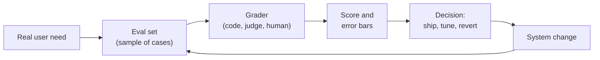
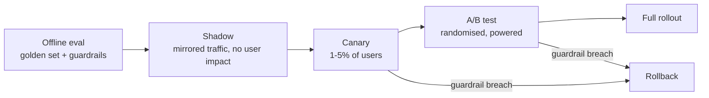
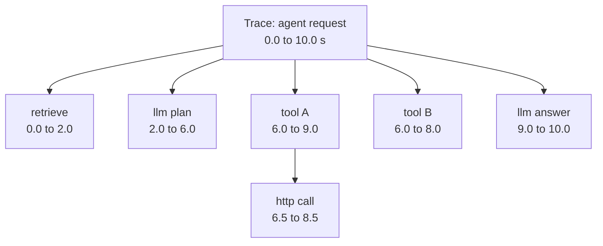
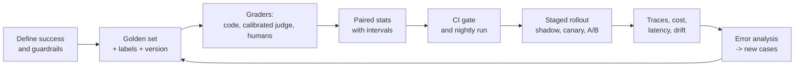

# Evals & Observability - Deep Dive

This guide is for engineers who can already describe an eval loop and an LLM-as-judge setup and now want to understand why the numbers behave as they do: where eval noise comes from, how big a golden set has to be, what a metric actually measures, how a judge is calibrated, how to put error bars on a comparison, what a leaderboard rank means, how online tests and traces fit in, and how to wire all of it into CI. [README.md](README.md) is the crash course (taxonomy, vocabulary, red flags) and [questions.md](questions.md) is the drill. This file supplies the mechanisms and arithmetic behind those answers, so you can derive a sample size or a confidence interval in an interview instead of quoting a rule of thumb.

Suggested study order, roughly 14-18 hours in total:

| Block | Parts | Hours |
|---|---|---|
| Measurement foundations | 1, 2, 3 | 4-5 |
| Judges and statistics | 4, 5 | 4-5 |
| Benchmarks and online evaluation | 6, 7 | 2-3 |
| Observability, drift and CI | 8, 9 | 2-3 |
| Exercises | see [exercises/README.md](exercises/README.md) | 4-6 (overlaps) |

Do the "Check yourself" questions after each part and run the matching exercise before moving on. Parts 4 and 5 are the ones interviewers probe hardest.

## Prerequisites

- Probability basics: mean, variance, standard error, the normal approximation to a binomial. See [../01-ml-and-dl-foundations/deep-dive.md](../01-ml-and-dl-foundations/deep-dive.md).
- How sampling temperature makes LLM output random, and what a token is. See [../02-llm-fundamentals/deep-dive.md](../02-llm-fundamentals/deep-dive.md).
- Prompt structure, rubrics and structured output, which judges depend on. See [../03-prompt-engineering-and-context/deep-dive.md](../03-prompt-engineering-and-context/deep-dive.md).
- Retrieval metrics (recall@k, nDCG) and the RAG component split. See [../04-rag-and-retrieval/deep-dive.md](../04-rag-and-retrieval/deep-dive.md).
- Agent trajectories and tool calls, which become spans. See [../06-agents-and-tool-use/deep-dive.md](../06-agents-and-tool-use/deep-dive.md).
- Python and numpy. The exercises use nothing else (plus the standard library).

## Contents

1. [Part 1 - Why LLM evaluation is hard](#part-1---why-llm-evaluation-is-hard)
2. [Part 2 - Building golden datasets](#part-2---building-golden-datasets)
3. [Part 3 - Metrics and their limits](#part-3---metrics-and-their-limits)
4. [Part 4 - LLM-as-judge in depth](#part-4---llm-as-judge-in-depth)
5. [Part 5 - Statistics for evals](#part-5---statistics-for-evals)
6. [Part 6 - Benchmarks, leaderboards and ranking](#part-6---benchmarks-leaderboards-and-ranking)
7. [Part 7 - Online evaluation](#part-7---online-evaluation)
8. [Part 8 - Observability and drift](#part-8---observability-and-drift)
9. [Part 9 - Regression testing and evals in CI](#part-9---regression-testing-and-evals-in-ci)
10. [Putting it together](#putting-it-together)
11. [Exercises](#exercises)
12. [Further study](#further-study)

---

## Part 1 - Why LLM evaluation is hard

### The problem

A classifier eval is easy to state: one input, one label, compare. An LLM feature breaks every part of that.

- **The output space is open.** A good answer can be phrased thousands of ways. There is no single reference string to match.
- **Quality has several dimensions.** An answer can be correct but rude, helpful but unfaithful to the source, fluent but wrong. A single score hides trade-offs.
- **The system is stochastic.** At temperature above zero the same input yields different outputs. Even at temperature zero, batching and hardware non-determinism can change outputs between runs.
- **The grader is also imperfect.** A code assertion is exact but narrow. A model judge is broad but noisy and biased. Humans disagree with each other.
- **The input distribution moves.** Users change, products add surfaces, and the model behind an API alias changes under you.
- **Optimisation corrupts the measure.** Anything you tune against slowly stops measuring what you cared about.

Evaluation is therefore a measurement problem with several independent noise sources. The first step is to name them, because each one has a different fix.

### Four sources of variance

When a score moves between two runs, at least four things may have caused it:

| Source | What varies | Typical fix |
|---|---|---|
| Example sampling | Which items are in the eval set | More examples, stratification, paired comparison |
| Generation sampling | The model's random output on a fixed item | Several samples per item, lower temperature |
| Grader noise | The judge's verdict on a fixed output | Better rubric, fixed judge version, order swapping, repeated judging |
| Real change | The system actually got better or worse | This is the signal you want |

Example sampling and generation sampling can be separated with arithmetic. Let item i have a true pass probability q_i (the chance a fresh sample passes). The population pass rate is p = mean of q_i. Scoring each of n items once, the variance of the mean score is

```
Var(mean) = (1/n) * [ Var_i(q_i) + E_i( q_i * (1 - q_i) ) ]
              ^ item difficulty     ^ generation noise
```

The sum in brackets equals p(1-p), the familiar binomial variance, but the split matters.

Worked example. Half the items are easy (q = 1.0) and half are hard but passable (q = 0.6). Then p = 0.8.

```
Var_i(q_i)        = 0.5*(1.0-0.8)^2 + 0.5*(0.6-0.8)^2 = 0.04
E[q_i (1 - q_i)]  = 0.5*0 + 0.5*0.24                  = 0.12
total             = 0.16 = 0.8 * 0.2                   (matches p(1-p))
```

With n = 100 and one sample per item, SE = sqrt(0.16 / 100) = 0.040. Now draw k = 5 samples per item and average them. The generation term shrinks by k:

```
Var(mean) = (1/100) * (0.04 + 0.12/5) = 0.00064   ->  SE = 0.0253
```

The SE drops from 4.0 to 2.5 points. It cannot drop below sqrt(0.04/100) = 2.0 points however many samples you draw, because the remaining variance comes from which 100 items you picked. Only more items reduce that floor. This is the first practical rule of eval statistics: **repeat samples to average out generation noise, add items to reduce sampling noise, and know which one you are limited by.**

### Measurement validity

Statistics tells you how precisely you measured something. Validity asks whether it was the right thing.

- **Construct validity.** Does "helpfulness score from a judge" track what users call helpful? Check by comparing to human labels and to downstream outcomes.
- **Coverage.** Does the eval set contain the cases your users actually produce, in the right proportions, including the rare costly ones?
- **Reliability.** Does re-running give the same answer? Quantified by repeat-run variance and rater agreement.
- **Goodhart effects.** Prompts tuned for 6 months against 150 fixed cases fit those cases. The score rises while real quality does not.



Every arrow is a place where the measurement can drift away from the need: the sample can misrepresent users, the grader can misjudge, the error bars can be missing, and the decision can ignore them. The rest of this guide goes through those arrows one by one.

### Common misconceptions

- **"Temperature 0 makes evals deterministic."** It makes them less random, not deterministic. Provider-side batching, floating-point reduction order and model updates can change outputs. Treat a temperature-0 run as one sample.
- **"A bigger judge is always a better grader."** A stronger judge usually helps, but biases such as position and verbosity persist and must be measured on your task.
- **"If the score went up, the change worked."** Without an interval you cannot tell a two-point gain from noise on a small set.

### Check yourself

1. You score each of 100 items once and get 80%. What is the standard error, and what is its main limitation as a description of your uncertainty?

<details><summary>Answer</summary>

SE = sqrt(0.8 x 0.2 / 100) = 0.04, so the 95% interval is roughly 72% to 88%. The limitation is that it treats items as independent draws from the user population and ignores that the item set was chosen by you, that several items may share a source document (clustering), and that the grader is imperfect. It describes sampling noise only.

</details>

2. In the worked example, what happens to the SE if you draw 20 samples per item instead of 5?

<details><summary>Answer</summary>

Var = (1/100) x (0.04 + 0.12/20) = 0.00046, SE = 0.0214. Going from 5 to 20 samples moves SE only from 2.53 to 2.14 points because the item-difficulty floor of 2.0 points dominates. Spend further budget on more items.

</details>

3. Why can two runs of the same prompt at temperature 0 disagree?

<details><summary>Answer</summary>

Floating-point reductions can differ with batch composition and kernels, the provider may route to different hardware or silently update the model, and tie-breaking between near-equal logits can flip. These effects are small per token but a single changed token can redirect a long generation.

</details>

4. Name one eval failure that is a validity problem and not a statistical one.

<details><summary>Answer</summary>

A judge score that correlates poorly with user satisfaction, or an eval set made of easy synthetic prompts while users send messy long ones. More samples give a more precise estimate of the wrong quantity.

</details>

---

## Part 2 - Building golden datasets

### What a golden set is for

A golden dataset is a versioned collection of inputs, with enough labelling that a grader can score outputs. It serves three jobs that pull in different directions:

1. **Development**: a fast, small set you iterate on daily.
2. **Regression**: cases that must keep passing, mostly past failures.
3. **Held-out test**: a set nobody tunes against, used to confirm that gains generalise.

Keeping these separate prevents the most common silent failure, which is optimising against the very cases used to report success.

### Sampling

How you pick items decides what the score means.

**Random sample of production traffic.** Gives an unbiased estimate of overall quality. It under-represents rare, high-cost cases: if 1% of traffic is refund disputes, 200 random items contain about 2 of them.

**Stratified sample.** Split traffic into strata (intent, language, user tier, document type) and draw a fixed number from each. This gives precision on every stratum, but the overall score must be **reweighted** by traffic share or it is misleading.

Worked example. Three intents with traffic shares and true pass rates:

| Intent | Traffic share | Pass rate |
|---|---|---|
| order status | 0.60 | 0.90 |
| returns | 0.30 | 0.70 |
| disputes | 0.10 | 0.40 |

Population pass rate = 0.6 x 0.9 + 0.3 x 0.7 + 0.1 x 0.4 = 0.54 + 0.21 + 0.04 = **0.79**. If you sample 33 items from each intent and average naively, you report (0.9 + 0.7 + 0.4) / 3 = **0.667**. Neither number is wrong; they answer different questions. Report per-stratum scores for diagnosis and the traffic-weighted score for a "what users experience" headline. For product decisions where disputes are costly, add a severity weight as well.

**Importance and failure-driven sampling.** Oversample traces that users thumbed down, escalated, or abandoned, and traces where a cheap detector (a guardrail, a low judge score, a long tool loop) fired. These are high-value but biased; use them for finding bugs, and keep a separate random sample for estimating rates.

**Synthetic generation.** Prompt a strong model with a taxonomy of scenarios (intent x difficulty x persona x edge condition) to cover gaps. Two safeguards: human review before admission, and tagging each item as synthetic so you can report the two groups separately. Synthetic items inherit the generator's blind spots and tend to be cleaner and more uniform than real traffic.

### Labelling

What a label contains depends on the grader.

| Task | Label | Notes |
|---|---|---|
| Classification, extraction | Gold output | Define normalisation rules up front |
| Q and A over documents | Reference answer plus key facts plus gold source ids | Key facts allow partial credit and judge grounding |
| Open-ended generation | Rubric criteria, optional reference | A reference is a guide, not a string to match |
| Agents | Final-state check plus expected tool calls | Prefer verifying outcomes over matching trajectories |
| Safety | Expected behaviour (refuse, safe-complete, escalate) | Include borderline cases |

A workable protocol:

1. Write the labelling guide first, with 5-10 worked examples including hard cases.
2. Have two people label an overlapping 20-30% sample independently.
3. Compute agreement (Cohen's kappa, Part 4). If it is low, the guide is ambiguous, not the labellers lazy.
4. Adjudicate disagreements, and fold the resolutions back into the guide as new examples.
5. Spot-check later batches against the adjudicated set to detect drift in labeller behaviour.

**Label noise caps what you can measure.** Suppose labels are wrong 10% of the time, symmetrically. A system with true accuracy 0.90 measures at 0.90 x 0.90 + 0.10 x 0.10 = 0.82. A true 0.95 system measures at 0.95 x 0.9 + 0.05 x 0.1 = 0.86. The 5-point true gap shrinks to 4 points, and every label error also adds variance. Near the ceiling you cannot separate systems until labels are cleaned. When two strong models "disagree" with the gold label on the same items, read those items: the label is often the one in error.

### Coverage

Coverage means the set exercises the situations the product will meet. Build a coverage matrix and look for empty cells:

```
                 short   long   multi-turn   non-English   adversarial
order status       12      4        3            2            1
returns            10      6        5            3            2
disputes            3      2        2            0            0   <- gap
```

The empty cells tell you what to add. This is also how you decide where a failure cluster found in production belongs.

### How many examples

Start with 20-50 hard, real cases because they change decisions immediately. Sizing for a target precision follows from the standard error. For a pass rate p measured to a half-width h at 95% confidence, n = 1.96^2 x p(1-p) / h^2.

```
p = 0.8, h = 0.05:  n = 3.84 * 0.16 / 0.0025 = 246
p = 0.8, h = 0.03:  n = 3.84 * 0.16 / 0.0009 = 683
p = 0.8, h = 0.02:  n = 3.84 * 0.16 / 0.0004 = 1,536
```

That is for estimating one pass rate. Comparing two systems uses different formulas (Part 5) and usually needs paired designs to be affordable.

### Contamination and leakage

An eval is contaminated when the model has seen the items or their answers. For public benchmarks, it shows up as inflated scores that do not transfer. For your private set, it arises through quieter routes:

- You pasted failing examples into the prompt as few-shot demonstrations, then evaluated on those same examples.
- Your retrieval corpus contains the eval answers verbatim (the model "retrieves" the question's own gold document, which is legitimate for retrieval evals but not if the corpus was built from the eval set).
- You fine-tuned on traces that include eval inputs.
- Prompt authors read the test failures and wrote rules that match them. This is overfitting by human, not by gradient.

Defences: keep the held-out test split out of prompts and fine-tuning sets, deduplicate between training or few-shot data and eval data by exact and fuzzy match (n-gram overlap, embedding similarity above a threshold), prefer items created after the model's training cutoff, rotate in fresh production items, and record which dataset version produced each score. Some benchmark builders embed a canary string in the data so that leakage into training corpora can be detected later.

### Versioning

Treat the dataset like code: stored in the repo or a versioned store, changed by review, with a content hash or version id written into every result. Without that, "last month's 78% versus today's 81%" may compare different questions. When you modify a set, keep the old version available so you can recompute scores for earlier systems on the new set before comparing.

### Where people go wrong

- Using only easy synthetic items, producing scores near 98% with no headroom.
- Reporting a stratified mean as if it were the production rate.
- Mixing the dev and test splits "just this once".
- Treating gold labels as infallible when two strong systems agree with each other and not the label.
- Letting the set go stale: new product features have no cases.

### Check yourself

1. Disputes are 10% of traffic and you sample 40 disputes in a 400-item set (also 10%). Is the set stratified?

<details><summary>Answer</summary>

It is proportional, so the unweighted mean already equals the traffic-weighted mean, but 40 items give a wide interval on the dispute stratum alone (SE about 0.08 at p = 0.5). If the dispute rate matters, oversample to e.g. 100 and reweight, or report the stratum separately.

</details>

2. Labels are wrong 8% of the time symmetrically. What does a system with true accuracy 0.97 appear to score?

<details><summary>Answer</summary>

0.97 x 0.92 + 0.03 x 0.08 = 0.8924 + 0.0024 = 0.8948, about 89.5%. The apparent ceiling is 92%, so no system can show above it, and differences among strong systems are compressed.

</details>

3. You need ±4 points at 95% confidence around a pass rate near 0.7. How many items?

<details><summary>Answer</summary>

n = 3.84 x 0.21 / 0.0016 = about 505 items.

</details>

4. Why report the dataset version with every score?

<details><summary>Answer</summary>

Scores from different dataset versions are not comparable: item mix, difficulty and labels differ. A version id (or hash) lets you recompute old systems on the new set and keeps trend lines honest.

</details>

---

## Part 3 - Metrics and their limits

### The principle

Use the cheapest grader that captures the criterion. When the answer is verifiable, a deterministic check beats any judge: it is free, repeatable and unbiased. Reference-overlap metrics sit in the middle. They are cheap but only meaningful when answers are short and constrained.

### Exact match and token F1

**Exact match (EM)** compares normalised strings. Normalisation matters as much as the comparison: lowercase, strip punctuation and articles, collapse whitespace. "The Eiffel Tower." and "eiffel tower" match after normalisation.

**Token F1** treats prediction and reference as bags of tokens. Let common = the multiset intersection (each token counts as often as it appears in both).

```
precision = common / len(prediction)
recall    = common / len(reference)
F1        = 2 * precision * recall / (precision + recall)
```

Worked example: prediction "the cat sat on the mat", reference "a cat was on the mat". The multiset intersection is {cat, on, the, mat}: "the" appears twice in the prediction and once in the reference, so it counts once. common = 4, precision = 4/6, recall = 4/6, F1 = 0.667. EM is 0.

Failure modes: F1 rewards verbose answers that contain the gold tokens (recall rises, precision falls, but a long answer can still score decently), and ignores meaning ("not in Paris" overlaps heavily with "in Paris"). Both EM and F1 are standard for extractive QA. For free-form answers they under-credit correct paraphrases. See [../12-coding-challenges/12_eval_metrics.py](../12-coding-challenges/12_eval_metrics.py) for an implementation.

### BLEU and ROUGE

Both come from machine translation and summarisation.

**BLEU** is a precision measure over n-grams. For each n from 1 to 4, compute the clipped n-gram precision: each candidate n-gram counts at most as often as it appears in the reference. Combine with a geometric mean and multiply by a brevity penalty:

```
BLEU = BP * exp( (1/4) * sum_{n=1..4} log p_n )
BP   = 1 if c > r else exp(1 - r/c)          (c = candidate length, r = reference length)
```

Clipping example: candidate "the the the the", reference "the cat". Unclipped unigram precision is 4/4. Clipped it is 1/4, since the reference has "the" once. Without clipping a degenerate output wins.

**ROUGE** is recall-oriented. ROUGE-N is n-gram recall against the reference. ROUGE-L uses the longest common subsequence (LCS). Example: candidate "the cat sat on the mat", reference "the cat is on the mat". LCS = "the cat on the mat" = 5 tokens. P = 5/6, R = 5/6, F = 0.833.

The limits, which are the useful part to remember:

- They measure surface overlap, not meaning. A faithful paraphrase scores low, and "the cat is not on the mat" scores high against "the cat is on the mat" (LCS 6 of 6 reference tokens, so recall 1.0 and precision 6/7) despite flipping the meaning.
- They need good references, and with one reference they punish valid alternatives.
- Correlation with human judgement is weak for open-ended generation, and the metric rewards copying the reference style.
- They are fine as regression signals for constrained tasks (translation with several references, extractive summaries) and poor as quality scores for chat.

### Embedding similarity

Embed the candidate and the reference and take cosine similarity. This credits paraphrase, which overlap metrics do not. Limits:

- Cosine values from many embedders cluster in a narrow high band (for example 0.7-0.95 for unrelated English sentences), so thresholds do not transfer between models.
- Negation, numbers and entity swaps barely move the vector: "revenue rose 12%" and "revenue fell 12%" are close.
- It scores topical similarity, not correctness.

Use it for cheap near-duplicate detection, clustering failures, or as a first-pass filter that sends low-similarity items to a stronger grader. Calibrate any threshold against labelled pairs from your own domain.

### Execution-based grading and pass@k

For code, run the output against hidden tests in a sandbox with timeouts and resource limits. Hidden tests matter: visible tests invite overfitting. String similarity to a reference solution is meaningless for code.

Because generation is random, a single sample per problem is a noisy estimate of whether the model can solve it. **pass@k** is the probability that at least one of k independent samples passes. Generate n >= k samples per problem, count c passing, and estimate it without bias.

Derivation. Choose k samples uniformly at random from the n you generated. The probability that all k are failures is the number of ways to pick k from the n - c failures divided by the number of ways to pick any k:

```
P(all k fail) = C(n-c, k) / C(n, k)
pass@k        = 1 - C(n-c, k) / C(n, k)
```

This is unbiased because the k samples are a uniformly random subset of independent draws. Worked example with n = 10, c = 3:

```
pass@1 = 1 - C(7,1)/C(10,1) = 1 - 7/10   = 0.30
pass@5 = 1 - C(7,5)/C(10,5) = 1 - 21/252 = 0.9167
pass@8 = 1 - C(7,8)/C(10,8) = 1  (C(7,8) = 0, fewer than 8 failures)
```

The tempting shortcut is the plug-in estimate 1 - (1 - c/n)^k. For the same data it gives 1 - 0.7^5 = 0.832 at k = 5 and 1 - 0.7^10 = 0.972 at k = 10 even though 3 of the 10 samples did pass, which means pass@10 is exactly 1. The plug-in treats the observed rate as the true one and samples with replacement, ignoring what the data tells you directly. In practice the plug-in estimator is biased and noisier. Implement the unbiased version in the numerically stable product form `1 - prod(1 - k / arange(n-c+1, n+1))` to avoid huge binomials.

**pass^k (all k succeed).** For an agent that must work every time, the useful number is the probability that k independent attempts all pass. With per-attempt success p, it is p^k. At p = 0.9: pass^1 = 0.9, pass^5 = 0.59, pass^8 = 0.43. The unbiased estimator mirrors pass@k: C(c, k) / C(n, k). With n = 10 and c = 9, pass^5 = C(9,5)/C(10,5) = 126/252 = 0.5. A 90% agent that looks fine on pass@k fails half the time when you need five consecutive successes. Always say which of the two matches the product: pass@k for "a human or a verifier picks the best attempt", pass^k for "the system must be reliable on every run".

### Multiple choice

Multiple-choice benchmarks are graded by comparing the model's chosen letter, either from generated text or from the log-probability of each option. Both are sensitive to option order, to the format of the prompt, and to answer extraction rules. A few points of difference from prompt formatting alone is common (approximate; varies by benchmark), which is why published numbers should be compared only under the same harness.

### Choosing a metric

| If the output is... | Use |
|---|---|
| A label, number or ID | Exact match after normalisation |
| Structured (JSON) | Schema validity plus field-level match |
| Code | Execution on hidden tests, pass@k or pass^k |
| A short span | Token F1 plus EM |
| Long free text with a verifiable core | Key-fact checks (does it contain fact X, assert no forbidden claim Y) |
| Long free text, subjective | Rubric judge (Part 4) calibrated against humans |
| A set of retrieved items | recall@k, MRR, nDCG ([Part 9 of the RAG guide](../04-rag-and-retrieval/deep-dive.md)) |

### Common misconceptions

- **"BLEU or ROUGE tell me if a chatbot answer is good."** They tell you about overlap with one reference.
- **"A high embedding similarity means the answer is right."** It means it is about the same topic.
- **"pass@10 = 10 x pass@1."** Not even close; it saturates toward 1 as k grows.

### Check yourself

1. Compute pass@3 for n = 8, c = 2.

<details><summary>Answer</summary>

1 - C(6,3)/C(8,3) = 1 - 20/56 = 0.643.

</details>

2. Why does clipping matter in BLEU?

<details><summary>Answer</summary>

Without clipping, repeating a common reference word gets perfect unigram precision. Clipping caps each n-gram's count at its maximum count in the reference.

</details>

3. An agent has per-run success 0.95. What is the chance it succeeds on all of 10 runs, and what does that imply?

<details><summary>Answer</summary>

0.95^10 = 0.599. A 95% agent fails a ten-step reliability requirement about 40% of the time. Reliability-sensitive products should report pass^k and design for retries, verification and human fallback.

</details>

4. Give a pair of sentences with high embedding cosine but opposite meaning, and say what grader you would use instead.

<details><summary>Answer</summary>

"The refund was approved" and "The refund was denied". For correctness use a key-fact assertion or a judge with a rubric that checks the decision; for tool-using flows, check the actual refund state in the environment.

</details>

---

## Part 4 - LLM-as-judge in depth

### Why a judge, and what it costs

For open-ended outputs there is no assertion to write. A judge model, given a rubric, grades the output. This scales human taste at roughly the price of one more model call per item, but the judge is itself a measuring instrument with error. The professional approach is to **measure the instrument**: calibrate it against humans, quantify its biases, and report its uncertainty.

### Pointwise versus pairwise

**Pointwise** grading asks for a score for one answer: "rate 1-5". Problems: scale drift (a 4 today is a 3 tomorrow), compressed distributions (most scores land on 4), and sensitivity to prompt wording. It works well when the rubric is anchored with examples per level, or reduced to binary pass/fail per criterion.

**Pairwise** grading shows two answers and asks which is better, or tie. Comparison is an easier cognitive task for models and humans, and it yields a ranking or win rate directly. Drawbacks: position bias is a first-class problem, cost grows with the number of systems compared, and it only supports relative claims ("B beats A"), not absolute ("answers meet the bar").

| | Pointwise | Pairwise |
|---|---|---|
| Output | Score or pass/fail per item | Winner per item |
| Best for | Absolute gates, per-criterion diagnosis, CI | Choosing between two versions, ranking models |
| Main risk | Scale drift, score compression | Position bias, verbosity bias |
| Cost for k systems | k calls per item | k(k-1)/2 pairs, times 2 for order swap |

A sensible default: binary per-criterion pointwise judges for CI gates and monitoring, pairwise with order swapping for choosing between candidate changes.

### Rubric design

- **One criterion per judge call.** "Is every claim in the answer supported by the context?" is one judgement. "Rate overall quality" mixes many.
- **Define the pass condition with examples**, including borderline ones, in the prompt.
- **Ask for reasoning before the verdict**, then parse a structured verdict field. The reasoning makes failures auditable. Do not assume it always improves accuracy; test it on your calibration set.
- **Give reference material** when one exists (the gold answer, the retrieved context), and say what the reference is for ("grade correctness against this fact list").
- **Fix the judge's temperature and version**, and record both. A silent judge update changes every score.
- **Allow "cannot determine"** for cases where context is insufficient, and count those separately.

### Known biases and how to measure each

**Position bias.** The judge prefers the answer in a particular slot, often the first. Test it directly: judge every pair twice, once in each order. Let v1 be the verdict with A first and v2 the verdict with B first. A position-blind judge returns the same winner both times.

Measures:

- **Consistency rate**: fraction of pairs where both orders pick the same winner.
- **First-slot share**: among non-tie verdicts, how many pick the first slot. Without bias this is about 0.5.
- **Binomial test**: is the first-slot share compatible with 0.5? With 18 non-tie verdicts of which 12 pick slot 1, the exact two-sided p-value is 2 x 31,180 / 262,144 = 0.238, so 12 of 18 does not show bias, while 18 of 18 gives p = 7.6e-6.

Mitigation: run both orders and keep only consistent verdicts as wins, counting inconsistent pairs as ties or reporting them separately. The cost is discarded data and double judge calls. The consistency rate itself is a quality metric for the judge: if it is 60%, much of what the judge says is position noise. [Exercise 03](exercises/ex03_position_bias.py) implements the detector.

**Verbosity bias.** Longer answers win regardless of content. Test: construct or find pairs where the longer answer is not better, and see how often the judge still picks it. Or regress judge win on the length difference and read the coefficient. Mitigation: state in the rubric that padding is penalised, report length alongside quality, compare within length bins, or truncate/normalise where a fixed budget is part of the task.

**Self-preference.** Models rate their own outputs, or outputs in their own style, higher. Mitigation: use a judge from a different model family than the generator, or a panel of judges from different families, and check whether the ranking changes when the judge changes.

**Style and format bias.** Markdown, lists, confident tone and hedging patterns influence verdicts. Control by normalising formatting before judging where formatting is not part of the criterion.

**Leniency or severity.** A judge can be systematically more lenient than humans (the next section quantifies it). This matters most when the judge gates a release: a lenient judge lets bad answers through.

### Calibrating against humans

Sample 50-100 items (stratified toward the cases that matter), have trusted humans label them with the same rubric, and compare with the judge.

**Percent agreement** is the fraction of identical verdicts. It is easy to read and misleading when one class dominates.

**Cohen's kappa** corrects for the agreement expected by chance given each rater's label frequencies:

```
kappa = (po - pe) / (1 - pe)
po = observed agreement
pe = sum over labels of P_rater1(label) * P_rater2(label)
```

Worked example. 50 items, labelled good (y) or bad (n) by the judge (rows) and a human (columns):

```
              human y   human n   total
judge y          20         5       25
judge n          10        15       25
total            30        20       50
```

po = (20 + 15) / 50 = 0.70. The judge says y 50% of the time and the human 60%, so pe = 0.5 x 0.6 + 0.5 x 0.4 = 0.50. kappa = (0.70 - 0.50) / (1 - 0.50) = **0.40**. Raw agreement of 70% sounds fine; kappa of 0.4 is only moderate agreement.

The **prevalence effect**: 100 items, 90 both-y, 5 judge-y/human-n, 5 judge-n/human-y, 0 both-n. po = 0.90. Each rater says y 95% of the time, so pe = 0.95 x 0.95 + 0.05 x 0.05 = 0.905 and kappa = (0.90 - 0.905) / 0.095 = **-0.053**. High agreement, kappa below zero, because the judge never identifies the rare bad answers the human flags. Whenever the positive class is rare, kappa (and per-class precision and recall) tell you what percent agreement hides.

Rule-of-thumb bands for kappa (an informal convention, not a law): below 0.2 slight, 0.2-0.4 fair, 0.4-0.6 moderate, 0.6-0.8 substantial, above 0.8 almost perfect. What you need depends on the stakes. Also compare with human-human kappa on the same rubric: a judge cannot be expected to exceed the agreement between your own labellers.

**Weighted kappa** is for ordinal scores (1-5). It gives partial credit to near-misses with a disagreement weight such as |i - j| / (k - 1) (linear) or its square (quadratic). A judge that is off by one point is much better than one that is off by three. [Exercise 02](exercises/ex02_cohens_kappa.py) implements both.

**Treat the judge as a classifier.** For a pass/fail judge compute sensitivity (fraction of human-pass items the judge passes) and specificity (fraction of human-fail items the judge fails). Using the table from [exercises P2](exercises/README.md): 120 both pass, 40 both fail, 30 judge-pass/human-fail, 10 judge-fail/human-pass. Sensitivity = 120 / 130 = 0.92, specificity = 40 / 70 = 0.57. Agreement is 80%, but specificity is poor: the judge lets 43% of bad answers through. For a CI gate that is the number to worry about.

### Correcting a judge's aggregate

When the judge has known sensitivity (se) and specificity (sp), the observed pass rate relates to the true one by

```
observed = p * se + (1 - p) * (1 - sp)
p        = (observed - (1 - sp)) / (se + sp - 1)
```

With se = 0.90, sp = 0.80 and an observed pass rate of 0.70: p = (0.70 - 0.20) / 0.70 = 0.714. The correction is only valid if the calibration set resembles production, and se and sp are themselves estimates with error, so the corrected rate needs a wider interval. The more reliable approach to large effects is to use the judge for comparisons (the bias is similar in both arms and mostly cancels) and use human labels for absolute claims.

### Judge panels, repeats and cost

- **Repeat** the judge at nonzero temperature and take a majority vote to reduce judge noise, at k times the cost.
- **Panels** of judges from different families reduce self-preference and idiosyncratic bias. Report disagreement as an uncertainty signal and send high-disagreement items to a human.
- **Cascade**: run a cheap code check first, a cheap judge next, and escalate only uncertain or high-stakes items to a stronger judge or human.
- **Budget**: with 300 items, 4 criteria and 2 orders, a pairwise run is 2,400 judge calls per comparison. Budget it before designing the suite.

### Where people go wrong

- Reporting judge-human agreement on an easy, balanced sample and trusting the number on a skewed production stream.
- Using the model under test as its own judge.
- Changing the judge prompt and comparing new scores to old ones.
- Never reading the cases where the judge and human disagree. Those cases are where the rubric gets fixed.
- Using a single holistic 1-10 score and reporting means to two decimals.

### Check yourself

1. A judge and a human agree on 94% of 200 items, but 95% of items are good. Why is this uninformative?

<details><summary>Answer</summary>

A judge that says "good" every time would agree on about 95%. Agreement is dominated by the majority class. Report kappa, and sensitivity and specificity for the rare "bad" class.

</details>

2. 40 pairs are judged in both orders: 26 consistent, 14 inconsistent. What is the consistency rate and what do you do with the 14?

<details><summary>Answer</summary>

26/40 = 65%. Treat the 14 as ties (or exclude them) when computing win rates and report them. A consistency rate of 65% means the judge is quite position-sensitive, so tighten the rubric or change the judge before trusting small win-rate differences.

</details>

3. Why prefer binary per-criterion judges for CI gating?

<details><summary>Answer</summary>

They are easier to calibrate (a confusion matrix against human labels), less prone to scale drift, and give interpretable failures. A threshold on a 1-10 score is arbitrary and unstable.

</details>

4. Compute kappa for: judge y/n = 40/10, human y/n = 35/15, joint both-y 33, both-n 8.

<details><summary>Answer</summary>

n = 50. po = (33 + 8) / 50 = 0.82. Judge y rate 0.8 and human 0.7, so pe = 0.8 x 0.7 + 0.2 x 0.3 = 0.62. kappa = (0.82 - 0.62) / 0.38 = 0.526. Check the table: judge y = 40 means judge-y/human-n = 7 and judge-n/human-y = 2; both sum correctly (33 + 7 = 40, 33 + 2 = 35, 2 + 8 = 10, 7 + 8 = 15).

</details>

---

## Part 5 - Statistics for evals

### The score is an estimate

An eval score is a sample mean. Report it with an interval, and compare systems with a method that accounts for how the data were collected. Four tools cover nearly everything: the normal interval and its Wilson variant, the bootstrap, the paired comparison, and a power calculation.

### Standard error and intervals for one accuracy

For n independent items with pass rate p:

```
SE = sqrt(p (1 - p) / n)          95% interval about p +- 1.96 * SE
```

For 80 correct out of 100: SE = 0.04, interval 0.722 to 0.878. The normal interval is poor near 0 or 1 and for small n (it can exceed [0, 1]). The **Wilson interval** is better behaved:

```
centre = (p + z^2 / 2n) / (1 + z^2 / n)
half   = z * sqrt(p(1-p)/n + z^2 / 4n^2) / (1 + z^2 / n)
```

For 80/100 it gives 0.711 to 0.867: shifted slightly toward 0.5 and asymmetric. For a suite with 20 items and 19 passing, the normal interval is 0.855 to 1.045 (impossible above 1) while Wilson gives 0.76 to 0.99.

### The bootstrap

The bootstrap needs no formula and works for any statistic (mean, F1, a ratio, a median latency):

1. Draw n items with replacement from the n observed items. This is one resample.
2. Compute the statistic on it.
3. Repeat B times (1,000-10,000).
4. The 2.5th and 97.5th percentiles of the B statistics are a 95% percentile interval.

```python
import numpy as np

def bootstrap_ci(scores, n_boot=2000, alpha=0.05, seed=0):
    x = np.asarray(scores, dtype=float)
    rng = np.random.default_rng(seed)
    idx = rng.integers(0, len(x), size=(n_boot, len(x)))
    means = x[idx].mean(axis=1)
    return x.mean(), *np.percentile(means, [100 * alpha / 2, 100 * (1 - alpha / 2)])
```

For 80/100 this returns an interval of about 0.72 to 0.88 for seed 0, in agreement with the normal formula. The bootstrap is valuable when the statistic has no easy standard error, but it still assumes the items are independent and representative. It cannot fix a biased sample.

### Comparing two systems: why pairing matters

Suppose systems A and B run on the same 200 items. Tabulate by item:

| | B right | B wrong |
|---|---|---|
| **A right** | 100 | 8 |
| **A wrong** | 20 | 72 |

A is right on 100 + 8 = 108 items, so A scores 0.54. B is right on 100 + 20 = 120 items, so B scores 0.60. The difference is +0.06.

**Unpaired view.** Treat the two accuracies as independent samples. SE of each is about sqrt(0.54 x 0.46 / 200) = 0.035 and sqrt(0.6 x 0.4 / 200) = 0.0346. The SE of the difference is sqrt(0.035^2 + 0.0346^2) = 0.0492, so the 95% interval is 0.06 +- 0.096, which includes zero (z = 1.22, p about 0.22).

**Paired view.** Only the 28 items on which the systems disagree carry information about the difference. The 100 items both get right and the 72 both get wrong cancel out. The per-item difference d has d = +1 on 20 items, -1 on 8 items, and 0 on 172. Mean d = 12/200 = 0.06. E[d^2] = 28/200 = 0.14, so Var(d) = 0.14 - 0.0036 = 0.1364 and SE = sqrt(0.1364 / 200) = 0.0261. The interval is 0.06 +- 0.051, or (0.009, 0.111). Zero is excluded.

Same data, opposite conclusions. The shared difficulty of items inflated the unpaired variance. This is the single most useful statistical habit for eval work: **compare systems per item, not per aggregate.**

Three equivalent ways to run the paired test:

- **Paired bootstrap**: resample items, compute mean(b - a) each time. Result for this data (seed 0, 2,000 resamples): difference 0.06, interval (0.01, 0.115), p about 0.03. The unpaired bootstrap on the same data gives (-0.04, 0.16), p about 0.25. [Exercise 01](exercises/ex01_bootstrap_ci.py) builds both.
- **McNemar's test** on the discordant counts b = 20 and c = 8. With continuity correction chi2 = (|20 - 8| - 1)^2 / (20 + 8) = 121/28 = 4.32, p = 0.038. The exact version is a binomial test of 20 out of 28 against 0.5, two-sided p = 0.036.
- **Paired t-test** on the per-item scores, appropriate for continuous scores (judge ratings, F1) with enough items.

Note how only 28 of 200 items matter. If you had only 28 flips total, say 14 each way, no amount of other items would help. The power of a paired test is set by the number of discordant items.

### Sample size and power

Power is the probability that a test detects a true effect of a given size. Two error rates frame it: alpha (false positive, usually 0.05) and beta (false negative; power = 1 - beta, usually 0.8).

For comparing two accuracies p1 and p2 with n items per arm (independent samples):

```
n = ( z_{1-a/2} * sqrt(2 * pbar * (1 - pbar)) + z_{power} * sqrt(p1 q1 + p2 q2) )^2 / (p1 - p2)^2
pbar = (p1 + p2) / 2,   z_{0.975} = 1.960,   z_{0.80} = 0.842
```

Worked example. Detect 80% versus 83% (a 3-point gain):

```
pbar = 0.815;  2 * pbar * (1 - pbar) = 0.3016;  sqrt = 0.5491;  * 1.960 = 1.0763
p1 q1 + p2 q2 = 0.16 + 0.1411 = 0.3011;  sqrt = 0.5487;  * 0.842 = 0.4619
n = (1.0763 + 0.4619)^2 / 0.03^2 = 2.366 / 0.0009 = 2,629 per arm
```

For 80% versus 87% (7 points): n = 441 per arm. Halving the effect roughly quadruples the sample, because n scales like 1 / delta^2.

**Paired design.** If the systems disagree on a fraction pd of items and the true difference is delta, the paired sample size is

```
n = ( z_{1-a/2} * sqrt(pd) + z_{power} * sqrt(pd - delta^2) )^2 / delta^2
```

With pd = 0.10 and delta = 0.03: (1.960 x 0.3162 + 0.842 x 0.3148)^2 / 0.0009 = (0.6198 + 0.2650)^2 / 0.0009 = 0.7829 / 0.0009 = **870 items**, against 2,629 per arm (5,258 evaluations in total) for the unpaired design. Pairing buys a factor of roughly 3 per arm here, and the gain is larger when the systems are similar (small pd), which is exactly the situation in prompt tweaks.

**Minimum detectable effect (MDE).** Turn the question around: given n, what difference can you reliably see? Solving the power formula numerically near p = 0.8 with 80% power and unpaired samples:

| Items per arm | MDE (points) |
|---|---|
| 100 | about 13 |
| 300 | about 8 |
| 1,000 | about 5 |

This is the sobering table. A 100-item suite cannot confirm a 5-point gain at all, and 13 points is the smallest gap it reliably detects when comparing independently. Paired comparison can pull these numbers down but never to zero.

[Exercise 04](exercises/ex04_sample_size.py) implements the sample-size, power and MDE calculations.

### Clustered data

If several items share a source (five questions per document, several turns per conversation), they are correlated, and the naive SE is too small. The design effect for clusters of size m with intra-cluster correlation rho is

```
DEFF = 1 + (m - 1) * rho
```

With m = 5 questions per document and rho = 0.3, DEFF = 2.2, the variance is 2.2 times the naive value, SE is 1.48 times larger, and 500 items behave like 500 / 2.2 = 227 independent ones. Fix it by computing the standard error at the cluster level (average within each cluster first, then take the SE across clusters) or by bootstrapping clusters instead of items.

### Multiple comparisons and peeking

If you test 20 variants or 20 metrics at alpha = 0.05 with no true effects, the chance of at least one false positive is 1 - 0.95^20 = 0.64. Remedies: pre-register the primary metric, apply a correction (Bonferroni uses alpha / m = 0.0025 for 20 tests), or treat the selected winner as a hypothesis to confirm on fresh data. The same logic applies to looking at a running test repeatedly (Part 7): five equally spaced looks at a nominal 5% can inflate the false-positive rate to about 14%.

### Gating with intervals: non-inferiority

For CI you rarely need to prove improvement. You need to show that a change did not make things worse by more than a tolerance. State a margin (for example, 2 points) and require that the lower bound of a one-sided confidence interval on the paired difference stays above minus the margin. Part 9 works through the sample size this needs.

### Overlapping intervals

Two separate 95% intervals can overlap while the difference is still significant, and non-overlap is sufficient but not necessary for significance. Always form the interval of the difference (ideally paired) rather than eyeballing two bars.

### Common misconceptions

- **"p < 0.05 means the improvement is real and important."** It means the data are unlikely under zero effect. The size matters too, and the interval shows it.
- **"We re-ran and it came out the same, so it is stable."** At temperature zero a re-run may reproduce the same single sample.
- **"More samples per item fixes small test sets."** It reduces generation noise only; the item-sampling floor stays.
- **"Our eval has 1,000 rows, so it has 1,000 independent items."** Not if rows share documents, sessions or templates.

### Check yourself

1. 60 items, new prompt 51 correct, old 46. Is the difference distinguishable from noise unpaired?

<details><summary>Answer</summary>

Difference 0.083; unpaired SE about 0.072; the interval is roughly -0.06 to +0.22, which includes zero. Even a favourable paired split (9 items improved, 4 regressed) gives exact p = 0.27.

</details>

2. In a paired comparison the systems disagree on 30 of 500 items: 21 favour B, 9 favour A. Run McNemar.

<details><summary>Answer</summary>

Without continuity correction chi2 = (21 - 9)^2 / 30 = 4.8 (p = 0.028); with correction (|12| - 1)^2 / 30 = 4.03 (p = 0.045). The exact binomial for 21 of 30 gives p = 0.043 (two-sided). Borderline significant; the difference is 12/500 = 2.4 points.

</details>

3. Why does a smaller disagreement rate make the paired design more efficient?

<details><summary>Answer</summary>

The variance of the per-item difference is pd - delta^2, so it shrinks with pd. If the systems rarely disagree, each disagreement is informative and the total noise is small, so fewer items are needed.

</details>

4. You want to detect a 2-point gain at 80% base rate with 80% power, unpaired. Roughly how many per arm?

<details><summary>Answer</summary>

About 2,629 x (3/2)^2 = 5,900 as a first estimate, since n scales as 1/delta^2. The exact formula for 0.80 vs 0.82 gives about 6,000 (the variance terms also change slightly with p). Either way the order of magnitude is thousands per arm, which is why you pair, cluster-correct, or demand a larger effect.

</details>

5. An eval with 25 clusters of 8 items and rho = 0.5. What is the effective sample size?

<details><summary>Answer</summary>

DEFF = 1 + 7 x 0.5 = 4.5. N = 200, so effective n = 200 / 4.5 = 44, not 200.

</details>

---

## Part 6 - Benchmarks, leaderboards and ranking

### What public benchmarks are good for

Public benchmarks (MMLU, GSM8K, HumanEval, SWE-bench variants, MT-Bench, Chatbot Arena and others) give a shared yardstick. They help you shortlist models cheaply and compare labs' claims under the same test. They do not tell you whether a model fits your product. [README.md](README.md) tracks which are currently saturated or retired; that status is perishable, so check before citing a benchmark in an interview or a design doc.

### Pitfalls

**Contamination.** Test items or answers appear in pretraining or fine-tuning data. The score then measures memorisation. Signals: much better results on the public test than on a freshly written variant of the same difficulty; high accuracy on items alone, without the question; accuracy dropping when problem numbers or names are perturbed. Defences by benchmark makers: private test sets, dynamic or post-cutoff items, and canary strings.

**Saturation.** When top models cluster near the ceiling, differences are within noise and label error. A benchmark at 95% with 2% label noise cannot rank models at 94% and 96%.

**Goodhart's law.** A published number becomes a target and is optimised directly. Training mixtures include benchmark-like data, prompts are tuned for the exact format, and reported numbers use best-of-several harness variants.

**Harness sensitivity.** The score depends on the prompt template, few-shot count, answer extraction regex, sampling parameters, tool scaffolding (for agent benchmarks), timeouts and number of attempts. Numbers from different harnesses are not comparable. The agent benchmark SWE-bench is especially scaffold-sensitive: the same model can differ by many points with different scaffolds (approximate; varies).

**Noise.** A benchmark with 500 items has a 95% interval of about ±4 points at 80%; a leaderboard gap of 1-2 points between models is often indistinguishable. Check whether the report includes intervals or repeated runs.

**Distribution mismatch.** Multiple-choice knowledge tests say little about long-document support tasks, tool use or tone.

A useful discipline: before using a benchmark number, ask who ran it, under what harness, with how many samples, on how many items, with what interval, and when.

### Pairwise preference and ranking

Arena-style leaderboards collect pairwise human votes ("which answer is better?") and convert them into a ranking. Two methods matter.

**Elo.** Each player has a rating R. The expected score of A against B is

```
E_A = 1 / (1 + 10^((R_B - R_A) / 400))
```

so a 400-point gap means 10:1 odds (E = 0.909). After a game with outcome S in {0, 0.5, 1}, update with a step size K:

```
R_A <- R_A + K * (S - E_A)
R_B <- R_B - K * (S - E_A)
```

Worked example. A is rated 1000 and B 1200. E_A = 1 / (1 + 10^(0.5)) = 0.240. If A wins with K = 32, A gains 32 x (1 - 0.240) = 24.3 points and B loses the same. Equal players moving after one win: +16 and -16.

Elo is **online**, so the result depends on the order of games and on K. A model that happens to be tested late, after its opponents settled, ends up with a different rating than if it came first. That is a fine property for chess and an unfortunate one for a static leaderboard.

**Bradley-Terry.** Assume each system i has a positive strength p_i, with

```
P(i beats j) = p_i / (p_i + p_j)
```

Given all battles, find the p that maximise the likelihood. A simple, convergent method is the minorise-maximise (MM) update:

```
p_i <- W_i / sum_j ( n_ij / (p_i + p_j) )
```

where W_i is the number of wins (ties count 0.5 each) and n_ij the number of battles between i and j. Rescale after each iteration (for example to geometric mean 1), because only ratios are identified. Order does not matter, and the fit supports confidence intervals by bootstrapping over battles.

Worked example. A beats B in 3 of 4 battles. The MLE for P(A beats B) is 3/4, so p_A / p_B = 3. In Elo points, 400 x log10(3) = 190.8. With 100 battles and 75 wins the point estimate is identical but the bootstrap interval is far narrower, which is why leaderboards publish intervals and why an Elo gap of 10 points between adjacent models is usually noise. [Exercise 05](exercises/ex05_elo_bradley_terry.py) implements both and shows the order dependence.

### What arena rankings measure

Human preference voting is hard to contaminate, because prompts arrive from live users and are new, which is a real strength. It also measures **preference**, not correctness: voters are a self-selected population, prompts skew toward certain topics, and style (length, formatting, confidence) shifts votes. Several leaderboards publish style-controlled variants that regress away length and markdown effects. Preference rank is a good signal for chat feel and a weak one for factual reliability, safety or narrow professional tasks.

### Building your own mini-benchmark

For a product decision use your own set (Part 2) and run candidate models under one harness: same prompts, same sampling settings, same grader, same scoring code. Report paired differences with intervals, cost per task and latency percentiles alongside quality. The model that leads a public leaderboard may be 30% worse on your data and 5x the price.

### Check yourself

1. Why do leaderboards prefer Bradley-Terry to online Elo?

<details><summary>Answer</summary>

Bradley-Terry fits all battles jointly by maximum likelihood, so it is independent of game order and has no step-size parameter, and it supports bootstrap confidence intervals. Elo depends on K and on the order in which games arrive.

</details>

2. A beats B 60 times out of 100. What is the implied Elo gap?

<details><summary>Answer</summary>

Odds 60:40 = 1.5. Gap = 400 x log10(1.5) = 70.4 points.

</details>

3. A benchmark reports model X at 87.0 and model Y at 85.5 on 500 items. What do you need to know before believing X is better?

<details><summary>Answer</summary>

Whether the intervals or a paired test are reported (a 1.5-point gap on 500 items is well inside noise), whether both ran under the same harness, how many samples per item, and whether either model was exposed to the test data.

</details>

4. Give two reasons a benchmark's rank order can reverse on your own data.

<details><summary>Answer</summary>

Distribution mismatch (the benchmark tests something other than your tasks) and harness or prompt sensitivity (the benchmark's prompt format favours one model). Contamination and style bias are also valid.

</details>

---

## Part 7 - Online evaluation

### Why offline is not enough

An offline suite predicts. It cannot tell you whether users complete more tasks, escalate less, or come back. Differences between the suite and real traffic, interaction effects between turns, and novelty effects only show up with live users. Online evaluation confirms and quantifies impact, and offline evaluation makes it affordable by filtering out bad candidates first.

### Rolling out a model or prompt change



Each stage answers a different question and is cheaper than the next:

- **Offline** asks whether the change is plausibly better on known cases and passes zero-tolerance checks.
- **Shadow** asks whether it behaves on the real input distribution. The new variant processes mirrored requests; outputs are compared with a judge or heuristics; users see nothing.
- **Canary** asks whether it breaks anything in production: error rate, latency percentiles, refusal rate, cost per task, safety triggers.
- **A/B** asks whether users are better off, with statistical power.

### A/B test design for LLM features

- **Unit of randomisation.** Randomise by user (or account), not by request, so a user's experience is consistent and one user's repeated sessions do not count as independent evidence. If outputs feed a shared knowledge base or interact across users, consider cluster randomisation.
- **Metric hierarchy.** Choose one **primary metric** tied to value (task completion, resolution without escalation, 7-day retention), a few **diagnostic metrics** that explain movement (turns per task, acceptance rate, regenerations) and **guardrail metrics** that must not regress.
- **Pre-register the decision rule** and the sample size.
- **Sample size** uses the Part 5 formulas, with the user-level variance of the metric and the minimum effect worth shipping. A binary task-completion metric at 60% needs thousands of users per arm to detect 2 points: n = (1.96 x sqrt(2 x 0.6 x 0.4) + 0.842 x sqrt(2 x 0.24))^2 / 0.02^2, which is about 9,300 per arm. Variance reduction (regressing out pre-experiment behaviour) can shrink it considerably.
- **Duration.** Run at least a full weekly cycle, because behaviour differs on weekdays and weekends, and long enough that novelty effects fade.
- **Sample ratio mismatch (SRM).** Before reading any metric, check that the observed allocation matches the design. For a 50/50 design with 20,000 users, 10,400 versus 9,600 gives chi2 = 400^2 / 10,000 + 400^2 / 10,000 = 32, p about 1.5e-8 (one degree of freedom). A mismatch means assignment or logging is broken (for example the treatment crashes and those users drop out of the logs), and the metrics cannot be trusted. Even 5,200 versus 4,800 out of 10,000 gives chi2 = 16 and p about 6e-5.
- **Peeking.** Repeatedly checking p-values and stopping on the first significant one inflates false positives (about 14% for five looks at a nominal 5%). Use a fixed horizon, or a sequential method designed for repeated looks.

### Guardrail versus quality metrics

| Type | Examples | Decision rule |
|---|---|---|
| Quality (optimise) | Task success, faithfulness, resolution rate, acceptance rate | Ship if the lower bound of the gain exceeds the minimum worthwhile effect |
| Guardrail (must not regress) | Policy-violation rate, PII leakage, error rate, p95 latency, cost per task | Block if the upper bound of the increase exceeds the tolerance |
| Diagnostic | Tokens per answer, tool calls per task, turns | Explain, do not decide |

The decision rules are asymmetric on purpose. You do not need to prove a guardrail improved; you need evidence that it did not worsen beyond tolerance. That is non-inferiority testing, the same logic as Part 5. When you track many guardrails at once, correct for multiplicity or the false alarm rate will stall every launch.

### Implicit feedback

Explicit ratings are sparse and biased (a few percent of sessions, skewed toward extremes). Implicit signals are plentiful but ambiguous:

| Signal | Reads as positive | Ambiguity |
|---|---|---|
| Copy to clipboard, accept suggestion | Output was useful | May copy to critique it |
| Edit distance on accepted text | Small edit means good fit | A user may give up and rewrite from scratch |
| Regeneration | Negative | Also exploration, "show me another" |
| Follow-up reformulation | Negative | Could be a natural next question |
| Abandonment | Negative | Could mean the answer was complete |
| Escalation to a human | Negative | Policy may force escalation for some topics |
| Session length | Engagement | Longer can mean the model made the task harder |

Validate each signal: show that it correlates with human-labelled quality or with a trusted outcome on a sampled set before using it as an optimisation target. Otherwise you optimise a proxy and drift from value (Goodhart again).

### Interleaving

For ranking and retrieval changes, interleaving merges results from two rankers into one list shown to the user. Team-draft interleaving alternates which ranker picks next, skipping duplicates, and credits a click to the ranker that contributed that item. Each user acts as their own control, which removes between-user variance, so interleaving reaches a given sensitivity with far less traffic than an A/B test. It does not measure absolute metrics such as time on task, so confirm winners with an A/B for decisions where those matter.

### Sampling production for judging

You cannot judge every request. Sample a fixed fraction (say 1-5%) uniformly for rates, add oversampled slices (thumbs-down, long tool loops, low-confidence flags) for diagnosis, and keep a human-labelled slice to re-calibrate the judge. Track the judge's pass rate over time as an online metric, and track its calibration against the human slice as a separate one.

### Where people go wrong

- Running an A/B without a sample size calculation, then stopping when the dashboard shows significance.
- Skipping the SRM check.
- Reading thumbs-up rate as quality when 2% of users vote.
- Shipping on a primary metric win while a guardrail quietly regressed.
- Treating novelty as a lasting lift (a new assistant style attracts curiosity for a week).

### Check yourself

1. Why randomise by user and not by request?

<details><summary>Answer</summary>

Requests from one user are correlated and users should see a consistent experience. Request-level randomisation overstates the independent sample size (clustering), can mix experiences within a conversation, and leaks treatment effects across sessions.

</details>

2. 50,000 users split 25,300 versus 24,700. Is there an SRM?

<details><summary>Answer</summary>

Expected 25,000 each. chi2 = 300^2 / 25,000 x 2 = 7.2, p about 0.007. Yes, a mismatch that warrants investigation before reading any result.

</details>

3. A change cuts cost per task by 20% and raises task success by 1 point, but the jailbreak rate rises from 0.4% to 0.9% (statistically significant). What do you do?

<details><summary>Answer</summary>

Block or fix. A safety guardrail regression is not tradable for a small quality or cost gain. Investigate why (new model or prompt weaker against attacks), add the failing attacks to the regression suite, and re-test.

</details>

4. Why can interleaving be more sensitive than an A/B?

<details><summary>Answer</summary>

Each user sees both systems, so between-user variance cancels. The comparison is within a single result list.

</details>

---

## Part 8 - Observability and drift

### Traces and spans

An LLM request is a **trace**: a tree of **spans**. Each span is one unit of work: a model call, a retrieval, a tool invocation, a guardrail check, a reranker. Spans have start and end times, a parent, attributes, and a status.



Tool A and tool B run in parallel. The root's wall time is 10 s while the sum of child durations is 12 s. [Exercise 06](exercises/ex06_trace_spans.py) builds these calculations.

What to record per span: model name and exact version, provider, sampling parameters, prompt template version, input and output token counts (and reasoning tokens separately where the model exposes them), time to first token and total latency, retry count, error status, cost, plus identifiers (user, session, request) for joining with feedback. The OpenTelemetry GenAI semantic conventions define standard attribute names so traces move between backends, but they are still evolving; pin your instrumentation version and read the changelog on upgrade. See [README.md](README.md) for the current status.

### Self time and the critical path

Two derived quantities turn a trace into an action list.

**Self time** is a span's duration minus the time covered by its children. Children can overlap (parallel tool calls), so subtract the length of the **union** of their intervals, not their sum. In the trace above, the root has self time 0: its children cover the entire 10 seconds. "tool A" has duration 3.0 and its child "http call" covers 2.0, so self time is 1.0.

**Critical path** is the chain of spans the request actually waited on. Walk backwards from the end of the root: pick the child that ended last, then the child that ended last before that one started, and recurse into each. Here the path is retrieve, llm plan, tool A (and its http call), llm answer. Tool B is not on it: it finishes at 8.0 while tool A is still running until 9.0, so making tool B faster changes nothing. Optimising a span off the critical path is the classic wasted effort. Optimise spans with large self time that are on the critical path.

### Latency percentiles

Latency distributions are skewed with long tails (queueing, cold caches, long generations, retries). The mean hides the tail, and users and downstream timeouts feel the tail.

- **p50** is the typical request, **p95** the experience of the unlucky 1 in 20, **p99** the worst 1 in 100.
- Compute a percentile by sorting and interpolating: for q in [0, 100], position = (n - 1) x q / 100, then interpolate between neighbours. With n = 1,000, p99 sits between the 10th and 11th slowest requests, so it is itself noisy; with 100 requests it is mostly the single worst one.
- **Do not average percentiles.** If host 1 has p95 = 2 s over 10,000 requests and host 2 has p95 = 8 s over 100 requests, the fleet p95 is nowhere near 5 s. Aggregate the raw samples or histograms (and merge sketches such as t-digest or HDR histograms), then compute the percentile.
- **Tails compound.** If a single call exceeds 14 s 1% of the time, an agent that makes 5 sequential calls hits at least one slow call with probability 1 - 0.99^5 = 4.9%. Fan-out and chained steps make the end-to-end tail much heavier than any component's. Track the task-level latency distribution, not only per-call percentiles.
- **Split LLM latency.** Time to first token (TTFT, driven by queueing and prompt processing) matters for streaming UX; time per output token multiplies by length. A response of 400 tokens at 25 ms per token with a TTFT of 0.6 s takes 0.6 + 400 x 0.025 = 10.6 s. Reasoning models add hidden "thinking" tokens that count towards both latency and cost while producing no visible text, so record them in their own attribute.

### Token and cost accounting

Cost per call = input tokens x input price + output tokens x output price (plus cached-token and reasoning-token rates where the provider has them). Prices are quoted per million tokens. Example with illustrative prices of 3 and 15 per million input and output tokens: a call with 2,000 input and 500 output tokens costs 2,000 x 3 / 1e6 + 500 x 15 / 1e6 = 0.006 + 0.0075 = 0.0135 currency units. At 1 million such calls per day that is 13,500 per day, about 405,000 per 30 days.

Roll costs up the span tree so you can attribute spend to features, prompts and tenants. Typical findings: a retry loop that doubles spend on one route; prompt creep (the system prompt and retrieved context grow week by week); one tool that returns huge payloads which get pasted back into the context each turn. Track **cost per successful task**, not just cost per request, so a cheaper model that fails twice as often does not look efficient.

### Sampling, retention and privacy

Storing every full trace is expensive and risky. Common practice:

- **Head sampling** keeps a fixed fraction chosen when the trace starts.
- **Tail sampling** decides after the trace finishes and keeps all traces that errored, ran slow, hit a guardrail or were rated badly, plus a random baseline fraction.
- Prompts and completions often contain personal data. Redact or hash at ingestion, set retention limits, restrict access by role, store pointers to content in a controlled store instead of inline where possible, and support deletion requests. Metadata (tokens, latency, model) can be kept longer than content.

### Drift

Drift is a change in the data or the system that the frozen eval set does not see. Types:

| Type | Example | How to notice |
|---|---|---|
| Input drift | New user cohort, new language, new product surface | Intent and topic mix, prompt length, language ID |
| Output drift | Shorter answers, more refusals, different tool-call rates | Output length, refusal rate, tool-call distribution |
| Model drift | Provider updates an alias or deprecates a version | Version attribute in traces, scheduled canary eval |
| Quality drift | Judge scores or user outcomes decline | Judge pass rate, implicit signals, human spot checks |
| Cost drift | Token creep, retries | Tokens per request, cost per task |

Pin exact model versions and treat any version change as a release, with the golden set re-run.

**Population Stability Index (PSI)** compares the distribution of a variable (judge score, prompt length, latency) in a recent window against a reference window. Split into bins, usually based on the reference quantiles (deciles), and compute

```
PSI = sum over bins of (a_i - e_i) * ln(a_i / e_i)
```

where e_i and a_i are the reference and current proportions. Worked example with three bins: e = [0.5, 0.3, 0.2] and a = [0.3, 0.3, 0.4].

```
bin 1: (0.3 - 0.5) * ln(0.3/0.5) = (-0.2)(-0.5108) = 0.1022
bin 2: 0
bin 3: (0.4 - 0.2) * ln(0.4/0.2) = (0.2)(0.6931)   = 0.1386
PSI = 0.2408
```

A common rule of thumb (a convention from credit scoring, not a theorem): below 0.1 stable, 0.1 to 0.25 moderate shift, above 0.25 major shift. The statistic is symmetric in the two distributions, and it explodes on empty bins, so clip proportions at a small epsilon. For samples of 5,000 from a standard normal compared against another normal sample with mean shifted by 0.5 standard deviations, PSI is about 0.25, while two independent samples from the same distribution give about 0.005.

**Two-sample Kolmogorov-Smirnov (KS)** compares empirical distribution functions directly. The statistic D is the largest vertical gap between the two empirical CDFs. Example: x = [1, 2, 3], y = [2.5, 3.5, 4.5]. At 2, F_x = 2/3 and F_y = 0, so the gap is 2/3. At 3, F_x = 1 and F_y = 1/3, gap 2/3. D = 2/3. The asymptotic p-value uses the Kolmogorov distribution with an effective size ne = nm / (n + m). KS needs no binning and has a p-value, but with large samples it flags shifts too small to matter: D = 0.02 is unremarkable with 200 points per window and highly significant with 100,000 per window. Use PSI or an effect-size threshold for alerting, and KS for confirming. [Exercise 07](exercises/ex07_drift_psi_ks.py) implements both.

What to monitor with these: judge-score histograms per criterion, prompt and completion token counts, latency, retrieval scores, topic or intent distribution (cluster embeddings), tool-call frequencies, refusal rate. These need no labels, so they give early warning; but a distribution change is a symptom. It does not tell you whether quality changed, so follow an alert with a sample review and a rerun of the golden set.

### Alerting

- Alert on a rolling baseline and a burn rate, not on a single data point.
- Separate **page** (guardrail breach, error spike, p99 latency over the SLO) from **ticket** (slow drift).
- Run a **scheduled canary eval** with a small fixed set against the production configuration (hourly or daily) so a silent upstream change pages you before users notice.
- Pair every alert with the trace query that opens the relevant failing traces. Dashboards say "something changed"; reading traces says why (the error analysis loop in Part 9).

### Common misconceptions

- **"We have logs, so we have observability."** Without parent-child structure and per-span attributes you cannot find where time or money went.
- **"The average latency is fine."** Users and timeouts experience the tail.
- **"PSI below 0.1 means quality is stable."** It means this variable's distribution is stable.

### Check yourself

1. A parent span runs 0 to 10 s; children run 0-4, 3-7 and 8-10. What is the parent's self time?

<details><summary>Answer</summary>

The union of children is [0, 7] and [8, 10], length 7 + 2 = 9. Self time = 10 - 9 = 1 s (the gap 7 to 8). The sum of child durations is 4 + 4 + 2 = 10, which would wrongly give 0.

</details>

2. Why is averaging the p95 of two services wrong?

<details><summary>Answer</summary>

A percentile is not linear: it depends on the whole distribution and on the weight of each service's traffic. Merge the raw samples or histograms and compute the percentile over the merged data.

</details>

3. Compute PSI for e = [0.25, 0.25, 0.25, 0.25] and a = [0.4, 0.3, 0.2, 0.1].

<details><summary>Answer</summary>

0.15 x ln(1.6) = 0.0705; 0.05 x ln(1.2) = 0.0091; -0.05 x ln(0.8) = 0.0112; -0.15 x ln(0.4) = 0.1374. PSI = 0.228, moderate.

</details>

4. Your p99 latency doubles overnight but p50 is unchanged. List three hypotheses and how you check each.

<details><summary>Answer</summary>

(1) A subset of requests got longer outputs or contexts: check the token distribution and per-route p99. (2) A downstream tool or provider region slowed or retries increased: check span-level self time and retry counts. (3) Queueing or rate limiting under load: check concurrency, 429 rates and TTFT versus generation time. In each case filter traces to the slow tail and read the critical path.

</details>

5. Why record reasoning tokens separately?

<details><summary>Answer</summary>

They are billed as output tokens and dominate latency for reasoning models, yet they do not appear in the visible answer. Without a separate counter, cost and latency spikes look unexplained.

</details>

---

## Part 9 - Regression testing and evals in CI

### Prompts are code

A prompt, a model version, a retrieval setting, a tool schema and a judge rubric all change behaviour. Each should flow through the same gate as code: review, automated checks, and a recorded result. The goal is to find out within minutes whether a change broke something, and to make the answer repeatable.

### Tiers

| Tier | When | Contents | Typical size and time |
|---|---|---|---|
| Fast checks | Every commit | Schema and format assertions, forbidden-content checks, tool-call validity, a few smoke cases | Seconds |
| PR suite | Every PR touching prompts, models, retrieval or tools | Curated 50-300 cases with code graders and calibrated judges | Minutes |
| Nightly | Scheduled | Full golden set, multiple samples per item, per-stratum report | Under an hour |
| Periodic human | Weekly or monthly | Re-label a sample to re-calibrate judges, review borderline cases | Human time |
| Canary in production | Hourly or daily | Small fixed set against live config | Seconds to minutes |

Keep PR runs short enough that engineers do not skip them, and keep the nightly run broad enough to catch what the PR suite misses.

### What to gate on

1. **Hard assertions**: zero tolerance. Schema validity, PII leakage tests, jailbreak regression cases, tool-argument validity. Any failure blocks.
2. **Quality scores**: compare against the baseline with a paired test and a tolerance.
3. **Guardrail operations metrics**: p95 latency, tokens per task, cost per task, error rate, each with a threshold.

Compare with a baseline stored from the main branch run on the same dataset version and the same judge version. Pin both. If you rerun the baseline every time, regressions from provider-side drift are visible as a baseline change; if you store it, they are visible as a failure. Both signals are useful: store one and also run the scheduled canary.

### Setting the threshold: the non-inferiority sample size

Suppose the gate is "block if the new version is worse by more than 2 points". Using the paired difference with disagreement rate pd = 0.10 on n items, the SE of the mean difference is about sqrt(pd / n). A one-sided 95% lower bound is diff - 1.645 x SE. With n = 300: SE = sqrt(0.10 / 300) = 0.0183, and the lower bound is diff - 0.030. Even if the true difference is exactly zero, the bound sits near -3 points, so you cannot certify a 2-point margin: the gate would fail, or it would pass only by luck. To have the lower bound at -2 points for a zero true difference you need 1.645 x sqrt(pd / n) <= 0.02, so n >= 1.645^2 x 0.10 / 0.0004 = 676 items.

This is the trade-off in every CI design. Short suites cannot guarantee small margins. Options: lower the bar to catching large regressions in PRs (a margin of 5 points needs only about 110 items under the same assumptions) and rely on the nightly full run for small ones; raise n; reduce pd by controlling the generation (lower temperature, fixed seeds where supported, several samples per item); or use more discriminating items (the hard cases where regressions show first).

### Flakiness

A flaky eval is one that fails or passes by chance. Causes and fixes:

- **Sampling noise**: lower temperature for evals, take the median or mean over k samples, or use a pass-rate threshold instead of a single pass.
- **Judge noise**: pin judge version and temperature, use majority vote for borderline items, use binary criteria.
- **Provider variance**: run with retries on infrastructure errors and record them separately from quality failures.
- **Test set contamination between runs**: caches that make a second run see the first run's answers. Isolate the cache or key it by version.
- **Non-hermetic tools**: tools that call live systems change results. Use recorded fixtures or sandboxes.

Track the suite's own stability: run the unchanged system several times and measure the spread. If the unchanged system's score varies by 3 points between runs, a gate tolerance of 2 points is meaningless. That spread is the practical noise floor, and measuring it takes only a few runs.

### Cost control

Judge calls and long contexts make evals expensive. Tactics: cache by (input, config version) so unchanged cases are not re-run; run cheap code graders first and judge only what passes; shrink the PR suite with a stratified sample and keep the full set for nightly; batch judge calls where the provider has a discounted batch interface; and track eval cost per run as a metric.

### The error-analysis loop

The suite is only as good as its cases, and the best new cases come from failures:

1. Pull 50-100 failing traces from production or the nightly run (thumbs-down, escalation, guardrail hits, low judge scores).
2. Read them. Write a one-line description of each failure.
3. Cluster the descriptions (manual or with a model's help), rank clusters by frequency times severity.
4. Fix the top cluster. Add its representative cases to the regression suite so it cannot return silently.
5. Check the coverage matrix (Part 2) for the cell that should have caught it.

When a fix lands, the regression case must fail before the fix and pass after: that proves the case catches the bug.

Retire cases that every candidate has passed for months into a smoke tier (they still guard against catastrophic regressions) and keep the discriminating tier focused on cases where candidates still differ.

### Provider changes

When a provider releases a new model version or deprecates one, the pipeline should answer in one run: is quality, cost and latency still acceptable? Keep a "model migration" job that runs the full golden set (including the judge calibration slice) against the candidate, reports paired differences by stratum with intervals, and highlights the items that flipped in either direction. Read the flips: they show what changed in behaviour, which is often a formatting or refusal change rather than a capability one.

### Where people go wrong

- A suite that takes 40 minutes, so nobody runs it before merge.
- A gate based on a mean score threshold ("must be at least 0.85") with no interval, which flaps.
- No dataset version, judge version or model version recorded with each result.
- Letting the PR suite become the training set for prompt tweaks and reporting its score as quality.
- Regression cases that were never confirmed to fail on the buggy version.

### Check yourself

1. Why store the dataset, judge and model versions with every result?

<details><summary>Answer</summary>

Scores are only comparable when the instrument and the target are the same. A change in any of the three can move the score without any change in the system you meant to evaluate.

</details>

2. Your unchanged system scores 81, 84, 79 and 83 on four runs. Is a 2-point gate sensible?

<details><summary>Answer</summary>

The spread is about 5 points (SD about 2.2), so a 2-point tolerance will fire on noise. Reduce noise (more items, multiple samples per item, lower temperature, paired comparison with a stored baseline) or widen the gate until it is calibrated to the measured noise floor.

</details>

3. A margin of 3 points, pd = 0.08. How many items are needed so that a truly equal system passes a 95% one-sided gate?

<details><summary>Answer</summary>

n >= 1.645^2 x 0.08 / 0.03^2 = 2.706 x 0.08 / 0.0009 = 240.5, so 241 items. This uses the normal approximation to the paired difference with variance about pd.

</details>

4. How do you check that a new regression case is a useful test?

<details><summary>Answer</summary>

Run it against the version that exhibits the bug (it must fail) and against the fixed version (it must pass), and make sure the grader is not so loose that it passes either way.

</details>

---

## Putting it together

A strong end-to-end answer to "how would you evaluate and monitor this LLM feature?" follows the shape of the system:



1. **Start from the decision.** What would you do differently with the answer? Name the primary quality metric and the guardrails before touching data (Part 7).
2. **Build the smallest useful set** from real failures, stratified and versioned (Part 2), with a held-out split.
3. **Pick the cheapest valid grader per criterion**: assertions, execution, key-fact checks, then calibrated binary judges, with humans as the reference (Parts 3 and 4). State the judge's measured kappa, sensitivity and specificity, and its biases with their mitigations.
4. **Report differences with error bars**, paired, with a stated minimum detectable effect and, for gates, a non-inferiority margin tied to the sample size (Part 5).
5. **Use public benchmarks only to shortlist**, run candidates through your own harness (Part 6).
6. **Roll out in stages** and test the user-level outcome with a powered A/B, SRM check and guardrails (Part 7).
7. **Instrument** traces with spans, tokens, cost and percentile latency, with PII handling; monitor drift on score and input distributions (Part 8).
8. **Close the loop**: production failures become regression cases through weekly error analysis, and CI blocks regressions (Part 9).

Questions that expose depth, with the part that answers them:

- "How many examples do you need?" Depends on the effect, the pairing and the noise: Parts 2 and 5.
- "How do you know your judge is any good?" Calibration, kappa, sensitivity/specificity, bias tests: Part 4.
- "Quality dropped after a model update. Go." Version pin, shadow/canary result, golden-set rerun with paired flips, trace reading: Parts 8 and 9.
- "The new model tops the leaderboard." Contamination, harness, noise, your own distribution: Part 6.
- "Why is p99 latency up?" Critical path, self time, tails compounding: Part 8.

## Exercises

Seven coding exercises (Python and numpy only, each runs in seconds) and ten pen-and-paper or design exercises are in [exercises/README.md](exercises/README.md).

| # | Exercise | Parts |
|---|---|---|
| 1 | [Bootstrap CI, paired and unpaired](exercises/ex01_bootstrap_ci.py) | 5 |
| 2 | [Cohen's kappa and weighted kappa](exercises/ex02_cohens_kappa.py) | 2, 4 |
| 3 | [Position-bias detector for a pairwise judge](exercises/ex03_position_bias.py) | 4 |
| 4 | [Sample size, power and MDE](exercises/ex04_sample_size.py) | 5 |
| 5 | [Elo and Bradley-Terry](exercises/ex05_elo_bradley_terry.py) | 6 |
| 6 | [Trace span tree: self time, cost, critical path](exercises/ex06_trace_spans.py) | 8 |
| 7 | [Drift detection with PSI and KS](exercises/ex07_drift_psi_ks.py) | 8 |

For pass@k, QA F1 and a basic pairwise-judge harness, see [../12-coding-challenges/12_eval_metrics.py](../12-coding-challenges/12_eval_metrics.py).

## Further study

Primary sources and canonical references:

- [Judging LLM-as-a-Judge with MT-Bench and Chatbot Arena](https://arxiv.org/abs/2306.05685) - Zheng et al. Agreement rates and the position, verbosity and self-enhancement biases (Part 4).
- [Evaluating Large Language Models Trained on Code](https://arxiv.org/abs/2107.03374) - Chen et al. (Codex). HumanEval and the unbiased pass@k estimator (Part 3).
- [Chatbot Arena: An Open Platform for Evaluating LLMs by Human Preference](https://arxiv.org/abs/2403.04132) - Chiang et al. Pairwise votes and Bradley-Terry ranking (Part 6).
- [Adding Error Bars to Evals: A Statistical Approach to Language Model Evaluations](https://arxiv.org/abs/2411.00640) - Evan Miller. Clustered standard errors, paired analysis and power for eval comparisons (Part 5).
- [SWE-bench: Can Language Models Resolve Real-World GitHub Issues?](https://arxiv.org/abs/2310.06770) - Jimenez et al. An execution-graded agentic benchmark (Part 6).
- [tau-bench: A Benchmark for Tool-Agent-User Interaction in Real-World Domains](https://arxiv.org/abs/2406.12045) - Yao et al. Introduces the pass^k reliability measure (Part 3).
- [Holistic Evaluation of Language Models](https://arxiv.org/abs/2211.09110) - Liang et al. (HELM). Multi-metric evaluation and the argument for reporting more than accuracy.
- [BLEU: a Method for Automatic Evaluation of Machine Translation](https://aclanthology.org/P02-1040/) - Papineni et al. The original definition including clipping and the brevity penalty (Part 3).
- [ROUGE: A Package for Automatic Evaluation of Summaries](https://aclanthology.org/W04-1013/) - Lin. ROUGE-N and ROUGE-L (Part 3).
- [Your AI Product Needs Evals](https://hamel.dev/blog/posts/evals/) - Hamel Husain. The practitioner's guide to eval-driven development and error analysis (Parts 2 and 9).
- [Patterns for Building LLM-based Systems and Products](https://eugeneyan.com/writing/llm-patterns/) - Eugene Yan. Evals as the first pattern, with a survey of methods.
- [OpenTelemetry Generative AI semantic conventions](https://opentelemetry.io/docs/specs/semconv/gen-ai/) - the evolving standard for tracing LLM calls (Part 8).
- Kohavi, Tang and Xu, "Trustworthy Online Controlled Experiments" (Cambridge University Press, 2020) - the standard text on A/B testing, sample ratio mismatch and guardrail metrics (Part 7).
