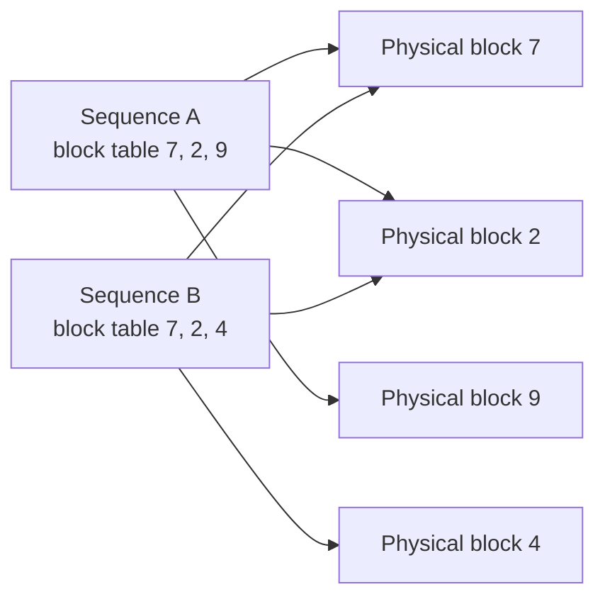
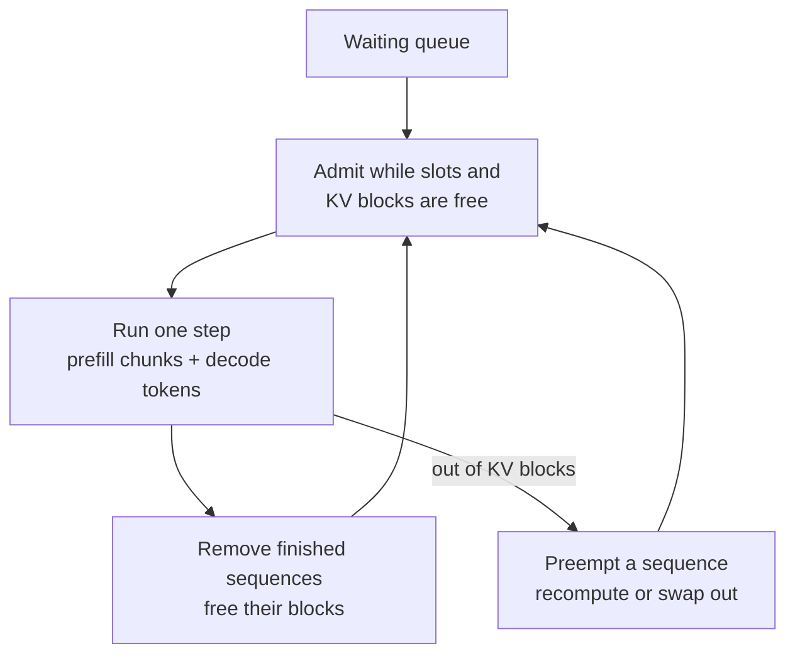
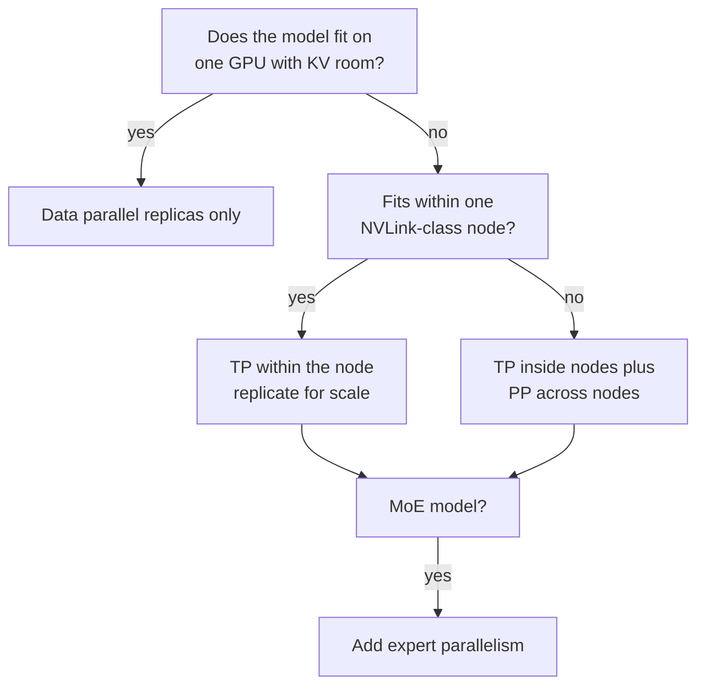
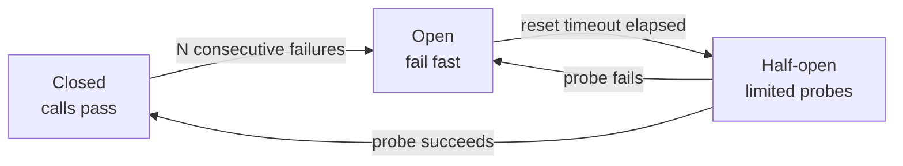

# Inference, Serving & Production LLM Systems - Deep Dive

This guide is for engineers who can already say "prefill is compute-bound, decode is memory-bound, use vLLM" and now want to derive the numbers behind those sentences: why a batch-1 decode step costs what it costs, how big the KV cache is and what a paged allocator does with it, what quantisation saves and what it breaks, when speculative decoding loses, how to turn a QPS target into a GPU count, and how to build the reliability layer around a provider call. [README.md](README.md) is the crash course (vocabulary, serving playbook, red flags) and [questions.md](questions.md) is the drill. This file supplies the arithmetic and mechanisms so that you can produce a number in an interview instead of recalling one.

Suggested study order, roughly 14-18 hours in total:

| Block | Parts | Hours |
|---|---|---|
| Hardware arithmetic and metrics | 1, 2, 3 | 4-5 |
| Memory and scheduling | 4, 5 | 3-4 |
| Making the model cheaper and faster | 6, 7, 8 | 4-5 |
| Operating it | 9, 10 | 3-4 |
| Exercises | see [exercises/README.md](exercises/README.md) | 4-6 (overlaps) |

Do the "Check yourself" questions after each part and run the matching exercise before moving on. All worked numbers use one fixed set of hardware assumptions (stated in Part 2) so that figures stay comparable across parts. They are round, vendor-neutral approximations of a current datacentre GPU, not benchmarks.

## Prerequisites

- Transformer shapes: layers, hidden size, attention heads, grouped-query attention, and what a parameter count means. See [../02-llm-fundamentals/deep-dive.md](../02-llm-fundamentals/deep-dive.md).
- Matrix multiplication cost (2 FLOPs per multiply-add) and softmax. See [../01-ml-and-dl-foundations/deep-dive.md](../01-ml-and-dl-foundations/deep-dive.md).
- How prompts are assembled and why prefix stability matters. See [../03-prompt-engineering-and-context/deep-dive.md](../03-prompt-engineering-and-context/deep-dive.md).
- Percentiles, golden sets and tracing, for SLOs and load tests. See [../07-evaluation-and-observability/deep-dive.md](../07-evaluation-and-observability/deep-dive.md).
- Whole-system design framing. See [../11-ai-system-design/deep-dive.md](../11-ai-system-design/deep-dive.md).
- Python and numpy. The exercises use nothing else.

## Contents

1. [Part 1 - The two phases and what a token costs](#part-1---the-two-phases-and-what-a-token-costs)
2. [Part 2 - Roofline: arithmetic intensity, ridge point and worked numbers](#part-2---roofline-arithmetic-intensity-ridge-point-and-worked-numbers)
3. [Part 3 - Latency metrics and how batching trades them](#part-3---latency-metrics-and-how-batching-trades-them)
4. [Part 4 - KV cache management: PagedAttention and prefix caching](#part-4---kv-cache-management-pagedattention-and-prefix-caching)
5. [Part 5 - Continuous batching, chunked prefill and scheduling](#part-5---continuous-batching-chunked-prefill-and-scheduling)
6. [Part 6 - Quantisation with memory and error math](#part-6---quantisation-with-memory-and-error-math)
7. [Part 7 - Speculative decoding economics](#part-7---speculative-decoding-economics)
8. [Part 8 - Parallelism: tensor, pipeline, expert and data](#part-8---parallelism-tensor-pipeline-expert-and-data)
9. [Part 9 - Capacity planning and cost modelling](#part-9---capacity-planning-and-cost-modelling)
10. [Part 10 - Production reliability: limits, retries, breakers, streaming](#part-10---production-reliability-limits-retries-breakers-streaming)
11. [Putting it together](#putting-it-together)
12. [Exercises](#exercises)
13. [Further study](#further-study)

---

## Part 1 - The two phases and what a token costs

### The problem

A decoder-only language model produces text one token at a time, and each token depends on every earlier token. A serving system has to make that sequential process cheap for thousands of concurrent users. Every optimisation in this folder follows from two facts about the model: how many FLOPs a token costs, and how many bytes must move to compute it.

### FLOPs per token

A dense transformer with P parameters performs about 2P FLOPs per token in its linear layers: each parameter takes part in one multiply and one add. Attention adds a term that grows with the context length n, but for moderate n it is small.

```
linear FLOPs per token      = 2 * P
attention FLOPs per token   = 4 * n_layers * d_model * n      (QK^T and AV, per generated token at context n)
```

For an 8B model (P = 8e9, 32 layers, d_model = 4096), one token at context 2,000 costs 16 GFLOP in the linear layers and 4 * 32 * 4096 * 2000 = 1.05 GFLOP in attention, so attention is 6% of the total. At context 128,000 the attention term is 67 GFLOP, four times the linear term. Long contexts change the cost structure, not just the memory bill.

### Bytes per token

To compute a token the GPU must read every weight that participates in it. For a dense model that is all P weights, at the stored precision:

```
weight bytes = P * bytes_per_param           8B at FP16 = 16 GB,  70B at FP16 = 140 GB
```

Decode also reads the KV cache of the sequence being extended (Part 4). Prefill reads the weights once for the whole prompt.

### Two phases, one model

- **Prefill** processes the n_prompt prompt tokens in a single forward pass. The weights are read once and used for n_prompt tokens, so the FLOPs-per-byte ratio is high. Prefill is a stack of large matrix-matrix multiplies and is **compute-bound** once the prompt is a few hundred tokens or longer.
- **Decode** produces one token per sequence per step. The weights are read once and used for as many tokens as there are sequences in the batch. At batch 1 that is one token per full weight read: a matrix-vector product, **memory-bandwidth-bound**.

The same 16 GB of weights serves 2,000 tokens in prefill and 1 token in batch-1 decode. That ratio of 2,000 to 1 is the whole story of why the two phases behave differently.

### Prefill is not free of quadratic cost

The linear layers scale with n_prompt. Causal attention scales with n_prompt squared. For the 8B shape above:

| Prompt tokens | Linear FLOPs (2 P n) | Attention FLOPs (~2 d_model n^2 per layer, causal) | Attention share |
|---|---|---|---|
| 2,048 | 3.3e13 | 1.1e12 | ~3% |
| 32,768 | 5.2e14 | 2.8e14 | ~35% |
| 131,072 | 2.1e15 | 4.5e15 | ~68% |

The causal mask halves the full 4 d_model n^2 per layer to about 2 d_model n^2. At 128K tokens attention dominates prefill, which is why long-context prefill is expensive and why FlashAttention-style kernels (which avoid materialising the n x n score matrix in HBM) matter most there. They change memory traffic, not the FLOP count.

### What this means for the rest of the guide

| Phase | Work per step | Bound by | Latency metric it drives |
|---|---|---|---|
| Prefill | 2 P n_prompt FLOPs, one weight read | Compute (peak FLOP/s) | TTFT |
| Decode | 2 P B FLOPs for B sequences, one weight read plus B KV reads | Memory bandwidth | TPOT / ITL |

### Common misconceptions

- "A bigger GPU makes decode proportionally faster." Decode scales with memory bandwidth, not FLOP/s. Moving between two GPUs with equal bandwidth and 3x different FLOP/s barely changes batch-1 decode.
- "Prefill and decode are the same operation with different lengths." Both are the same matrices, but the arithmetic intensity differs by orders of magnitude, so they need different batching and sometimes different hardware.

### Check yourself

1. How many FLOPs does one token cost in a 70B dense model, ignoring attention?

<details><summary>Answer</summary>

About 2 x 70e9 = 140 GFLOP. Each parameter contributes one multiply and one add.

</details>

2. Why is attention a small share of FLOPs at 2K context but a large share at 128K?

<details><summary>Answer</summary>

Linear-layer FLOPs per token are constant (2P), while attention FLOPs per token grow linearly with the context length. In prefill the total attention cost grows with the square of the prompt. In the 8B example the attention-to-linear ratio per generated token is 1.05 GFLOP to 16 GFLOP at 2K and 67 GFLOP to 16 GFLOP at 128K.

</details>

3. Prefill reads the weights once for 2,000 tokens. What does that tell you about its arithmetic intensity relative to batch-1 decode?

<details><summary>Answer</summary>

The same bytes serve about 2,000 times more FLOPs, so prefill intensity is roughly 2,000 times higher: about 2,000 FLOPs per byte at FP16 against about 1 for batch-1 decode. That puts prefill well above the ridge point (~300 FLOPs per byte on the hardware used here) and decode far below it.

</details>

---

## Part 2 - Roofline: arithmetic intensity, ridge point and worked numbers

### The model

The roofline model says a kernel's time is at least the larger of two times:

```
t_compute = FLOPs / peak_FLOPs_per_s
t_memory  = bytes moved / memory_bandwidth
t         >= max(t_compute, t_memory)
```

**Arithmetic intensity** is FLOPs divided by bytes moved. The **ridge point** is the intensity at which the two times are equal: peak_FLOPs / bandwidth. A kernel with intensity below the ridge is memory-bound (its speed is set by bandwidth). A kernel above the ridge is compute-bound.

### Hardware assumptions used in this guide

These are round figures for a current datacentre GPU in the H100 class. Treat them as ~ values.

```
peak dense BF16/FP16 compute   ~ 989e12 FLOP/s
HBM bandwidth                  ~ 3.35e12 B/s
HBM capacity                   ~ 80e9 B
ridge point                    = 989e12 / 3.35e12 = ~295 FLOPs per byte
NVLink (per GPU, per direction) ~ 450e9 B/s
```

Real kernels achieve a fraction of peak: ~60-80% of bandwidth and ~30-60% of peak FLOP/s (called MFU, model FLOPs utilisation) are typical. The exercises and examples make this an explicit efficiency parameter.

### Decode at batch B

For B sequences, each with c cached tokens, using the 8B shape (P = 8e9, FP16 weights, 32 layers, 8 KV heads, head_dim 128, so 131,072 bytes of KV per token, derived in Part 4):

```
FLOPs  = 2 * P * B                       = 16e9 * B
bytes  = P * 2 + B * c * 131072          = 16e9 + B * c * 131072
```

Weight-only case (c = 0):

| Batch B | FLOPs | Bytes | Intensity | t_compute | t_memory | Step time | Tokens/s |
|---|---|---|---|---|---|---|---|
| 1 | 16e9 | 16e9 | 1.0 | 0.016 ms | 4.78 ms | 4.78 ms | ~209 |
| 8 | 128e9 | 16e9 | 8.0 | 0.13 ms | 4.78 ms | 4.78 ms | ~1,675 |
| 64 | 1.02e12 | 16e9 | 64 | 1.04 ms | 4.78 ms | 4.78 ms | ~13,400 |
| 295 | 4.72e12 | 16e9 | 295 | 4.77 ms | 4.78 ms | 4.78 ms | ~61,800 |
| 512 | 8.19e12 | 16e9 | 512 | 8.28 ms | 4.78 ms | 8.28 ms | ~61,800 |

Read the table in three observations.

1. **Batch-1 decode is capped by bandwidth.** 16 GB / 3.35 TB/s = 4.78 ms per token, about 209 tokens per second, regardless of how much compute the GPU has. This is the ceiling quoted in the README (a 70B FP16 model needs 140 GB read per token, ~24 tok/s on one GPU's worth of bandwidth).
2. **Batching is nearly free until the ridge.** Step time stays 4.78 ms from B = 1 to B = 295, so throughput scales linearly with batch size. Intensity at batch B is 2 P B / (2 P) = B for FP16 weights, so the ridge-crossing batch is simply the ridge point: ~295.
3. **Past the ridge, throughput plateaus** at peak FLOP/s / (2 P) = 989e12 / 16e9 = ~61,800 tokens/s for this model. More batch only adds latency.

### KV traffic changes the picture

Now add context. Each sequence at c = 2,000 reads 2,000 x 131,072 = 262 MB of KV per step, and that read is per sequence: it is not shared across the batch the way weights are.

```
per-sequence compute  = 16e9 FLOP   / 989e12 = 16.2 us
per-sequence KV read  = 262e6 bytes / 3.35e12 = 78.2 us
```

The KV read costs about 4.8 times the compute for each added sequence. So with c = 2,000 the memory time grows faster than the compute time as B grows, and decode **never becomes compute-bound at any batch size**:

| Batch B (c = 2,000) | Bytes | t_memory | t_compute | Step time | Tokens/s |
|---|---|---|---|---|---|
| 1 | 16.26e9 | 4.85 ms | 0.016 ms | 4.85 ms | ~206 |
| 32 | 24.39e9 | 7.28 ms | 0.52 ms | 7.28 ms | ~4,400 |
| 128 | 49.5e9 | 14.8 ms | 2.1 ms | 14.8 ms | ~8,650 |

Throughput still rises with B because the fixed weight read is amortised, but the curve flattens as KV traffic dominates: at B = 128 the KV read (33.5 GB) is twice the weight read. This is the quantitative reason that **KV cache size, not weights, governs long-context serving cost**, and why GQA, KV quantisation and short contexts all raise throughput.

Intuition for why attention never escapes: every KV element is used for the query heads in its group only. With 32 query heads and 8 KV heads, each K or V element (2 bytes) feeds 4 query heads at 2 FLOPs each, so attention decode runs at about 4 FLOPs per byte whatever the batch. The ridge is ~295.

### Prefill

For T prompt tokens the weights are read once:

```
t_compute = 2 * P * T / peak = 16e9 * T / 989e12 = 16.2 us per token
t_memory  = 16e9 / 3.35e12  = 4.78 ms (fixed)
```

T = 295 is the crossover. A 2,000-token prompt costs 32e12 FLOP, or 32.4 ms at peak and about 81 ms at a realistic 40% MFU. That is the time cost of ~6.8 batch-1 decode steps at the ideal peak. It sets the **floor on TTFT** for that prompt on this hardware, before any queueing.

### What quantisation does to the roofline

Halving bytes per weight halves t_memory but not t_compute. With INT4 weights (0.5 bytes), intensity at batch B is 4B, so the crossover batch falls from ~295 to ~74. Quantisation therefore helps latency at low batch (fewer bytes to read), and at high batch it helps only if the matmuls themselves also run in a lower precision (Part 6).

### Check yourself

1. An 8B model at INT8 weights, batch 1, empty cache, on 3.35 TB/s. What is the decode ceiling?

<details><summary>Answer</summary>

Bytes per token = 8e9, so the step time is 8e9 / 3.35e12 = 2.39 ms and the ceiling is ~419 tokens per second, double the FP16 figure (the weights are half as large).

</details>

2. At what batch size does FP16 weight-only decode become compute-bound on this GPU, and what happens to throughput after that?

<details><summary>Answer</summary>

At B ~ 295, the ridge point. Beyond it step time grows linearly with B, so throughput is flat at ~61,800 tokens per second for the 8B model and each additional sequence only adds latency.

</details>

3. Why does adding KV cache (c = 2,000) prevent decode from ever becoming compute-bound in the 8B example?

<details><summary>Answer</summary>

Each sequence adds 16.2 us of compute but 78.2 us of KV read time. Memory time grows about 4.8 times faster than compute time with batch, so the memory term stays larger at every B. Weight reads amortise over the batch, but KV reads do not.

</details>

4. A prefill of 100 tokens on the 8B model: compute-bound or memory-bound?

<details><summary>Answer</summary>

Memory-bound. 100 tokens cost 1.6e12 FLOP, which is 1.6 ms at peak, while reading the 16 GB of weights takes 4.78 ms. Prefill needs more than ~295 tokens to become compute-bound, so short prompts in an otherwise idle server do not use the GPU well.

</details>

---

## Part 3 - Latency metrics and how batching trades them

### Definitions

| Metric | Definition | What drives it |
|---|---|---|
| **TTFT** | Time from request arrival to first output token | Queue wait + prefill time (prompt length, prefix cache hit) + first decode step |
| **TPOT / ITL** | Time per output token after the first. ITL is the gap between consecutive tokens as the client sees them | Decode step time: weights + KV bytes over bandwidth, batch size, any interleaved prefill |
| **E2E latency** | TTFT + (n_out - 1) x TPOT | Both |
| **Throughput** | Tokens per second across all requests, input and output counted separately | Batch size, hardware, quantisation |
| **Goodput** | Requests (or tokens) per second that meet the SLO | Scheduler quality and load |

TPOT is a mean per request. ITL percentiles describe the worst gaps and are what users feel as stutter. A system can have a good mean TPOT and a poor P99 ITL if prefills periodically interrupt decode (Part 5).

### Batching trades throughput for per-user speed

Use a simple, calibratable model of one decode step with n sequences:

```
step_time(n) = t0 + t1 * n
t0 = fixed per step (weight read, kernel launches)       e.g. 20 ms
t1 = incremental cost per sequence (KV read, extra compute) e.g. 0.5 ms
```

Then ITL equals step_time(n) and aggregate decode throughput is n / step_time(n):

| Batch n | ITL (ms) | Per-user tokens/s | Aggregate tokens/s |
|---|---|---|---|
| 1 | 20.5 | 48.8 | 49 |
| 8 | 24.0 | 41.7 | 333 |
| 32 | 36.0 | 27.8 | 889 |
| 64 | 52.0 | 19.2 | 1,231 |
| 128 | 84.0 | 11.9 | 1,524 |
| 256 | 148.0 | 6.8 | 1,730 |

Going from batch 1 to 64 multiplies aggregate throughput by 25 while ITL grows 2.5 times. From 64 to 256 throughput grows 40% while ITL grows 2.8 times. The asymptote is 1 / t1 = 2,000 tokens per second. This is the "knee": the useful operating region is where marginal throughput per added ms of ITL is still high.

Choosing the operating point from an SLO: with an ITL SLO of 50 ms, the largest batch is 60 (20 + 0.5 x 60 = 50 ms), giving 60 / 0.050 = 1,200 tokens per second. Tightening the SLO to 30 ms caps the batch at 20 and throughput at 667 tokens per second. **The SLO, not the hardware, picks the batch.**

### Little's law links concurrency to latency

For any stable system:

```
L = lambda * W        in-flight requests = arrival rate x time in system
```

Worked example: 40 requests per second, each taking 8 seconds end to end, means 320 requests in flight. That 320 is the concurrency your KV memory must hold (Part 4) and the minimum batch capacity of the fleet. If a latency regression raises W from 8 s to 12 s at the same arrival rate, in-flight requests rise to 480 without any traffic increase, which can push a fleet that was at 70% KV usage over its memory limit. Exercise 7 uses this.

### Queueing makes the tail

Even with constant service times, random arrivals create waiting. For an M/M/1 queue (one server, Poisson arrivals, exponential service) the mean wait is rho / (1 - rho) times the mean service time. Doubling utilisation from 45% to 90% multiplies the wait by 11. For the sojourn time in M/M/1 with service rate mu = 10 per second and arrival rate 8 per second (rho = 0.8): mean = 1 / (mu - lambda) = 0.5 s, and the P99 = ln(100) / (mu - lambda) = 2.3 s, 4.6 times the mean. Real LLM servers batch many sequences, so they behave more like a pooled multi-server queue, which is far better than separate queues at the same load, but the shape holds: **latency has a knee, and you must provision to stay left of it** (target 60-70% of saturation).

### Goodput

Raw throughput can be improved by letting TTFT grow, which is useless for chat. Define goodput as the rate of requests that meet all SLOs, for example TTFT P99 below 800 ms and ITL P99 below 60 ms. Plot goodput against offered load: it rises, peaks and then falls as more requests miss their SLO. The capacity you plan for is the peak goodput, not the peak throughput.

### Check yourself

1. Using step_time = 20 + 0.5 n ms, what batch gives 1,000 tokens per second?

<details><summary>Answer</summary>

n / (0.020 + 0.0005 n) = 1,000 gives n = 20 + 0.5 n, so n = 40. ITL at that point is 40 ms.

</details>

2. 25 requests per second, each in the system for 12 s on average. How many concurrent requests, and what KV memory at 1,800 tokens each and 320 KiB per token?

<details><summary>Answer</summary>

L = 25 x 12 = 300 requests. KV = 300 x 1,800 x 327,680 bytes = 177 GB, so at least three 80 GB GPUs' worth of free KV space before weights, even at this modest load.

</details>

3. Why does a system at 90% utilisation have much worse tail latency than at 45%, even though only twice as busy?

<details><summary>Answer</summary>

Queueing delay scales as rho / (1 - rho). At 45% that is 0.82 service times, at 90% it is 9, about 11 times more. Any burst above the mean pushes the system toward saturation where the queue grows without bound until the burst ends.

</details>

4. A change increases throughput by 20% and P99 TTFT from 600 ms to 2 s. Is it an improvement?

<details><summary>Answer</summary>

Not for an interactive product with a sub-second TTFT SLO. Goodput probably fell, because requests that used to meet the SLO now miss it. For an offline batch job, where only throughput matters, it would be an improvement.

</details>

---

## Part 4 - KV cache management: PagedAttention and prefix caching

### What the cache stores and why

At each layer, attention needs the keys and values of every previous token. Recomputing them for every new token would make generating n tokens cost O(n^2) forward passes of work. Storing them makes each step cost one token's worth of projection plus a read of the cache. The price is memory.

```
KV bytes per token = 2 (K and V) * n_layers * n_kv_heads * head_dim * bytes_per_element
```

| Model shape | Calculation | Per token | 8K context | 128K context |
|---|---|---|---|---|
| 8B (32 layers, 8 KV heads, 128, FP16) | 2 x 32 x 8 x 128 x 2 | 131,072 B (128 KiB) | 1.07 GB | 17.2 GB |
| 70B (80 layers, 8 KV heads, 128, FP16) | 2 x 80 x 8 x 128 x 2 | 327,680 B (320 KiB) | 2.68 GB | 42.9 GB |
| 70B, FP8 KV | 2 x 80 x 8 x 128 x 1 | 163,840 B | 1.34 GB | 21.5 GB |
| 70B with full multi-head attention (64 KV heads) | 2 x 80 x 64 x 128 x 2 | 2,621,440 B | 21.5 GB | 344 GB |

GQA with 8 KV heads cuts the cache 8 times against full multi-head attention at 64 heads. MLA (a low-rank compressed KV) cuts it further. Hybrid architectures that replace most attention layers with state-space or linear-attention layers keep a fixed-size state per layer instead of a cache that grows with context, which changes the budget calculation in Part 9.

### The memory budget

```
usable memory   = mem_util * HBM          (0.85-0.92 is typical, leaving room for activations and the runtime)
KV capacity     = usable memory - weights - activation workspace
max concurrent tokens = KV capacity / bytes per token
```

Worked example: 70B model with FP8 weights (70 GB) on two 80 GB GPUs, mem_util 0.9: 0.9 x 160 = 144 GB usable, 74 GB for KV (ignoring ~1-4 GB workspace), so 74e9 / 327,680 = **225,830 tokens** can be cached. At 1,800 tokens per sequence (1,500 in, 300 out) that is **125 concurrent sequences**. Concurrency is a memory number, not a compute number.

### The fragmentation problem

The naive allocator reserves a contiguous buffer per sequence sized for the maximum length, because the output length is unknown when the request starts. Suppose max_len = 4,096 and the average sequence actually uses 900 tokens:

```
reserved per sequence = 4096 tokens
used on average       = 900 tokens (22%)
wasted                = 78%, of which most is "reserved but not yet written" (internal fragmentation)
```

Contiguous allocation also suffers external fragmentation: free space exists but not in a large enough contiguous run. The PagedAttention paper (see Further study) reported that earlier systems used only ~20-40% of KV memory for actual token states. Both numbers translate directly into a smaller batch, so lower throughput.

### PagedAttention: virtual memory for KV

The fix borrows from operating systems.

- Divide KV memory into fixed-size **blocks** of b tokens (16 is common). For the 70B model one block is 16 x 320 KiB = 5 MiB.
- Each sequence has a **block table**: a list mapping logical block index to physical block id. A 2,000-token sequence has 125 table entries.
- Blocks are allocated on demand as tokens are generated. Any free block can extend any sequence, so there is no external fragmentation.
- The attention kernel is written to gather K and V through the block table instead of assuming contiguous memory.

Internal waste is at most one partial block per sequence, on average b/2 = 8 tokens, under 1% for 1,800-token sequences. Moving from ~22% to ~99% utilisation multiplies feasible concurrency by up to ~4.5 on this workload, which is the main source of PagedAttention's throughput gains.



Sequences A and B share their first two blocks (a common prompt prefix) and diverge afterwards. Shared blocks have reference count 2.

### Reference counts and copy-on-write

Because a block can be referenced by several sequences, each carries a **reference count**. Two situations create sharing:

1. **Parallel sampling and beam search.** Several continuations of one prompt share the prompt blocks. The partially filled last block is shared too. When one continuation appends a token to a block with ref_count > 1, the allocator **copies on write**: it takes a fresh block, copies the contents, drops one reference on the old block and writes to the copy. The other continuation then owns the original and writes in place.
2. **Prefix caching** (below).

Exercise 2 builds exactly this: a block allocator with reference counts, block tables, copy-on-write, and prefix sharing.

### Prefix caching

If two requests start with the same tokens, the keys and values of those tokens are identical (causal attention means a token's K and V depend only on earlier tokens). So the KV blocks can be reused and the prefill for that prefix skipped.

The mechanism at block granularity:

```
hash(block_i) = H(hash(block_{i-1}), tokens_in_block_i)      (chained hash)
```

A block is identified by its own tokens **and everything before it**. The chain matters: the tokens [4, 5, 6, 7] after one prefix have different K and V than the same tokens after another prefix. On a new request, compute the chain of hashes for its full blocks, look each up, and reuse the longest contiguous run of hits from the start. Prefill then runs only for the remaining tokens.

Properties to know:

- **Granularity is one block.** A 1,030-token shared prefix with 16-token blocks caches 64 blocks = 1,024 tokens. The partial block is recomputed.
- **Freed blocks stay in the cache** until memory pressure evicts them, typically least-recently-used first. A prefix that one user used a minute ago is still warm for the next user.
- **Radix-tree variants** (as in SGLang's RadixAttention) store prefixes in a tree and share common ancestors across many requests, with the same underlying idea.
- **The prefix must be an exact token match** from the first token. A timestamp, request id or per-user greeting at the top of the system prompt destroys sharing. Put stable content first and variable content last.

Worked example: 100 concurrent requests share a 2,000-token system prompt on the 70B model.

```
Without sharing: 100 x 2,000 x 327,680 B = 65.5 GB of KV for the prompt copies
With sharing:     1 x 2,000 x 327,680 B  =  0.66 GB (125 blocks), referenced 100 times
KV saved: ~64.9 GB, room for ~110 more concurrent 1,800-token sequences
Prefill saved: 99 of 100 requests skip 2,000 tokens x 140 GFLOP = 2.8e14 FLOP each
```

The compute saving shows up as lower TTFT and higher capacity (Part 9 shows capacity more than doubling at a 67% hit rate). The memory saving shows up as larger batch.

### Eviction, tiers and routing

- **Eviction** is LRU over blocks with ref_count 0. Blocks in use by running sequences cannot be evicted.
- **Tiers.** Cold blocks can be offloaded to CPU memory, NVMe or a shared store. Reloading beats recomputing when the prefix is long and the transfer path is fast. For a 10,000-token prefix on the 70B model, prefill is about 1.4e15 FLOP, around 0.44 s on 8 GPUs at 40% MFU. Reloading 3.3 GB over a ~50 GB/s path takes about 65 ms.
- **Cache-aware routing.** With N replicas and round-robin, a prefix is warm on only 1/N of requests after a cold start. Route by prefix hash or by reported cache state, with a load cap so a popular prefix does not overload one replica.
- **API prompt caching** is the same mechanism billed differently. Providers discount cached input tokens and some add a write fee and a TTL. Check each provider's current price page, since multipliers vary by model generation.

### Check yourself

1. Compute the KV bytes per token for a model with 60 layers, 8 KV heads, head_dim 128 and FP8 KV.

<details><summary>Answer</summary>

2 x 60 x 8 x 128 x 1 = 122,880 bytes per token (120 KiB).

</details>

2. With 16-token blocks, a 700-token prompt shares its first 650 tokens with a cached prefix. How many tokens does prefill still process?

<details><summary>Answer</summary>

650 / 16 = 40.6, so 40 full blocks match = 640 tokens. Prefill processes 700 - 640 = 60 tokens. The 10 tokens in the partial block of the shared prefix are recomputed.

</details>

3. Why must the hash of a block include the previous block's hash?

<details><summary>Answer</summary>

Because a token's K and V depend on all earlier tokens. The same four tokens appearing after different prefixes have different cached values. A hash of only the block's own tokens would let two different histories collide on the same cached block and corrupt the output.

</details>

4. Two beams share a partially filled last block (ref_count 2) and the first beam appends a token. What exactly happens?

<details><summary>Answer</summary>

Copy on write. The allocator takes a free block, copies the existing tokens' KV into it, decrements the old block's ref_count to 1, points the first beam's table at the copy and writes the new token there. The second beam keeps the original block and writes in place later without any copy.

</details>

---

## Part 5 - Continuous batching, chunked prefill and scheduling

### Static batching and the convoy effect

The simplest scheme gathers up to B requests, runs them together until every one has finished, then starts the next group. Output lengths vary, so short requests finish early and their slots idle until the longest request in the batch finishes. Worse, a short request's result is held until the batch ends.

Worked example with step_time(n) = 20 ms + 0.5 ms x n and two simultaneous requests of 2 and 10 output tokens:

```
step(2) = 21 ms
Static:      both requests return at 10 x 21 ms = 210 ms
Continuous:  short request leaves after 2 x 21 = 42 ms
             long request: 42 + 8 x step(1) = 42 + 8 x 20.5 = 206 ms
```

The short request is five times faster, the long one slightly faster too, and the slot freed at 42 ms can be given to a waiting request.

### Continuous batching

Orca introduced **iteration-level scheduling**: the batch is re-formed at every decode step. Before each step, the scheduler admits waiting requests if there are free slots and free KV blocks. After each step, finished sequences leave. Slots never sit idle while a queue exists.



The gain grows with the variance in output length. With uniform lengths and a full queue, static and continuous batching perform the same (a test in Exercise 4). With a workload of 80% short answers and 20% long ones it is several times better in throughput and much better for short requests' latency. Exercise 4 simulates this.

### Memory-aware admission and preemption

Admission needs a policy because output length is unknown at admission time.

- **Reserve for the worst case** (prompt + max_tokens): never preempts, but admits few requests, as in the old contiguous scheme.
- **Reserve for the prompt and grow on demand**: admits many requests, and may run out of blocks mid-generation.

When blocks run out, the scheduler **preempts** a sequence (usually the lowest priority or most recently admitted). Two options: **recompute** (drop its KV, requeue it, redo prefill later) or **swap** (move blocks to CPU memory and back). Recompute is simple and cheap for short sequences. Swap pays off for long ones if the transfer path is fast. Frequent preemption signals that the batch cap is too high for the memory, and it appears as unexplained TTFT P99 growth and wasted compute. Watch the preemption counter.

### The prefill interference problem

A 32,768-token prompt on the 8B model costs 5.2e14 FLOP of linear work plus 2.8e14 of attention (Part 1), or about 8e14, which is ~1.6 s at 50% of peak. If the scheduler runs that prompt as one prefill step, **every running decode sequence stalls for ~1.6 s**: an ITL spike of 1.6 s instead of ~25 ms. The decode streams freeze, and the P99 ITL is dominated by other users' prompts.

### Chunked prefill

Sarathi-Serve's fix is to give each iteration a **token budget** (say 512) and fill it with decode tokens first (one per running sequence) and then prefill chunks from waiting prompts.

```
iteration budget = 512 tokens
decode tokens    = 100 running sequences x 1 token = 100
prefill chunk    = 412 tokens of the long prompt
```

The long prompt takes about 80 iterations (32,768 / 412) to finish prefill, and each iteration is only a few milliseconds longer than a pure decode step. Costs and benefits:

- ITL stays stable for everyone, since no step is huge.
- The long prompt's own TTFT grows slightly (it shares iterations with decode work).
- Total throughput often improves, because mixing compute-heavy prefill tokens with bandwidth-bound decode tokens fills both resources in the same iteration: the decode tokens use the weight read that the prefill tokens already pay for.

The chunk size is a tuning knob. Smaller chunks protect ITL but lengthen the long prompt's TTFT and add per-iteration overhead.

### Check yourself

1. In the static example above, why is the long request's latency better under continuous batching even though it needs the same number of tokens?

<details><summary>Answer</summary>

After the short request leaves at step 2, the batch has one sequence and steps cost 20.5 ms instead of 21 ms. The effect is small (206 ms against 210 ms). The big winners are the short request and any request waiting for the freed slot.

</details>

2. What would you watch to detect that the batch cap is too high for the KV memory?

<details><summary>Answer</summary>

The preemption or recompute counter, KV cache utilisation sitting near 100%, and TTFT P99 spikes. Throughput can look fine while redone prefill wastes compute.

</details>

3. With a 512-token iteration budget and 100 running sequences, how many iterations does a 20,000-token prompt need to finish prefill?

<details><summary>Answer</summary>

Each iteration has 412 tokens left for prefill after 100 decode tokens, so 20,000 / 412 = 48.5, which rounds up to 49 iterations.

</details>

4. Why can mixing prefill and decode in one iteration raise throughput?

<details><summary>Answer</summary>

Decode is bandwidth-bound and leaves compute idle, while prefill is compute-bound. In one iteration the weights are read once for both, so the prefill tokens' compute fills the otherwise idle FLOP capacity of the decode step.

</details>


---

## Part 6 - Quantisation with memory and error math

### What is being quantised

Three different tensors can be stored at lower precision, and they have different effects.

| Target | Saves | Speeds up | Main risk |
|---|---|---|---|
| **Weights** (W8, W4) | Weight memory and weight bandwidth | Bandwidth-bound decode | Accuracy loss from rounding |
| **Activations** (A8) | Nothing stored long-term. Enables low-precision matmul | Compute-bound work: prefill, large batches | Activation outliers |
| **KV cache** (FP8, INT8, lower) | Cache memory and KV bandwidth | Long-context decode, larger batch | Long-context retrieval accuracy |

Notation: W4A16 means 4-bit weights with 16-bit activations. The weights are dequantised to 16 bits inside the kernel and the matmul runs in 16 bits. W8A8 means both operands are 8-bit and the matmul runs on 8-bit tensor cores.

### Memory math

```
weight memory = P * bits_per_weight / 8
```

| Model | FP16 | INT8 / FP8 | INT4 (group 128, ~4.125 bits) |
|---|---|---|---|
| 8B | 16 GB | 8 GB | 4.1 GB |
| 70B | 140 GB | 70 GB | 36.1 GB |

The "4-bit" in INT4 is really 4.125 bits per weight with a 16-bit scale per group of 128 (4 + 16/128). With group size 32 it is 4.5 bits, with group size 64 it is 4.25. Smaller groups track the local weight scale better and cost more bits. Adding a 4-bit zero point per group (asymmetric) costs another 4/128 = 0.03 bits.

A 70B model drops from two GPUs to one at INT4, which frees an entire GPU's worth of memory for KV: on an 80 GB card, 0.9 x 80 - 36.1 = 35.9 GB for KV, or 109,600 tokens at 320 KiB per token.

### Speed math

Decode at batch 1 reads all the weights each step. For 8B at INT4 group 128:

```
bytes per token = 8e9 * 4.125 / 8 = 4.125 GB
step time       = 4.125e9 / 3.35e12 = 1.23 ms  ->  ~812 tokens/s
FP16 baseline   = 4.78 ms                      ->  ~209 tokens/s     (3.9x)
```

The speedup is just the byte ratio. It is measured against the roofline, not against peak FLOPs, so it applies in the memory-bound regime. At large batch, or in prefill, the matmuls dominate and W4A16 helps little (the kernel still computes in 16-bit and pays dequantisation overhead). That is why W8A8 (INT8 or FP8) matters for throughput-oriented serving: it speeds the matmul as well. FP8 tensor cores run at about twice the FP16 FLOP rate on current hardware, so FP8 weights and FP8 compute double both the ridge-side compute and halve the bytes, and the crossover batch stays near 295 while every step gets about twice as fast.

### The error model

Uniform quantisation with step size D rounds each value to the nearest level, so the error is roughly uniform on [-D/2, D/2] with variance D^2 / 12. For symmetric b-bit quantisation of a tensor with maximum magnitude amax, D = amax / (2^(b-1) - 1).

Worked example for weights ~ N(0, sigma^2) with amax ~ 4 sigma:

```
INT8:  D = 4 sigma / 127 = 0.0315 sigma    MSE = D^2/12 = 8.3e-5 sigma^2    SQNR ~ 40.8 dB
INT4:  D = 4 sigma / 7   = 0.571 sigma     MSE = D^2/12 = 2.7e-2 sigma^2    SQNR ~ 15.7 dB
```

Each bit buys about 6 dB (factor 4 in MSE). INT4 has 330 times the MSE of INT8 on the same data. That is why 8-bit is almost lossless and 4-bit needs care.

### Outliers: why one weight ruins a tensor

The scale is set by the maximum, so a single outlier inflates D for everyone. Suppose a tensor has sigma = 0.02 but one weight is 1.2 (60 sigma). Per-tensor INT4 gives D = 1.2 / 7 = 0.171, which is 8.6 sigma: every ordinary weight rounds to zero. The remedy is **group-wise** quantisation: one scale per group of 32-128 consecutive weights, so an outlier only damages its own group. Exercise 3 reproduces this and shows the MSE falling by a large factor as groups get smaller, at the cost of more scale bits.

Per-channel scales (one per output row) are the intermediate option and are standard for INT8 weights.

### Symmetric versus asymmetric

- **Symmetric**: q = round(x / s), zero maps to zero, range [-amax, +amax]. Simple and fast.
- **Asymmetric**: q = round(x / s) + z with a zero point z, range [min, max]. It spends all levels on the observed range.

For one-sided data such as ReLU outputs in [0, 6], symmetric INT8 only uses the positive half, 128 levels instead of 256, so its step is twice as large and MSE four times larger. Asymmetric quantisation fixes that. Weights are roughly symmetric, so weight quantisation is mostly symmetric, while some activation quantisation needs the zero point.

### Weight-only post-training methods

Round-to-nearest (RTN) quantises each weight independently and is a decent baseline at 8 bits and mediocre at 4. Two ideas improve 4-bit:

- **GPTQ** quantises a layer's weights one column at a time and, after rounding each column, **updates the not-yet-quantised columns to compensate for the error**, using second-order information from the layer's input statistics (the Hessian of the layer's squared output error, H = 2 X X^T from a small calibration set). The goal is to minimise ||W X - W_q X||^2 on real inputs rather than the raw weight error.
- **AWQ** observes that a small fraction of weight channels (roughly 1%) matter far more because they multiply large activations. Quantisation error in such a channel is amplified by the activation. AWQ scales those channels' weights up before quantisation (and the matching activations down), which reduces their relative rounding error, without mixed precision. The scale is chosen by a search on calibration activation statistics.

Both are calibrated on a few hundred sample sequences. Calibration data that does not resemble your traffic is a known source of silent quality loss in domain-specific deployments.

GGUF k-quants (the llama.cpp ecosystem) use block-wise scales with mixed precisions per tensor type and are the practical equivalent for CPU and Apple Silicon.

### Activation quantisation and its outlier problem

In W8A8 the activations are quantised per tensor or per token at run time. Transformer activations have a few channels with magnitudes tens of times larger than the rest. With a per-tensor scale set by those channels, the other channels lose almost all resolution. In Exercise 3, one activation channel scaled by 60 causes the relative error on the remaining channels to grow by well over 10 times. Fixes include per-token scales, moving the difficulty from activations into weights by a per-channel rescale (the idea behind SmoothQuant), rotations that spread outliers, and keeping a few sensitive layers at higher precision.

### What to evaluate

Perplexity on a generic corpus hides task-specific damage. Evaluate quantised models on your own task set: long-context retrieval, code, multilingual, tool-call formatting, and numeric reasoning tend to degrade first. Rough expectations, to be verified per model: 8-bit is usually indistinguishable, good 4-bit weight-only shows small measurable loss, and below 4 bits quality drops quickly. A bigger quantised model usually beats a smaller full-precision model at the same memory, but check that on your task.

### Check yourself

1. How much memory does a 13B model need at INT4 with group size 64, ignoring non-weight tensors?

<details><summary>Answer</summary>

Bits per weight = 4 + 16/64 = 4.25. Memory = 13e9 x 4.25 / 8 = 6.9 GB.

</details>

2. Why does W4A16 speed up batch-1 decode by close to 4 times but give little benefit for a 4,000-token prefill?

<details><summary>Answer</summary>

Batch-1 decode is bandwidth-bound and time is proportional to bytes read, which falls by about 3.9 times. A 4,000-token prefill is compute-bound, so the time depends on FLOPs and the precision of the matmul. W4A16 still computes in 16-bit and adds dequantisation work, so the time is about the same or slightly worse.

</details>

3. Per-tensor symmetric INT8 on a tensor with sigma = 1 and one outlier at 100. What is the step size and what happens to ordinary values?

<details><summary>Answer</summary>

D = 100 / 127 = 0.79. A typical value of size 1 is represented by about one or two levels, giving errors of up to 0.39, which is a large fraction of sigma. Normal values lose most of their resolution because of one outlier.

</details>

4. Why is asymmetric quantisation useful for post-ReLU activations?

<details><summary>Answer</summary>

Post-ReLU values are non-negative. Symmetric quantisation wastes the negative half of the integer range, using about 128 levels. Asymmetric quantisation with a zero point spans [0, max] with all 256 levels, halving the step size and cutting MSE by about four times.

</details>

---

## Part 7 - Speculative decoding economics

### The problem

Decode is bandwidth-bound: at small batch the GPU spends most of each step waiting on weight reads and uses a sliver of its compute. Verifying several tokens in one pass costs almost the same time as generating one, because the weights are read once either way. Speculative decoding exploits this idle compute.

### The algorithm

1. A cheap **drafter** proposes k tokens autoregressively, each from its own distribution q.
2. The **target** model scores all k proposed tokens (plus one more position) in a single forward pass, giving its distributions p at every position.
3. Walk through the proposals in order. Accept token x with probability min(1, p(x) / q(x)). At the first rejection, discard the remaining proposals and sample a replacement from the **residual distribution** max(0, p - q), normalised.
4. If all k are accepted, sample one bonus token from the target's distribution at the next position.

Every iteration therefore emits between 1 and k + 1 tokens for a single target pass.

### Why the output distribution is exactly the target's

Take a single position. The probability that token x is emitted is the probability it was proposed and accepted, plus the probability of a rejection followed by x being drawn from the residual:

```
P(emit x) = q(x) * min(1, p(x)/q(x))  +  P(reject) * r(x)
          = min(q(x), p(x))           +  P(reject) * max(0, p(x) - q(x)) / Z
```

Here Z = sum over x of max(0, p - q) = 1 - sum over x of min(p, q), which equals P(reject), so the factor cancels and:

```
P(emit x) = min(q(x), p(x)) + max(0, p(x) - q(x)) = p(x)
```

Tiny numeric check with three tokens: p = (0.6, 0.3, 0.1) and q = (0.3, 0.5, 0.2).

```
accept probability alpha = sum min(p, q) = 0.3 + 0.3 + 0.1 = 0.7
residual max(0, p - q) = (0.3, 0, 0)  -> normalised (1, 0, 0)
P(emit token 1) = 0.3 (proposed and accepted) + 0.3 (reject) * 1 = 0.6  = p(1)
P(emit token 2) = 0.5 * min(1, 0.3/0.5) = 0.3                           = p(2)
P(emit token 3) = 0.2 * min(1, 0.1/0.2) = 0.1                           = p(3)
```

So speculative sampling is a **lossless** latency optimisation under exact verification: the distribution of outputs is that of the target model (up to floating-point noise from different batching). Greedy decoding is a special case where a proposal is accepted only if it is the target's argmax. Lossy "relaxed" verification policies exist that accept more tokens in exchange for a distribution shift. Those are a quality trade-off and must be evaluated like quantisation.

### The expected speedup

Let alpha be the per-token acceptance probability, assumed independent across positions, and k the number of draft tokens. The expected number of tokens per iteration is:

```
E[tokens] = (1 - alpha^(k+1)) / (1 - alpha)
```

Derivation: the iteration emits j accepted tokens plus one more (replacement or bonus). The number of accepted tokens has P(>= j) = alpha^j for j <= k, so E = sum_{j=0..k} alpha^j, a geometric sum.

Let c be the cost of one drafter step relative to one target step (c = 0.05 for a drafter 1/20 the size, c is nearer 0 for n-gram lookup). If verifying k + 1 tokens costs the same as one decode step (true while memory-bound), the cost per iteration is 1 + k c target-step units and:

```
speedup = E[tokens] / (1 + k c)
```

Computed with c = 0.05:

| alpha | k = 2 | k = 4 | k = 8 |
|---|---|---|---|
| 0.6 | 1.78 | 1.92 | 1.77 |
| 0.8 | 2.22 | 2.80 | 3.09 |
| 0.9 | 2.46 | 3.41 | 4.38 |

Reading it: acceptance rate dominates. At alpha = 0.6 more draft tokens barely help and k = 8 is worse than k = 4, because later tokens are rarely accepted yet still cost drafter time. At alpha = 0.9 longer drafts keep paying. Real acceptance is not independent across positions (it usually decays within a draft), so these are upper-bound-style estimates. Treat 2-3 times on inter-token latency as a good outcome and measure on your own traffic.

### When it stops helping: the batch effect

The assumption that verification is free holds only while the target step is memory-bound. Verifying k + 1 tokens for each of B sequences means B (k + 1) token-positions per step. With the 8B model on the Part 2 hardware, compute equals memory time at 295 token-positions, so with k = 4 the step becomes compute-bound at B = 59.

Example at B = 256 with k = 4 (ignoring drafter cost and KV):

```
Baseline step:      max(4.78 ms memory, 256 x 16.2 us = 4.14 ms compute) = 4.78 ms, 256 tokens
Speculative step:   compute = 1,280 positions x 16.2 us = 20.7 ms,  expected tokens = 256 x 3.36 = 860
Throughput:         baseline 53.6 tokens/ms,  speculative 41.5 tokens/ms  -> 0.77x
```

Speculation is net negative at high batch because the rejected positions burn compute that is no longer idle. Production engines therefore adapt: disable or shorten drafts when the batch is large, and pick draft length per request from live acceptance estimates.

### Drafter choices and their trade-offs

| Drafter | Cost c | Acceptance | Notes |
|---|---|---|---|
| Small model, same tokenizer | 0.03-0.1 | Medium-high on in-distribution text | Extra memory and a second model to serve |
| Feature-level drafter (reads target hidden states, EAGLE family) | Low | High | Needs training for each target |
| Multi-token-prediction heads trained into the model | Very low | High | Requires a model trained with them |
| N-gram / prompt lookup | ~0 | High for extraction, editing, code edits. Low for free generation | No extra model at all |

Acceptance is workload dependent: structured and repetitive outputs (code, JSON, quoting the prompt) accept a lot, creative text at high temperature accepts little. High-temperature sampling lowers alpha because p and q overlap less.

### Check yourself

1. alpha = 0.7, k = 3, c = 0.1. What is the expected speedup?

<details><summary>Answer</summary>

E = (1 - 0.7^4) / 0.3 = (1 - 0.2401) / 0.3 = 2.533. Cost = 1 + 3 x 0.1 = 1.3. Speedup = 2.533 / 1.3 = 1.95.

</details>

2. Why can the target's verification pass cost almost the same as a single token step?

<details><summary>Answer</summary>

At small batch the step is bound by reading weights, which happens once whether the pass scores one position or k + 1. Extra positions add FLOPs that fit into otherwise idle compute.

</details>

3. Why is speculative decoding usually disabled at high load?

<details><summary>Answer</summary>

At high batch the step is already near compute-bound. Verifying k + 1 positions per sequence multiplies the compute by k + 1, while only 2.4 to 3.4 tokens per sequence are accepted on average. Throughput falls below the non-speculative baseline.

</details>

4. In the three-token example, what is the residual distribution and why is it needed?

<details><summary>Answer</summary>

max(0, p - q) = (0.3, 0, 0), normalised to (1, 0, 0). It places the probability mass that the drafter under-proposed (token 1 was proposed at 0.3 but should be emitted at 0.6) so that rejection plus acceptance gives exactly p.

</details>

---

## Part 8 - Parallelism: tensor, pipeline, expert and data

### Why parallelism at all

Two reasons, and they pull in different directions:

1. **Fit.** A 70B model at FP16 is 140 GB and does not fit on an 80 GB GPU. Shard it.
2. **Speed.** More GPUs working on one request gives more aggregate bandwidth. Eight GPUs read 8 times the bytes per second, so a model's step time falls roughly in proportion if communication is cheap.

### Data parallelism (replicas)

Run N independent copies of the model, each serving different requests. No communication between replicas, near-linear throughput scaling, and the right choice **when the model already fits on one device (or one tensor-parallel group)**. It does not reduce the latency of a single request. Most fleets are many replicas of a small tensor-parallel group, fronted by a router.

### Tensor parallelism (TP)

Split each layer's weight matrices across g GPUs. In a transformer block:

- Attention: split heads across GPUs. The output projection produces partial sums that must be added across GPUs.
- MLP: split the up-projection by columns and the down-projection by rows, again ending in a partial sum.

That gives two **all-reduces** per layer (one after attention, one after the MLP).

Communication volume for decode, 70B model (80 layers, hidden size 8192), batch 64, FP16 activations:

```
activation per all-reduce = 64 x 8192 x 2 B = 1.05 MB
ring all-reduce traffic per GPU = 2 (g-1)/g x size = 1.75 x 1.05 MB = 1.83 MB   (g = 8)
all-reduces per step = 2 x 80 = 160
traffic per step per GPU = 160 x 1.83 MB = 293 MB
at ~450 GB/s NVLink: 0.65 ms of bandwidth time, plus per-call latency (~5-10 us each x 160 = ~1-1.6 ms)
```

Weight read per GPU at g = 8 is 17.5 GB, which is 5.2 ms. So communication adds ~2 ms on top of 5.2 ms, about 35%. Over PCIe at an effective ~30 GB/s, the same 293 MB takes ~10 ms and exceeds the weight read: TP over slow links makes things worse. **TP belongs inside an NVLink-class domain** (a server, or a rack-scale domain). Rules of thumb:

- Per-step latency falls with g but with diminishing returns, because the all-reduce cost does not shrink with g (and the per-call latency is fixed).
- Choose the smallest g that fits the model with enough KV room, unless latency needs more.
- TP degree must divide the number of heads (and KV heads, or KV heads get replicated, wasting memory).

### Pipeline parallelism (PP)

Assign consecutive layers to different GPUs (stage 1 has layers 1-20, and so on). Only one activation tensor crosses each stage boundary per micro-batch, so communication is tiny and tolerates slower links, which makes PP the tool for **crossing nodes**. The costs:

- **Latency.** A single token passes through all stages in sequence. PP adds no speedup for one request's step time.
- **Bubbles.** With p stages and m micro-batches in flight, the idle fraction is (p - 1) / (m + p - 1). With p = 4 and m = 8 that is 3/11 = 27%. At low concurrency in serving, there are few micro-batches, so bubbles hurt.

Use PP when the model does not fit in a single TP domain, for instance very large models across nodes, with TP inside each node.

### Expert parallelism (EP) for mixture-of-experts models

A mixture-of-experts (MoE) layer has E expert MLPs and routes each token to its top-k experts. Memory scales with total parameters, per-token compute with active parameters. EP places different experts on different GPUs and sends each token to the GPUs hosting its chosen experts: two **all-to-all** exchanges per MoE layer (dispatch and combine).

The bandwidth advantage of MoE shrinks at modest batch. For an 8-expert, top-2 model (~47B total, ~13B active, Mixtral-style) with uniform independent routing, the fraction of a layer's experts touched by a decode batch of B tokens is 1 - (1 - 2/8)^B:

```
B = 1:   25%      B = 4: 68%      B = 8: 90%      B = 16: 99%
```

At B = 8 the step reads ~90% of all expert weights, so the memory traffic approaches that of a ~45B dense model even though per-token compute is that of ~13B. The savings are real for FLOPs and for batch-1 bandwidth, but at serving batch sizes you pay the bandwidth of the full model. For models with many fine-grained experts and larger batches, expert parallelism spreads those reads over more GPUs. New bottlenecks:

- **Load imbalance.** Routing is uneven. A hot expert's GPU gates every step, since the step ends when the slowest GPU finishes.
- **All-to-all latency** over the interconnect, twice per layer.
- Redundant placement of hot experts and auxiliary load balancing are common mitigations.

### Choosing



Quantisation often moves a model one branch to the left: a 70B model at INT4 is 36 GB and runs on a single GPU, replacing TP-2 with replica-level data parallelism and removing communication entirely. The trade is quality risk and less KV room per GPU.

### Check yourself

1. A 70B model at FP8 (70 GB) on 80 GB GPUs needs how many GPUs for a reasonable KV budget, and what parallelism?

<details><summary>Answer</summary>

One GPU leaves about 2 GB for KV at mem_util 0.9, which is not workable. Use TP = 2 for 74 GB of KV room (Part 4), or 4 for more room and lower latency. Replicate that group for throughput.

</details>

2. Pipeline parallelism with 4 stages and a single request in flight. What fraction of GPU time is idle?

<details><summary>Answer</summary>

With m = 1, the bubble fraction is (4 - 1) / (1 + 4 - 1) = 75%. At any moment only one stage is working on the one micro-batch. Serving PP therefore needs enough concurrent micro-batches.

</details>

3. Why is TP across two machines connected by 25 GB/s Ethernet usually a poor choice?

<details><summary>Answer</summary>

Each layer needs two all-reduces on the critical path of every token. At 25 GB/s the 293 MB per step in the 70B example costs about 12 ms, more than twice the weight-read time per GPU, and per-call network latency adds more. Use PP across machines instead and keep TP within the node.

</details>

4. Why does an MoE model's decode cost approach that of a dense model of the same total size as batch grows?

<details><summary>Answer</summary>

More tokens in the batch means more distinct experts are selected per layer, so more expert weights must be read. At 8 experts with top-2, a batch of 16 touches ~99% of them, so memory traffic is about the full model's weights.

</details>

---

## Part 9 - Capacity planning and cost modelling

### The recipe

Capacity planning turns a workload into a number of GPUs. The steps mirror the previous parts:

1. **Fix the workload**: QPS (peak, not average), input tokens, output tokens, and any prefix cache hit rate.
2. **Fix the SLOs**: TTFT P99 and ITL P99.
3. **Fix the deployment unit**: model, precision, GPUs per replica (Part 8).
4. **Compute the KV-limited batch** (Part 4).
5. **Compute the ITL-limited batch** (Part 3) and take the smaller.
6. **Compute the time one request consumes on a replica**: prefill plus its share of decode steps.
7. **Replicas = QPS / (requests per second per replica x target utilisation)**, rounded up, plus failure headroom.

### Worked example

Workload: 40 requests per second at peak, 1,500 input tokens and 300 output tokens, ITL P99 target 50 ms. Model: 70B with FP8 weights (70 GB) and FP16 KV (327,680 B per token), on 2 GPUs per replica (the Part 4 budget). Assumptions: 70% of peak bandwidth achieved, 40% MFU in prefill, GPU price $2.50 per hour (illustrative, vendor neutral).

**KV-limited batch.** 225,830 cache tokens / 1,800 tokens reserved per sequence (peak length) = 125.

**ITL-limited batch.** Average context during decode = 1,500 + 300 / 2 = 1,650 tokens. The step time at batch B is

```
step = (weight bytes + B x 1,650 x 327,680) / (2 GPUs x 3.35e12 x 0.7)
     = (70e9 + B x 540.7e6) / 4.69e12
```

For a 50 ms step, the byte budget is 0.05 x 4.69e12 = 234.5e9, so B <= (234.5e9 - 70e9) / 540.7e6 = 304. The memory limit (125) binds first.

**Step time at B = 125.** (70e9 + 125 x 540.7e6) / 4.69e12 = 137.6e9 / 4.69e12 = **29.3 ms**, under the 50 ms target.

**Prefill time.** 2 x 70e9 x 1,500 = 2.1e14 FLOP. Replica compute is 2 x 989e12 x 0.4 = 7.91e14 FLOP/s, so prefill is **265 ms**.

**Time one request consumes of the replica.** Prefill is exclusive for the replica's compute (ignoring chunked-prefill overlap), while decode steps are shared by 125 sequences:

```
decode share = 300 steps x 29.3 ms / 125 = 70.4 ms
per request  = 265.4 + 70.4 = 335.8 ms   ->  2.98 requests per second per replica
```

**Replicas.** At 70% target utilisation, 40 / (2.98 x 0.7) = 19.2, so **20 replicas = 40 GPUs**, $100 per hour, about $72,000 per month. Add N+1 or zone redundancy on top.

Take-aways that interviewers look for:

- **Prefill dominates replica time** here (265 ms of 336 ms), though a single request spends 300 x 29.3 ms = 8.8 s decoding. Decode is cheap per request because 125 requests share each step. Latency of a request and cost of a request are different things.
- **Memory binds the batch, not the SLO.** More KV memory (FP8 KV, more GPUs per replica) raises throughput. A looser ITL SLO does not.
- **The model of one request's time should be stress-tested.** If the real MFU in prefill is 25% instead of 40%, prefill time is 425 ms and the fleet grows by about 45%.

### Sensitivity of the plan (same workload, 40 QPS)

| Variant | Batch | Prefill | Requests/s per replica | Replicas (2 GPUs each) | $/hour |
|---|---|---|---|---|---|
| Base | 125 | 265 ms | 2.98 | 20 | 100 |
| ITL SLO 25 ms | 87 | 265 ms | 2.85 | 21 | 105 |
| FP8 KV cache | 250 | 265 ms | 3.33 | 18 | 90 |
| Prefix cache, 1,000 of 1,500 tokens hit | 125 | 88 ms | 6.29 | 10 | 50 |
| FP8 KV plus prefix cache | 250 | 88 ms | 8.09 | 8 | 40 |

A tighter SLO costs 5%. Prefix caching halves the fleet because prefill is the dominant cost. Combining the two levers cuts the bill by 60%. Exercise 5 implements this planner. **Order of magnitude first, then levers**: know which term dominates before optimising.

### Cost per million tokens

```
$ per million tokens = fleet $ per hour / tokens per hour x 1e6
```

At 40 QPS x 1,800 tokens: 259.2M tokens per hour, so $100 / 259.2M x 1e6 = **$0.386 per million tokens** (input and output together). If you attribute all cost to output tokens (43.2M per hour) it is $2.31 per million output tokens. Providers split input and output prices because they cost differently to serve: input tokens are processed in the compute-bound prefill, in bulk, while output tokens each take part in a bandwidth-bound step and take a slot for the whole generation (Part 5).

### Self-hosted versus API

Compare per-request costs, with an explicitly hypothetical API price list of $0.50 per million input tokens and $2.00 per million output tokens for a model of equal quality:

```
API cost per request = 1,500 x 0.50e-6 + 300 x 2.00e-6 = $0.00135    -> $0.75 per million total tokens
Self-hosted at 70% utilisation:   $0.386 per million total tokens
Self-hosted at 20% average utilisation: 0.386 x 0.7 / 0.20 = $1.35 per million total tokens
```

Break-even utilisation = 0.386 x 0.7 / 0.75 = **36%**. Below roughly a third average utilisation the API is cheaper, even before counting the engineers. Self-hosting costs scale with provisioned capacity, API costs scale with usage, so **utilisation is the lever that decides**. Spiky traffic, small teams and frontier-model requirements push toward the API. Steady high volume, data-residency requirements, custom fine-tunes, and latency control push toward self-hosting. Include the costs this arithmetic omits: on-call, redundancy (the plan above has no spare capacity), the cost of the idle warm pool, and the evaluation work for each model upgrade.

### Check yourself

1. In the worked example, what is the total KV the fleet holds at full batch (125 sequences) per replica in GB, and does it exceed the budget?

<details><summary>Answer</summary>

125 sequences x 1,800 reserved tokens x 327,680 B = 73.7 GB, just under the 74 GB budget. (Actual usage averages less because sequences are shorter than their reserved peak.)

</details>

2. Halve the output length to 150 tokens, same input. What happens to requests per replica?

<details><summary>Answer</summary>

The reserved length falls to 1,650, so KV batch rises to 136. The decode share per request falls roughly in half, 150 steps x ~30 ms / 136 = 33 ms, so per request = 265 + 33 = ~298 ms, or 3.4 requests per second. Capacity rises about 13%, much less than the 2x you might expect, because prefill dominates.

</details>

3. Why plan at 70% target utilisation rather than 95%?

<details><summary>Answer</summary>

Queueing delay grows as rho / (1 - rho): 2.3 service times at 70%, 19 at 95%. Bursts, restarts, and autoscaler lag need headroom, and the SLO is on P99, which is the part of the distribution that suffers most near saturation.

</details>

4. API at $0.75 per million total tokens. A fleet costs $100 per hour and serves 100M tokens per hour at peak but averages 25M per hour over the day. Which is cheaper?

<details><summary>Answer</summary>

Self-hosting costs $100 / 25M x 1e6 = $4.00 per million tokens at the average load, because you pay for peak capacity all day. The API is far cheaper unless you can fill the idle capacity with batch work or scale the fleet down off-peak.

</details>

---

## Part 10 - Production reliability: limits, retries, breakers, streaming

### The failure modes

Provider-backed and self-hosted LLM calls fail in specific ways: 429 (rate limited), 5xx and 529-style overload, timeouts on a long generation, a stream that stalls mid-response, a response cut off at `max_tokens` or by a safety stop, and malformed structured output. A reliability layer needs a policy for each, and the policies need to compose without amplifying each other.

### Rate limits

Providers limit requests per minute and tokens per minute (sometimes input and output separately). Handle them on both sides:

- **Client-side limiting** with a token bucket per provider or key, sized slightly below the limit, avoids most 429s. Estimate tokens from the prompt plus `max_tokens`, and reconcile with actual usage afterwards. See [../12-coding-challenges/11_rate_limiter_and_retry.py](../12-coding-challenges/11_rate_limiter_and_retry.py).
- **Honour `Retry-After`** when the server sends one.
- **Queue with priorities.** Interactive requests are served ahead of batch jobs, and batch jobs use the provider's batch API where available.

### Retries: backoff, jitter and budgets

Retry only errors that are retryable and calls that are safe to repeat: 429, 5xx, connection errors, and timeouts on idempotent calls. Never blindly retry a call with side effects (a tool call that sends an email).

Exponential backoff with **full jitter**: wait a random time uniformly between 0 and min(cap, base x 2^attempt).

```
base = 0.5 s, cap = 30 s:   attempt 0: U(0, 0.5)   1: U(0, 1)   2: U(0, 2)   3: U(0, 4)   ...   7+: U(0, 30)
```

The jitter matters. Without it, all clients that failed at the same moment retry at the same moments and hit the recovering service in synchronised waves. With full jitter the retries spread across the window.

Retries multiply load. If a fraction f of calls fail and each is retried up to 3 times, the offered load is up to 1 + f + f^2 + f^3 times normal: with f = 0.5 that is 1.875 times, applied precisely when the provider is struggling. Two defences:

- A **retry budget**: retries may be at most ~10% of recent first-attempt traffic. Beyond that, fail fast.
- A **circuit breaker** (next section).

Also set a cap on attempts and on total elapsed time: a retried request that finishes after the user has left is wasted spend.

### Circuit breakers

A breaker per provider (and per model) turns a slow failure into a fast one.



- **Closed**: normal. Count consecutive failures (or error rate over a window).
- **Open**: reject immediately without calling the provider. This protects the provider as it recovers and protects your own threads and budgets from piling up behind timeouts.
- **Half-open**: after a timeout, let a small number of probe calls through. A success closes the breaker, a failure re-opens it with a fresh timer.

What counts as a failure matters. Count timeouts, 5xx and connection errors. Do not count 4xx client errors (your bug, not their outage). 429 should usually trigger backoff and pacing rather than tripping the breaker, unless it persists. Exercise 6 implements the state machine with an injected clock and a router that skips open breakers.

### Layered timeouts

A single global timeout is wrong for a streaming generation that can legitimately run for 60 seconds.

| Timeout | Typical purpose | Example value |
|---|---|---|
| Connect | Network or load balancer down | 2-5 s |
| TTFT (time to first token) | Queue or prefill stuck | ~2-3 x P99 TTFT, for example 5-10 s |
| Inter-chunk inactivity | Stream stalled mid-generation | 10-30 s |
| Total | Hard cap on spend and user patience | Depends on the product, for example 120 s |

Set them from measured P99 values, and make the TTFT and idle timeouts the main failure detectors for streams.

### Fallbacks

A fallback chain tries provider A, then provider B, then a smaller or local model, then a cached or degraded answer. Pitfalls:

- **Prompt and schema differences.** A prompt tuned for one model can fail on another. Test every fallback path on the golden set (see [../07-evaluation-and-observability/deep-dive.md](../07-evaluation-and-observability/deep-dive.md)).
- **Fallbacks that are never exercised rot.** Run a small share of live traffic through them or test them in game days.
- **Correlated failure.** Two providers on the same cloud region or a shared dependency fail together.
- **Fallback overload.** When the primary breaker opens, the entire load lands on the secondary and may trip its limits. Provision or rate-limit for it.
- **Quality gating.** A cheaper fallback may be acceptable for chat and unacceptable for a compliance workflow. Make fallback eligibility part of the route definition.
- **Cache poisoning.** Do not cache a degraded answer as if it were the primary's.

### Graceful degradation under overload

When capacity is short, degrade deliberately in this order: shed or queue low-priority and batch traffic, cap `max_tokens` and reasoning effort, truncate history, fall back to a smaller model, serve cached answers, and finally reject with a clear retryable error. Quality should degrade before availability does.

### Streaming

Streaming over server-sent events (SSE, `text/event-stream`) sends deltas as they are generated.

- **Cancellation.** If the client disconnects, the server must notice and abort the generation so the KV blocks and batch slot are freed. A server that keeps generating for a closed tab wastes the very capacity Part 9 computed. Check that your proxy layer propagates client disconnects to the engine.
- **Buffering.** Reverse proxies and CDNs can buffer SSE and defeat streaming. Disable response buffering on the streaming route.
- **Finish reason.** Always read `finish_reason` (or `stop_reason`). `length` means the output was truncated, and parsing it as complete JSON is a bug. A content-filter stop or a tool-call stop needs distinct handling.
- **Partial structured output.** Tool-call arguments and JSON arrive as fragments. Buffer per block and parse at block end, or use an incremental parser for progressive UI. Never execute a tool on a partial argument string.
- **Mid-stream failure.** After tokens have been shown, a retry restarts from scratch and may differ from what the user saw. Either hide partial output until validation, or send a "restart" event, or resume with the partial text as a prefix when the API allows.

### What to monitor

- TTFT and ITL P50, P95 and P99 per route and model.
- Queue depth, batch size, KV cache utilisation, preemption count (self-hosted).
- 429 rate, 5xx rate, timeout rate, breaker state, fallback rate.
- Tokens in and out, cached-token ratio, cost per request and per feature.
- Stream stalls and client-disconnect aborts.

GPU "utilisation" alone is misleading: a bandwidth-bound decode loop can read 100% busy while using a small share of the compute capability.

### Check yourself

1. A provider has a partial outage and 60% of calls fail. Your client retries up to 3 times with no jitter and no budget. What happens to its load?

<details><summary>Answer</summary>

Offered load is up to 1 + 0.6 + 0.36 + 0.216 = 2.18 times normal, concentrated at identical backoff intervals if there is no jitter. That worsens the outage. Add jitter, a retry budget (~10%), and a circuit breaker that fails fast when the error rate stays high.

</details>

2. Why does the breaker keep a half-open state instead of just closing after the timeout?

<details><summary>Answer</summary>

Closing fully after the timeout would send the entire load at a possibly still-failing provider and trip again immediately. Half-open lets one or a few probe calls test recovery, so only a trickle of traffic is exposed.

</details>

3. A streamed response ends with `finish_reason = "length"`. Your code parses the text as JSON. What goes wrong and what do you do?

<details><summary>Answer</summary>

The output was cut at `max_tokens`, so the JSON is almost certainly truncated and the parse fails or, worse, succeeds on a partial structure. Treat `length` as an error for structured output: raise `max_tokens`, shorten the output schema, or retry with a continuation, and log the occurrence.

</details>

4. Which timeout detects a stream that produced 200 tokens and then froze?

<details><summary>Answer</summary>

The inter-chunk inactivity timeout. The TTFT timeout has already passed and the total timeout may be a minute or more away, so only the idle timeout catches the stall quickly.

</details>

---

## Putting it together

A strong answer to "design the serving layer for X" moves through the same chain every time, with numbers at each step.

1. **Workload and SLOs.** Peak QPS, input and output length distributions, prefix sharing, TTFT and ITL targets at P99. Use Little's law to turn QPS and latency into concurrency.
2. **Model and memory.** Weights at the chosen precision plus KV per token times concurrent tokens decide the number of GPUs per replica. Quantise weights to fit and KV to raise the batch, and check quality on your task.
3. **Throughput model.** Decode is bandwidth-bound: step time is bytes over bandwidth. Prefill is compute-bound. Compute the batch from the KV and ITL limits, then requests per second per replica, and replicas from a target utilisation.
4. **Scheduler features.** Continuous batching, paged KV, prefix caching with cache-aware routing, chunked prefill to protect ITL, speculative decoding only where batch is small and acceptance is high.
5. **Parallelism.** Replicas first, TP inside NVLink domains when the model does not fit, PP across nodes, EP for MoE.
6. **Cost.** $ per million tokens from the fleet cost and the utilisation you can hold, compared with the API price at that utilisation.
7. **Reliability.** Client-side rate limiting, jittered retries with a budget, a breaker and fallback chain per provider, layered timeouts, streaming with cancellation, graceful degradation.
8. **Observability.** The metrics in Part 10, with alerts on P99 and on KV utilisation and preemption, not on average latency or GPU utilisation.

Typical follow-ups and how the parts answer them: "Why not just add GPUs?" (KV memory sets the batch, so more GPUs per replica help only through KV room and latency, Parts 4, 8). "Tail latency regressed with no code change." (Prefix cache miss rate, preemptions, long-prompt interference, queue depth. Parts 4, 5.) "Cut cost by half." (Prefix caching, KV quantisation, right-sizing the utilisation target, model tiering. Parts 4, 6, 9.) "What if the provider goes down?" (Part 10.)

## Exercises

Hands-on practice is in [exercises/README.md](exercises/README.md). The coding exercises use numpy and the standard library only.

| # | Exercise | Part |
|---|---|---|
| 1 | Roofline calculator for prefill and decode | 1, 2 |
| 2 | Paged KV block allocator with prefix sharing and copy-on-write | 4 |
| 3 | INT8 symmetric and asymmetric, group-wise INT4, error and memory | 6 |
| 4 | Static versus continuous batching simulator | 3, 5 |
| 5 | Capacity planner: GPUs for a QPS target and cost per million tokens | 9 |
| 6 | Circuit breaker, jittered backoff and fallback router | 10 |
| 7 | Little's law and queueing simulation | 3, 9 |

The exercises directory also has pen-and-paper and design problems with model answers. Related drills elsewhere in the repo: [KV cache](../12-coding-challenges/06_kv_cache.py), [rate limiter and retry](../12-coding-challenges/11_rate_limiter_and_retry.py), [semantic cache](../12-coding-challenges/16_semantic_cache.py), [speculative decoding](../12-coding-challenges/19_speculative_decoding.py).

## Further study

Primary sources only. Figures quoted in this guide are approximations (~) based on round hardware numbers and are meant for estimation, not benchmarking.

- [Efficiently Scaling Transformer Inference (Pope et al., 2022)](https://arxiv.org/abs/2211.05102) - prefill and decode analysis, batching and partitioning trade-offs.
- [Transformer Inference Arithmetic (kipply)](https://kipp.ly/transformer-inference-arithmetic/) - the back-of-envelope method for KV size, bandwidth and latency used throughout.
- [Efficient Memory Management for LLM Serving with PagedAttention (Kwon et al., 2023)](https://arxiv.org/abs/2309.06180) - block tables, copy-on-write, and the fragmentation measurements.
- [Orca: A Distributed Serving System for Transformer-Based Generative Models (Yu et al., OSDI 2022)](https://www.usenix.org/conference/osdi22/presentation/yu) - iteration-level scheduling.
- [Taming Throughput-Latency Tradeoff in LLM Inference with Sarathi-Serve (Agrawal et al., 2024)](https://arxiv.org/abs/2403.02310) - chunked prefill and stall-free scheduling.
- [DistServe (Zhong et al., 2024)](https://arxiv.org/abs/2401.09670) - prefill/decode disaggregation and goodput.
- [FlashAttention (Dao et al., 2022)](https://arxiv.org/abs/2205.14135) - IO-aware exact attention.
- [Fast Inference from Transformers via Speculative Decoding (Leviathan et al., 2022)](https://arxiv.org/abs/2211.17192) - the acceptance rule, losslessness proof and speedup analysis.
- [Accelerating Large Language Model Decoding with Speculative Sampling (Chen et al., 2023)](https://arxiv.org/abs/2302.01318) - the concurrent speculative sampling formulation.
- [GPTQ: Accurate Post-Training Quantization for Generative Pre-trained Transformers (Frantar et al., 2022)](https://arxiv.org/abs/2210.17323) - second-order, column-wise rounding with error compensation.
- [AWQ: Activation-aware Weight Quantization (Lin et al., 2023)](https://arxiv.org/abs/2306.00978) - protecting salient channels by scaling.
- [SmoothQuant (Xiao et al., 2022)](https://arxiv.org/abs/2211.10438) - moving activation outliers into the weights for W8A8.
- [FP8 Formats for Deep Learning (Micikevicius et al., 2022)](https://arxiv.org/abs/2209.05433) - the E4M3 and E5M2 formats.
- [Megatron-LM: Training Multi-Billion Parameter Language Models Using Model Parallelism (Shoeybi et al., 2019)](https://arxiv.org/abs/1909.08053) - the tensor-parallel layer split used in serving as well.
- [Mixtral of Experts (Jiang et al., 2024)](https://arxiv.org/abs/2401.04088) - a concrete top-2 MoE with total versus active parameters.
- [vLLM documentation](https://docs.vllm.ai/) - the practical reference for a modern serving stack.
- [Exponential Backoff and Jitter (AWS Architecture Blog)](https://aws.amazon.com/blogs/architecture/exponential-backoff-and-jitter/) - the standard reference for retry design.
