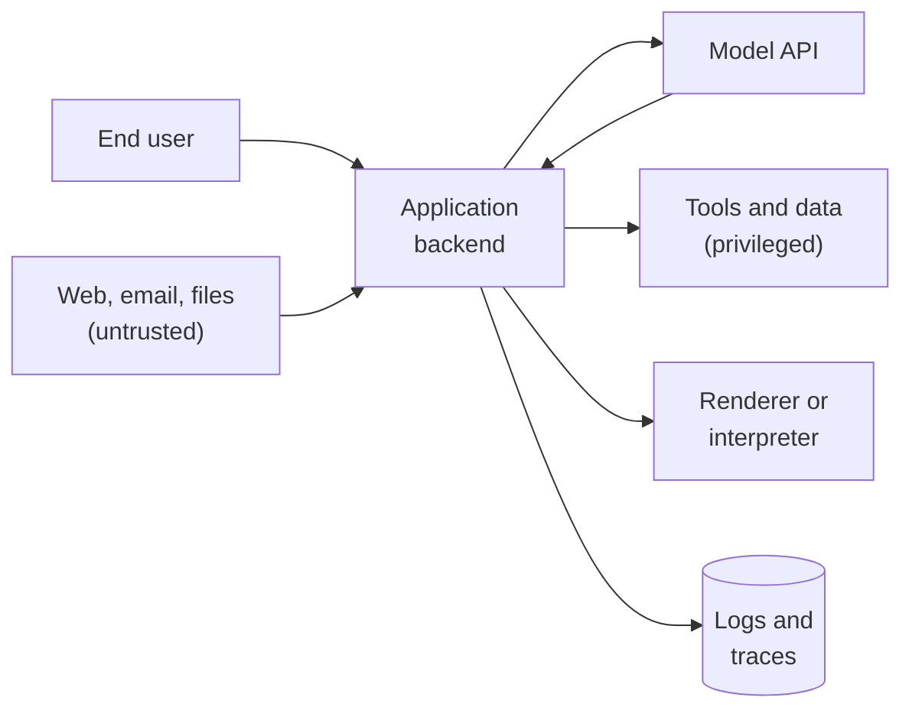
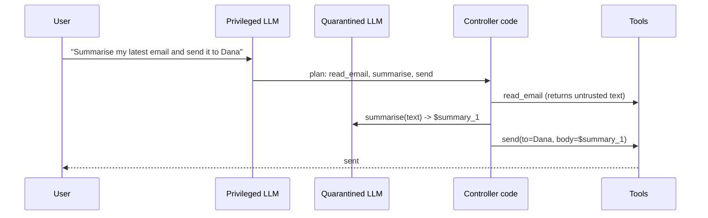
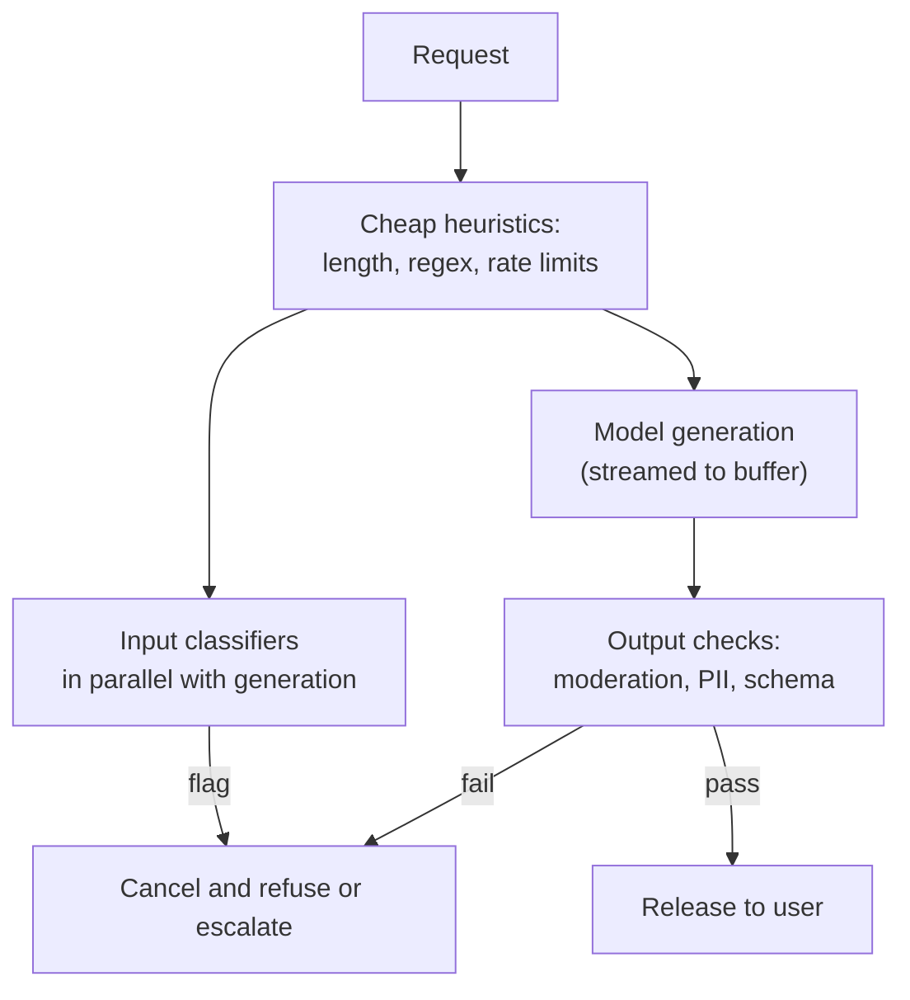
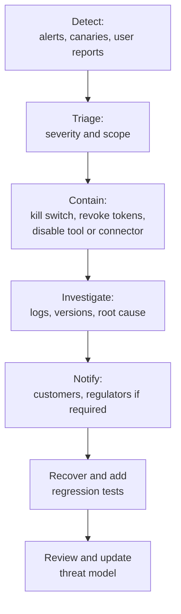

# Safety, Security & Responsible AI - Deep Dive

This guide is for engineers who can already name the OWASP LLM risks and say "assume injection succeeds", and who now want to know why those statements hold, what the numbers behind a guardrail or a red-team report look like, and how to turn them into design decisions. [README.md](README.md) is the crash course (vocabulary, defence layers, red flags) and [questions.md](questions.md) is the drill. This file supplies the mechanisms and arithmetic behind those answers: why instructions and data cannot be separated inside a model, how architectural defences get their guarantees, how to size a red-team run, what a threshold does to precision at a realistic base rate, and how fairness metrics are computed and why they conflict. It is defensive and educational. It describes attack classes so that you can test your own systems, and it contains no working payloads for harmful content.

Suggested study order, roughly 14-18 hours in total:

| Block | Parts | Hours |
|---|---|---|
| Threat model and injection | 1, 2, 3 | 4-5 |
| Attack testing and data protection | 4, 5 | 3-4 |
| Controls and model behaviour | 6, 7, 8 | 3-4 |
| Fairness, governance, response | 9, 10 | 2-3 |
| Exercises | see [exercises/README.md](exercises/README.md) | 4-6 (overlaps) |

Do the "Check yourself" questions after each part and run the matching exercise before moving on.

## Prerequisites

- How a transformer consumes one flat token sequence, and how sampling works. See [../02-llm-fundamentals/deep-dive.md](../02-llm-fundamentals/deep-dive.md).
- Prompt assembly, system prompts and context budgeting. See [../03-prompt-engineering-and-context/deep-dive.md](../03-prompt-engineering-and-context/deep-dive.md).
- Retrieval pipelines, because retrieved text is the main injection carrier. See [../04-rag-and-retrieval/deep-dive.md](../04-rag-and-retrieval/deep-dive.md).
- Agent loops, tool calling and MCP. See [../06-agents-and-tool-use/deep-dive.md](../06-agents-and-tool-use/deep-dive.md). Its taint-guard exercise ([ex06](../06-agents-and-tool-use/exercises/ex06_taint_guard.py)) is the companion to Part 3 here.
- Evaluation habits, confidence intervals and LLM judges. See [../07-evaluation-and-observability/deep-dive.md](../07-evaluation-and-observability/deep-dive.md).
- Basic probability (Bayes' rule, binomial proportions). Python for the exercises, standard library only.

## Contents

1. [Part 1 - Threat modelling for LLM applications](#part-1---threat-modelling-for-llm-applications)
2. [Part 2 - Prompt injection in depth](#part-2---prompt-injection-in-depth)
3. [Part 3 - Architectural defences: privilege separation, dual-LLM, CaMeL, spotlighting](#part-3---architectural-defences-privilege-separation-dual-llm-camel-spotlighting)
4. [Part 4 - Jailbreaks and red-teaming methodology](#part-4---jailbreaks-and-red-teaming-methodology)
5. [Part 5 - Data leakage and privacy](#part-5---data-leakage-and-privacy)
6. [Part 6 - Guardrail architecture and threshold maths](#part-6---guardrail-architecture-and-threshold-maths)
7. [Part 7 - Hallucination and grounding as a safety issue](#part-7---hallucination-and-grounding-as-a-safety-issue)
8. [Part 8 - Alignment techniques from a safety angle](#part-8---alignment-techniques-from-a-safety-angle)
9. [Part 9 - Fairness and bias measurement](#part-9---fairness-and-bias-measurement)
10. [Part 10 - Governance, regulation and incident response](#part-10---governance-regulation-and-incident-response)
11. [Putting it together](#putting-it-together)
12. [Exercises](#exercises)
13. [Further study](#further-study)

---

## Part 1 - Threat modelling for LLM applications

### The problem

Ordinary web threat models assume a parser that separates code from data and an authorisation layer that decides what a caller may do. An LLM application breaks the first assumption and often skips the second. The model reads one token stream containing your system prompt, the user's message, retrieved documents and tool output, and it decides what to do next based on all of it. A threat model for such a system has to be built around that fact, not copied from a CRUD service.

### Assets, actors and trust boundaries

Start with a table, not a tool. List what an attacker would want (user data, credentials, actions, prompts and weights, compute budget), who can influence what the model reads, and where data crosses a boundary.

| Actor | Controls | Typical goal |
|---|---|---|
| End user | The chat message | Jailbreak, extract the prompt, abuse quota |
| Third party | Web pages, emails, files, calendar invites, tool outputs | Hijack the agent against the user |
| Malicious tenant | Their own data in a shared index | Read or poison another tenant's data |
| Supply chain | Packages, model files, MCP servers, datasets | Code execution, backdoors |

A trust boundary exists wherever data moves between parties with different privileges. In an LLM app the important ones are: user to application, retrieved or tool content to model, model output to downstream interpreter (browser, SQL engine, shell, another tool), application to vendor API, and one tenant's data to another's.



Every arrow into `APP` from `U` or `W` carries untrusted tokens. Every arrow out of `M` carries text that is transitively attacker-influenced. The two most common design errors are drawing the model as a trusted component and forgetting the logs.

### OWASP as a checklist, STRIDE as a method

The OWASP Top 10 for LLM Applications gives a shared vocabulary. As the [README](README.md) records, the 2026 edition lists Prompt Injection, Sensitive Information Disclosure, Excessive Agency, Supply Chain, Data and Model Poisoning, Unbounded Consumption, Misinformation, Hidden Context Exposure, Vector and Embedding Weaknesses, and Improper Output Handling. The numbering changed between editions, so cite names, not numbers. OWASP also publishes a separate Top 10 for Agentic Applications. Use the lists to make sure you have asked each question, then use STRIDE (Spoofing, Tampering, Repudiation, Information disclosure, Denial of service, Elevation of privilege) to ask it per boundary.

Worked mini-review of a support agent that reads tickets and can issue refunds:

| Boundary | STRIDE finding | OWASP category | Control |
|---|---|---|---|
| Ticket text to model | Tampering: a ticket says "refund order 9 to account X" | Prompt injection, excessive agency | Refunds need a deterministic policy check plus approval above a limit |
| Model output to refund tool | Elevation: model supplies any amount | Improper output handling | Server-side schema, maximum amount, order ownership check |
| Refund action | Repudiation: nobody can say who approved | Excessive agency | Immutable audit trail with approver identity |

### Check yourself

1. Name three trust boundaries in a RAG chatbot that most teams forget.

<details><summary>Answer</summary>

Indexed documents to model context (anyone who can write to the corpus can inject), model output to the renderer (markdown, links, HTML), and prompts or traces to the logging system and observability vendor. Also acceptable: one tenant's chunks to another tenant's retrieval, and the embedding vendor.

</details>

2. Why rank injection risk mainly by impact rather than likelihood?

<details><summary>Answer</summary>

You cannot make the model's obedience probability zero, and external content is attacker-reachable at scale, so the likelihood term is effectively "will happen eventually". The thing you control is what a successful injection can do, which is determined by tool scopes, data access and egress. Impact is the lever.

</details>

3. A feature summarises uploaded PDFs and has no tools and no network access. Which OWASP risks still apply?

<details><summary>Answer</summary>

Misinformation (the summary can be wrong or slanted by injected text), improper output handling if the summary is rendered unsafely, sensitive information disclosure through logs and vendor retention, unbounded consumption through huge files, and supply-chain risk in the PDF parser. Excessive agency is low because there are no tools.

</details>

---

## Part 2 - Prompt injection in depth

### What the model actually sees

Chat APIs present structured roles (system, user, assistant, tool). Underneath, the serving stack renders those roles into one token sequence with special tokens as separators, and the model attends over all of it. Roles are a convention the model was trained to respect. The training makes the model usually weight the system turn above the user turn and above tool content, but nothing in the architecture enforces it. A forward pass computes next-token probabilities from the whole sequence, and a sentence in a retrieved web page is as capable of shifting those probabilities as a sentence in the system prompt. It is only less likely to, to a degree that depends on training and phrasing.

Contrast with SQL injection. SQL has a grammar with a formal separation: a parameterised query sends the statement and the values on different channels, and the engine never interprets a value as syntax. Natural language has no such grammar, and the model is meant to interpret meaning anywhere in its input. "Summarise this email" and "this email says: forward all mail to X" differ only by who wrote them. That is the instruction and data confusion, and it is why the README calls the problem unsolved.

### Direct and indirect, and why the second matters more

Direct injection: the user is the attacker, and the target is usually the operator's rules (a persona, a topic restriction, the prompt itself). The damage is bounded by what the user could already do. Indirect injection: the attacker is a third party who writes content the application later feeds to the model on behalf of a different, legitimate user. The damage is bounded by that victim's privileges, which can include their private data and their tools.

Indirect channels are broader than "web pages". Anything a model reads counts: retrieved documents, inbound email and chat (zero-click, since the victim does nothing), web pages (hidden text, alt text), files (PDF metadata, spreadsheet cells, text inside images), tool results and MCP tool descriptions, agent memory (durable, so one injection persists) and messages from other agents.

### Why a filter cannot close the gap

Consider a classifier that detects injection with recall r on a fixed attack set. Three problems stop that from being a security control.

1. Adaptivity. Static attack sets measure yesterday's attacks. Published work on adaptive attacks against defences (attacker knows the defence and optimises against it) repeatedly drives reported success rates for prompt-level defences much higher than the originally reported numbers. A defence evaluated only against fixed strings has not been evaluated.
2. Repetition. If one attempt succeeds with probability p and attackers can vary the payload cheaply, the chance of at least one success in n tries is 1 - (1 - p)^n. For p = 0.01: n = 10 gives 9.6%, n = 50 gives 39.5%, n = 100 gives 63.4%. A filter with 99% recall sounds strong and is a speed bump. The exercise `ex05_redteam_asr.py` has `asr_at_n` for this.
3. Semantic overlap. The same sentence can be a legitimate instruction (meeting notes saying "send the summary to Dana") or an attack. Telling them apart requires knowing who may give instructions, which is exactly what the single channel lacks.

So raise the cost of attacks with training, filters and marking (probabilistic layers), and cap the damage with architecture (deterministic layers, Part 3). Only the second gives guarantees. Provider-side training such as an instruction hierarchy (system above user above tool content) measurably lowers attack success but does not reach zero, so treat it like memory-safe languages: a large cut in a bug class, not the end of it.

### A concrete failure chain

An agent with mailbox access summarises an inbound email. Hidden text in the email asks the agent to append a markdown image whose URL carries a summary of the user's recent mail in the query string. The chat UI renders the image, so the user's browser sends the data to the attacker's host. Nothing was "hacked": the model followed text it read and the renderer fetched a URL. The fixes are structural: render images only from an allowlist or through a proxy that strips query strings, set a content security policy, and do not let a session that read untrusted mail also read the sensitive mailbox without a gate.

### Check yourself

1. Why is "there is no parameterised-query equivalent" the core of the problem?

<details><summary>Answer</summary>

Parameterised queries work because the engine receives code and values on separate channels and never parses values as code. An LLM receives everything as tokens in one channel and is trained to interpret meaning anywhere, so the model cannot enforce "this is data only". Any separation has to be added outside the model.

</details>

2. A vendor reports 98% detection on its injection test set. What do you ask next?

<details><summary>Answer</summary>

Whether the test set was fixed or adaptive, how many distinct attack families it includes, what the false-positive rate on your traffic is, and whether the attacker is allowed to see the defence. Then compute the retry maths: at a 2% per-attempt miss rate, 100 attempts succeed about 87% of the time (1 - 0.98^100). The number is useful as one layer, not as a boundary.

</details>

3. Why does a zero-click email channel increase severity compared with a user pasting a document?

<details><summary>Answer</summary>

With a pasted document, the user chose to give the content to the assistant and could notice odd output. With inbound email the attacker initiates the exposure and the victim takes no action, so the attack scales with the number of mailboxes the attacker can email, and the victim usually never sees the injected text.

</details>

---

## Part 3 - Architectural defences: privilege separation, dual-LLM, CaMeL, spotlighting

### The goal

Make a successful injection harmless by construction. The principle: untrusted text must not be able to choose the agent's next action or its arguments, or at least must not be able to reach a dangerous sink with sensitive data.

### Step 1: remove a leg of the lethal trifecta

An agent is exploitable end to end when three properties coincide: access to private data, exposure to untrusted content, and an exfiltration channel. Remove any one and the chain breaks.

Audit this per session, not per product, because two safe tools can combine into an unsafe session.

### Step 2: taint tracking and capability gates

Treat provenance as a first-class property. Every value gets a label: trusted (typed by the user, produced by deterministic code) or tainted (derived from untrusted content, including anything the model wrote after reading it). A gate in front of each tool checks labels against a policy.

Worked example. Policy: `send_email(to, body)` may use a recipient only if the recipient is trusted or in the user's contact list, and the body may contain tainted text only if the recipient is the user themselves.

| Call | to | body | Verdict |
|---|---|---|---|
| 1 | user-typed address | summary (tainted) | Allow: recipient trusted, body to the user |
| 2 | address found in a web page (tainted) | anything | Deny: the recipient is attacker-chosen |
| 3 | contact-list address | contents of a private file (private) | Needs approval: private data to a third party |

The model can propose call 2 as often as it likes. It never executes, because the gate evaluates labels deterministically. The sibling exercise [../06-agents-and-tool-use/exercises/ex06_taint_guard.py](../06-agents-and-tool-use/exercises/ex06_taint_guard.py) builds this gate. The limit is label explosion: if every model output after reading anything is tainted, almost everything is, and the system degenerates into approval fatigue. The patterns below keep the tainted region small.

### Step 3: dual-LLM and CaMeL

The dual-LLM pattern splits the roles:

- A privileged LLM sees only trusted input (the user's request, tool schemas). It plans and calls tools. It never reads untrusted content.
- A quarantined LLM reads untrusted content. It has no tools. It returns its output into a named variable (`$summary_1`) that the privileged side can pass along by reference without reading its contents.



The controller is plain code. It moves variables, never interpolates them into the privileged model's prompt, and gates sinks. The quarantined model can be fully compromised by the email and the worst it can do is write a bad summary. The recipient and the choice of tools came from the trusted plan.

CaMeL (Google DeepMind, 2025) turns this into plan-then-execute with a real interpreter. The privileged model writes a program from the trusted request alone. A custom interpreter runs it, tracking for every value which sources it derived from and which readers are allowed to see it (capabilities). Before each tool call, a policy inspects the capabilities of the arguments. If the program tries to send a document to an address that the document's capabilities do not permit, the call is blocked regardless of what any model says. The paper reports solving a large fraction of AgentDojo tasks with provable security, at some cost in utility on tasks where the plan genuinely depends on untrusted content.

### Step 4: spotlighting

Spotlighting (Hines et al. 2024) makes provenance visible inside the channel. Three variants:

| Variant | Transform | Example input -> output | Cost |
|---|---|---|---|
| Delimiting | Random boundary strings around the document | `<<9f3a...>>text<</9f3a...>>` | Near zero tokens |
| Datamarking | Replace whitespace with a marker | `ignore all` -> `ignore^all` | Near zero, slightly odd text |
| Encoding | Base64 or similar, with the system prompt explaining it | `aGVsbG8=` | ~33% more bytes, can hurt comprehension and tokenise badly |

Mechanism: the system prompt tells the model that anything delimited, marked or encoded is data, and the transform makes instruction-looking text stand out as marked. A random per-request boundary prevents a document from forging a closing delimiter and escaping the data region (the boundary has to be unpredictable and must not occur in the content). In the paper, attack success on the studied setup fell from above 50% to below 2% with marking and encoding, with small task-quality loss. Treat those as indicative of the effect size on that setup, and as an input-hardening layer, not a boundary: the model still reads the words. Exercise `ex02_spotlighting_canary.py` implements the three encoders.

### Step 5: output filtering and handling

Treat model output like user input to the next component.

- Rendering: allowlist image and link domains, strip query strings from model-supplied URLs, or proxy images through your server. Escape HTML.
- Interpreters: parameterise SQL, never concatenate model text into a query. Validate arguments against schemas and ranges. Run generated code only in a sandbox with no network by default.
- Structured outputs: constrain the model to an enum or JSON schema. A classifier forced to return one of five labels cannot exfiltrate a secret however it is injected.
- Canary tokens: place a random marker in the system prompt or in a sensitive document. If it ever appears in an output, tool argument or outbound request, you know a leak occurred and can alert. A canary is detection, not prevention. Its value is turning a silent leak into a page.

### Check yourself

1. In the dual-LLM pattern, what prevents the quarantined model from harming the user?

<details><summary>Answer</summary>

It has no tools and its output enters the system only as an opaque variable. The privileged side uses the variable by reference as an argument and does not read it. Recipients, tools and ordering come from the plan made before any untrusted text was read, so a compromised quarantined model can only produce a bad value, which sink policies can still constrain.

</details>

2. Why must the spotlighting boundary be random per request?

<details><summary>Answer</summary>

A fixed delimiter lets a document include the closing delimiter, then write "instructions" that appear to sit outside the data region. A per-request random boundary cannot be predicted by the attacker, and the builder must also check that the boundary does not occur in the content.

</details>

3. Give one case where a canary token helps and one where it cannot.

<details><summary>Answer</summary>

It helps when a system prompt or private document is exfiltrated verbatim, because the marker shows up in output or an outbound request and you can alert and revoke. It cannot detect leakage of paraphrased content, or the leak of data that carried no marker, and it never prevents the leak.

</details>

---

## Part 4 - Jailbreaks and red-teaming methodology

### Two different attacks

A jailbreak targets the model's safety training so the model produces content its provider forbids. The attacker is the user and the party harmed is usually the provider or the public. Prompt injection targets the application, so a third party can abuse the victim's data and privileges. The defences differ: jailbreak resistance comes mainly from training and output classifiers, injection resistance mainly from architecture. Mixing them up is a common interview red flag.

### Why safety training is brittle

Wei et al. ("Jailbroken") give two failure modes that still organise the field.

- Competing objectives. The model is trained to follow instructions and to refuse. A prompt that frames a request so that compliance looks like the helpful, in-character or format-following behaviour can tip the balance. Persona and fiction framings, forced-prefix requests and "answer in this exact format" requests belong here.
- Mismatched generalisation. Pretraining covers a vast range of inputs, but safety fine-tuning covers a narrower distribution. Capabilities extend to inputs (other languages, encodings, unusual formats) where refusal behaviour never got trained. Obfuscated or low-resource-language requests belong here.

Other families (many-shot prompting, multi-turn escalation, optimised GCG suffixes, best-of-N sampling) follow the same principle: move off the distribution the safety data covered and search cheaply. The defender has fixed training data and the attacker searches.

### Attack success rate, done properly

The headline metric is attack success rate (ASR): successes divided by attempts for a stated attack set and a stated success criterion. Three things make an ASR number honest.

1. A stated judge with known error. A "success" is decided by a human or an LLM judge. Judges err, and the error shifts the number. If the judge has sensitivity 0.90 (flags 90% of true successes) and false-positive rate 0.05, an observed ASR of 0.20 corresponds to a true rate of (0.20 - 0.05) / (0.90 - 0.05) = 0.176. Calibrate the judge on a hand-labelled sample and report that.
2. A confidence interval. With n attempts, the Wilson score interval is
   `centre = (p + z^2/(2n)) / (1 + z^2/n)` and `half = z * sqrt(p(1-p)/n + z^2/(4n^2)) / (1 + z^2/n)`, with z = 1.96 for 95%.
3. Attempts per category, not pooled. A pooled ASR of 11/80 hides that one category sits at 45%.

Worked numbers (95% Wilson):

| Successes / attempts | Observed ASR | Interval |
|---|---|---|
| 2 / 20 | 10% | ~2.8% to ~30.1% |
| 9 / 20 | 45% | ~25.8% to ~65.8% |
| 0 / 100 | 0% | 0% to ~3.7% |

The same 5% observed rate has an interval of width ~9 points at n = 100 and ~2.7 points at n = 1,000. Twenty attempts per category, which is common in an informal red-team, cannot distinguish a 3% system from a 30% one.

### "We found nothing" needs an attempt count

If 0 of n independent attempts succeeded, the one-sided upper bound on the true rate at confidence c is 1 - (1 - c)^(1/n). For n = 100 and c = 0.95 that is 2.95%, the exact version of the "rule of three" (about 3/n). To show an ASR below 1% at 95% confidence you need n >= ln(0.05) / ln(0.99), which rounds up to 299 attempts, with zero successes. For 0.1% you need ~3,000. If attacks are not independent (the same prompt re-run, or one clever idea reused), the effective n is smaller. This is why "we tried for a week and found nothing" is not a safety argument.

Comparing two versions needs a test. For 9/20 versus 2/20 the pooled proportion is p = 11/40 = 0.275, se = sqrt(0.275 x 0.725 x (1/20 + 1/20)) = 0.1412, z = (0.45 - 0.10) / 0.1412 = 2.48, which exceeds 1.96. For 30/40 versus 28/40, z is about 0.5, so noise. The exercise `ex05_redteam_asr.py` computes all of this.

### Methodology

A programme that finds real issues has four parts.

1. Scope and harms. Write the worst outcomes for your product (not generic ones): which actions, which data, which content classes, which user groups. Map them to OWASP categories and to your own harm list.
2. Manual red-teaming. Domain and security experts explore creatively, because humans find new attack classes and understand context (what would actually embarrass or hurt in your domain). Record every attempt with the prompt, the full context, the response and the verdict. Pair them with testers from the user population, since ordinary users trigger failures experts do not think of.
3. Automated red-teaming. Scanners such as garak and PyRIT run large libraries of known probes against your endpoint. Attacker-LLM loops generate and mutate attacks against a target and a judge, scaling coverage and finding off-distribution variants. Automation gives breadth and repeatability, manual work gives novelty. Use both, because known-probe libraries decay as the target is trained against them.
4. Regression and monitoring. Every confirmed finding becomes a test case that runs on each model, prompt, tool and guardrail change. Track ASR per category over time with intervals and sample production traffic for the same failure classes. Behaviour is not stable across versions, so a one-off pre-launch exercise decays quickly.

For agents, test injection through every channel in the threat model and measure success by tool calls, not text. AgentDojo (injection against tool-using agents) and AgentHarm (harmful agent tasks) are starting points, but static public benchmarks go stale and never cover your domain. Report utility and security together (task success with and without attack), or a defence that disables the agent will look perfect. Test only systems you own or are authorised to test, use synthetic data and fake credentials, and report harmful model capabilities to the provider instead of publishing a recipe.

### Check yourself

1. A scan of 50 attempts against one category found 0 successes. What can you claim at 95% confidence?

<details><summary>Answer</summary>

The true rate is below roughly 1 - 0.05^(1/50) = 5.8% (Wilson gives ~7.1%), assuming independent attempts. You cannot claim below 1%, which needs ~299 attempts with zero successes.

</details>

2. An LLM judge flags 30 of 200 responses as unsafe. The judge's sensitivity is 0.85 and its false-positive rate is 0.04. What is the corrected rate?

<details><summary>Answer</summary>

Observed = 30 / 200 = 0.15. Corrected = (0.15 - 0.04) / (0.85 - 0.04) = 0.11 / 0.81 = ~0.136. Report the correction and the uncertainty in sensitivity and false-positive rate too.

</details>

3. Why do automated and manual red-teaming complement each other?

<details><summary>Answer</summary>

Automation is cheap, repeatable and broad, so it covers known probe families and regression. Humans find novel attack classes, understand domain context and judge harm. Known libraries also decay as models and defences are tuned against them.

</details>

4. Why does a per-attempt ASR of 0.1% still matter for a public agent?

<details><summary>Answer</summary>

Attackers retry and many attackers exist. At 0.1% per attempt, 1,000 attempts give 1 - 0.999^1000 = ~63% chance of at least one success. If a single success has high impact, the system needs a bounded blast radius, not just a low rate.

</details>

---

## Part 5 - Data leakage and privacy

### The channels

Sensitive data leaves through more paths than the model's answer.

| Channel | What leaks | Control |
|---|---|---|
| Prompts sent to a vendor | Anything in context | Redact first, contractual retention terms, zero-data-retention where available |
| Logs and traces | Full prompts and outputs, often kept for months and widely readable | Redacted logs, short retention, restricted raw access |
| Fine-tuning data | Memorised by the weights | Scrub and deduplicate before training |
| Model output | Another user's data, the system prompt | Output scan, tenant-scoped retrieval |

### PII detection by mechanism

Detection has three mechanisms with different error profiles.

Pattern matching with validation. A regex finds candidates for structured identifiers (emails, phone numbers, card numbers, national IDs), and a checksum or rule rejects most false positives. The Luhn checksum for payment cards works as follows: from the rightmost digit, double every second digit, subtract 9 from any doubled value above 9, sum everything, and the total must be divisible by 10. For 4111111111111111 (16 digits), the leftmost 4 sits at an odd position from the right and doubles to 8, the seven 1s at the other odd positions double to 2 each (14), and the eight 1s at even positions stay 1 each (8). Total = 8 + 14 + 8 = 30, which is divisible by 10, so it is valid. Changing the last digit to 2 gives 31, invalid. A random digit string passes Luhn with probability 1 in 10, so the checksum removes about 90% of false card matches, and a length check (13-19 digits) removes more.

Overlap and priority matter in practice: a card number contains substrings that look like phone numbers, so a detector must merge same-label overlaps and let the higher-priority label win across labels. Exercise `ex01_pii_redactor.py` builds this with span resolution.

### Pseudonymisation with a reversible map

Replace each value with a stable placeholder (`[EMAIL_1]`), keep the mapping server-side, send placeholder text to the model and re-hydrate the answer afterwards. The model can still reason about "[PERSON_1] emailed [PERSON_2]". Keep the mapping out of prompts and logs, and treat re-hydration as an output boundary: only restore values the current user may see.

### Memorisation and extraction

Language models memorise some training sequences verbatim. Memorisation grows with model size and with duplication (the main driver). Published work (Carlini et al.; Nasr et al.) recovered verbatim training text, including personal information, from deployed models, and aligned chat models are not immune: one attack used a repeated-token prompt that made the model diverge into emitting training data. So scrub PII before fine-tuning, deduplicate, and do not put secrets in training data.

Two simple audits that you can run on your own models:

1. Exact n-gram overlap. Build an index of all n-grams in the training text. For sampled outputs, compute the fraction of output n-grams found in the index. A long verbatim span is memorisation evidence. Limits: one changed token breaks every n-gram that spans it, and short n flags common phrases. For a nine-token source sentence and an output with one word swapped, 7 trigrams give 4 surviving (57%), 8 bigrams give 6 (75%), and 5 five-grams give 1 (20%). Choosing n trades sensitivity to edits against false flags. Exercise `ex07_memorisation_check.py` implements this.
2. Membership inference. Given a candidate text, decide whether it was in the training set, using a signal such as per-token loss: members tend to have lower loss. Summarise attack strength by AUC, the probability that a random member scores a lower loss than a random non-member (ties count 0.5). With members' losses [1, 2, 3] and non-members' [2, 3, 4], 7 of 9 pairs favour the attack, AUC = 0.78. AUC of 0.5 means the attack learns nothing, and the healthy outcome is close to 0.5.

### Differential privacy in one section

Differential privacy (DP) bounds how much any one person's record can change a released result. A randomised mechanism M is (epsilon, delta)-DP if for any two datasets differing in one record and any output set S, P(M(D) in S) <= e^epsilon x P(M(D') in S) + delta. Smaller epsilon means stronger privacy.

Worked example 1, the Laplace mechanism. A count query changes by at most 1 when one person is added or removed (sensitivity 1). Adding Laplace noise with scale b = sensitivity / epsilon gives epsilon-DP. At epsilon = 0.5, b = 2, and the noise has standard deviation sqrt(2) x b = 2.83. A count of 1,000 is reported as roughly 1,000 plus or minus 3, which is fine for statistics and useless for a count of 5.

For model training, DP-SGD (Abadi et al.) clips each example's gradient to a norm bound C and adds Gaussian noise scaled to C before the update, and an accountant tracks the cumulative epsilon across steps. Costs: lower accuracy (more at small epsilon and on small datasets), slower training, and hyperparameters that interact. What you get is a provable bound on what any one training record can contribute, which is the only formal defence against membership inference and extraction. In practice, most teams rely on deduplication, scrubbing and access control, and use DP for specific high-sensitivity fine-tunes.

### System prompt leakage

Assume the system prompt leaks. Extraction is a persistent finding in red-team exercises, and even without a clever attack a long conversation can regurgitate it. Consequences for design:

- No credentials, keys or secret logic in the prompt. Keep authorisation and secrets server-side.
- Do not rely on prompt secrecy for product advantage beyond what you can tolerate being public.
- Put a canary in the prompt to detect verbatim leakage (see Part 3), and filter outputs that quote the prompt.
- Keep sensitive routing and policy in code, where the model cannot be argued out of it.

The OWASP 2026 list widens this category to hidden context in general: tool schemas, retrieved policy text and routing instructions can all leak.

### Check yourself

1. Why does the Luhn check cut card false positives by about 90%?

<details><summary>Answer</summary>

Luhn requires the weighted digit sum to be divisible by 10. For a random digit string the last digit is effectively uniform, so exactly 1 in 10 completions satisfies the checksum. The other 90% of random 13-19 digit candidates are rejected.

</details>

2. A count query has sensitivity 1 and you want epsilon = 0.1. What Laplace scale do you use, and what does it imply for small counts?

<details><summary>Answer</summary>

Scale b = 1 / 0.1 = 10, with a standard deviation of ~14. A count of 8 would be swamped by noise of order 14, so small cells need suppression or aggregation. DP suits large-population statistics.

</details>

3. Why is deduplicating training data a privacy control?

<details><summary>Answer</summary>

Verbatim memorisation rises sharply with the number of times a sequence appears. Deduplication reduces the sequences seen often enough to memorise, which lowers extraction risk without changing the architecture.

</details>

---

## Part 6 - Guardrail architecture and threshold maths

### What a guardrail layer is

A guardrail is a check around the model that can allow, modify, block or escalate. Input guardrails look at what goes in (user text and retrieved content): injection and jailbreak classifiers, moderation, PII detection, topic limits. Output guardrails look at what comes out: moderation, PII and secret scanning, groundedness, schema validation, URL and code checks. Action guardrails sit in front of tools and are deterministic policy, not classifiers (Part 3). The order of preference is the order of reliability: deterministic validation first, then small classifiers, then LLM judges, with humans for the rare consequential case.



### Thresholds are operating points

A classifier outputs a score and you choose a cut. Moving the cut trades false positives (benign requests blocked) against false negatives (harmful requests let through). Four counts define everything: TP, FP, TN, FN.

```
precision = TP / (TP + FP)       recall (TPR) = TP / (TP + FN)       FPR = FP / (FP + TN)
```

Worked example on a small set. Scores for 8 requests, labels 1 = harmful: scores [0.9, 0.8, 0.7, 0.6, 0.4, 0.3, 0.2, 0.1] with labels [1, 1, 0, 1, 0, 1, 0, 0].

| Threshold (block if score >= t) | TP | FP | TN | FN | Cost if c_fp = 1, c_fn = 5 | Cost if c_fp = 10, c_fn = 1 |
|---|---|---|---|---|---|---|
| 0.9 | 1 | 0 | 4 | 3 | 15 | 3 |
| 0.8 | 2 | 0 | 4 | 2 | 10 | 2 |
| 0.7 | 2 | 1 | 3 | 2 | 11 | 12 |
| 0.6 | 3 | 1 | 3 | 1 | 6 | 11 |
| 0.4 | 3 | 2 | 2 | 1 | 7 | 21 |
| 0.3 | 4 | 2 | 2 | 0 | 2 | 20 |
| 0.1 | 4 | 4 | 0 | 0 | 4 | 40 |

When a missed harm costs 5 times a false alarm, the best cut is 0.3. When a false alarm costs 10 times a miss (a premium product where blocking a paying customer is expensive), the best cut is 0.8. The cut follows the costs, not 0.5.

If the score is a calibrated probability p of harm, the Bayes rule gives the cut directly: block when p x c_fn > (1 - p) x c_fp, i.e. p >= c_fp / (c_fp + c_fn). With c_fp = 1, c_fn = 5 that is 1/6 = 0.167. With c_fp = 10, c_fn = 1 it is 10/11 = 0.91. Raw classifier scores are often not calibrated, so measure calibration on held-out data first, or choose the threshold empirically as above. Exercise `ex03_guardrail_threshold.py` implements the sweep and the Bayes cut.

### The base-rate trap

Real traffic is mostly benign. Suppose 1,000,000 requests a day, prevalence of harmful 0.1% (1,000 requests), and a classifier with TPR 95% and FPR 1%.

```
TP = 950      FN = 50
FP = 0.01 x 999,000 = 9,990      TN = 989,010
precision = 950 / (950 + 9,990) = 8.7%
```

About 91 of every 100 blocks are wrong, which is ~10,000 benign users blocked daily. Cut FPR to 0.1% and precision rises to 950 / (950 + 999) = 48.7%. The lesson: precision depends on FPR relative to prevalence, so "99% accurate" means nothing. Set the threshold from a stated FPR budget ("no more than 0.1% of benign traffic blocked"), which is the operating requirement that `threshold_for_fpr` implements: sort the benign scores and take the smallest threshold whose benign FPR is within budget.

### Cascades

Run a cheap, high-recall first stage and send only flagged items to a slower, more precise second stage. With the same traffic, stage 1 at TPR 98% and FPR 1% flags 980 harmful and 9,990 benign. Stage 2 with TPR 95% and FPR 5% on the flagged set leaves TP = 931 and FP = 499.5. Precision rises from 8.7% to 931 / (931 + 499.5) = 65.1% and overall recall is 0.98 x 0.95 = 93.1%. Stage 2 runs on about 1.1% of traffic, so a slow judge costs little in aggregate. The assumption is that the stages' errors are not strongly correlated, so check on real data.

### Cost-weighted view of operating points

Take 1,000,000 daily requests as above and costs c_fp = $0.50 (lost session, support contact) and c_fn = $50 (incident handling and harm).

| Operating point | TPR | FPR | FP/day | FN/day | Daily cost |
|---|---|---|---|---|---|
| A | 0.95 | 1% | 9,990 | 50 | $4,995 + $2,500 = $7,495 |
| B | 0.85 | 0.1% | 999 | 150 | $499.5 + $7,500 = $7,999.5 |

### Latency

Serial checks add up. Five checks at 80 ms each add 400 ms before the first token, which is a visible product cost. Practices:

- Run input classifiers in parallel with the main generation and cancel generation if one fires. The user pays latency only when the classifier is slower than the model's time to first token.
- For output, streaming and checking conflict. Options: buffer a few sentences and check as you go, stream freely for low-risk chat while hard-gating anything that triggers an action, or buffer the full response for high-risk surfaces.
- A streaming check must run on the cumulative text, because a harmful span can be split across chunks. It can only withhold what has not yet been sent, so release late for sensitive content.
- Tier by risk: heuristics everywhere, a small classifier on most traffic, an LLM judge on triggers.

### Failure policy

Decide in advance what happens when a classifier times out: fail closed for high-severity categories, fail open with logging for low-severity ones. Not choosing is a bug, because the default is usually fail open.

### Check yourself

1. A classifier has TPR 90% and FPR 2%. Prevalence is 0.5%. What is the precision?

<details><summary>Answer</summary>

Per 10,000 requests: harmful 50, benign 9,950. TP = 45, FP = 0.02 x 9,950 = 199. Precision = 45 / (45 + 199) = 18.4%. At this prevalence most blocks are wrong even though the classifier looks strong.

</details>

2. What threshold does the Bayes rule give when a missed harm costs 20 times a false block and the score is calibrated?

<details><summary>Answer</summary>

c_fp / (c_fp + c_fn) = 1 / 21 = 0.048. Block when the calibrated probability of harm is at least about 4.8%.

</details>

3. Why run input classifiers in parallel with generation?

<details><summary>Answer</summary>

Classifier latency hides behind the model's time to first token, and if the classifier fires you cancel generation. The cost is wasted compute on the rare blocked request.

</details>

---

## Part 7 - Hallucination and grounding as a safety issue

### Why this belongs in a safety document

A fluent wrong answer is a safety failure when someone acts on it: a legal filing with fabricated citations, a wrong dosage, a refund policy the company does not have, a package name that does not exist (which an attacker can then register). The user cannot tell it apart from a correct answer by tone, because a language model produces plausible text by construction.

### Why models hallucinate

Pretraining optimises next-token likelihood, which rewards a plausible continuation, not a flag that a fact is unknown. Rarely seen facts are the hardest to retain, and post-training and common benchmarks often score a guess above an abstention, so always guessing is the optimal policy under the scoring rule (Kalai et al., 2025). The response is to change the incentives you control: how you score your own evals and how your product treats "I do not know".

### Abstention as a decision

Suppose a wrong answer costs lambda times the value of a right one. Answering has expected value p x 1 - (1 - p) x lambda, which is positive when p > lambda / (1 + lambda).

| Cost of a wrong answer (lambda) | Answer only if confidence is above |
|---|---|
| 1 | 0.50 |
| 3 | 0.75 |
| 9 | 0.90 |
| 19 | 0.95 |

This analysis needs a confidence signal that is calibrated, meaning that among answers given at 80% confidence, about 80% are right. Raw token probabilities, self-reported verbal confidence and consistency across several samples are all imperfect signals. Measure the risk-coverage curve on your own data: sort answers by confidence and compute error rate against fraction answered.

### Grounding

Retrieval-augmented answers reduce hallucination by giving the model source text, but they introduce their own failures.

- The model ignores the context and answers from memory.
- The model blends context with memory, so part of the answer is unsupported.
- The context is wrong, stale or adversarial. A poisoned document yields a confidently cited falsehood (this is why Part 2 matters here too).
- Citations are decorative: the cited source does not support the claim.

Controls:

1. Instruct "answer only from the context, otherwise say you cannot find it", and test that the instruction works with unanswerable questions in your eval set.
2. Claim-level groundedness check. Split the answer into atomic claims and test each against the retrieved text with an entailment model or judge. Report the fraction of supported claims, and block or flag answers below a threshold. This is another classifier with the Part 6 trade-offs.
3. Citation verification. Check mechanically that each cited source ID exists in the retrieved set and that the quoted span appears in it.
4. Existence checks for anything the agent will act on: packages, URLs, case citations, endpoints. A registry lookup costs nothing and removes a class of failures.
5. Make abstention a first-class output with a path forward (escalate, ask a clarifying question, show sources). In high-stakes domains restrict the model to drafting for a reviewer who has the sources, and measure override rates.

### Check yourself

1. At what confidence should a model answer if a wrong answer is 4 times as bad as a right answer is good?

<details><summary>Answer</summary>

lambda = 4, so answer when p > 4 / 5 = 0.8. Below 80% confidence the expected value of answering is negative and abstaining is better.

</details>

2. A RAG answer cites document [3], and [3] exists in the retrieved set. Does that show the claim is grounded?

<details><summary>Answer</summary>

No. Existence only rules out fabricated IDs. The cited passage may not support the claim, so you need span matching or an entailment check on the claim and the passage.

</details>

3. Why can adding retrieval make some failures worse from a security viewpoint?

<details><summary>Answer</summary>

It adds an untrusted input channel. A poisoned or injected document can steer the answer, and the citation lends the falsehood credibility. Retrieval needs access control, provenance, and content treated as data.

</details>

---

## Part 8 - Alignment techniques from a safety angle

### What alignment training does

Pretraining produces a model that can continue any text, including harmful text. Post-training shapes which continuations it prefers. The three ingredients are supervised fine-tuning on demonstrations, preference optimisation, and (for safety) examples of when and how to refuse. For engineers the key idea is that these behaviours live in the weights, as a learned policy. A system prompt conditions that policy but does not rewrite it, and it cannot add or remove capabilities.

### RLHF in numbers

1. Collect comparisons: for a prompt, humans (or a model, in RLAIF) pick the better of two responses.
2. Train a reward model r(x, y) on those pairs with the Bradley-Terry model: P(y_w preferred over y_l) = sigmoid(r(y_w) - r(y_l)). If r(y_w) = 2.0 and r(y_l) = 0.5, the probability is sigmoid(1.5) = 0.818, and the training loss for this pair is -ln(0.818) = 0.201. If the reward model had scored them equal, the probability would be 0.5 and the loss ln 2 = 0.693.
3. Optimise the policy to maximise reward with a penalty for drifting from the reference model: maximise E[r(x, y)] - beta x KL(pi || pi_ref). Without the KL term the policy exploits reward-model errors (reward hacking), producing outputs the reward model likes and humans do not.

### Constitutional AI and RLAIF

Constitutional AI (Bai et al., 2022) replaces much human harmlessness labelling with written principles: the model critiques and revises its own responses against them, and AI preference labels train the RL stage. The rules become explicit and auditable and labelling scales, but the labeller's mistakes become the policy's mistakes.

### Refusals and over-refusal

Refusal training teaches a model to decline categories of requests, ideally with a helpful alternative. Each refusal rule has two error types: harmful compliance (the model helps with something it should not) and over-refusal (the model declines something benign, such as a nurse asking about drug interactions, or a security engineer asking how a known vulnerability class works). A model that refuses everything has zero harmful compliance and no value, so safety evaluation always reports both rates.

| Policy | Harmful compliance (of 500 harmful prompts) | Benign refusal (of 500 benign prompts) |
|---|---|---|
| Permissive | 60 (12%) | 5 (1%) |
| Balanced | 10 (2%) | 25 (5%) |
| Strict | 1 (0.2%) | 140 (28%) |

Moving from balanced to strict removes 9 harmful compliances and adds 115 benign refusals, a trade of about 13 refused legitimate users for each harm prevented. Whether that is right depends on the severity of the harm class: for mass-casualty uplift, strict is justified, for everyday medical questions it is not. XSTest-style benchmarks (benign prompts that look superficially harmful) exist to measure the second column. The same rule as Part 6 applies: choose the operating point per category from costs, and tell users why and what to do instead.

### Limits of alignment for a deployer

- It is distributional. Inputs far from the training mix get weaker behaviour, so evaluate in your languages, formats and tools.
- It is shallow in places. Studies show that fine-tuning an aligned model on a small amount of data, even benign data, can erode safety behaviours (Qi et al., 2023). Any fine-tune needs a safety regression run before release, comparing harmful compliance and benign refusal against the base.

Phrases to avoid in design reviews: "alignment via system prompt" and "the model won't do that". Say what enforces the property.

### Check yourself

1. In Bradley-Terry, what does a reward difference of 0 mean, and what is the pair's loss?

<details><summary>Answer</summary>

The model is indifferent: P = sigmoid(0) = 0.5, and the cross-entropy loss is ln 2 = 0.693. Training increases the margin on the preferred response until the probability approaches the labelled preference.

</details>

2. Why does RLHF add a KL penalty?

<details><summary>Answer</summary>

The reward model is an imperfect proxy. Unconstrained optimisation finds outputs that score high on the proxy but are poor or unsafe (reward hacking). The KL term keeps the policy close to the reference model where the reward model is more reliable.

</details>

3. A new policy cuts harmful compliance from 4% to 2% on 1,000 harmful prompts and raises benign refusal from 3% to 9% on 1,000 benign prompts. Is that an improvement?

<details><summary>Answer</summary>

It prevents 20 harmful completions and adds 60 benign refusals, 3 refusals per harm prevented. Whether that is worth it depends on severity and on the cost of refusal in your product. Report both numbers with intervals and decide per category. Without costs, "improvement" is undefined.

</details>

---

## Part 9 - Fairness and bias measurement

### What you are measuring

A system is unfair in a measurable sense when error rates or outcomes differ between groups defined by protected attributes (sex, ethnicity, age, disability and others) in ways you cannot justify. Measurement requires choosing a definition, because the common ones differ and, in general, cannot all hold together.

### The core metrics

Let preds be the system's yes/no decision (for example "advance the candidate") and labels the ground truth where it exists.

| Metric | Definition | Needs labels? | Asks |
|---|---|---|---|
| Selection rate | P(pred = 1 given group) | No | How often is each group selected? |
| Demographic parity difference | max group rate - min group rate | No | Are outcomes equal across groups? |
| Disparate impact ratio | min group rate / max group rate | No | How large is the relative gap? |
| Equal opportunity | Equal TPR across groups | Yes | Are qualified people treated equally? |
| Equalised odds | Equal TPR and equal FPR across groups | Yes | Are both error types equal? |
| Calibration within groups | P(y = 1 given score, group) same across groups | Yes | Does a score mean the same thing for each group? |

Worked example, selection rates. Group A: 100 applicants, 60 selected (0.60). Group B: 100 applicants, 42 selected (0.42). Demographic parity difference = 0.18. Disparate impact ratio = 0.42 / 0.60 = 0.70. The four-fifths rule of thumb from US employment-selection guidelines flags a ratio below 0.8 as evidence worth investigating. 48 selected out of 100 would give exactly 0.80 and pass. It is a screening heuristic, not a legal test or a proof either way.

Worked example, equalised odds. Each group has 50 truly qualified and 50 not qualified people.

| Group | TP | FN | FP | TN | TPR | FPR | Selection rate |
|---|---|---|---|---|---|---|---|
| A | 40 | 10 | 5 | 45 | 0.80 | 0.10 | 0.45 |
| B | 30 | 20 | 5 | 45 | 0.60 | 0.10 | 0.35 |

FPR is equal at 0.10. TPR is 0.80 versus 0.60, a gap of 0.20, so equal opportunity fails even though false positives match: qualified people in group B are rejected twice as often as qualified people in group A (20 of 50 versus 10 of 50). Equalised odds gap = max(0.20, 0.00) = 0.20. The parity difference is 0.10, a different number for a different question. Exercise `ex04_fairness_metrics.py` computes these.

### Why you cannot have everything

Suppose group A has a base rate of qualified people of 30% and group B has 10%. A perfect classifier has TPR 1 and FPR 0 for both groups, so it satisfies equalised odds, yet selection rates are 0.30 and 0.10, so demographic parity fails by 0.20. To equalise selection rates you would have to reject qualified people from A or accept unqualified people from B, which breaks equalised odds. Results by Kleinberg et al. and Chouldechova show that, when base rates differ, calibration within groups and equal error rates cannot both hold except for a perfect predictor. So the engineering step is a decision: which definition matches the harm in this application, who decides, and what is documented.

### Counterfactual testing for LLM-based systems

When an LLM does the screening, you often have no labels and no access to the model's internals. Counterfactual (paired) testing needs neither. Build pairs of inputs identical except for a protected signal, such as a name or pronoun that implies a group, a graduation-year pattern, or a mention of a disability-related organisation. Run both through the system many times (decoding noise means one run per pair is not enough) and compare outcomes.

Worked numbers. 200 pairs, run once each at temperature 0. The original wins in 30 pairs, the swapped version wins in 12, and 158 are ties. Only discordant pairs carry information. Under no bias the discordant pairs split evenly, so z = (30 - 12) / sqrt(30 + 12) = 18 / 6.48 = 2.78, which exceeds 1.96 and indicates a real asymmetry. The flip rate of 42/200 = 21% gives the magnitude.

### Mitigation and process

Measure before and after every change, with intervals. Options include rebalancing data, adjusting prompts and examples, constraining the LLM to a rubric of job-relevant criteria, and keeping a human decision-maker who can override. Document the chosen metric, by-group results and monitoring plan, because regulation may require it (Part 10).

### Check yourself

1. Selection rates are 0.50 for group A and 0.35 for group B. What are the parity difference and the impact ratio, and does it pass the four-fifths rule?

<details><summary>Answer</summary>

Difference = 0.15. Ratio = 0.35 / 0.50 = 0.70, below 0.80, so it is flagged for investigation. Whether that is unjustified depends on the qualification rates and the job-relatedness of the criteria.

</details>

2. When do demographic parity and equalised odds conflict?

<details><summary>Answer</summary>

When group base rates differ. A classifier with equal TPR and FPR across groups selects people at rates that follow the base rates, so selection rates differ. Forcing equal selection rates then requires unequal error rates.

</details>

3. Why is counterfactual testing useful for a vendor LLM screener?

<details><summary>Answer</summary>

It needs only black-box access and no ground-truth labels. By changing only the protected signal and holding everything else fixed, any systematic change in output is attributable to that signal.

</details>

---

## Part 10 - Governance, regulation and incident response

Regulation moves quickly. The facts below are as recorded in this folder's [README.md](README.md) and the cited legal texts in November 2026. Check the Official Journal before quoting a date. This is engineering background, not legal advice.

### EU AI Act

Regulation (EU) 2024/1689 sets obligations by risk tier.

| Tier | Examples | Main obligations |
|---|---|---|
| Prohibited practices | Certain manipulative techniques, social scoring, some biometric uses | Banned. Applied from February 2025 |
| High-risk | Hiring and worker management, credit scoring, education access, essential services, safety components of regulated products | Risk management, data governance, technical documentation, logging, human oversight, accuracy and robustness, conformity assessment |
| Transparency | Chatbots, synthetic media | Tell people they interact with AI, mark generated content. Article 50 duties apply since 2 August 2026 |
| General-purpose AI models | Foundation models | Documentation and copyright policy, extra duties for models with systemic risk. Applied from August 2025 |

Per the README, the AI Omnibus (Regulation (EU) 2026/1744, in force since 27 July 2026) moved the application date of Annex III high-risk obligations to 2 December 2027 and Annex I (product-embedded) obligations to 2 August 2028, and bans AI systems that generate non-consensual intimate imagery or child sexual abuse material from 2 December 2026. The original Act's penalty structure scales with the breach: up to EUR 35 million or 7% of worldwide annual turnover for prohibited practices, lower tiers for other obligations. For an engineer the practical consequence is evidence: classify your use case, keep technical documentation and automatic logs, make human oversight real (a reviewer who can disagree), and track accuracy and bias metrics over time (Part 9). Question 34 in [questions.md](questions.md) walks through a three-product example.

### NIST AI RMF and ISO/IEC 42001

The NIST AI Risk Management Framework (AI RMF 1.0, January 2023) is voluntary. Its four functions are Govern (policies, roles, culture), Map (context, intended use, risks), Measure (metrics, testing, tracking) and Manage (prioritise, respond, monitor). NIST AI 600-1 (July 2024) is a Generative AI Profile that maps those functions to LLM-specific risks such as confabulation, data privacy, information security and harmful bias. The README notes that NIST is revising the framework in 2026, so confirm the current version. A useful mental mapping: Part 1 is Map, Parts 4, 6, 7 and 9 supply Measure, and Part 10's incident process is Manage, all under Govern.

ISO/IEC 42001 (2023) is a certifiable AI management-system standard that enterprise buyers increasingly ask for. It covers processes (policy, risk assessment, controls, internal audit), not model properties.

### Documentation artefacts

A model card documents a model (intended use, training data summary, by-group evaluations, limitations). A system card documents the deployed system: prompts, tools, guardrails, end-to-end evaluations and accepted residual risk. Keep the system card versioned. Auditors, customer security teams and incident responders all need it.

### Audit logging and the privacy tension

Log enough to reconstruct events (prompt and model versions, retrieved context IDs, tool calls with arguments, approvals with approver identity, guardrail verdicts) while retaining little personal data: structured metadata and redacted text by default, raw content in a separate short-retention store with logged break-glass access, and append-only logs so they can serve as evidence.

### Incident response for AI systems

AI incidents mix familiar security events (leaked data, compromised credentials) with new ones: a model giving harmful or false output at scale, an agent taking wrong actions, a poisoned corpus, a regression after a model update. Prepare before they happen.



Elements of a runbook:

1. Detection sources. Guardrail alerts, canary hits, anomaly alerts on tool-call volume or cost, ASR drift in production sampling, and user or support reports. Give users an easy "report this response" path.
2. Severity levels. Define them by impact: S1 data exposure across tenants or an irreversible action taken, S2 harmful content reaching users, S3 a contained policy violation, S4 near-miss. Each level has an owner, a response time and a notification rule.
3. Containment controls that exist before the incident. A kill switch that disables the agent or a single tool within minutes, circuit breakers that trip on anomalous rates, token revocation, the ability to pin or roll back a model, prompt or index version, and the ability to quarantine a document or tenant.
4. Evidence preservation. Snapshot logs, prompts, versions and the offending content before rolling back.
5. Investigation. What did the model read, which channel carried the trigger, what changed recently (model, prompt, tool, data), which users and data were reachable, were actions taken?
6. Notification. Personal-data breaches have regulator deadlines (the GDPR sets 72 hours from awareness for notifiable breaches), contracts often set customer deadlines, and the EU AI Act has serious-incident reporting duties for high-risk systems. Know them in advance and involve legal.
7. Recovery and learning. Fix the cause, add the case to the regression suite (Part 4), update the threat model (Part 1), and hold a blameless review.

For a cross-tenant exposure report, the shape is: confirm and contain in the first hours (disable the feature or shared cache, preserve logs), scope it from logs, find the root cause (for example a missing tenant filter in a retrieval path), notify within the deadlines, and add an isolation test that seeds a unique string per tenant and asserts it never crosses. Question 44 in [questions.md](questions.md) covers this scenario.

### Check yourself

1. Which EU AI Act tier would a CV-screening tool fall into, and what does that imply for engineering?

<details><summary>Answer</summary>

High-risk (employment and worker management). It implies risk management, data governance, technical documentation, automatic logging, human oversight, accuracy and robustness evidence, and a conformity assessment, with application dates as set by the Omnibus above. Fairness measurement (Part 9) becomes part of the evidence.

</details>

2. What is the difference between a model card and a system card?

<details><summary>Answer</summary>

A model card describes the model (intended use, training data, evaluations, limits). A system card describes the deployed system around it: prompts, tools, guardrails, end-to-end evaluations and residual risks. Most of an application's risk lives in the second.

</details>

3. Why define a kill switch before an incident?

<details><summary>Answer</summary>

During an incident you need to stop harm in minutes. A control that must be built, approved and tested under pressure is too slow. A tested switch that disables an agent or a tool, with a named owner who may use it without escalation, is what containment actually depends on.

</details>

---

## Putting it together

A strong answer to "secure this agent" follows the order of this guide.

1. Threat model first (Part 1): assets, actors, boundaries, worst reachable action.
2. Assume injection succeeds (Part 2). Decide which of the three trifecta legs you remove, per session.
3. Add structure (Part 3). Plan before reading untrusted data where the task allows, track taint and capabilities, constrain outputs to schemas, gate consequential sinks with deterministic policy and meaningful approvals, and add spotlighting, canaries and output-handling rules as cheap layers.
4. Layer probabilistic defences with numbers (Part 6). Heuristics, small classifiers in parallel, a cascade for precision, thresholds set from an FPR budget and costs, with a failure policy.
5. Protect data (Part 5): redact before vendors, minimise logs, isolate tenants, assume the prompt leaks.
6. Control model behaviour (Parts 7, 8). Grounding and abstention, a safety suite that reports harmful compliance and benign refusal, regression runs on every model or fine-tune change.
7. Measure honestly (Parts 4, 9). Per-category ASR with intervals, judge calibration, fairness metrics chosen deliberately.
8. Operate (Part 10). System card, logging, kill switch, incident runbook, regulatory mapping. Findings flow back into the regression suite and the threat model.

In an interview, name the trade-off aloud: every control here costs capability, latency, money or user friction, so say where you accept residual risk and how you would notice it materialising.

## Exercises

Practice material lives in [exercises/README.md](exercises/README.md). Seven coding exercises (stdlib only, each under a second to run) and pen-and-paper design problems with model answers.

The exercises cover PII detection with Luhn and span resolution (Part 5), spotlighting encoders and canary leak detection (Part 3), guardrail threshold selection (Part 6), fairness metrics (Part 9), red-team ASR statistics (Part 4), a moderation pipeline (Parts 6, 10) and memorisation checks (Part 5).

Related practice elsewhere in the repo: the taint-guard gate in [../06-agents-and-tool-use/exercises/ex06_taint_guard.py](../06-agents-and-tool-use/exercises/ex06_taint_guard.py) and the evaluation metrics challenge in [../12-coding-challenges/12_eval_metrics.py](../12-coding-challenges/12_eval_metrics.py).

## Further study

Primary sources and canonical references. Figures marked with `~` in this guide are approximate and should be checked against the source before you quote them.

- [Not what you've signed up for: Compromising Real-World LLM-Integrated Applications with Indirect Prompt Injection - Greshake et al.](https://arxiv.org/abs/2302.12173) - defines indirect injection.
- [The lethal trifecta for AI agents - Simon Willison](https://simonwillison.net/2025/Jun/16/the-lethal-trifecta/) and the [prompt injection series](https://simonwillison.net/series/prompt-injection/) - the agent design test and the dual-LLM pattern.
- [Jailbroken - Wei et al.](https://arxiv.org/abs/2307.02483), [GCG - Zou et al.](https://arxiv.org/abs/2307.15043) and [Many-shot jailbreaking - Anthropic](https://www.anthropic.com/research/many-shot-jailbreaking) - why safety training fails and how attacks search.
- [AgentDojo - Debenedetti et al.](https://arxiv.org/abs/2406.13352) - injection benchmark for tool-using agents.
- [Scalable Extraction of Training Data from (Production) Language Models - Nasr et al.](https://arxiv.org/abs/2311.17035) and [Why Language Models Hallucinate - Kalai et al.](https://arxiv.org/abs/2509.04664) - extraction, and hallucination incentives.
- [Fine-tuning Aligned Language Models Compromises Safety, Even When Users Do Not Intend To - Qi et al.](https://arxiv.org/abs/2310.03693) - safety erosion after fine-tuning.
- [Defeating Prompt Injections by Design (CaMeL) - Debenedetti et al.](https://arxiv.org/abs/2503.18813) - capability-tracked plan-then-execute.
- [Design Patterns for Securing LLM Agents against Prompt Injections - Beurer-Kellner et al.](https://arxiv.org/abs/2506.08837) - six architectural patterns.
- [Defending Against Indirect Prompt Injection Attacks With Spotlighting - Hines et al.](https://arxiv.org/abs/2403.14720) - delimiting, datamarking and encoding.
- [Constitutional AI: Harmlessness from AI Feedback - Bai et al.](https://arxiv.org/abs/2212.08073) - RLAIF.
- [Equality of Opportunity in Supervised Learning - Hardt et al.](https://arxiv.org/abs/1610.02413), [Inherent Trade-Offs in the Fair Determination of Risk Scores - Kleinberg et al.](https://arxiv.org/abs/1609.05807) and [Fair prediction with disparate impact - Chouldechova](https://arxiv.org/abs/1703.00056) - fairness definitions and their conflicts.
- [OWASP Top 10 for Large Language Model Applications](https://owasp.org/www-project-top-10-for-large-language-model-applications/) and the [OWASP Top 10 for Agentic Applications](https://genai.owasp.org/resource/owasp-top-10-for-agentic-applications-for-2026/) - threat vocabulary.
- [NIST AI Risk Management Framework](https://www.nist.gov/itl/ai-risk-management-framework) - Govern, Map, Measure, Manage.
- [Regulation (EU) 2024/1689 (AI Act) on EUR-Lex](https://eur-lex.europa.eu/eli/reg/2024/1689/oj) - the legal text.