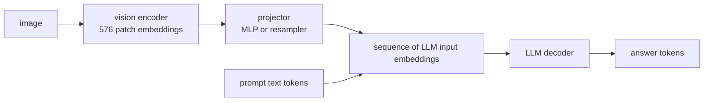
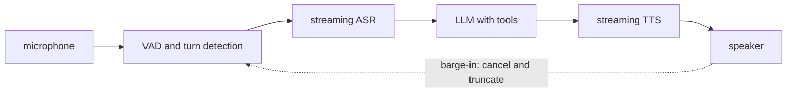
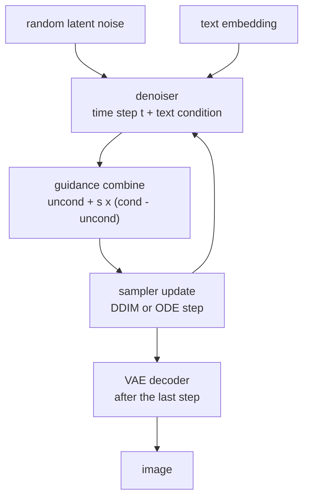

# Multimodal Models - Deep Dive

This is the long-form companion to [README.md](README.md) (the crash course) and [questions.md](questions.md) (the drill). The README tells you what a VLM, CLIP, diffusion or a voice pipeline is. This file explains why each piece is built the way it is, with the arithmetic you need to defend a design: how many tokens an image costs, what the contrastive loss does to a batch, why a spectrogram looks the way it does, what a diffusion network is trained to predict, and how to read a hallucination benchmark. It is written for someone who has already used a vision-language API and now wants to answer follow-up questions without hand-waving.

Suggested study order and time: Parts 1 to 3 (images, CLIP, VLM architecture) in one sitting of about 3 hours, because every later part reuses them. Parts 4 and 5 (documents and retrieval) about 1.5 hours. Part 6 (audio) about 2 hours. Part 7 (diffusion) about 2.5 hours, the densest part. Parts 8 and 9 (video, grounding, evaluation) about 1.5 hours. Then do the exercises, about 6 hours for all seven. Total: 16 to 18 hours.

## Prerequisites

- Transformer basics: attention, embeddings, the KV cache. See [../02-llm-fundamentals/deep-dive.md](../02-llm-fundamentals/deep-dive.md).
- Training basics: cross-entropy, softmax, gradient descent, normalisation. See [../01-ml-and-dl-foundations/deep-dive.md](../01-ml-and-dl-foundations/deep-dive.md).
- Retrieval basics: dense embeddings, ANN indexes, ColBERT-style late interaction. See [../04-rag-and-retrieval/deep-dive.md](../04-rag-and-retrieval/deep-dive.md).
- Evaluation habits (labelled sets, confidence intervals, judges). See [../07-evaluation-and-observability/deep-dive.md](../07-evaluation-and-observability/deep-dive.md).
- Serving cost and latency vocabulary (prefill, time to first token, KV cache). See [../08-inference-and-production/deep-dive.md](../08-inference-and-production/deep-dive.md).
- Python and numpy, enough to read the snippets.

## Contents

- [Part 1 - Images as tokens](#part-1---images-as-tokens)
- [Part 2 - Contrastive vision-language pretraining](#part-2---contrastive-vision-language-pretraining)
- [Part 3 - VLM architectures and how they are trained](#part-3---vlm-architectures-and-how-they-are-trained)
- [Part 4 - Document understanding](#part-4---document-understanding)
- [Part 5 - Multimodal retrieval](#part-5---multimodal-retrieval)
- [Part 6 - Audio: spectrograms, ASR and voice agents](#part-6---audio-spectrograms-asr-and-voice-agents)
- [Part 7 - Image generation: diffusion and flow matching](#part-7---image-generation-diffusion-and-flow-matching)
- [Part 8 - Video and spatial grounding](#part-8---video-and-spatial-grounding)
- [Part 9 - Evaluation, hallucination and safety](#part-9---evaluation-hallucination-and-safety)
- [Putting it together](#putting-it-together)
- [Exercises](#exercises)
- [Further study](#further-study)

---

## Part 1 - Images as tokens

### The problem

A transformer consumes a sequence of vectors. Text has a natural discrete sequence. An image is a 2-D grid of pixels with strong local structure and no natural "next". Feeding every pixel as a token is hopeless: a 224 x 224 image has 50,176 pixels, and self-attention cost grows with the square of the sequence length. The ViT answer is to cut the image into patches and treat each patch as one token.

### Patchify, embed, add position

Take an image of height H and width W with 3 channels and a patch size p. The grid has (H / p) x (W / p) patches. Each patch is flattened to a vector of p x p x 3 numbers and multiplied by one learned matrix to get a d-dimensional embedding. A position embedding is added so the model knows where each patch came from, and the sequence goes through ordinary transformer layers.

Worked example, the original ViT-B/16: a 224 x 224 image, p = 16. The grid is 14 x 14 = 196 patches. Each patch holds 16 x 16 x 3 = 768 numbers, and ViT-B has d = 768, so the embedding matrix is 768 x 768. Equivalent view: the patch embedding is a convolution with kernel p, stride p, and d output channels.

For CLIP ViT-L/14 at 336 px: p = 14, grid 24 x 24 = 576 patches, patch vector 14 x 14 x 3 = 588 numbers, d = 1024. These are the numbers behind the "576 image tokens" you see in LLaVA-1.5.

The reshape trick: split each spatial axis into (blocks, within-block), move the two block axes next to each other, and flatten. Exercise 1 asks you to write this and its inverse.

### Why the sequence length is the whole story

Per transformer layer, with N tokens and width d, the multiply-adds are roughly:

```text
projections + MLP:   12 * N * d^2     (4 N d^2 for Q, K, V, O and 8 N d^2 for a 4x MLP)
attention scores:    2 * N^2 * d      (QK^T and then the weighted sum of V)
```

The two terms are equal when N = 6d. For ViT-L (d = 1024) that is N = 6,144 tokens. At the 576 tokens of a 336 px image, attention is only 576 / (6144 + 576) = 8.6% of the layer compute, so cost is close to linear in tokens. At 4,096 tokens (a 896 x 896 image with 14 px patches is 64 x 64) attention is 4096 / (6144 + 4096) = 40%. So doubling the side length multiplies the token count by 4 and the encoder compute by a bit more than 4, and the attention matrix alone grows 16 times.

The LLM side has its own bill. Image tokens enter the LLM context, so they pay for prefill compute and for KV cache memory for the whole conversation. For a Llama-style 7B model (32 layers, 32 KV heads, head dimension 128, fp16), the KV cache costs 2 x 32 x 32 x 128 x 2 bytes = 524,288 bytes per token. One 576-token image therefore holds 576 x 524,288 = 302 MB of cache for as long as the conversation lives. With grouped-query attention (8 KV heads) it is 75 MB. This is a main reason providers charge for images as tokens and cap images per request.

### What providers do with the pixels

Every provider turns an image into a token count that grows with area, but the formulas differ and change with model generations, so check current documentation before quoting a price. The README lists the current schemes. Three simplified models, all implemented in the exercise code:

1. **Fixed 512 px tiles.** Scale so the longer side is at most 2,048, then so the shorter side is at most 768, then count 512 x 512 tiles. Tokens = 85 + 170 x tiles. A 1,024 x 1,024 image becomes 768 x 768, which is 2 x 2 = 4 tiles, so 85 + 680 = 765 tokens. A 2,048 x 4,096 image becomes 768 x 1,536, which is 2 x 3 = 6 tiles, so 1,105 tokens.
2. **Per-patch with a cap.** Tokens = ceil(W / 28) x ceil(H / 28), and images over the cap are downscaled first. A 1,000 x 1,000 image is 36 x 36 = 1,296 tokens. A 1,568 x 1,568 image would be 56 x 56 = 3,136 tokens, so with a 1,568 cap it is shrunk until it fits.
3. **Fixed budget tiers.** The caller picks a resolution setting and the model spends a fixed token count per image regardless of size.

Same image, three bills. Take 1,344 x 896 (a typical wide photo):

```text
fixed 512 px tiles:  longer side ok, shorter 896 > 768 -> scale to 1152 x 768
                     tiles = ceil(1152/512) x ceil(768/512) = 3 x 2 = 6
                     tokens = 85 + 170 x 6 = 1,105
per-patch (28 px):   48 x 32 = 1,536 tokens (fits a 1,568 cap)
AnyRes, 336 tiles:   grid 3 x 2 + one global thumbnail = 7 views
                     7 x 576 = 4,032 raw tokens, or 7 x 144 = 1,008 after 4x compression
```

Three answers between roughly 1,000 and 4,000 for one image. Never quote "an image costs N tokens". Quote the formula for the model you are using and the resolution you will actually send.

### Dynamic tiling (AnyRes)

A fixed-resolution encoder trained at 336 or 448 px sees a 4,000 x 1,000 banner as a squashed smear if you resize it to a square. Dynamic tiling fixes that without retraining the encoder:

1. Choose a grid (cols x rows) whose aspect ratio is closest to the image's, subject to a maximum number of tiles.
2. Resize the image to (cols x tile) by (rows x tile) and cut it into tiles.
3. Add one low-resolution global thumbnail so the model keeps the whole-image context.
4. Encode every view independently and concatenate the tokens, usually with a row-break marker so the LLM can recover the layout.

Worked example, tile = 336, at most 6 tiles. A 1,344 x 672 image has ratio 2:1. The grids with ratio 2 are 2 x 1 (2 tiles) and 4 x 2 (8 tiles, over the limit), so choose 2 x 1: 2 tiles + 1 thumbnail = 3 views. A 672 x 672 image has ratio 1. Both 1 x 1 and 2 x 2 match, and the rule "prefer the bigger grid when the image fills at least half of it" picks 2 x 2, since 451,584 is above 0.5 x 336^2 x 4 = 225,792. That is 4 tiles + 1 thumbnail = 5 views, 2,880 tokens at 576 per view. A 200 x 200 icon fails that test and uses 1 view: do not upsample to spend tokens on nothing.

The cost control knob is tokens per view. A pixel-shuffle step merges each 2 x 2 neighbourhood of patch embeddings into one wider token, cutting 1,024 tokens to 256 (InternVL does this on 448 px tiles). Qwen2-VL merges 2 x 2 patches in its projector for the same reason. Compression trades fine detail (small text) for context.

### Check yourself

1. A ViT with 14 px patches sees a 518 x 518 image. How many patches, and how does the attention pair count compare with 224 x 224?

<details><summary>Answer</summary>

518 / 14 = 37, so 37 x 37 = 1,369 patches. A 224 x 224 image has 16 x 16 = 256 patches. Tokens grow 5.35 times and attention pairs (N squared) grow 28.6 times: 1,369^2 = 1,874,161 versus 65,536.

</details>

2. Why does a dynamic-tiling VLM add a global thumbnail?

<details><summary>Answer</summary>

Tiles are encoded independently, so no tile sees the whole image. The thumbnail gives the LLM a coarse view of the full layout while the tiles supply fine detail. Without it, objects that straddle tile boundaries and global questions suffer.

</details>

3. Compute the KV-cache memory for a 1,024-token image in a model with 40 layers, 8 KV heads, head dimension 128, fp16.

<details><summary>Answer</summary>

Per token: 2 (K and V) x 40 x 8 x 128 x 2 bytes = 163,840 bytes. For 1,024 tokens: 167,772,160 bytes, about 168 MB.

</details>

---

## Part 2 - Contrastive vision-language pretraining

### The problem CLIP solves

Before CLIP, vision models were trained to predict one of a fixed set of labels (1,000 ImageNet classes). The labels were expensive and the features were tied to that vocabulary. The web, though, contains billions of images with free-text captions or alt text. CLIP's idea: do not predict the text, just learn which caption goes with which image. That only requires matching pairs to score higher than non-matching pairs, a much easier target than generating text, and it uses open-vocabulary language as supervision.

### The loss, step by step

Two encoders, an image encoder f and a text encoder g, each ending in a linear map to a shared d-dimensional space. For a batch of N (image, caption) pairs:

1. Embed and L2-normalise: u_i = f(image_i) / ||f(image_i)||, v_j = g(text_j) / ||g(text_j)||.
2. Build the N x N similarity matrix S_ij = <u_i, v_j> / T, where T is a temperature.
3. The correct match for row i is column i. Apply cross-entropy over each row (an image picks its caption among N) and over each column (a caption picks its image among N).
4. Average the two: L = (CE_rows + CE_cols) / 2.

This is InfoNCE with N - 1 in-batch negatives, applied in both directions. It is symmetric because retrieval runs in both directions: the row term trains image-to-text search, the column term trains text-to-image search, and using both gives every embedding in the batch a gradient from N - 1 competitors.

### A worked batch

Batch of 3. Cosine similarities, rows = images, columns = captions:

```text
         c0    c1    c2
img0    0.8   0.2   0.1
img1    0.3   0.7   0.4
img2    0.1   0.5   0.6
```

With T = 0.1 the logits are 10 times larger (8, 2, 1 and so on). Per-row losses (image-to-text), each the negative log softmax of the diagonal entry:

```text
row 0: logits (8, 2, 1)  -> p = 0.9966 -> loss 0.0034
row 1: logits (3, 7, 4)  -> p = 0.9362 -> loss 0.0659
row 2: logits (1, 5, 6)  -> p = 0.7273 -> loss 0.3182   (caption 1 at 0.5 is close to the true 0.6)
mean image-to-text = 0.1292
```

Per-column losses (text-to-image): 0.0076, 0.1328, 0.1328, mean 0.0911. The CLIP loss is (0.1292 + 0.0911) / 2 = 0.1101. Row 2 carries more than half of the image-to-text loss: the loss concentrates on hard negatives, which is the point of in-batch contrastive learning.

### Temperature

Temperature controls how peaked the softmax is.

- High T (say 1.0): logits span a narrow range because cosine similarity is in [-1, 1]. The softmax stays flat, loss stays high, and the gradient does not distinguish hard from easy negatives.
- Low T (0.01 to 0.05): small similarity differences become large logit differences. The loss focuses on the hardest negatives, and training can be unstable or overfit to false negatives (another caption that is also valid for the image).

Reproduce it by hand with N = 4, positive similarity 0.9 and three negatives at 0.5. T = 1 gives p = 0.332 and loss 1.10. T = 0.1 gives p = 0.948 and loss 0.054. CLIP does not fix T. It learns it as a parameter (a log-scale scalar, initialised at 0.07 and clipped so the scale never exceeds 100, which means T never goes below 0.01), so the model sharpens itself as embeddings improve.

Two consequences. Loss values are not comparable across temperatures. And the loss of an uninformative model is log N: with N = 32,768 pairs in a batch that is 10.4, so bigger batches give harder, more informative negatives, which is why CLIP-style training used batches of about 32k.

### Zero-shot classification as nearest-neighbour search

To classify an image without labelled examples of the target classes:

1. Write a prompt per class, for example "a photo of a golden retriever", and embed each prompt with the text encoder.
2. Embed the image.
3. Predict the class whose prompt embedding has the highest cosine similarity.

The classifier head is built from text at inference time. Two details matter. Prompt wording shifts accuracy by several points: "a photo of a {class}" beats the bare class name, because captions in training data look like sentences. And the CLIP authors improved results by averaging embeddings from many templates per class ("a photo of the large {class}", "a drawing of a {class}"), re-normalising, and using that mean as the class vector. The reported zero-shot ImageNet top-1 for the largest CLIP is about 76%, with no ImageNet training labels used. Adding a class costs one text-encoder pass, and the same space does image-to-text and text-to-image retrieval.

### SigLIP: replace the softmax with independent binary problems

The softmax over a batch makes every pair depend on all others, which complicates multi-device training because every device needs the full N x N logit set. SigLIP treats each (i, j) pair as an independent binary classification:

```text
loss = - (1/N) * sum over i, j of log sigmoid( z_ij * (t * <u_i, v_j> + b) )
       with z_ij = +1 when i == j and -1 otherwise
```

Here t is a learnable scale and b a learnable bias. The bias matters: there are N positives and N^2 - N negatives, so at initialisation the loss would be dominated by negatives. Starting with b = -10 (and t = 10) makes "no match" the default. A single aligned pair at that initialisation gives logit 0 and loss log 2 = 0.693, and a negative pair gives logit -10 and loss log(1 + e^-10) = 0.00005. The exercise implements both losses.

### What contrastive models can and cannot do

Strengths: broad open-vocabulary recognition, cheap retrieval, robust features that transfer to VLMs. Weaknesses worth naming in an interview:

- **Bag-of-words behaviour.** The loss only needs to separate captions within a batch, and random batches rarely contain "the dog chased the cat" versus "the cat chased the dog". So word order, attribute binding (red cube, blue sphere), negation and counting are weak. Hard-negative training (captions with swapped words) helps.
- **Short, caption-style text.** CLIP's text encoder reads 77 tokens trained on alt-text style captions, not documents.
- **Modality gap.** Image and text embeddings occupy separate cones of the sphere even after training. Rankings within a modality pair are still right, but mixing image-image and text-image similarities under one threshold is unreliable.
- **No dense or localised features.** The global embedding was trained for image-level matching. Later variants add localisation and dense-feature objectives, which matters for VLMs that must read small text.
### Check yourself

1. In a batch of N pairs, how many positive and negative pairs does the CLIP loss use, and what is the loss when the model is totally uninformative?

<details><summary>Answer</summary>

The matrix has N positives and N^2 - N negatives, so each row has one positive and N - 1 negatives. An uninformative model gives equal logits, each softmax is uniform, and the loss is log N.

</details>

2. Why does a smaller temperature punish hard negatives more?

<details><summary>Answer</summary>

Dividing cosine similarity by a small T stretches logit differences, so a negative only slightly less similar than the positive still gets a large softmax probability and a large gradient. At large T the logits are squeezed and the gradient is nearly uniform over negatives.

</details>

3. Why does SigLIP need a bias term initialised to a large negative value?

<details><summary>Answer</summary>

There are N^2 - N negative pairs and only N positives. With a zero bias the initial loss and gradient would be dominated by negatives, pushing every logit down and slowing early training. A bias near -10 starts the model with the correct prior, "most pairs do not match".

</details>

---

## Part 3 - VLM architectures and how they are trained

### The standard recipe

A vision-language model has three parts: an encoder that turns pixels into patch embeddings, a projector that maps them into the LLM's embedding space, and a decoder LLM. The image embeddings are placed in the LLM's input sequence where the image appears in the prompt, and from then on attention does the rest.



The model is trained with the ordinary next-token loss on the answer tokens only. Image positions contribute no loss, and prompt tokens usually do not either.

### Projector options

All of these map N encoder tokens of width d_v to M LLM-space tokens of width d_llm.

**Linear or MLP (LLaVA).** Each patch embedding goes through a linear layer or a two-layer MLP independently. M = N, so nothing is compressed. For d_v = 1024 and d_llm = 4096, a two-layer MLP has 1024 x 4096 + 4096 + 4096 x 4096 + 4096 = 20,979,712 parameters, about 21M. Next to a 7B LLM and a 300M encoder that is tiny, which is why it can be trained in hours.

**Q-Former (BLIP-2) and Perceiver Resampler (Flamingo).** A fixed set of M learned query vectors cross-attends into the N patch embeddings:

```text
Q: (M, d) learned queries      K, V: (N, d) from patch embeddings
output = softmax(Q K^T / sqrt(d)) V           -> (M, d), independent of N
cost   = O(M * N * d), versus O(N^2 * d) for self-attention over all patches
```

M is fixed (32 in BLIP-2, 64 in Flamingo's resampler). A 576-patch image shrinks to 32 tokens, an 18-fold cut in LLM context. The queries learn to extract what the language model needs, and varying input sizes and video frames map to a constant budget.

The catch is information loss: 32 queries must carry everything the LLM could ask about. Tasks needing exact detail (OCR, counting, chart values) suffer. Several ablations have found that a simple MLP with all tokens (or with deterministic merging) matches or beats learned resamplers at the same training data, which is why the common recipe is MLP + tiling + light pooling. Resamplers survive where the token budget is hard (video, many images, small models).

### Cross-attention fusion versus early fusion in the input

There are two ways to let the LLM see image features.

**Prefix tokens in the sequence (LLaVA-style).** Image embeddings are tokens in the LLM's input, and every layer's self-attention sees them. No LLM architecture change. The cost is M tokens in context and in the KV cache of every layer.

**Cross-attention layers (Flamingo, and open models such as Llama 3.2 Vision).** New cross-attention layers are inserted every few LLM layers. Text hidden states are queries and image features are keys and values. The text sequence stays short and the original LLM weights can stay frozen, which preserves text ability exactly. A gated residual (a tanh gate initialised at zero) makes the new layers start as no-ops, so training begins from the original LLM's behaviour.

| | Prefix tokens | Cross-attention layers |
|---|---|---|
| LLM change | none | new layers inserted |
| Image cost in context | M tokens in every layer | M keys and values only in the cross-attention layers |
| KV cache for the image | M x all layers | M x only the cross-attention layers (1/4 of layers if every 4th) |
| Used in | LLaVA, Qwen-VL, InternVL | Flamingo, Llama 3.2 Vision |

Prefix fusion won the open-source mainstream because it is simple, scales with data, and handles interleaved multi-image prompts without extra machinery.

### Native multimodal models

The adapter approach starts from a text LLM and a vision encoder trained separately. A native (early-fusion) model trains one transformer from the start on interleaved text, images and often audio.

- **Discrete image tokens.** A VQ tokenizer maps an image to codebook indices (Chameleon uses a codebook of 8,192 entries and about 1,024 tokens per 512 x 512 image). The LLM predicts them with the same softmax as text, so it can generate images too. Cost: quantisation loses fine detail.
- **Frontier omni models.** Their makers describe them as natively multimodal. Architecture details are not published, so say "described as" in an interview and do not invent specifics.

The trade: deeper integration (understand and generate in one stream, tighter cross-modal reasoning) against a far higher training cost and less reuse of existing LLMs.

### Training stages

A typical open recipe has three phases.

**Stage 1: alignment (projector only).** Freeze the encoder and the LLM. Train only the projector on image-caption pairs (LLaVA-1.5 used about 558K) with next-token loss on the caption. This is cheap and stable and teaches the projector to land image features where the LLM expects "word-like" vectors. Skipping it and training everything from the start often damages the LLM, because a randomly initialised projector sends garbage that gradients try to explain by rewriting the LLM.

**Stage 2: visual instruction tuning.** Unfreeze the LLM (the encoder often stays frozen or gets a much lower learning rate). Train on conversational data: visual question answering, detailed descriptions, reasoning, OCR, charts, referring and grounding tasks. LLaVA-1.5's mix was about 665K examples, and the first LLaVA used GPT-generated conversations built from captions and boxes. Loss only on assistant tokens.

**Stage 3 and beyond: capability stages.** High-resolution continuation, long-context and multi-image or video data, text-only data mixed in to avoid forgetting, then preference tuning with data where the model's own hallucinations are the "rejected" answers.

Synthetic data from a stronger model is the dominant source, with its own risk: the student inherits the teacher's hallucinations and blind spots, so filtering and verification matter.

### Check yourself

1. Why is stage 1 of LLaVA-style training projector-only?

<details><summary>Answer</summary>

The projector starts random. If the LLM were trainable at the same time, gradients from garbage image embeddings would modify the LLM to compensate and damage its language ability. Freezing both large models and training only about 21M projector parameters learns the mapping cheaply and leaves a clean starting point for instruction tuning.

</details>

2. A Q-Former produces 32 tokens from 576 patches. What is gained, what is lost, and for which task does it hurt most?

<details><summary>Answer</summary>

Gained: an 18 times smaller LLM context and KV cache for the image, plus a constant budget regardless of resolution. Lost: detail, since everything the LLM may ask about must fit in 32 vectors. Dense OCR and counting hurt most.

</details>

3. A model answers "yes" to "Is there a bicycle?" for any street scene. Which data stage do you look at first?

<details><summary>Answer</summary>

Stage 2 data and any preference stage. Check whether negative questions about absent objects are present, whether there are enough "no" answers, and whether synthetic captions mention objects that were not in the image (teacher hallucinations). A balanced yes/no probe (Part 9) quantifies it.

</details>

---


## Part 4 - Document understanding

### Why documents are the hardest everyday image

A photo has a few large objects. A document page has thousands of tiny glyphs whose exact characters matter, arranged in a layout (columns, tables, headers, footnotes) that carries meaning. Errors are expensive: one wrong digit in an invoice total is a failure, while one wrong pixel in a photo is nothing. Document AI therefore sits at the boundary of the two main design choices: explicit OCR and layout analysis, or a VLM reading pixels.

### How many tokens does a page cost?

Take a US Letter page, 8.5 x 11 inches, and a per-patch scheme with 28 px patches (Part 1).

```text
DPI    pixels         tokens (ceil(W/28) x ceil(H/28))    height of 10 pt text
100    850 x 1100     31 x 40  = 1,240                    ~14 px
150    1275 x 1650    46 x 59  = 2,714                    ~21 px
200    1700 x 2200    61 x 79  = 4,819                    ~28 px
```

A 10 pt line is 10 / 72 inch tall, so at 100 DPI a full text line is only about 14 px tall. A patch 28 px wide covers roughly 4 to 5 characters horizontally and two text lines vertically. At that density the encoder must recognise characters from a few pixels each. At 200 DPI the same text is legible, but the page costs about 4,800 tokens. Compare with the text alone: a dense page of 600 words is roughly 800 text tokens. So an image of a page costs 1.5 to 6 times the tokens of its own text, and that gap is the economic argument for OCR text. It is also the reason for compression methods that reduce vision tokens per page, such as the "optical compression" approach in some document models.

For a 100-page file at 1,568 tokens per page, a typical per-image cap, the cost is 156,800 tokens per file. That calculation is exercise P2.

### The three architectures

1. **Classic OCR pipeline.** Detect text regions, recognise characters, reconstruct reading order, send the text (with coordinates) to an LLM for extraction. Strengths: per-page cost of a fraction of a cent, deterministic output, exact bounding boxes for audit and redaction. Weaknesses: reading order across columns, tables, forms with checkboxes, handwriting, and errors that cascade (OCR reads "l" for "1", the LLM trusts it).
2. **OCR-free VLM.** Page image in, JSON or Markdown out. One system, understands layout and visual cues together. Costs more per page, sometimes by 10 to 100 times with frontier models, can produce fluent wrong values, and rarely gives reliable coordinates.
3. **Document-specialised small VLMs.** Models trained to convert page images to Markdown or structured text. They handle tables and reading order far better than classic OCR at a cost closer to OCR. They still hallucinate in blurred regions.

A production decision is usually a cascade: classify pages cheaply (scanned or digital, form or prose, table-heavy), use text extraction directly for digital PDFs (a born-digital PDF has the text already, and re-OCRing it throws information away), OCR plus LLM for clean prose, and a VLM for hard pages. Always pass the VLM both the image and the OCR text, so each covers the other's blind spots: the text for exact characters, the image for layout.

### Validation is part of the design

A VLM does not know when it is wrong, so you build checks outside it.

Arithmetic identities catch most silent digit errors, because a hallucinated digit rarely keeps the sums consistent. Other checks: type and range validation (dates in a sane window), checksum digits (IBAN, VAT numbers), cross-field rules (due date after issue date), and agreement between two independent readings (OCR and VLM disagree on a field, send to review). Route failures to human review instead of retrying blindly: a second sample from the same model tends to repeat the same error.

### Metrics for document tasks

Exact match is harsh for answers with formatting variation. DocVQA uses **ANLS** (average normalised Levenshtein similarity). For one question, compare the prediction with each accepted answer, compute the normalised edit distance NL = distance / max(len(pred), len(gt)), score s = 1 - NL when NL < 0.5, else 0, and take the best over accepted answers. Example: prediction "1,234.50" against ground truth "1234.50": distance 1 (the comma), max length 8, NL = 0.125, score 0.875. The 0.5 threshold stops partial credit for garbage. For extraction products, report **per-field accuracy** on your own documents, split by field type (amounts, dates, names, free text) and by document source, since a model that is 99% right on printed invoices may be 80% on phone photos.

### Check yourself

1. A scanned 8.5 x 11 page at 150 DPI is sent to a per-patch scheme with 28 px patches. How many tokens?

<details><summary>Answer</summary>

1,275 x 1,650 pixels. ceil(1275 / 28) = 46 and ceil(1650 / 28) = 59, so 46 x 59 = 2,714 tokens.

</details>

2. Why do arithmetic validators catch many VLM digit hallucinations?

<details><summary>Answer</summary>

A wrong digit usually breaks a relationship the document itself guarantees (quantity times price equals amount, lines sum to subtotal, subtotal plus tax equals total). For all the numbers to stay consistent after one invented digit, a second compensating error would be needed, which is unlikely.

</details>

3. When does it make sense to skip OCR and use the PDF text layer?

<details><summary>Answer</summary>

Whenever the PDF is born digital (exported from software, not scanned). The text layer is exact and free. Use a layout step on top if you need reading order or table structure. Fall back to OCR for pages without a usable text layer.

</details>

---

## Part 5 - Multimodal retrieval

### Three retrieval architectures

README lists three levels of multimodal RAG. Here is how each works in detail and what it costs.

**Level 1: text-only RAG over parsed documents.** Parse and chunk text, embed, retrieve. Figures, charts, scanned text and diagram labels are lost.

**Level 2: caption at ingestion.** For each image, table or chart, a VLM writes a description (and for tables, a Markdown or CSV version). Embed the descriptions together with the nearby text. At query time retrieve descriptions, then give the original image to the VLM that answers. You pay the VLM once per image at ingestion. The failure mode: the caption decides what is findable. A query about a detail the caption omitted cannot match.

**Level 3: embed the page image.** CLIP-like dual encoders embed a page into one vector, which works for photos but not for text-heavy pages: one vector cannot hold a table's cells. ColPali-style models embed a page into many vectors instead.

### Late interaction on page images

ColPali feeds a page image through a VLM backbone and projects each output patch embedding to a small dimension (128). A page becomes about 1,024 vectors. The query is text, encoded into one 128-dimensional vector per query token. Score a page with MaxSim, the ColBERT operator:

```text
score(q, page) = sum over query tokens i of  max over page patches j of  <q_i, p_j>
```

```python
import numpy as np

def maxsim(q: np.ndarray, page: np.ndarray) -> float:
    """q: (Lq, d) query token vectors, page: (Lp, d) patch vectors, both L2-normalised."""
    return float((q @ page.T).max(axis=1).sum())
```

Worked example with 2 query tokens and 3 patches:

```text
similarities  patch0 patch1 patch2
q token 0       0.9    0.1    0.2     max = 0.9
q token 1       0.3    0.8    0.4     max = 0.8
score = 1.7
```

A second page whose patches are all moderately similar to both tokens (0.5 everywhere) scores 1.0. The first page wins because each query token found a patch that specifically matches it: one patch shows the word "Q3", another shows the number "revenue" in a table header. A single mean-pooled page vector blurs that into a general "financial page" and cannot separate this page from many similar ones.

The costs, using the exercise numbers:

- **Storage.** 1,024 vectors x 128 dimensions x 2 bytes (fp16) = 262,144 bytes per page. For 5,000 pages that is 1.31 GB, versus 10 MB for one 1,024-dimension vector per page, 128 times more. Quantisation (binary or int8) and pruning of background patches cut this by an order of magnitude with modest quality loss.
- **Compute.** A 20-token query against 1,024 patches of width 128 is 20 x 1,024 x 128 = 2.6M multiply-adds per page. 5,000 pages is 13 GMAC, which is trivial on a GPU. A million pages is 2.6 TMAC per query, so use a first-stage candidate generator (a pooled single vector per page, or a text index) and apply MaxSim to the top few hundred.


When to choose which: Level 2 for mixed corpora with mostly text and some figures and a need for cheap storage; Level 3 for visually rich, layout-heavy collections (slides, scientific papers with figures, forms) where parsing quality is the main source of error; a hybrid (text index for exact terms plus page-image retrieval for visual content, merged with rank fusion) for corpora where users search both ways. Evaluate retrieval separately from generation: recall at k on a labelled question set, because a good generator cannot fix a missed page.

### Check yourself

1. Why does MaxSim retain information that mean pooling loses?

<details><summary>Answer</summary>

Mean pooling averages all patches into one vector, mixing everything on the page. MaxSim keeps one vector per patch and lets each query token select its own best-matching patch, so distinct pieces of evidence (a number, a header, a legend entry) can each contribute to the score.

</details>

2. Compute the storage for 100,000 pages with 1,024 patches, 128 dimensions, int8.

<details><summary>Answer</summary>

1,024 x 128 x 1 byte = 131,072 bytes per page, times 100,000 = 13.1 GB. fp16 would be 26.2 GB.

</details>

3. Your caption-based RAG misses queries about small table cells. Which level fixes that and what does it cost?

<details><summary>Answer</summary>

Page-image late interaction (Level 3) or storing the table as parsed rows in the text index. Level 3 costs multi-vector storage and a VLM at answer time. Parsing tables into rows costs a good table extractor and still fails on irregular layouts.

</details>

---

## Part 6 - Audio: spectrograms, ASR and voice agents

### From waveform to a picture

Speech at 16 kHz is 16,000 numbers per second. A 30-second clip is 480,000 samples. A model could consume raw samples with strided convolutions (wav2vec 2.0 does), but the dominant representation for ASR is a **log-mel spectrogram**, built in four steps:

1. **Frame.** Cut the signal into overlapping windows of 25 ms (400 samples) with a hop of 10 ms (160 samples). Within 25 ms speech is roughly stationary.
2. **Window and transform.** Multiply each frame by a Hann window (to avoid edge artefacts) and take an FFT. The output has n_fft / 2 + 1 bins, spaced sr / n_fft apart: for n_fft = 400 that is 40 Hz. Take the squared magnitude to get power.
3. **Mel filterbank.** Collapse the linear frequency bins into about 80 bands equally spaced on the mel scale, using overlapping triangular filters.
4. **Log.** Take the logarithm of each band's energy.

The mel scale approximates human pitch perception: mel = 2595 x log10(1 + f / 700). Some values: 1,000 Hz is 1,000 mel, 4,000 Hz is 2,146 mel, 8,000 Hz is 2,840 mel. The band from 0 to 1,000 Hz takes 35% of the whole mel range, while 4,000 to 8,000 Hz (half the bandwidth) takes only 24%. So the mel filterbank devotes resolution to low frequencies, where vowels and the first formants live, and uses a few wide filters for the noisy high end of consonants.

Why log: loudness perception is roughly logarithmic, the dynamic range of speech is huge, and a gain change (the speaker moves away from the microphone) becomes an additive shift rather than a multiplicative one. Doubling the amplitude multiplies power by 4 and adds log10(4) = 0.602 to every log-mel value in bands carrying energy. Exercise 3 verifies it.

Resulting size: 30 s at 100 frames per second is 3,000 frames x 80 bands = 240,000 values, half of the raw 480,000 samples, now arranged as a 2-D image of time versus frequency. Whisper's encoder then applies two convolutions, the second with stride 2, so the transformer sees 1,500 positions for 30 seconds, one per 20 ms, 50 per second.

### Whisper-style encoder-decoder ASR

The architecture: a transformer encoder over the 1,500 positions, and an autoregressive decoder that cross-attends to the encoder output and emits text tokens. A prefix of special tokens configures the task:

```text
<|startoftranscript|> <|en|> <|transcribe|> <|notimestamps|>  hello world <|endoftext|>
```

Multitask format: language identification, transcription, translation to English, and timestamps are all next-token prediction with different prefixes. Whisper trained on about 680,000 hours of weakly supervised audio (noisy transcripts from the web), and its robustness to accents, background noise and domain shift comes from that diversity and scale, not from a clever architecture.

Behaviours to know:

- **Fixed 30-second windows.** Longer audio is chunked, with timestamps and previously decoded text carried across windows. This is not natively streaming. Real-time products use streaming models or chunk with overlap.
- **Hallucination on silence or music.** The decoder is a language model: given no speech, it can emit a plausible phrase ("Thanks for watching") or loop. Mitigations: a voice activity detector to remove non-speech, a no-speech probability threshold (default 0.6 in the reference implementation), log-probability and compression-ratio checks that trigger a retry at higher temperature (defaults -1.0 and 2.4), and turning off conditioning on previous text, which prevents a bad segment from poisoning later ones.
- **CER** (character error rate) is the same ratio over characters, used for languages without spaces and for OCR. "kitten" to "sitting" is 3 edits over 6 characters, CER 50%.
- **WER ignores importance.** Missing "not" is one error out of ten words, like a dropped article. For products, add task metrics: entity accuracy (names, numbers), command success, downstream answer accuracy.


### Voice agents: pipeline versus speech-to-speech



A cascaded pipeline puts text in the middle, so you can log it, apply guardrails, call tools, swap vendors and inspect failures. A native speech-to-speech model skips the text boundary, hears tone and hesitation, and can answer quickly, but you have less visibility and fewer options to control it.

**Latency budget.** People leave gaps of roughly 200 ms between turns, and sub-second voice-to-voice response is the goal, with 500 to 800 ms feeling good. Add up a plain pipeline:

```text
endpointing (decide the user stopped)        200 ms
ASR finalisation                             150 ms
LLM time to first token                      350 ms
LLM streaming until the first full sentence  200 ms
TTS time to first audio                      150 ms
network (both directions)                    100 ms
total                                       1,150 ms
```

That is 350 ms over an 800 ms target. Where to cut, in order of payoff:

1. **Overlap, do not serialise.** Stream partial transcripts into the LLM, stream tokens into TTS, and start TTS on the first clause rather than the first complete sentence. Chunking policy trades latency against prosody: a clause of 5 to 8 words usually sounds fine.
2. **Smarter endpointing.** A fixed silence timeout (say 700 ms) either cuts people off mid-thought or adds dead air. A semantic turn-detection model over the streaming transcript waits less when the utterance is complete ("What is my balance?") and longer when it trails off ("My account number is..."). Saving 100 ms on endpointing applies to every turn.
3. **Reduce time to first token.** Cache the system prompt and tool definitions, keep the prompt short for voice, use a smaller or faster model for the opening response. The LLM time depends on prompt length through prefill.
4. **Colocate and keep connections warm.** Network and TLS setup should not be paid per turn. Use a persistent WebRTC or WebSocket stream.

A realistic target after these steps: 100 + 50 + 200 + 100 + 150 + 100 = 700 ms.

**Interruptions (barge-in).** Keep VAD running while the agent speaks, with echo cancellation so the agent does not hear itself. On detected speech: stop playback immediately, cancel LLM and TTS generation, and truncate the stored conversation to what the user actually heard, using word timestamps from TTS. If you keep the full planned reply in history, the model will believe it said things the user never heard. Tune sensitivity: a cough or "mm-hm" should not stop the agent, so classify backchannels separately from real interruptions.

### Check yourself

1. A 16 kHz signal, 25 ms window, 10 ms hop, 10 s long. How many frames and what is the FFT bin spacing at n_fft = 512?

<details><summary>Answer</summary>

Samples 160,000. Frame length 400, hop 160, so 1 + (160,000 - 400) / 160 = 998 frames (floor of 997.5 is 997, plus 1). Bin spacing 16,000 / 512 = 31.25 Hz.

</details>

2. Why does the mel scale help speech models?

<details><summary>Answer</summary>

It spends more filters on low frequencies, where speech carries most of its phonetic information, and compresses the high band, so the representation matches perceptual resolution and is smaller and more stable than a linear spectrogram.

</details>

3. A system has WER 12% with many insertions on call recordings that include hold music. What do you try?

<details><summary>Answer</summary>

Voice activity detection to drop music and silence before ASR, a no-speech threshold, disabling conditioning on previous text, and checking whether the insertions come from music. Then re-measure with the S, D, I breakdown.

</details>

4. You must cut 300 ms from a voice agent. Name the three cheapest changes.

<details><summary>Answer</summary>

Start TTS on the first clause instead of the full sentence, replace the fixed silence timeout with semantic turn detection, and cache the prompt prefix (or use a faster model for the first response). All three attack serial waiting without changing models' answers.

</details>

---

## Part 7 - Image generation: diffusion and flow matching

### The idea

Modelling the joint distribution of millions of pixel values directly is hard. Diffusion decomposes it. A fixed forward process destroys an image by adding a little Gaussian noise at a time. A network learns to undo one small step. Generation starts from pure noise and undoes steps until an image remains. Each learned step is a regression problem, which is why training is stable compared with GANs.

### The forward process and the noise schedule

Choose small variances beta_1, ..., beta_T. One step is q(x_t | x_{t-1}) = Normal(sqrt(1 - beta_t) x_{t-1}, beta_t I). Define alpha_t = 1 - beta_t and abar_t = alpha_1 x ... x alpha_t. A sum of independent Gaussians is Gaussian, so t steps collapse into one jump:

```text
x_t = sqrt(abar_t) * x_0 + sqrt(1 - abar_t) * eps,    eps ~ Normal(0, I)
```

Training never simulates the chain: pick any t, draw eps, compute x_t. The coefficient sqrt(abar_t) is the signal that remains, sqrt(1 - abar_t) the noise, and abar_t / (1 - abar_t) the signal-to-noise ratio (SNR).

The original linear schedule runs beta from 1e-4 to 0.02 over T = 1000 steps:

```text
t       abar_t      SNR
100     0.897       8.7
250     0.524       1.10
500     0.0786      0.085
750     0.0034      0.0034
1000    4.0e-5      ~0
```

By t = 500 only 8% of the signal remains, and the last 250 steps work on nearly pure noise, which wastes network evaluations. The **cosine schedule**, abar_t = f(t) / f(0) with f(t) = cos^2(((t / T + s) / (1 + s)) x pi / 2) and s = 0.008, keeps abar at 0.847 at t = 250 and 0.494 at t = 500. Exercise 5 computes both.

### What the network predicts

```python
# one training step (pseudocode in numpy style)
t = rng.integers(0, T)                   # random timestep per example
eps = rng.normal(size=x0.shape)
x_t = np.sqrt(abar[t]) * x0 + np.sqrt(1 - abar[t]) * eps
loss = np.mean((eps_theta(x_t, t) - eps) ** 2)   # plain MSE
```

Three equivalent targets trade stability across noise levels:

- **eps-prediction:** x0 = (x_t - sqrt(1 - abar) eps) / sqrt(abar). Errors at high noise (abar near 0) are amplified by 1 / sqrt(abar).
- **v-prediction:** v = sqrt(abar) eps - sqrt(1 - abar) x0. Well behaved at every noise level, used by many modern and distilled models, and it supports a schedule that ends at exactly zero SNR so training matches sampling.


### A closed-form denoiser you can run

For data x0 ~ Normal(m, s0^2) the optimal predictor is exact. Marginally x_t is Normal(sqrt(abar) m, abar s0^2 + 1 - abar), and

```text
E[eps | x_t] = sqrt(1 - abar) * (x_t - sqrt(abar) * m) / (abar * s0^2 + 1 - abar)
```

At abar near 0 this is x_t itself (all noise). A real network learns such a function for distributions with no closed form. Plugging this predictor into the DDIM sampler below with m = 3 and s0 = 0.5, from standard normal noise, gives mean 2.99 and standard deviation 0.47 at 50 steps, 0.33 at 8 steps, 0.49 at 200 steps and 0.50 at 1,000 steps (20,000 samples, seed 0). The mean is right at every step count. The spread shrinks when the sampler takes too few steps, which in images means lost diversity and detail.

### Sampling: DDPM and DDIM

DDPM adds fresh noise at each of the T steps. **DDIM** rewrites the update so it can skip steps and be deterministic:

```python
def ddim_step(x, eps, abar_t, abar_prev):
    x0_hat = (x - np.sqrt(1 - abar_t) * eps) / np.sqrt(abar_t)       # current guess of the clean image
    return np.sqrt(abar_prev) * x0_hat + np.sqrt(1 - abar_prev) * eps  # re-noise to the next, lower level
```

Pick any decreasing timestep sequence, for example 50 of 1,000. Same noise in, same image out. Sampling is then an ODE integration, so higher-order solvers (DPM-Solver, Heun) reach good images in roughly 15 to 30 steps, and distillation reaches 1 to 4.

### Latent diffusion

A 512 x 512 x 3 image is 786,432 values per step. **Latent diffusion** trains a VAE that maps it to a latent 8 times smaller per side, 64 x 64 x 4 = 16,384 values, 48 times fewer. Diffusion runs in latent space and the VAE decoder runs once at the end. The denoiser has moved from a U-Net to a transformer (**DiT**) over latent patches as in Part 1: a 64 x 64 latent with patch size 2 gives 1,024 tokens. A 1,024 x 1,024 image with a 16-channel latent is 128 x 128 x 16, about 4,096 tokens, so attention cost matters again.

### Classifier-free guidance

Condition the denoiser on a text embedding c, and replace c with an empty embedding for about 10 to 20% of training examples, so one network learns both eps(x_t, c) and eps(x_t). At sampling, run both and extrapolate:

```text
eps_guided = eps_uncond + s * (eps_cond - eps_uncond)
```

By Bayes, grad log p(c | x) = grad log p(x | c) - grad log p(x), so this is the conditional score plus (s - 1) times an implicit classifier gradient. Scale 1 is plain conditional sampling, 0 is unconditional, above 1 sharpens toward the prompt. Numbers from the exercise 5 toy, with unconditional Normal(0, 1), conditional Normal(2, 0.3^2) and 50 DDIM steps:

```text
scale 0:  mean 0.00, std 0.96     (unconditional)
scale 1:  mean 2.00, std 0.27     (conditional)
scale 3:  mean 2.32, std 0.017    (past the conditional mean, diversity almost gone)
scale 7:  mean 2.22, std 0.00001  (collapsed to a point)
```

Guidance trades diversity for adherence, and at high scale the prediction leaves the range the network saw in training: oversaturated colour, burnt contrast, artefacts. Mitigations: rescale toward the conditional prediction's standard deviation, guide only a middle band of steps, or distil guidance into the model. Cost: two evaluations per step, so 30 steps is 60 passes.



### Flow matching and rectified flow

Flow matching uses the simplest path, a straight line between a data point and a noise sample:

```text
x_t = (1 - t) * x_0 + t * eps,     velocity target v = eps - x_0
```

The network predicts v from (x_t, t), and sampling integrates dx/dt = v from t = 1 (noise) to t = 0, for example with Euler steps. Worked example: x0 = 2, eps = -1, so v = -3. At t = 0.5, x = 0.5. One Euler step from t = 1 (x = -1) to t = 0 gives -1 - 1 x (-3) = 2, exactly x0. For a single pair the path is straight and one step is exact. At inference the network does not know which data point a noise sample pairs with, so it learns the average velocity over all candidates, and the true flow bends. Even so, paths are straighter than diffusion's, 20 to 30 steps is common, and the objective is a plain regression. SD3 and Flux-class models use this with transformer denoisers, and guidance, latents and text conditioning carry over unchanged.

### Check yourself

1. At abar = 0.5, what are the signal and noise coefficients for x_t, and the SNR?

<details><summary>Answer</summary>

Both are sqrt(0.5) = 0.707. SNR = 0.5 / 0.5 = 1.

</details>

2. In the flow-matching example, why is one Euler step exact for one data-noise pair but not for a dataset?

<details><summary>Answer</summary>

For one pair the velocity is the constant eps - x0, so the path is straight. For a dataset the network sees only x_t and t and outputs the expected velocity over all pairs that could have produced x_t. That expectation changes along the path, so the true flow bends and needs more steps.

</details>

3. In the toy problem, 8-step DDIM keeps the mean but loses spread. What does that suggest about few-step samplers on images?

<details><summary>Answer</summary>

Discretisation error from large steps is systematic: samples are pulled toward the centre of the distribution. For images that means blander, less diverse outputs. Higher-order solvers, more steps or distillation reduce it.

</details>

---

## Part 8 - Video and spatial grounding

### Video as many images

**Token budget arithmetic.** Suppose a frame costs 258 tokens (an older Gemini figure) and audio costs about 32 tokens per second. One hour at 1 frame per second is 3,600 x 258 = 928,800 frame tokens plus 3,600 x 32 = 115,200 audio tokens, about 1.04 million. A 45-minute video at the same settings is 783,000 tokens (exercise P8), and a 200,000-token context fits it with audio only at about 0.16 frames per second. Cost and context, not model quality, are the first constraints.

**Encoding choices.** Per-frame image encoding with concatenation is simplest and works with any VLM. Spatio-temporal patches ("tubelets", as in ViViT) span 2 frames x 16 x 16 pixels, so 8 frames of 224 px give 4 temporal slots x 196 patches = 784 tokens instead of 1,568, because neighbouring frames are redundant. Timestamps as text between frames ("00:12") help the LLM answer "when" questions.

### Sampling strategies

| Strategy | How | Good for | Fails on |
|---|---|---|---|
| Uniform | k frames at the centres of k equal segments | General summaries | Short events between samples |
| Fixed fps with a cap | 1 fps, thinned when over budget | Most products | Long videos, fast action |
| Keyframes | Keep frames that changed enough from the last kept frame | Slides, lectures, scene cuts | Noisy video, very slow changes |
| Query-aware | Retrieve candidate frames by text similarity, then sample densely near them | Questions about specific moments | Questions needing the whole video |
| Hierarchical | Coarse pass, then high-fps zoom on chosen windows | Long video | Needs a good first pass |

In the exercise, a 2-frame flash at indices 40 and 41 of a 100-frame clip falls between 10 uniform samples (indices 5, 15, ..., 95), and keyframe selection finds it. A keyframe threshold that is too low picks up camera noise and one that is too high skips real transitions.

Hierarchical cost for a one-hour video: a coarse pass at 0.1 fps is 360 frames, and three 20-second windows at 2 fps add 120. That is 480 x 258 = 123,840 tokens versus 928,800 at 1 fps everywhere, 7.5 times cheaper, with twice the temporal resolution in the windows. The price is two model calls and the risk that the coarse pass points to the wrong windows. A timestamped transcript resolves many questions that frames cannot, at far fewer tokens.

### Grounding: boxes as text

Many VLMs answer "where is X?" by writing coordinates as text, usually a box (x1, y1, x2, y2) on a normalised 0 to 1000 grid. Precision is limited to the grid and nothing guarantees that x2 > x1. Three silent bugs cause most "the model is bad at boxes" reports:

1. **Coordinate convention.** Normalised 0 to 1000 versus 0 to 1 versus pixels, and xyxy versus xywh. A box (250, 500, 750, 1000) on a 640 x 480 image is (160, 240, 480, 480) in pixels. Compare it with pixel ground truth unconverted and IoU collapses.
2. **Letterbox padding.** If you pad a 1,000 x 500 image to 1,000 x 1,000 with 250 rows on top and bottom, the model's coordinates are in the padded frame. A box at y from 400 to 600 is y from 150 to 350 in the original. Forget the offset and a 200 x 200 box is displaced by 250 px, so IoU is zero.
3. **Resizing and tiling** change the frame the model saw. Keep the transform and invert it.

### Intersection over union

IoU = area(A and B) / area(A or B). Two 10 x 10 boxes shifted 2 px: intersection 80, union 120, IoU 0.667. Shifted 4 px: 60 / 140 = 0.43, below the common 0.5 threshold. The same 2 px shift on 100 x 100 boxes gives 9,800 / 10,200 = 0.96. IoU is far stricter on small objects. **Acc@0.5** scores referring-expression tasks (one box per query, correct at IoU 0.5 or more). **Average precision** scores detection: rank predictions by confidence, mark true and false positives by greedy matching, integrate precision over recall. Example: two ground-truth objects and three predictions ranked true positive, false positive, true positive. Precision at each rank is 1, 1/2, 2/3 and recall is 1/2, 1/2, 1. The precision envelope is 1, 2/3, 2/3, so AP = 0.5 x 1 + 0.5 x 2/3 = 0.833. A confident false positive ranked first would give 0.667 for the same predictions. Exercise 6 builds all of this.

### Check yourself

1. A 30-minute lecture video, 1 fps, 70 tokens per frame, no audio. Total tokens, and the fps that fits 60,000 tokens?

<details><summary>Answer</summary>

1,800 x 70 = 126,000 tokens. For 60,000: 60,000 / 70 = 857 frames, so 857 / 1,800 = 0.476 fps, a frame every 2.1 seconds.

</details>

2. Two 50 x 50 boxes are offset by 5 px horizontally. IoU?

<details><summary>Answer</summary>

Intersection 45 x 50 = 2,250. Union 2 x 2,500 - 2,250 = 2,750. IoU = 0.818.

</details>

3. Keyframe selection compares each frame with the last kept frame, not the previous frame. Why?

<details><summary>Answer</summary>

In a slow fade, consecutive frames differ only slightly, so frame-to-frame differences never cross the threshold and the fade is skipped. Comparing with the last kept frame lets the difference accumulate until it crosses, so the fade is sampled at spaced points.

</details>

---

## Part 9 - Evaluation, hallucination and safety

### What to evaluate

The README lists the standard benchmarks (VQAv2, DocVQA, ChartQA, TextVQA, OCRBench, MMMU). Three cautions before using them to choose a model:

- **Contamination.** Benchmarks leak into training data, directly or through derived synthetic data.
- **Language priors.** Run the benchmark with the image blanked. If accuracy stays far above chance, it measures language prior as much as vision.
- **Aggregates hide failure modes.** Report by category: counting, spatial relations, text reading, charts, reasoning.

For your product, build a labelled set from real traffic, split by slice, with confidence intervals. With 200 examples at 90% accuracy the 95% interval is plus or minus 4 points (1.96 x sqrt(0.9 x 0.1 / 200) = 0.042), so a 2-point gain is invisible.

### Object hallucination

The model describes things that are not in the image. Causes: the language prior and co-occurrence (kitchens have refrigerators), weak grounding or low resolution (small objects are not encoded, so the model fills in), teacher hallucinations in synthetic training data, and long outputs where the model conditions more on its own earlier words than on the image.

**POPE** turns this into balanced yes/no questions, "Is there a {object} in the image?", half about present objects and half about absent ones. Absent objects are sampled three ways: random, popular (the most frequent in the dataset), and adversarial (those that co-occur with present objects). Report accuracy, precision, recall, F1 and the **yes-rate**. Worked example (exercise P9): 500 present and 500 absent questions, yes to 475 of the present and 200 of the absent. Accuracy 77.5%, precision 70.4%, recall 95%, F1 0.81, yes-rate 67.5%. A 40% false-positive rate on absent objects is a yes-bias that accuracy alone hides. **CHAIR** measures it in free-form captions: CHAIR_i is hallucinated mentions over all object mentions, and CHAIR_s is the share of captions with at least one hallucinated object. With 100 captions, 400 mentions and 20 hallucinated mentions spread over 15 captions, CHAIR_i = 5% and CHAIR_s = 15%. Short captions score well on CHAIR by saying little, so pair it with a coverage measure.

Mitigations, in the order I would try them: raise the effective resolution or crop and re-ask; prompt for abstention ("say not visible if unclear") and test it on true presences as well as absences, because some models then refuse real objects; ground first (ask for a box or a quote of the evidence, then verify with a detector or OCR); train with preference data whose rejected answers contain hallucinations; contrastive decoding against a no-image or distorted-image pass; and verify numbers outside the model (Part 4).

### Evaluating generation

- **FID** compares real and generated images as Gaussians in an Inception feature space: ||mu_1 - mu_2||^2 + Tr(S_1 + S_2 - 2 (S_1 S_2)^(1/2)). It needs thousands of samples and says nothing about whether one image matches its prompt.
- **CLIPScore** is the scaled cosine similarity of image and prompt embeddings and inherits CLIP's weakness on counting and attribute binding. Compositional checks (GenEval-style) catch what it misses.
- **Human preference** is the gold standard, aggregated with a Bradley-Terry or Elo model. A 100-point rating gap means the stronger model wins 1 / (1 + 10^(-100 / 400)) = 64% of the time, and 200 points gives 76%. Noise matters: 200 comparisons at a 55% win rate give a standard error of sqrt(0.55 x 0.45 / 200) = 3.5 points, so the 95% interval of about 48% to 62% includes parity.


### Safety and provenance, briefly

Two additions to the README. First, images are an input channel for prompt injection: text inside a screenshot ("ignore previous instructions") reaches the model as if it were instructions, so the rules in [../09-safety-security-and-responsible-ai/deep-dive.md](../09-safety-security-and-responsible-ai/deep-dive.md) and [../06-agents-and-tool-use/deep-dive.md](../06-agents-and-tool-use/deep-dive.md) apply to OCR output and VLM-read text. Second, provenance is not detection: C2PA manifests prove a claim of origin and are lost on re-encode, invisible watermarks survive many edits but can be attacked, and deepfake classifiers degrade as generators improve. Combine signing, watermarking, moderation and human review for high-stakes cases, and state the residual risk.

### Check yourself

1. Your VLM gets 90% on a multiple-choice visual benchmark and 62% with the image blanked. What does it tell you?

<details><summary>Answer</summary>

Most questions can be answered from language alone, so the image adds only about 28 points of headroom and scores say more about language priors than vision. Prefer benchmarks or slices where blind accuracy is near chance.

</details>

2. A POPE-style run on a balanced set gives a yes-rate of 85%. What is the maximum accuracy?

<details><summary>Answer</summary>

Of 1,000 questions, 850 yes answers include at most 500 correct ones, so at least 350 are false positives. At most 150 of the 500 absent objects get a correct "no", so accuracy is at most (500 + 150) / 1,000 = 65%.

</details>

3. 100 captions: 300 object mentions, 12 hallucinated mentions in 9 captions. CHAIR_i and CHAIR_s?

<details><summary>Answer</summary>

CHAIR_i = 12 / 300 = 4%. CHAIR_s = 9 / 100 = 9%.

</details>

---

## Putting it together

**Extract fields from 2 million scanned invoices.** Classify pages (digital or scanned, clean or messy). Use text layers where they exist. OCR the rest and pass the OCR text plus the page image to a small document VLM. Validate with arithmetic identities and checksums, escalate failures and disagreements to a larger VLM, then to human review. At 1,568 tokens per page for everything, 2M pages is 3.1 billion tokens, so the cascade matters (exercise P2). Evaluate per field on a labelled sample from every source, and watch the escalation rate as a drift signal.

**Voice agent for appointment booking.** Cascaded pipeline for control and tool calls: streaming ASR, semantic turn detection, an LLM with a cached prefix, streaming TTS, barge-in with history truncation. Budget milliseconds per stage, aim for about 700 ms p50 and under 1.5 s p95, and track interruption handling and wrong-cut-off rate. Measure ASR by entity accuracy on dates, names and numbers, since WER hides the errors that matter.

**Multimodal RAG over 5,000 pages of manuals.** Index parsed text for exact terms, caption figures at ingestion, and for diagram-heavy pages add page-image multi-vector retrieval (1.3 GB at fp16), fused with the text index. Send retrieved page images and text to a VLM and require page citations. Evaluate retrieval recall at k separately from answer accuracy, and run a blind test to prove the system reads the pages.


The pieces connect through the token budget. Pixels become tokens (Part 1), tokens need semantics (Part 2), and a projector hands them to an LLM (Part 3). Documents, retrieval and video are budgeting problems on top (Parts 4, 5 and 8). Audio swaps patches for a spectrogram (Part 6), generation runs the process backwards from noise (Part 7), and evaluation keeps it honest (Part 9).

## Exercises

Seven coding exercises and ten pen-and-paper exercises are in [exercises/README.md](exercises/README.md).

| # | File | Topic |
|---|---|---|
| 1 | `ex01_patchify_tokens.py` | Patchify, token budgets, dynamic tiling |
| 2 | `ex02_clip_loss.py` | Contrastive loss, SigLIP loss, zero-shot classification |
| 3 | `ex03_log_mel.py` | Mel filterbank and log-mel spectrogram |
| 4 | `ex04_wer.py` | WER and CER with alignment |
| 5 | `ex05_diffusion.py` | Forward process, schedules, DDIM, classifier-free guidance |
| 6 | `ex06_boxes.py` | IoU, matching, average precision |
| 7 | `ex07_video_sampling.py` | Frame sampling under a token budget |

## Further study

Primary sources. Figures marked with ~ are approximate and change with model generations, so check current provider documentation for prices and token rules.

- [An Image is Worth 16x16 Words (ViT)](https://arxiv.org/abs/2010.11929)
- [Learning Transferable Visual Models From Natural Language Supervision (CLIP)](https://arxiv.org/abs/2103.00020)
- [Sigmoid Loss for Language Image Pre-Training (SigLIP)](https://arxiv.org/abs/2303.15343)
- [Visual Instruction Tuning (LLaVA)](https://arxiv.org/abs/2304.08485)
- [Improved Baselines with Visual Instruction Tuning (LLaVA-1.5)](https://arxiv.org/abs/2310.03744)
- [BLIP-2](https://arxiv.org/abs/2301.12597)
- [Flamingo](https://arxiv.org/abs/2204.14198)
- [Qwen2-VL](https://arxiv.org/abs/2409.12191)
- [Chameleon: Mixed-Modal Early-Fusion Foundation Models](https://arxiv.org/abs/2405.09818)
- [ColPali: Efficient Document Retrieval with Vision Language Models](https://arxiv.org/abs/2407.01449)
- [Robust Speech Recognition via Large-Scale Weak Supervision (Whisper)](https://arxiv.org/abs/2212.04356)
- [Denoising Diffusion Probabilistic Models](https://arxiv.org/abs/2006.11239)
- [Denoising Diffusion Implicit Models](https://arxiv.org/abs/2010.02502)
- [Improved Denoising Diffusion Probabilistic Models (cosine schedule)](https://arxiv.org/abs/2102.09672)
- [Classifier-Free Diffusion Guidance](https://arxiv.org/abs/2207.12598)
- [High-Resolution Image Synthesis with Latent Diffusion Models](https://arxiv.org/abs/2112.10752)
- [Scalable Diffusion Models with Transformers (DiT)](https://arxiv.org/abs/2212.09748)
- [Flow Matching for Generative Modeling](https://arxiv.org/abs/2210.02747)
- [Scaling Rectified Flow Transformers for High-Resolution Image Synthesis (SD3)](https://arxiv.org/abs/2403.03206)
- [ViViT: A Video Vision Transformer](https://arxiv.org/abs/2103.15691)
- [Evaluating Object Hallucination in Large Vision-Language Models (POPE)](https://arxiv.org/abs/2305.10355)
- [Object Hallucination in Image Captioning (CHAIR)](https://arxiv.org/abs/1809.02156)
- [What are Diffusion Models? - Lilian Weng](https://lilianweng.github.io/posts/2021-07-11-diffusion-models/)
