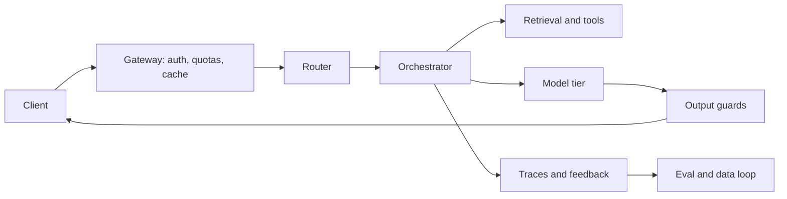
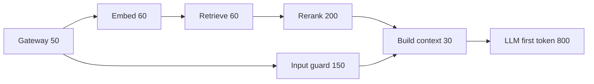
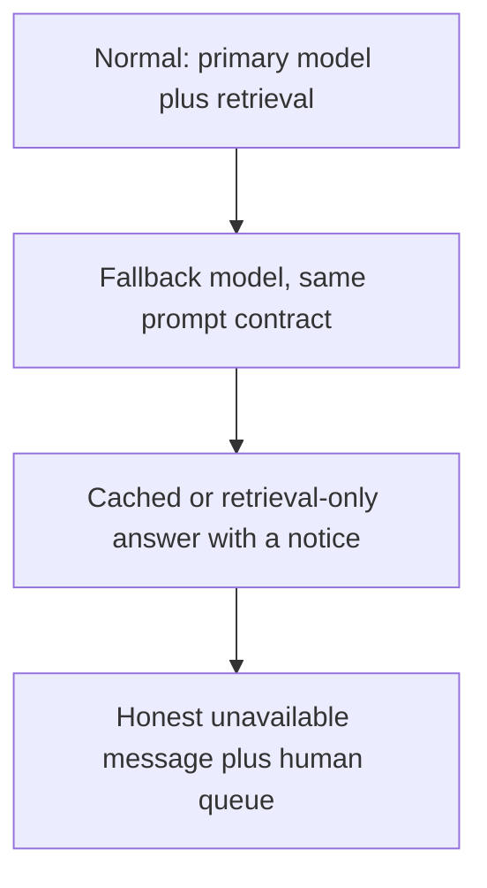

# AI System Design - Deep Dive

This guide is for engineers who have the vocabulary of AI systems (RAG, agents, gateways, evals) and now need to turn it into a repeatable method for a 45-60 minute design round, or for a real design review. [README.md](README.md) is the crash course: the 8-step framework, the building-block table and the rapid-fire prompts. The [case studies](case-studies/01-enterprise-rag-assistant.md) are ten finished designs. There is no questions.md for this folder. This file teaches the method behind those designs: how to estimate, how to budget latency and cost, how each block fails, how to ship safely, and how interviewers score you. It does not repeat the case studies. It gives you the arithmetic and reasoning to produce a case study yourself, for a prompt you have never seen.

Suggested study order, roughly 14-18 hours in total:

| Block | Parts | Hours |
|---|---|---|
| Method and numbers | 1, 2 | 3-4 |
| Blocks, latency, cost | 3, 4, 5 | 4-5 |
| Reliability, data, security | 6, 7 | 3-4 |
| Evaluation, rollout, scoring | 8, 9 | 2-3 |
| Exercises (design prompts on paper first) | see [exercises/README.md](exercises/README.md) | 4-6 (overlaps) |

Do the "Check yourself" questions after each part. Practise the estimation parts with a timer. The skill being tested is producing a defensible number in two minutes, not recalling a table.

## Prerequisites

- Transformer inference, KV cache, prefill versus decode. See [../02-llm-fundamentals/deep-dive.md](../02-llm-fundamentals/deep-dive.md).
- Retrieval, hybrid search and ANN index memory. See [../04-rag-and-retrieval/deep-dive.md](../04-rag-and-retrieval/deep-dive.md).
- Agent loops, tool use and the lethal trifecta. See [../06-agents-and-tool-use/deep-dive.md](../06-agents-and-tool-use/deep-dive.md).
- Evaluation, golden sets, LLM judges and tracing. See [../07-evaluation-and-observability/deep-dive.md](../07-evaluation-and-observability/deep-dive.md).
- Serving and cost mechanics (batching, quantisation, GPU memory). See [../08-inference-and-production/deep-dive.md](../08-inference-and-production/deep-dive.md).
- Prompt injection and safety controls. See [../09-safety-security-and-responsible-ai/deep-dive.md](../09-safety-security-and-responsible-ai/deep-dive.md).
- Classic system design: load balancing, queues, sharding, replication. [Designing Data-Intensive Applications](https://dataintensive.net/) is the reference.
- Python and numpy for the exercises.

## Contents

1. [Part 1 - The interview framework and its clock](#part-1---the-interview-framework-and-its-clock)
2. [Part 2 - Back-of-envelope estimation for AI systems](#part-2---back-of-envelope-estimation-for-ai-systems)
3. [Part 3 - Building blocks and how each one fails](#part-3---building-blocks-and-how-each-one-fails)
4. [Part 4 - Latency budgeting and streaming](#part-4---latency-budgeting-and-streaming)
5. [Part 5 - Cost engineering](#part-5---cost-engineering)
6. [Part 6 - Reliability and degradation](#part-6---reliability-and-degradation)
7. [Part 7 - Data flywheels, security and multi-tenancy](#part-7---data-flywheels-security-and-multi-tenancy)
8. [Part 8 - Evaluation-driven development and rollout](#part-8---evaluation-driven-development-and-rollout)
9. [Part 9 - Patterns, scoring and failure modes](#part-9---patterns-scoring-and-failure-modes)
10. [Putting it together](#putting-it-together)
11. [Exercises](#exercises)
12. [Further study](#further-study)

---

## Part 1 - The interview framework and its clock

### The problem the framework solves

A design prompt is one sentence, for example "design a support agent." The prompt hides the scale, the quality bar, the data, the constraints and the failure tolerance. A candidate who starts drawing boxes is solving a problem the interviewer did not pose. The framework exists to force the same order of thought every time: pin down what success means, put numbers on the load, choose the simplest architecture that meets them, then spend the remaining time on the parts that distinguish senior candidates (evaluation, cost, failure, rollout).

The README lists eight steps. This part adds what the README does not: what each step must produce, how much clock it deserves, and what a strong answer says out loud.

### The clock

For a 45-minute round (scale linearly for 60):

| Minutes | Phase | Output you must leave on the board |
|---|---|---|
| 0-5 | Requirements | 3-5 numbered requirements, one north-star metric, 2-3 guardrail metrics, explicit non-goals |
| 5-10 | Estimation | QPS, tokens per request, cost per request, rough GPU or quota need, storage size |
| 10-15 | High-level design | One diagram: request path, offline paths, what is sync versus async |
| 15-30 | Deep dives | Two or three components chosen with the interviewer, each with alternatives and failure modes |
| 30-40 | Evaluation and rollout | Golden set, component metrics, online metric, rollout plan |
| 40-45 | Risks and iteration | Week-1 versus quarter-1 plan, what you would not build yet |

Two rules keep this on schedule. First, state the time plan in the first minute: "I will spend five minutes on requirements and numbers, sketch the architecture, then go deep where you want, and leave ten minutes for evals and rollout." Interviewers often steer the deep dive, so announcing the plan secures the evaluation time. Second, when an interviewer pushes on a component, answer with the structure "choice, alternative, reason, what would change my mind." That structure is the tradeoff skill in miniature.

### What each phase should contain

**Requirements (0-5).** Ask about five things and write the answers down.

1. Users and task: who asks, what a good answer looks like, what an unacceptable answer costs (a wrong refund versus a clumsy summary).
2. Scale: daily active users, requests per user, corpus size, growth. If the interviewer will not say, propose a number and ask whether it is within 10x.
3. Latency: interactive (sub-second to a few seconds), background (minutes), or batch (hours). It changes the architecture more than any other answer.
4. Quality bar: a number. "At least 90% of answers rated correct and grounded on a 300-case golden set, and under 1% unsafe actions."
5. Constraints: data residency, regulated data, existing stack, build-versus-buy, budget.

Then state the north-star metric and the guardrails. For a support agent the north star might be resolution rate without escalation, with guardrails on wrong-action rate, p95 latency and cost per resolved ticket. Naming guardrails early signals that you know a single metric can be gamed.

**Estimation (5-10).** Part 2 covers the method. The deliverable is a short table of five numbers. Do not skip it because the interviewer did not ask. The numbers decide the architecture: 5 QPS and 5,000 QPS are different systems.

**High-level design (10-15).** Draw the request path left to right, then the offline paths underneath. Label each arrow with sync or async. Mark where state lives. Name the model strategy (which tier, API or self-host) on the diagram, not in a footnote.



Every case study in this folder is this picture with different boxes made thick. Semantic search thickens retrieval and nearly removes the model. The voice agent thickens latency handling. The gateway design is the first box, expanded.

**Deep dives (15-30).** Pick the components where the risk is. A good rule is to choose the one that dominates cost, the one that dominates quality, and the one that can hurt a user. In a support agent these are the model tier choice, retrieval over the policy corpus, and the refund tool. Offer the choice to the interviewer.

**Evaluation and rollout (30-40).** Where many strong candidates run out of time. Use a fixed script: golden set, metrics per component, judge calibration, CI gate, then shadow, canary and A/B (Part 8).

**Risks and iteration (40-45).** Name three risks with mitigations. Week 1 is one prompt plus retrieval plus a golden set and tracing. Quarter 1 adds routing, caching and the flywheel. Say what you will not build yet and what measurement would justify it.

### Where people go wrong

- **Treating the interviewer as a requirements oracle.** They want you to propose defaults. "I will assume 200k daily users, 5 requests each, 3k tokens in and 400 out. Tell me if that is off by more than 10x."

### Check yourself

1. You have 45 minutes. At minute 22 the interviewer is still asking about vector index choice. What do you do?

<details><summary>Answer</summary>

Answer the question concisely with choice, alternative and trigger, then redirect: "I can go further on the index, but I want to make sure we cover evaluation and rollout, so let me sketch those and return if time remains." The clock for evals is yours to protect. If the interviewer insists on the index, trade depth there for a compressed eval section, but never drop it.

</details>

2. Name three guardrail metrics for a document-extraction pipeline whose north star is field-level accuracy.

<details><summary>Answer</summary>

Examples: the rate of silently wrong values that pass validation (the costly error), the fraction sent to human review (cost and latency), and p95 time to result. Also acceptable: cost per document and rejection rate on malformed input. The point is to constrain the north star so it cannot be improved by routing everything to humans or by lowering the validation bar.

</details>

3. Why state non-goals in the requirements phase?

<details><summary>Answer</summary>

Non-goals cap the scope you must defend. "Not in scope: multilingual support, real-time voice, fine-tuning in v1." They also show the interviewer that you can cut, and they give you a place to park the follow-up questions you want to answer later without being derailed.

</details>

---

## Part 2 - Back-of-envelope estimation for AI systems

### Why the numbers matter

Classic capacity planning counts requests and bytes. AI systems have a third resource, tokens, and each token has a dollar price and a GPU-time price. Within the first ten minutes you should produce: queries per second (QPS), tokens per request, cost per request, GPU or quota need, and storage. The bar is being within about 10x with assumptions stated, and every later design decision (cache or not, cascade or not, self-host or not) is justified by these numbers.

### The chain

```
requests/day  = DAU x requests per user per day
average QPS   = requests/day / 86,400
peak QPS      = average QPS x peak-to-average factor (2-5, use 3 if unknown)
tokens/day    = requests/day x (input tokens + output tokens)
cost/request  = in_tokens x price_in + out_tokens x price_out   (prices per token)
monthly cost  = requests/day x cost/request x 30
GPUs          = (peak QPS x in_tokens / prefill_tps + peak QPS x out_tokens / decode_tps) / utilisation
```

Round liberally. 86,400 is 10^5 for estimating. The goal is the order of magnitude and the dominant term.

### Worked example: a support assistant

Assumptions, stated aloud:

- 200,000 daily active users, 5 requests per user per day, so 1,000,000 requests per day.
- 3,000 input tokens per request (system prompt 600, retrieved context 1,800, history and question 600) and 400 output tokens.
- Peak is 3x the average.

```
average QPS = 1,000,000 / 86,400  = 11.6
peak QPS    = 11.6 x 3            = 34.7
input tokens/day  = 1,000,000 x 3,000 = 3.0 billion
output tokens/day = 1,000,000 x   400 = 0.4 billion
```

Now price it with two hypothetical price points (use stated assumptions, not current list prices): a frontier tier at $3 per million input tokens and $15 per million output tokens, and a small tier at $0.15 and $0.60.

```
frontier: 3,000 x 3/1e6 + 400 x 15/1e6 = 0.009 + 0.006 = $0.015 per request
          monthly = 1,000,000 x 0.015 x 30 = $450,000
small:    3,000 x 0.15/1e6 + 400 x 0.60/1e6 = 0.00045 + 0.00024 = $0.00069 per request
          monthly = 1,000,000 x 0.00069 x 30 = $20,700
```

Three observations an interviewer will reward. The frontier tier is about 22x the small tier. Output is 40% of the frontier cost though it is 12% of the tokens (400 of 3,400), because output tokens are priced several times higher. And the input is mostly stable: a 600-token system prompt plus tool definitions repeat on every call, which prompt caching can discount.

Prompt caching: if 2,400 of the 3,000 input tokens are a shared, byte-stable prefix billed at 10% of the input price, the frontier request costs 600 x 3 + 2,400 x 0.3 + 400 x 15 = 1,800 + 720 + 6,000 = 8,520 micro-dollars, or $0.00852, a 43% reduction. The ceiling on the saving is set by the output cost, which caching does not touch.

### GPU sizing for self-hosting

Self-hosting converts a per-token price into a per-GPU-hour price. Prefill (processing the prompt) is compute-bound and fast per token. Decode (generating tokens) is memory-bandwidth-bound and slower per token, but a GPU serves many sequences at once with continuous batching. Assume, for a mid-size model on one accelerator, an aggregate 20,000 prefill tokens per second and 2,500 decode tokens per second. These are illustrative. Measure your own.

```
prefill load = 34.7 x 3,000 / 20,000 = 5.21 GPU
decode load  = 34.7 x   400 /  2,500 = 5.56 GPU
total        = 10.76 GPU at 100% utilisation
at 60% target utilisation: 10.76 / 0.6 = 17.9, so 18 GPUs
```

Never run at 100%: queueing delay grows sharply as utilisation approaches 1, and you need headroom for failures, so also never fewer than two replicas. At an assumed $2.50 per GPU-hour, 18 GPUs cost 18 x 2.50 x 730 = $32,850 per month. The hosted small model above costs $20,700 for the same traffic. Self-hosting is not cheaper at this scale. It pays when volume is several times higher, utilisation is high and steady, or data cannot leave your network. [Exercise 01](exercises/ex01_capacity_estimator.py) encodes this chain.

### Worked example: storage for embeddings

A corpus of 10 million documents averaging 8 chunks each is 80 million vectors. At 1,024 dimensions and 4 bytes per dimension (float32):

```
raw = 80,000,000 x 1,024 x 4 = 327.7 GB
float16: 163.8 GB    int8: 81.9 GB    PQ at 64 bytes/vector: 5.1 GB (plus codebooks)
```

An HNSW graph with M = 16 adds about 2 x 16 x 4 = 128 bytes per vector for layer-0 links, so +10.2 GB, about 3% at 1,024 dimensions but 50% at 64 dimensions. Dividing by usable RAM per node (say 128 GB x 0.7 = 89.6 GB) gives the shard count: 338 GB / 89.6 = 3.8, so 4 shards, 8 nodes with two replicas. One-time embedding cost at an assumed $0.02 per million tokens: 80M chunks x 400 tokens = 32 billion tokens = $640. Ingestion is cheap. Serving the index from RAM is the recurring cost. See [exercise 06](exercises/ex06_index_sizing.py) and Part 4 of the [RAG deep dive](../04-rag-and-retrieval/deep-dive.md).

### Worked example: an agent loop

Agent cost is not linear in steps because every step resends the history. Suppose a 4,000-token fixed prefix, 1,000 new tokens per step, 10 steps.

```
input tokens, no cache = 10 x 4,000 + 1,000 x (0+1+...+9) = 40,000 + 45,000 = 85,000
with prefix caching: new tokens = 4,000 + 9 x 1,000 = 13,000 at full price
                     cached reads = 72,000 at 10% = 7,200 equivalents
                     total = 20,200 equivalents, 4.2x cheaper
```

Quadratic growth in history is why step caps, context compaction and cheap models for intermediate steps are cost controls, not polish. See [../06-agents-and-tool-use/deep-dive.md](../06-agents-and-tool-use/deep-dive.md).

### Where people go wrong

- Using the average instead of the peak for capacity.
- Counting only user text and forgetting the system prompt, tool schemas, retrieved context and history, which usually dominate the input.
- Quoting a precise answer from imprecise inputs. Say "about $450k a month, 10x either way, driven by output tokens."

### Check yourself

1. A feature has 50,000 daily users, 4 requests each, 2,000 input and 250 output tokens. What are the average QPS and daily tokens?

<details><summary>Answer</summary>

Requests per day = 200,000. Average QPS = 200,000 / 86,400 = 2.3. Daily input tokens = 200,000 x 2,000 = 400 million. Daily output tokens = 200,000 x 250 = 50 million. At a peak factor of 3, peak QPS is about 7.

</details>

2. In the support example, which single change lowers the frontier cost most: halving input tokens or halving output tokens?

<details><summary>Answer</summary>

Halving output saves 200 x 15 / 1e6 = $0.003 per request. Halving input saves 1,500 x 3 / 1e6 = $0.0045 per request. Halving input saves more here because there are 7.5x more input tokens, which outweighs the 5x price gap. If the ratio were 800 input and 400 output tokens, output reduction would win. Always compute both.

</details>

3. Why is "18 GPUs" the answer and not "11"?

<details><summary>Answer</summary>

11 is the 100%-utilisation figure (10.76 rounded up). At that utilisation, requests queue without bound whenever load fluctuates. Dividing by a 60% target gives 17.9, rounded up to 18. The headroom absorbs bursts and node failures, and you need at least N+1 so one node loss does not drop capacity below peak.

</details>


---


## Part 3 - Building blocks and how each one fails

### The idea

The README lists eleven reusable blocks. Naming them is the entry fee. A senior answer also says what each block does when it is wrong, slow or down, and which signal reveals it.

### Failure-mode table

| Block | Typical failure | Detection signal | Mitigation |
|---|---|---|---|
| LLM gateway | Retry storm multiplies load during a provider brownout. Single point of failure. | Retry ratio, queue depth, 429 rate | Retry budget (for example at most 10% extra requests), jitter, circuit breaker, run the gateway stateless and multi-instance |
| Model router | Misroutes hard cases to the small model, quality drops silently | Quality by tier on a sampled, judged slice, escalation rate drift | Conservative default to the strong tier, shadow-score the router, cascade fallback on low confidence |
| Retrieval layer | Stale index, missing ACL filter, recall drop after an embedding change | recall@k on a probe set, index lag, empty-result rate | Freshness SLO, ACL as a pre-filter, versioned embeddings with dual-read during migration |
| Cache tiers | Stale answers after a content change. Cross-tenant leak. Wrong semantic hit. | Wrong-hit rate on audited samples, hit rate by tenant | TTL plus event invalidation, tenant and ACL in the key, high semantic threshold |
| Queue or async jobs | Duplicate processing, poison messages, unbounded backlog | Age of oldest message, redelivery count, DLQ size | Idempotency keys, dead-letter queue, bounded retries, backpressure |
| Guardrails | False positives block users. False negatives let attacks through. Added latency. | Block rate by rule, human-reviewed precision and recall of the guard | Tiered checks (cheap first), log-only mode before enforcing, fail closed on actions only |
| Eval and observability loop | Judge drift. Golden set goes stale. Traces missing the prompt version. | Judge agreement with human labels, set age, trace coverage | Version prompts, datasets and judge prompts together, recalibrate the judge each quarter |

Notice that most mitigations are classic distributed-systems ideas (budgets, idempotency, dead-letter queues, backpressure) applied to a component with a probabilistic output. The AI-specific part is the detection signal, which is almost always a measured quality number rather than an error code. A model that returns HTTP 200 with a wrong answer is a failure your infrastructure monitoring cannot see.

### The gateway

A gateway is the single place where provider credentials, quotas, retries, failover, metering and policy live. It exists because the alternative, every service calling providers directly, makes each of those concerns a copy-paste bug and gives you no way to change model or provider without touching ten services. The minimum interface is small:

```
POST /v1/complete  {tenant, task, messages, max_tokens, idempotency_key, tags}
-> stream of tokens + final {model_used, tokens_in, tokens_out, cost, trace_id}
```

Design decisions worth saying aloud: the caller names a task or a logical model alias ("summarise-fast"), not a provider model id, so you can swap models without a deploy. The gateway attributes cost to a tenant and a feature. It enforces limits in tokens, not requests, because one request can be 100 tokens or 100,000. It records every call. [Case study 10](case-studies/10-llm-gateway-and-serving-platform.md) goes through the data plane, quotas and failover in detail.

### The router and the cascade

A router picks a model before calling it, using the task type, a cheap classifier, or heuristics (input length, presence of code). A cascade calls the small model first and escalates on low confidence. They have different costs. A router pays only for the chosen model but needs to predict difficulty before seeing the output. A cascade sees the small model's output and its confidence but pays for the small call on every escalation. Part 5 works the numbers and [exercise 02](exercises/ex02_cascade_router.py) lets you sweep the threshold.

The failure mode to name: the router's mistakes are invisible. A request misrouted to a weak model returns a fluent, wrong answer. You find out only by sampling routed traffic and judging it per tier, so a router without a per-tier quality dashboard is unmonitored.

### Cache tiers

Three caches, in order of safety:

1. **Provider prompt caching** reuses the computation for a shared prefix. It is transparent and safe: the output is the same as without it. It needs a byte-stable prefix, so put system prompt and tool definitions first and variable content last.
2. **Exact response cache** keyed on a hash of the normalised input plus model, prompt version and tenant. Safe when the answer should be deterministic and the key includes everything the answer depends on.
3. **Semantic cache** returns a stored answer for a query whose embedding is close enough. It can serve a wrong answer. Two queries "How do I cancel my order?" and "How do I cancel my subscription?" are close in embedding space and have different answers.

The cost model for the semantic tier matters. Each non-exact lookup pays an embedding call, and each hit saves a model call. With exact hit rate e, semantic hit rate s, embedding cost c_e and model cost c_m:

```
expected cost = (1 - e) x c_e + (1 - e - s) x c_m
```

With e = 10%, s = 20%, c_e = $0.0001 and c_m = $0.015: 0.9 x 0.0001 + 0.7 x 0.015 = $0.01059, a 29% saving. If 1% of semantic hits are wrong, 0.2% of all traffic receives a wrong answer from the cache. Whether that is acceptable depends on the domain. For a refund-policy answer it is not. For a "summarise this public page" request it may be. Treat the similarity threshold as a precision knob that you set from labelled query pairs, and keep the cache keyed on tenant and permission scope. [Exercise 04](exercises/ex04_tiered_cache.py) simulates the tradeoff.

### Queues and async jobs

Anything that takes more than a few seconds or must survive a restart (batch classification, ingestion, long agent runs) goes behind a queue with at-least-once delivery and idempotent handlers, a dead-letter queue, a visibility timeout longer than the p99 job time, bounded retries and a status endpoint. Put a token-rate limiter in front of the workers and reserve a share of provider quota for interactive traffic, so a backlog cannot burn the quota in a minute.

### Guardrails

Place checks where the risk is. Input guards: injection signatures, PII redaction, topic scope. Output guards: schema validation, citation checks, moderation, leakage checks. Action guards: allowlisted tools, argument validation, spend and rate caps, approval for irreversible actions. Fail closed on actions and fail open with logging on cosmetic checks. Run cheap deterministic checks first, run input guards in parallel with retrieval so they stay off the critical path, and roll a new guard out in log-only mode to measure its false-positive rate before enforcing.

### Check yourself

1. Why must the semantic cache key include the tenant?

<details><summary>Answer</summary>

Two tenants can ask the same question and be entitled to different answers, because their documents and permissions differ. Without the tenant (or permission scope) in the key, tenant B can receive an answer that was generated from tenant A's private data. This is a data leak, not a quality bug, so the isolation has to be structural.

</details>

2. A cascade accepts 60% of traffic at the small model. The small model costs 1 unit and the large costs 20. What is the average cost and what does a router save?

<details><summary>Answer</summary>

Cascade: every request pays 1, the 40% escalated also pay 20, so 1 + 0.4 x 20 = 9 units. A router that decided before calling any model would pay 0.6 x 1 + 0.4 x 20 = 8.6 units, a small saving, but it must predict difficulty without seeing the output, which is usually less accurate than using the small model's own confidence. When the small model is cheap relative to the large one, the extra small call is a minor cost.

</details>

3. What makes retries dangerous at a gateway during a provider slowdown?

<details><summary>Answer</summary>

Each timed-out request is retried, so the provider sees more load exactly when it is struggling, which prolongs the slowdown (a retry storm). Retries also multiply cost for requests that may have partly succeeded. A retry budget, exponential backoff with jitter, a circuit breaker that stops sending to an unhealthy provider, and idempotency keys limit the damage.

</details>


---

## Part 4 - Latency budgeting and streaming

### What latency means for an LLM request

A single number hides the shape. Four timings matter:

- **Time to first token (TTFT)**: request arrival to the first streamed token. It includes everything before generation (auth, retrieval, guards, queueing, prefill).
- **Inter-token latency, or tokens per second**: the decode rate after the first token. Roughly 30-100 tokens per second is typical for interactive serving, and it varies by model and load.
- **Total time**: TTFT plus output tokens divided by decode rate.
- **Time to useful content**: for agents, structured output and tool calls, the first token is not useful. The usable content arrives at the end or after the final tool result.

Streaming changes the experience, not the total. A 400-token answer at 60 tokens per second takes 6.7 seconds to generate. With a 1.3 second TTFT the user starts reading at 1.3 seconds and finishes at 8.0 seconds. Without streaming the user stares at a spinner for 8 seconds. This is why interactive chat budgets TTFT, and batch or agent flows budget total time.

### The budget method

1. Pick the user-facing target at a percentile. Interactive systems usually specify p95 (and watch p99).
2. List stages and mark which can run in parallel.
3. Identify the critical path, the longest chain of dependent stages.
4. Allocate the target across the critical path in proportion to where the time must go, and reserve slack for network and jitter.
5. Give every stage a timeout shorter than the budget, with a defined fallback.

Worked budget for a RAG chat with a 1,500 ms p95 TTFT target:

| Stage | Budget (ms) | On critical path? |
|---|---|---|
| Edge, auth, gateway | 50 | yes |
| Query embedding | 60 | yes |
| Hybrid retrieval (ANN plus BM25) | 60 | yes |
| Rerank top 50 | 200 | yes |
| Input guard (injection, PII) | 150 | no, parallel with retrieval |
| Context build | 30 | yes |
| LLM prefill to first token | 800 | yes |
| Network to client | 100 | yes |
| Slack | 200 | |
| **Total on the critical path** | **1,500** | |

Check: 50 + 60 + 60 + 200 + 30 + 800 + 100 = 1,300, plus 200 slack = 1,500. The input guard takes 150 ms but overlaps retrieval (320 ms), so it costs nothing on the critical path. If the guard grew to 400 ms it would become the critical path, so the budget table has to be re-derived when any stage changes. [Exercise 03](exercises/ex03_latency_budget.py) computes the critical path of a DAG.



The longest path is gateway, embed, retrieve, rerank, build, LLM: 50 + 60 + 60 + 200 + 30 + 800 = 1,200 ms, plus 100 network gives 1,300.

### Percentiles do not add

Per-stage p95 budgets do not compose into an end-to-end p95. Two effects work in opposite directions.

**Stages in series.** For independent stages the tail of the sum is lighter than the sum of the tails, because it is unlikely that every stage is slow at once. Take four stages, each lognormal with median 100 ms and sigma 0.5. Each has a p95 of 100 x exp(0.5 x 1.645) = 227 ms. The sum of the four p95s is 910 ms. Simulating the sum gives a p95 of about 670 ms (median about 437 ms). Adding p95s over-budgets the chain by roughly a third, so budgeting each stage at its own p95 wastes headroom.

**Stages in parallel (fan-out).** Waiting for the slowest of k calls makes the tail worse. If each of k parallel calls has a 5% chance of exceeding its p95, the chance that at least one does is 1 - 0.95^k. For k = 10 that is 40%, so the p95 of the fan-out is far above the per-call p95. In the same simulation with median 100 ms and sigma 0.5, the fan-out p95 is about 227 ms for k = 1, 305 ms for k = 4 and 391 ms for k = 16. This is why multi-query retrieval, multi-tool agents and map-reduce summarisation have worse tails than their components suggest. The countermeasures are timeouts with partial results (return what arrived by the deadline), hedged requests (send a duplicate after the p95 delay and take the first answer, costing about 5% extra load for a large p99 improvement), and capping fan-out.

Exercise 03 reproduces both numbers with a seeded Monte Carlo.

### Levers that change latency

| Lever | Effect | Cost or risk |
|---|---|---|
| Stream the response | Perceived latency falls to TTFT | Cannot validate the whole output before the user sees it. Guard streaming chunks or accept it for low-risk output |
| Smaller model or tier | Lower TTFT and faster decode | Quality loss on hard requests |
| Shorter prompt | Faster prefill, lower cost | Less context. Move static text to a cached prefix |
| Prompt caching | Skips prefill for the shared prefix | Needs byte-stable prefixes |
| Parallelise independent stages | Removes stages from the critical path | Higher peak load, worse tail on fan-out |

For voice, the budget is voice-to-voice under roughly a second, so speech recognition, the model and synthesis must all stream and overlap. [Case study 9](case-studies/09-realtime-voice-agent.md) shows that budget end to end.

### Check yourself

1. The p95 of each of three serial stages is 200 ms. Is the end-to-end p95 600 ms?

<details><summary>Answer</summary>

No. For independent stages it is usually lower, in the example above about 25-30% lower for four stages, because all stages being slow together is rare. If the stages are correlated (a shared overloaded dependency), the end-to-end p95 moves toward the sum. Measure it. Do not assume either.

</details>

2. An agent step fans out to 8 parallel tool calls, each with a p99 of 2 s. About what fraction of steps will wait at least 2 s?

<details><summary>Answer</summary>

Each call is slower than 2 s with probability 1%. The chance at least one of 8 is slow is 1 - 0.99^8 = 7.7%. So roughly 8% of steps wait 2 s or more, though each call alone breaches that only 1% of the time. Use per-call deadlines and accept partial results.

</details>

3. Why can streaming conflict with output guardrails?

<details><summary>Answer</summary>

A guard that needs the complete output (schema validation, a citation check, a toxicity classifier over the whole text) cannot run before tokens reach the user. Options: stream only low-risk content, run the guard on chunks or sentences with the ability to retract, buffer a short window, or skip streaming for high-risk flows. The decision follows the cost of showing a bad token.

</details>


---

## Part 5 - Cost engineering

### The levers, in order of leverage

Cost per request is tokens times price. Four classes of lever act on it, and they stack multiplicatively when they apply to different parts of the traffic.

1. **Do not call the model** (exact and semantic caching, deterministic shortcuts for known intents).
2. **Call a cheaper model** (routing and cascades).
3. **Send fewer tokens** (prompt trimming, retrieval top-k tuning, context compaction, output caps, prompt caching of the shared prefix).
4. **Pay less per token** (batch pricing for offline work, committed capacity, self-hosting at high utilisation, quantised models).

The interview-ready habit is to start from the cost breakdown, find the dominant term, and attack that. In the support example the frontier cost is 60% input and 40% output, and the tier gap (22x) dwarfs everything else, so routing comes first.

### Cascades and routing: the arithmetic

Using the support example, small tier $0.00069 per request, frontier $0.015. Suppose confidence scoring lets the small model keep 60% of traffic. A cascade pays the small call for everyone and the frontier call for the escalated 40%:

```
cost = 0.00069 + 0.40 x 0.015 = 0.00669 per request   (0.446 of frontier-only, 55% cheaper)
```

Quality is where cascades get dishonest if you do not measure. Say the small model is 95% correct on the requests it keeps (they are the easy ones), and the frontier model is 88% correct on the escalated requests (they are the hard ones), while frontier-only is 92% on everything:

```
cascade quality = 0.60 x 0.95 + 0.40 x 0.88 = 0.570 + 0.352 = 0.922
```

The cascade matches the frontier tier at 45% of the cost, which is the best case. The best case needs a confidence signal that separates right from wrong. If the signal is random, the quality of the cascade falls on the straight line between the all-small and all-large endpoints, and you pay for the mix without the benefit. The test is a sweep over thresholds on a labelled set, which [exercise 02](exercises/ex02_cascade_router.py) builds, and the decision rule is: choose the cheapest threshold whose quality is at least the target, with a confidence interval wide enough to be honest about the small sample.

Where does the confidence signal come from? Options, from cheap to strong: token log-probabilities of the answer, a self-reported score (poorly calibrated, check it), a separate small verifier or judge, agreement across two cheap samples, or rule-based checks (the answer must validate against a schema or pass a test). Rule-based verifiers are best where they exist: SQL that executes, code that passes tests, extraction that validates.

### Caching: stacked savings

Semantic and exact caches act on the whole request. Applying them first and the cascade to the remaining misses, with the earlier numbers (exact 10%, semantic 20%, embedding $0.0001, cascade cost $0.00669 for misses):

```
cost per query = 0.9 x 0.0001 + 0.7 x 0.00669 = 0.00009 + 0.004683 = $0.004773
monthly (1M requests/day x 30) = $143,190   versus $450,000 baseline, a 68% reduction
```

Each step is a measured hit rate or escalation rate, not a hope. Show the stack as a table and give a range, because hit rates depend on how repetitive the traffic is. A support assistant has far more repetition than an open-ended research tool.

### Prompt caching and context discipline

Input tokens dominate agents, RAG and long-document tools. Order the prompt so the shared part is first and stable (system prompt, tool definitions, policy text), then retrieved documents, history and the question. Budget tokens by section, for example 600 for instructions, 1,800 for evidence, 600 for history. Retrieval top-k is a cost lever as well as a quality lever: going from 10 chunks of 400 tokens to 5 saves 2,000 tokens per request, which at $3 per million input tokens and 1 million requests per day is $180,000 per month. Measure the recall cost of lowering k against it, and check how your provider prices cache writes and expiry.

### Batching and offline work

Two different ideas. Continuous batching in serving raises GPU throughput by decoding many sequences together, which is why 2,500 tokens per second per GPU in Part 2 is an aggregate. Batch APIs for offline jobs accept relaxed deadlines (often hours) at a discount, commonly around half the interactive price (~, check current terms). Use them for enrichment, bulk classification, evaluation runs and backfills. For 500 million documents at 800 tokens and $0.15 per million input tokens, one pass is $60,000, so a cheap first-pass filter that removes half the documents saves $30,000 before any batch discount. See exercise D3 in [exercises/README.md](exercises/README.md).

### Build versus buy

Self-host when data cannot leave your boundary, volume is steady enough to keep GPUs above about 50-60% utilisation, or you need a fine-tuned model or latency control an API cannot give. Use an API when traffic is spiky, you are early, or you need a frontier capability. Part 2 shows the break-even: 18 GPUs at $32,850 per month against $20,700 for a hosted small tier, before on-call and evaluation costs. Many mature systems use an API for the frontier tier and self-host a high-volume small tier.

### Check yourself

1. The cascade accepts 70% at the small tier ($1 per 1,000 requests) and escalates 30% to a large tier ($20 per 1,000). What is the cost per 1,000 requests?

<details><summary>Answer</summary>

Every request pays the small call: $1. The escalated 30% also pay the large call: 0.3 x $20 = $6. Total $7 per 1,000, 65% below the $20 large-only cost. A router that skipped the small call on escalated requests would pay 0.7 x 1 + 0.3 x 20 = $6.70.

</details>

2. Retrieval top-k drops from 8 to 4 chunks of 500 tokens. Input price is $2 per million tokens, 2 million requests per day. Monthly saving?

<details><summary>Answer</summary>

Tokens saved per request = 4 x 500 = 2,000. Dollars per request = 2,000 x 2 / 1e6 = $0.004. Per day = 2,000,000 x 0.004 = $8,000. Per month (30 days) = $240,000. Before banking that, measure recall@4 versus recall@8 and answer quality, because a quality drop can cost more than the saving.

</details>

3. Why might a confidence-threshold cascade underperform on a new traffic mix?

<details><summary>Answer</summary>

The threshold was tuned on a labelled sample from the old distribution. If the new traffic is harder or different in style, the small model's confidence can be miscalibrated (confidently wrong), so fewer wrong answers get escalated. Monitor accuracy by tier on a judged sample and re-fit the threshold when the input distribution shifts.

</details>


---

## Part 6 - Reliability and degradation

### What fails in an AI system

The model provider is a remote dependency with its own outages, rate limits, latency spikes, silent version changes and policy refusals. Around it sit the ordinary failures: your retrieval index, queues and databases. Reliability design means deciding in advance what the product does at each level of degradation so that the answer to "what happens when the provider is down" is a plan, not a stack trace.

### Availability arithmetic

Serial dependencies multiply. If the gateway is 99.95% available, retrieval 99.9% and the model provider 99.5%, a request that needs all three succeeds with probability 0.9995 x 0.999 x 0.995 = 99.35%, about 4.7 hours of failure per month (0.0065 x 730 hours). The provider term dominates. A second, independent provider at 99.5% gives the model hop 1 - 0.005^2 = 99.9975%, and the chain rises to 0.9985 x 0.999975 = 99.85%, roughly 1.1 hours per month. Two honest caveats. Providers are not fully independent, since they share cloud regions and sometimes the same upstream. And the fallback model is a different model with different behaviour, so you must have evaluated it (and its prompt) before the outage, not during it.

### Retries, budgets and idempotency

Retry only transient failures (timeouts, 429, 5xx), with exponential backoff and random jitter so clients do not synchronise. Add a retry budget at the gateway, for example allow retries only while they are below 10% of recent requests. Without one, a full outage with 3 retries per client multiplies offered load by 4 (1 original plus 3 retries), which keeps a recovering provider down. Combine that with a circuit breaker: after a window of failures, stop sending to that provider for a cooldown, send a few probe requests, and close the breaker when they succeed.

Retries are safe only for idempotent operations. A model call is idempotent in effect (it returns text). A tool call such as "create refund" is not. Every side-effecting call carries an idempotency key derived from the logical action (run id, step id, tool, arguments), and the tool service stores the first result for that key and returns it on repeats. A retry after a lost response then does not issue a second refund. Idempotency stops duplicates from retries. It does not stop a new, mistaken action, so pair it with limits and approval. See [case study 3](case-studies/03-customer-support-agent.md) for the action guard.

### Rate limits and quota

Provider limits are expressed in tokens per minute and requests per minute. Compute the quota you need before you pick a tier. Using the support example, peak load is 34.7 requests per second at 3,400 tokens each:

```
34.7 x 3,400 = 118,000 tokens/s = 7.1 million tokens/min at peak
```

If your account tier is 2 million tokens per minute you will be throttled once traffic passes about 28% of peak (2 / 7.1). The fixes are a higher quota negotiated in advance, a second provider or region, a cheaper tier for part of the traffic, and shedding or queueing load. Design the gateway to enforce limits in tokens with a token bucket per tenant and per priority class, to reserve a share of quota for interactive traffic (for example 70%) so that batch jobs cannot consume it, and to return a clear 429 with a retry-after header instead of queueing without bound. A fair scheduler across tenants (weighted fair queueing) stops one tenant's burst from taking the shared pool. [Exercise 05](exercises/ex05_fair_scheduler.py) builds a token bucket and a weighted fair queue.

### The degradation ladder

Decide the order in which the product gives up quality to stay up.



Each rung needs a trigger (error rate over a threshold, p95 over budget, quota exhausted), a visible signal to the user where quality differs, and a regression test that exercises it. A rung that has never been run in production will not work when needed, so rehearse them with fault injection. Prefer an honest, fast "I can't answer that right now, a person will follow up" over a slow wrong answer. For agents, the safe degradation is to stop taking actions and hand over to a human with the trace attached.

### Multi-region

The gateway and orchestrator are stateless and run in each region. The vector index replicates with some lag, so state the freshness a failover region offers. Quotas are usually per region, so a failover region needs quota reserved in advance: if region A carries all traffic, region B must be able to carry it, or you only moved the outage. Data residency can forbid cross-region failover for some tenants, and for them the failover is the degradation ladder. Say N+1 capacity explicitly.

### Check yourself

1. Why can increasing the retry count make an outage longer?

<details><summary>Answer</summary>

Clients retry the failed requests, so the struggling provider receives a multiple of normal load at the moment it needs less. With 3 retries and a complete outage, offered load is 4x. Backoff with jitter, a retry budget and a circuit breaker spread and cap that load so the provider can recover.

</details>

2. Two providers each have 99% availability and fail independently. What is the combined availability of the model hop, and what assumption is doing the work?

<details><summary>Answer</summary>

1 - 0.01 x 0.01 = 99.99%. The assumption is independence, and the second assumption is that the fallback provider can carry the full load at acceptable quality, which needs reserved quota and an evaluated prompt. If both rely on the same region or upstream, the real figure is lower.

</details>

3. A refund tool times out. The client retries with the same arguments. What prevents a double refund, and what does it not prevent?

<details><summary>Answer</summary>

An idempotency key stored with the first result means the retry returns the original outcome without issuing a second refund. It does not prevent the model from deciding, in a later turn, to issue a different refund for the same order. That needs business rules (cumulative refund cap per order) and approval for large or repeated actions.

</details>


---

## Part 7 - Data flywheels, security and multi-tenancy

### The flywheel

A model-based product improves only if the team can measure, find failures and fix them faster than the world changes. The loop has five stages:

1. **Trace**: log the full request (prompt version, retrieved ids, tool calls, outputs, tokens, latency, cost, tenant) with privacy controls.
2. **Sample and label**: choose traces to judge, using random samples for an unbiased estimate and targeted samples (negative feedback, escalations, low-confidence outputs, long conversations) for finding failures.
3. **Curate**: turn failures into regression cases in the golden set, each with an expected behaviour.
4. **Improve**: change the prompt, retrieval, routing or model, and re-run the whole set.
5. **Ship and monitor**: roll out with the gates from Part 8, then return to step 1.

Worked sampling plan for 1 million requests per day: judge 0.1% at random (1,000 per day) with an LLM judge calibrated to humans, send about 50 per day to human review (half random, half targeted), and add the confirmed failures to the golden set weekly. A 1,000-sample daily random judge gives a pass-rate estimate with a 95% half-width of about 1.9 points when the rate is 90% (1.96 x sqrt(0.9 x 0.1 / 1000)). That is enough to see a 5-point regression within a day.

User feedback is a weak signal. Thumbs response rates are often a few percent, and the users who respond skew to extremes. Use it to find candidates, not to estimate quality. Implicit signals (copy, accept, edit distance, re-ask within one minute, escalation) are higher volume and less biased but need interpretation: a re-ask can mean the answer was bad or that the user wants more.

### Security as design, not a layer

Start from the threat list for the specific system.

| Threat | Where it enters | Structural control |
|---|---|---|
| Prompt injection (direct) | User input | Treat as untrusted, constrain tool permissions, never rely on the prompt alone |
| Prompt injection (indirect) | Retrieved pages, emails, tickets, tool outputs | Mark untrusted content, limit what the model can do after reading it, require approval for actions |
| Data exfiltration | Tools with network access, markdown image rendering, links | Egress allowlist, strip or proxy URLs, no private data plus untrusted content plus an outbound channel in the same context |
| Cross-tenant leakage | Shared index, cache, logs, fine-tuned model | Tenant in every key and filter, isolation tier (below), per-tenant encryption where required |

The key structural principle for agents is that safety cannot rest on the model obeying instructions. The model is a component that reads untrusted text. Break the combination of private data, untrusted content and an exfiltration channel, and gate irreversible actions behind validation or a person. [../06-agents-and-tool-use/deep-dive.md](../06-agents-and-tool-use/deep-dive.md) and [../09-safety-security-and-responsible-ai/deep-dive.md](../09-safety-security-and-responsible-ai/deep-dive.md) develop this.

### Permissions in retrieval: pre-filter, not post-filter

In an enterprise assistant each user may see only a subset of documents. Two designs: retrieve top-k and then drop documents the user cannot see (post-filter), or apply the permission filter inside the search (pre-filter). Post-filtering has two problems. It can leak through ranking side effects and timing, and it starves the result set. If a user can see 5% of the corpus and you retrieve the top 20 by similarity, the expected number of permitted documents is 20 x 0.05 = 1, and the chance that none are permitted is 0.95^20 = 36%. The user sees an empty or thin answer for reasons that look like a retrieval bug. Pre-filtering keeps recall high at the cost of a filtered ANN search that is more complex and, with restrictive filters, slower. See [case study 1](case-studies/01-enterprise-rag-assistant.md) for ACL sync and freshness.

### Multi-tenancy tiers

| Isolation tier | How | Cost | Use when |
|---|---|---|---|
| Shared index, tenant filter | One index, tenant id in metadata and filter | Lowest | Many small tenants, low sensitivity, strong filter testing |
| Namespace or collection per tenant | Logical partition inside a cluster | Low to moderate | Typical SaaS, easy deletion and export |
| Index or database per tenant | Separate index, optionally separate keys | Moderate to high | Large tenants, contractual isolation |
| Dedicated cluster or account | Separate infrastructure | Highest | Regulated or very large tenants, private networking |

Whatever the tier, test isolation: a suite that runs queries as tenant A designed to reach tenant B's data (including through caches and logs), run in CI. Noisy neighbours are a second axis: per-tenant token quotas, weighted fair queueing on shared model capacity, and per-tenant cost attribution so you can see who consumes what. A shared semantic cache needs the tenant (or permission scope) in the key, as covered in Part 3.

### Check yourself

1. A user can see 2% of documents. You post-filter the top 50. What is the expected number of permitted documents and the chance of zero?

<details><summary>Answer</summary>

Expected permitted = 50 x 0.02 = 1. The probability of none, assuming independence, is 0.98^50 = 36%. Pre-filter by permission, or use a tenant and group-aware index, so the top-k are all visible to the user.

</details>

2. Why sample at random as well as targeting failures?

<details><summary>Answer</summary>

Targeted samples are biased toward failures, so they overstate the failure rate and cannot estimate overall quality. Random samples give an unbiased estimate with a computable confidence interval. Targeted samples find new failure types to add to the golden set. You need both, for different purposes.

</details>

3. What breaks the "lethal trifecta" for a mail assistant that reads inbound email and can send email?

<details><summary>Answer</summary>

The trifecta is private data, untrusted content and an exfiltration channel. The assistant has all three. Break one: require human approval for outgoing mail to new recipients, restrict recipients to an allowlist (an egress control), or separate a reader agent that has no send tool from a sender that never sees raw inbound text.

</details>


---

## Part 8 - Evaluation-driven development and rollout

### Evals first

Write the golden set and the metrics before building the second version of anything. The reason is practical: without a fixed measure you cannot tell whether a change helped, and prompt changes are famous for fixing one case and breaking three. Treat the golden set as the specification of the product.

A usable golden set has: 100-1,000 cases drawn from real or realistic traffic, stratified by task type and difficulty, with expected outputs or grading rubrics, versioned, with failures added as they are found. Each component gets its own metric so you can localise a regression: retrieval recall@k and nDCG, faithfulness (is each claim supported by the context), answer correctness, tool-call accuracy and argument validity, refusal correctness, latency and cost. [../07-evaluation-and-observability/deep-dive.md](../07-evaluation-and-observability/deep-dive.md) covers metrics and judges in depth.

### How big a golden set?

Sampling noise is not a detail. With n = 200 cases and a true accuracy of 90%, the 95% half-width is 1.96 x sqrt(0.9 x 0.1 / 200) = 4.2 points, so an observed gain from 90% to 93% is within the noise. To tell 90% from 93% reliably (80% power, 5% significance) you need about 16 x p(1-p) / delta^2 cases per arm for independent samples: 16 x 0.09 / 0.03^2 = 1,600 per arm. Paired comparisons on the same cases are much more sensitive (each case is its own control), so run both candidates on the same golden set and look at the per-case differences. For a quick decision on a small set, report the number of cases that flipped from pass to fail and fail to pass, and read them.

### Judges need evals too

An LLM judge scores outputs against a rubric. It has known biases: preference for longer answers, for the first of two options, and for its own style. Calibrate it: have humans label 100-200 cases, compute agreement with the judge (for example Cohen's kappa), look at disagreements, tighten the rubric, and freeze the judge prompt and model as a versioned artifact. When the judge model changes, recalibrate. Use exact checks (schema validity, SQL execution, unit tests, citation existence) wherever possible and keep the judge for what is truly subjective. See the judge paper in Further study.

### Offline gates and online experiments

The pipeline:

1. **Offline gate in CI.** Any change to a prompt, model, retrieval config or tool schema runs the golden set. Block on regressions beyond a threshold in any stratum, not only on the overall mean.
2. **Shadow mode.** The candidate runs on real traffic in parallel, its output is logged and scored but never shown. This tests latency, cost, error rates and quality on the true distribution with zero user risk. It doubles the model cost for the shadowed share, so sample 5-10%.
3. **Canary.** Send 1% of traffic, then 5%, 25% and 100%, with a soak period at each step and automatic rollback on guardrail breach (error rate, p95 latency, cost per request, refusal rate, escalation rate, negative-feedback rate).
4. **A/B test.** For a product-level claim ("the new retrieval raises resolution rate"), randomise by user, run to a pre-computed sample size, and read the guardrails too.

Sample-size worked example. A canary at 1% of 1 million requests per day is 10,000 requests per day. To detect an error rate rising from 2.5% to 3.5% (delta 0.01, p near 0.03) you need about 16 x 0.03 x 0.97 / 0.0001 = 4,700 per arm, which 10,000 canary requests satisfy in a day. For an outcome metric such as resolution rate near 0.30 with a target lift of 2 points, you need about 16 x 0.21 / 0.0004 = 8,400 per arm. A product with 5,000 requests per day needs weeks for that test, so choose a more sensitive proxy or accept a larger minimum effect.

Offline wins do not always translate online. The golden set is a sample of past traffic, the judge is imperfect, and users adapt. So the online test is the final arbiter for product claims, and offline evals are the gate that stops you shipping known regressions.

### Change management for model behaviour

Pin model versions, not aliases: a moving alias is an unannounced deploy. Run the golden set nightly against production configuration to catch provider drift. Treat prompts, retrieval configs, tool schemas and judge prompts as code, with review and rollback, and keep the previous version deployable until the new one has soaked. After a model upgrade, re-tune router and cascade thresholds and re-run the safety suite.

### Check yourself

1. You compare two prompts on the same 300 golden cases. A scores 252 correct and B scores 261. B flips 21 cases to correct and 12 to wrong. Is B clearly better?

<details><summary>Answer</summary>

Net gain is 9 cases (3 points). The paired view has 33 discordant cases, 21 for B and 12 for A. Under no difference the split would be 50/50, and a sign test on 21 of 33 gives a p-value around 0.16, so the evidence is weak. Read the 33 discordant cases, check the strata, and collect more cases before concluding.

</details>

2. Why run shadow traffic before a canary?

<details><summary>Answer</summary>

Shadow exposes the candidate to real traffic without any user seeing its output, so latency, error rate, cost and judged quality can be measured at zero user risk. A canary exposes real users, so it should start only when shadow shows no major problem. Shadow cannot measure user behaviour (since users never see the output), which is why the canary and A/B follow.

</details>

3. What automated rollback conditions would you set on a 5% canary for a new model?

<details><summary>Answer</summary>

Examples: error or timeout rate above baseline by an absolute margin, p95 latency above budget, cost per request above a ceiling, refusal rate or escalation rate rising beyond a band, a drop in a judged quality sample, and any safety rule violation. Define thresholds and the window in advance so rollback does not depend on someone watching a dashboard.

</details>


---

## Part 9 - Patterns, scoring and failure modes

### Design patterns and where they appear

Most prompts reduce to a few patterns. Recognising the pattern tells you which blocks to thicken and which follow-ups to expect.

| Pattern | Core idea | Hard parts | Case study |
|---|---|---|---|
| Grounded Q&A over private data | Retrieve, then generate with citations | ACLs, freshness, faithfulness, chunking | [01 Enterprise RAG](case-studies/01-enterprise-rag-assistant.md) |
| Low-latency completion | Small fast model, aggressive caching, strict budget | Latency tiers, context from the repo, privacy, acceptance-rate evals | [02 Code assistant](case-studies/02-ai-code-assistant.md) |
| Tool-using agent with actions | Model plans, tools act, humans approve | Action guards, idempotency, handoff, injection | [03 Support agent](case-studies/03-customer-support-agent.md) |
| Retrieval-dominated ranking | The model is small or absent | ANN operations, reranking, embedding refresh, sub-100 ms budget | [04 Semantic search](case-studies/04-semantic-search.md) |
| High-throughput classification | Tiered cheap-to-expensive models plus human review | Throughput, thresholds, label drift, appeals | [05 Moderation](case-studies/05-content-moderation-pipeline.md) |
| Structured extraction | Parse, extract, validate, route to humans | Schema validation, confidence, review workload | [06 Document intelligence](case-studies/06-document-intelligence-pipeline.md) |
| Verifiable generation | Generate then check by execution | Schema grounding, correctness verification, safe execution | [07 Text-to-SQL](case-studies/07-text-to-sql-agent.md) |
| Long-form async pipeline | Transcribe, chunk, summarise, index | Long inputs, diarisation, search over outputs, privacy | [08 Meeting assistant](case-studies/08-meeting-assistant.md) |
| Real-time streaming | Overlapping stages, interruption handling | Voice-to-voice budget, barge-in, turn-taking | [09 Voice agent](case-studies/09-realtime-voice-agent.md) |
| Shared platform | Multi-tenant model access | Quotas, failover, fairness, serving data plane | [10 Gateway](case-studies/10-llm-gateway-and-serving-platform.md) |

When you meet a new prompt, ask which row it most resembles, borrow that row's hard parts, and then ask what is different. "Design an email assistant" is the support agent pattern with a different corpus and a more dangerous exfiltration channel. "Classify 500 million documents" is the moderation pattern with batch economics.

### A worked mini-design in five minutes

Prompt: "Design a search assistant for a 10,000-employee company's internal wiki." Assume 30% of staff use it daily at 4 questions each: 12,000 queries per day, 0.14 QPS average, about 2 at peak. At 4,000 input and 300 output tokens on a frontier tier ($3 and $15 per million) a query costs 0.012 + 0.0045 = $0.0165, so $198 per day or about $6,000 per month. The corpus (200,000 documents x 6 chunks = 1.2 million vectors at 1,024 float32 dimensions) is 4.9 GB. The numbers say: managed services, no GPUs, no semantic cache yet, hybrid retrieval with a permission pre-filter, one cited prompt with streaming, and a golden set from real questions before launch. The estimate took one minute and removed most of the architecture a candidate might have drawn.

### How interviewers score

Rubrics vary, but loops commonly grade on these dimensions:

| Dimension | Strong signal | Weak signal |
|---|---|---|
| Problem framing | Clarifies, states assumptions, names metrics and non-goals | Starts drawing immediately |
| Estimation | Within about 10x, assumptions labelled, dominant cost term identified | No numbers, or false precision |
| Architecture | Simple, justified by numbers, sync versus async clear | Box soup, agents for everything |
| Depth | Mechanism-level answers on at least two components | Name-dropping tools |
| Tradeoffs | Alternative, reason, trigger to revisit | Single option presented as obvious |
| Evaluation | Golden set, component metrics, judge calibration, online plan | "We will test it" |
| Failure thinking | Unprompted: injection, provider outage, drift, stale index | Only asked when pushed |
| Pragmatism and communication | Staged plan, can cut scope, listens and adapts | Rigid, monologue |

Seniority shifts the weight. Mid-level candidates need a sound architecture and basic evals. Senior candidates lead, raise cost and reliability unprompted, and defend choices under pushback. Staff candidates add organisation-level concerns such as platform versus product teams and build versus buy over years.

### Common failure modes in the round

1. **Skipping requirements** or **giving no numbers.** Fix: a five-minute script and the five-number table.
2. **Agent maximalism**, or **fine-tuning for freshness.** Fix: start with one prompt or workflow, use retrieval for changing facts.
3. **A vague eval plan.** Fix: golden set, metrics, judge calibration, rollout, in that order.
4. **Ignoring tenancy and ACLs**, or **treating the model as reliable.** Fix: say where the permission filter lives, and give a "when it is wrong" and a "when it is down" path.
5. **Going deep on the wrong thing.** Fifteen minutes on index algorithms for a 12,000-query-per-day system. Let the numbers choose the deep dive.
6. **Missing hints and running out of time.** If the interviewer asks "what if the provider is down", they are pointing at a gap. Answer, fold it into the design, and protect the last ten minutes.

### Check yourself

1. The interviewer says "assume 50 million daily users". How do the earlier numbers change your design?

<details><summary>Answer</summary>

Recompute: requests per day, QPS (a few thousand at peak), tokens per day (hundreds of billions) and cost. At this scale a frontier-only design is likely unaffordable, so tiering, caching and a cascade are central, and self-hosting a small tier becomes plausible at high utilisation. You also add sharded retrieval, multi-region deployment and tenant fairness. State which decisions changed because of scale, which shows the numbers drive the design.

</details>

2. You have 8 minutes left and have not discussed evaluation. What is the minimal credible answer?

<details><summary>Answer</summary>

Offline: a golden set of a few hundred real cases with expected behaviour, component metrics (retrieval recall@k, faithfulness, task success), an LLM judge calibrated against 100 human labels, and a CI gate. Online: shadow, then a 1-5% canary with guardrail rollback, then an A/B for the product metric with a pre-computed sample size. Close with the flywheel: sample production traces, add failures to the set.

</details>

3. Which case study pattern fits "design an invoice-processing system" and what does it tell you to prioritise?

<details><summary>Answer</summary>

Structured extraction ([case study 6](case-studies/06-document-intelligence-pipeline.md)). Prioritise schema validation, per-field confidence, cross-field checks (line items sum to the total), a human review queue sized to the confidence threshold, and field-level accuracy on a labelled set. Retrieval and agents are secondary.

</details>

---

## Putting it together

A strong answer is a chain where each step feeds the next.

1. Requirements give the quality bar, the latency class and the metrics.
2. Estimation turns them into load, cost and size, which choose managed or self-hosted, one tier or a cascade, a cache or none, one region or several.
3. The architecture is the smallest design that meets the numbers. Each block has a named failure and detection signal.
4. The latency budget and the cost breakdown pick the two or three components worth a deep dive.
5. Reliability and security appear as design elements: retry budgets, idempotency keys, a degradation ladder, a permission pre-filter, an isolation tier.
6. Evaluation closes the loop: golden set, gates, staged rollout, then a flywheel from production traces.
7. The iteration plan names what you will not build yet and what evidence would change your mind.

Practise the chain on paper with a timer, using the prompts in [exercises/README.md](exercises/README.md) and the rapid-fire list in the [README](README.md). Then read a case study and compare. The differences, not the matches, are where you learn.

## Exercises

Practice material is in [exercises/README.md](exercises/README.md). The pen-and-paper design section there is the main practice. The coding exercises are supporting calculators and simulators.

| # | File | Difficulty | What it teaches |
|---|---|---|---|
| 1 | [ex01_capacity_estimator.py](exercises/ex01_capacity_estimator.py) | Easy | QPS, tokens, cost per request, caching discount, GPU count (Part 2) |
| 2 | [ex02_cascade_router.py](exercises/ex02_cascade_router.py) | Medium | Cascade quality versus cost sweep, threshold selection (Parts 3, 5) |
| 3 | [ex03_latency_budget.py](exercises/ex03_latency_budget.py) | Medium | Critical path, Monte Carlo p95, fan-out tail, budget allocation (Part 4) |
| 4 | [ex04_tiered_cache.py](exercises/ex04_tiered_cache.py) | Medium | Exact plus semantic cache, wrong-hit rate, cost saving (Parts 3, 5) |
| 5 | [ex05_fair_scheduler.py](exercises/ex05_fair_scheduler.py) | Hard | Token bucket, weighted fair queue, fairness index (Part 6) |
| 6 | [ex06_index_sizing.py](exercises/ex06_index_sizing.py) | Easy | Embedding storage, HNSW and PQ size, shard and node count (Part 2) |

## Further study

- [Building Effective Agents - Anthropic](https://www.anthropic.com/engineering/building-effective-agents) - start simple, add agency only when measured need appears.
- [Patterns for Building LLM-based Systems & Products - Eugene Yan](https://eugeneyan.com/writing/llm-patterns/) - evals, retrieval, guardrails, caching as patterns.
- [Your AI Product Needs Evals - Hamel Husain](https://hamel.dev/blog/posts/evals/) - a practitioner's account of evaluation-driven development.
- [FrugalGPT: How to Use Large Language Models While Reducing Cost and Improving Performance](https://arxiv.org/abs/2305.05176) - cascades, adaptation and caching as cost levers.
- [Judging LLM-as-a-Judge with MT-Bench and Chatbot Arena](https://arxiv.org/abs/2306.05685) - judge agreement with humans and known biases.
- [The Tail at Scale - Dean and Barroso](https://research.google/pubs/the-tail-at-scale/) - why fan-out amplifies tail latency, and hedged requests.
- [Timeouts, retries and backoff with jitter - Amazon Builders' Library](https://aws.amazon.com/builders-library/timeouts-retries-and-backoff-with-jitter/) - retry storms and jitter.
- [Handling Overload - Google SRE Book](https://sre.google/sre-book/handling-overload/) - load shedding and graceful degradation.
- [Designing Data-Intensive Applications - Kleppmann](https://dataintensive.net/) - the classic-system-design half of the round.
