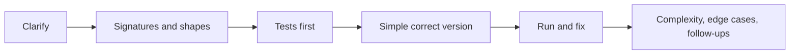
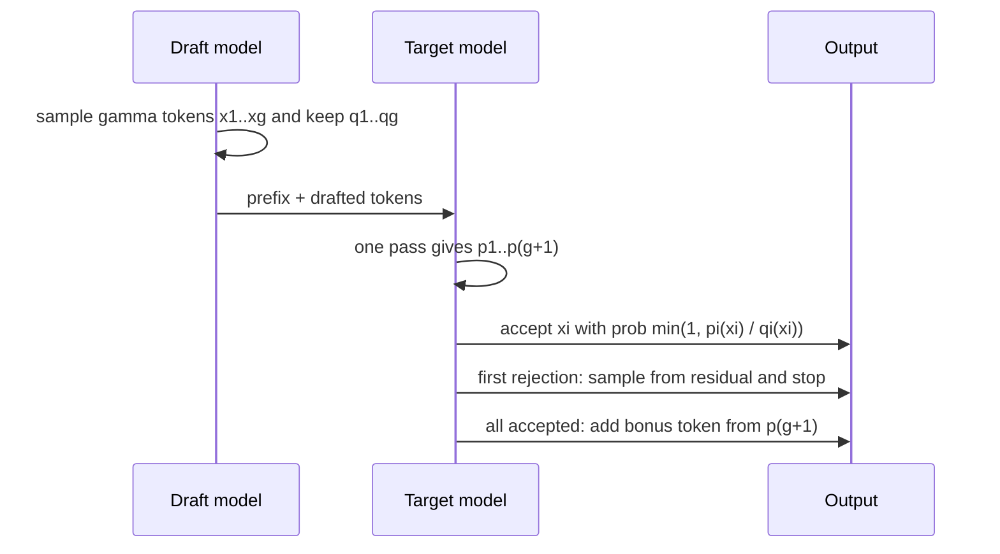
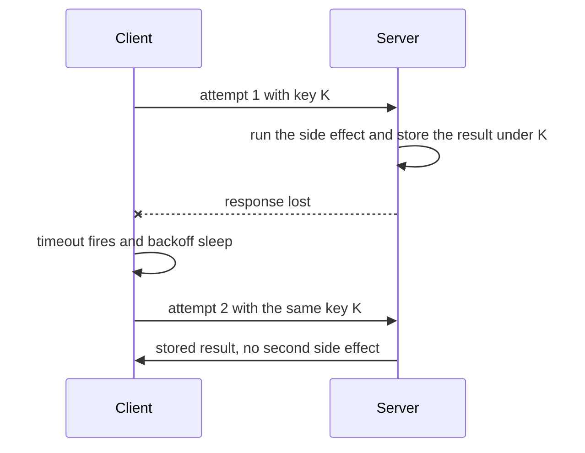

# Coding Challenges - Deep Dive

This guide is for engineers who can describe attention, sampling or a RAG pipeline and now need to produce one under time pressure, in plain numpy, while talking. [README.md](README.md) lists the 19 challenge files and what interviewers look for in each. There is no `questions.md` for this folder, because the drill is the code itself. This deep dive supplies what the docstrings leave out: a method for the round, the numpy habits that prevent most bugs, the mechanism and arithmetic behind each challenge, how to test and debug numerical code, and the two formats the README says the files cannot rehearse (async fan-out with safe retries, and find-the-planted-bugs).

Suggested study order, roughly 16-22 hours in total:

| Block | Parts | Hours |
|---|---|---|
| Method and numpy fluency | 1, 2 | 3-4 |
| Model internals and decoding | 3, 4, 5 | 5-7 |
| Retrieval, systems, training and eval | 6, 7, 8 | 4-5 |
| Testing, and the two uncovered formats | 9, 10 | 2-3 |
| Exercises | see [exercises/README.md](exercises/README.md) | 4-6 (overlaps) |

Read a part, then do the matching challenge file or exercise cold, with the clock running, before reading the reference solution.

## Prerequisites

- Python and numpy basics: arrays, slicing, `@`, `axis=`. Part 2 fills in the rest.
- Attention, residual streams and softmax at the conceptual level. See [../01-ml-and-dl-foundations/deep-dive.md](../01-ml-and-dl-foundations/deep-dive.md) and [../02-llm-fundamentals/deep-dive.md](../02-llm-fundamentals/deep-dive.md).
- Retrieval vocabulary (BM25, embeddings, chunking). See [../04-rag-and-retrieval/deep-dive.md](../04-rag-and-retrieval/deep-dive.md).
- Agent loops and tool calling. See [../06-agents-and-tool-use/deep-dive.md](../06-agents-and-tool-use/deep-dive.md).
- Evaluation vocabulary. See [../07-evaluation-and-observability/deep-dive.md](../07-evaluation-and-observability/deep-dive.md).

## Contents

1. [Part 1 - How to win an implementation round](#part-1---how-to-win-an-implementation-round)
2. [Part 2 - numpy fluency for ML interviews](#part-2---numpy-fluency-for-ml-interviews)
3. [Part 3 - Transformer internals](#part-3---transformer-internals)
4. [Part 4 - Decoding](#part-4---decoding)
5. [Part 5 - Tokenisation](#part-5---tokenisation)
6. [Part 6 - Retrieval](#part-6---retrieval)
7. [Part 7 - Systems code](#part-7---systems-code)
8. [Part 8 - Training and evaluation](#part-8---training-and-evaluation)
9. [Part 9 - Testing and debugging strategy](#part-9---testing-and-debugging-strategy)
10. [Part 10 - Two formats the challenge files do not cover](#part-10---two-formats-the-challenge-files-do-not-cover)
11. [Putting it together](#putting-it-together)
12. [Exercises](#exercises)
13. [Further study](#further-study)

---

## Part 1 - How to win an implementation round

### What is actually scored

An implementation round is not a test of whether you can recall code. The interviewer wants evidence on four things, and a passing test suite covers only the first.

1. **Correctness.** The function does what was asked, including edge cases.
2. **Understanding.** You can say why each line exists: why the mask is `-inf` before softmax, why the max is subtracted, why B starts at zero.
3. **Engineering judgement.** You pick sensible names and structure, state the complexity, and know what you would change at scale.
4. **Communication under uncertainty.** You ask before assuming, say what you are doing, and recover calmly from your own bugs.

Candidates with a perfect solution and no narration often score below candidates with a small bug they found and explained. The recovery is data.

### The method



A realistic 45-minute budget:

| Minutes | Step | Output |
|---|---|---|
| 0-5 | Clarify | Written list of assumptions |
| 5-9 | Signatures and shapes | Function stubs with type hints and shape comments |
| 9-14 | Tests first | 3-5 asserts, at least one computed by hand |
| 14-32 | Implement the simple version | Correct, readable code |
| 32-40 | Run, debug, tighten | Passing tests |
| 40-45 | Complexity, failure modes, follow-ups | Spoken summary |

**Clarify.** Ask the questions whose answers change the code. For ML code these are almost always the same:

- Shapes: is there a batch dimension? Is it `(B, T, D)` or `(T, D)`? Is the mask boolean or additive?
- Numerics: float32 or float64? Are huge or `-inf` inputs expected?
- Determinism: is a seed provided? Do ties matter, and who wins?
- Edge cases: empty input, `T = 1`, `k > V`, `p = 1`, all-padding rows.
- Allowed tools: numpy only? Can I use `einsum`? Is a loop acceptable first?
- Performance: is vectorisation required, or is correctness first?

Write the answers at the top of the file as comments. It is cheap, it shows discipline, and it protects you if the interviewer later disagrees.

**Signatures and shapes.** Before any body, write every function with types and a shape comment:

```python
def multi_head_attention(x, wq, wk, wv, wo, n_heads, mask=None):
    # x: (B, T, D); wq/wk/wv/wo: (D, D); returns (B, T, D)
    ...
```

Shape comments next to every intermediate variable catch roughly half of numpy bugs before they run. Keep them as you code.

**Tests first.** The tests-first habit does three things. It forces you to understand the spec, it gives you a target, and it lets you demonstrate engineering practice cheaply. Use a hierarchy:

1. One hand-computed value. For softmax of `[2, 1, 0]` the answer is about `[0.665, 0.245, 0.090]`.
2. One invariant. Rows sum to 1, output unchanged by adding a constant to logits, causal output unchanged when the future changes.
3. One edge. Empty input, a single token, all values equal, a huge logit.

Then write the simplest implementation that could pass them. A double loop over positions is fine as a first version and doubles as the reference for a vectorised one (Part 9).

**Talk while coding.** Narrate decisions, not syntax. "I subtract the row max so the largest exponent is zero, which avoids overflow and does not change the result because the factor cancels." Name the trick, name what breaks without it, and move on. Do not narrate every keystroke.

**State complexity in a fixed template.** "Time is O(T^2 d) for the score matrix and O(T d) extra memory per head, dominated by the T x T scores." Naming the dominant term and what it depends on is the scored behaviour. For cache, retrieval and tokenisation challenges, also say what the cost is per step as well as in total.

### When you are stuck

- Shrink the problem. Use `B = 1, T = 2, D = 2` and compute on paper. If you cannot, you do not yet understand the spec, so ask.
- Print shapes, not values. Most numpy bugs are shape bugs that broadcast silently.
- Write the loop version. A slow correct answer beats a fast wrong one, and you can vectorise afterwards.
- Say what you are testing. "I think the transpose axes are wrong, so I will check one head by hand" turns confusion into a plan.
- Do not backtrack silently. Tell the interviewer you are changing approach and why.

### Check yourself

1. You are given 45 minutes for beam search. What is on the screen at minute 10?

<details><summary>Answer</summary>

A signature with types, a list of assumptions (tie-breaking, what happens to finished beams, whether length normalisation is applied), and three to five tests: a hand-computed two-step case where beam search beats greedy, a beam width of 1 equal to greedy, and a check that scores are sums of log-probabilities. No search code yet, or at most a skeleton.

</details>

2. The tests fail on your first run. What do you do?

<details><summary>Answer</summary>

Read the first failure, not the last. Print shapes of the intermediates involved, reduce to a tiny input you can verify by hand, and say aloud what you suspect. Fix one thing at a time and rerun. Do not edit the test unless you can show the expectation itself was wrong.

</details>

3. Why write a slow loop version if you are asked for a vectorised one?

<details><summary>Answer</summary>

It is a reference implementation you can check the fast version against, it is easier to get right under pressure, and it shows the interviewer you can verify your own work. If time runs out you still have working code.

</details>

---

## Part 2 - numpy fluency for ML interviews

Most of the bugs in an implementation round are not algorithmic. They are shape, axis and numerical mistakes that numpy accepts silently. This part is the minimum fluency to avoid them.

### Broadcasting: the one rule

Align the shapes from the **right**. Pad the shorter shape with 1s on the left. Each pair of dimensions must be equal or one of them must be 1. The result takes the larger size.

```
a: (8, 1, 5)
b:    (3, 1)    -> padded to (1, 3, 1)
out: (8, 3, 5)
```

Working rules:

- `x[:, None]` and `x[..., None]` insert an axis. `x[None, :]` too. This is how you build pairwise tables: `d = i[:, None] - j[None, :]` is an `(n, m)` matrix from two vectors.
- Broadcasting never copies data. A `(B, T, 1)` times `(D,)` gives `(B, T, D)` without materialising anything large until the result.
- It also hides mistakes. `(5,) + (5, 1)` is `(5, 5)`, not `(5,)`. If you expected a vector and got a matrix, a broadcast did it.
- Use `keepdims=True` for any reduction you then broadcast back against the input: `x - x.max(axis=-1, keepdims=True)`. Without it a `(B, T)` max does not align with a `(B, T, V)` array, and for square cases it aligns the wrong way.

### A full shape trace: multi-head attention

Take `B = 2`, `T = 5`, `D = 8`, `h = 2` heads, `dh = D / h = 4`.

```
x                       (2, 5, 8)
q = x @ wq              (2, 5, 8)        wq is (8, 8)
q.reshape(2, 5, 2, 4)   (2, 5, 2, 4)     split the LAST axis into (heads, dh)
.transpose(0, 2, 1, 3)  (2, 2, 5, 4)     (B, h, T, dh): heads in front of time
k, v likewise           (2, 2, 5, 4)
scores = q @ k^T        (2, 2, 5, 4) @ (2, 2, 4, 5) = (2, 2, 5, 5)
   k^T is k.transpose(0, 1, 3, 2) or k.swapaxes(-1, -2)
scores / sqrt(dh)       (2, 2, 5, 5)     sqrt(4) = 2, not sqrt(8)
mask (5, 5) broadcasts  (2, 2, 5, 5)
softmax(axis=-1)        (2, 2, 5, 5)     each row sums to 1
out = probs @ v         (2, 2, 5, 5) @ (2, 2, 5, 4) = (2, 2, 5, 4)
.transpose(0, 2, 1, 3)  (2, 5, 2, 4)     bring time back in front of heads
.reshape(2, 5, 8)       (2, 5, 8)        merge (heads, dh) into channels
out @ wo                (2, 5, 8)
```

`matmul` treats leading dimensions as batch dimensions and multiplies the last two, which is why no loop over batch or head is needed.

Why reshape then transpose, and not `reshape(B, h, T, dh)` directly? `reshape` reads elements in memory order and refills the new shape. The channel axis of `x` has the heads contiguous: channels 0-3 are head 0 and channels 4-7 are head 1. Splitting that axis as `(h, dh)` is a valid reshape. Reshaping straight to `(B, h, T, dh)` would instead cut the flattened `(T, D)` block into `h` chunks of `T x dh` elements, mixing different positions into one "head". The shape is right and the values are nonsense, so no error is raised. The merge has the mirror-image trap: after transposing back to `(B, T, h, dh)`, `reshape` is correct. Skip the transpose and you scramble heads across positions. `ex01_vectorise_drills.py` has a test for exactly this.

### einsum

`einsum` names every axis with a letter. The rules:

1. A letter that appears in the output is kept.
2. A letter that appears in the inputs but not the output is **summed over**.
3. A letter that appears in several inputs is multiplied across them (matched elementwise along that axis).

```python
np.einsum("bhqd,bhkd->bhqk", q, k)      # scores: sum over d
np.einsum("bhqk,bhkd->bhqd", p, v)      # weighted values: sum over k
np.einsum("bi,bj->ij", a, b)            # sum over the batch of outer products
np.einsum("bi,ij,bj->b", x, w, y)       # a bilinear form per batch element
np.einsum("btd,vd->btv", h, emb)        # logits through a tied embedding
```

Use it when the contraction has three or more axes or unusual ones. Use `@` for plain matrix products, since it is clearer and calls BLAS directly. In an interview, say the subscript string out loud as a sentence: "for each batch and head, query q and key k, sum over d."

### Selecting values

Three standard ways to pick one entry per row, all appearing in cross-entropy code:

```python
logp[np.arange(N), targets]                     # (N, V) -> (N,): fancy indexing
np.take_along_axis(logp, ids[..., None], -1)[..., 0]   # (B, T, V) -> (B, T)
(logp * one_hot).sum(-1)                        # materialises (N, V): slower
```

Fancy indexing with two index arrays pairs them elementwise. It does not form a grid. `logp[ids]` with one array selects whole rows, which is a different operation.

### Numerical stability

**Softmax.** `exp(x)` overflows when the result exceeds the largest finite float: input above about 88.7 in float32 and about 709.8 in float64. Subtracting the row max `m` leaves every exponent at most 0:

```
softmax(x)_i = exp(x_i - m) / sum_j exp(x_j - m)
```

The factor `exp(-m)` appears in numerator and denominator and cancels, so the result is mathematically identical. The largest term is exactly 1, so the denominator is at least 1 and never zero. Example: for `[1000, 1001]` the naive version computes `inf / inf = nan`. The stable version computes `exp([-1, 0]) = [0.368, 1]` and returns `[0.269, 0.731]`.

**Log-sum-exp.** The same shift works inside a log:

```
logsumexp(x) = m + log(sum(exp(x - m)))
```

For `[1000, 1000]`: `m = 1000`, the sum is `1 + 1 = 2`, and the answer is `1000 + log 2 = 1000.693`. The naive `log(sum(exp(x)))` returns `inf`.

Two details matter. First, if a whole row is `-inf` (every token masked), `m = -inf` and `x - m` is `nan`. Replace a non-finite max with 0 for the shift, so the sum is 0 and the result is `-inf` instead of `nan`. Second, `log_softmax = x - logsumexp(x)` is more accurate than `log(softmax(x))`, because a probability that underflows to 0 has `log = -inf` while the log-space value is a finite large negative number.

**Cross-entropy.** Never form probabilities and then take a log. Compute `-(logits[target] - logsumexp(logits))`. The gradient with respect to logits is `softmax(logits) - onehot(target)`, divided by `N` for a mean. That gradient is the reason frameworks fuse softmax and cross-entropy into one operation.

**softplus and logsigmoid.** `log(1 + exp(x))` overflows for large `x`. Use `max(x, 0) + log1p(exp(-|x|))`. The exponent is never positive, and `log1p` stays accurate when its argument is tiny. For `x = -50` the naive `log(1 + exp(-50))` rounds `1 + 1.9e-22` to exactly 1 and returns 0, while `log1p` returns `1.9e-22`. Then `logsigmoid(x) = -softplus(-x)` and binary cross-entropy from a raw score `z` and label `y` is `max(z, 0) - z*y + log1p(exp(-|z|))`.

**Where epsilon goes.** Layer norm divides by `sqrt(var + eps)`. The epsilon sits inside the square root. Compare `var = 1e-6` and `eps = 1e-5`: `1 / sqrt(var + eps) = 301.5`, while `1 / (sqrt(var) + eps) = 990.1`. The second form behaves differently for small variances, and it does not match what the original layer was trained with. In `rms_norm` the same rule holds with `mean(x^2)` in place of the variance. In a cosine similarity, the equivalent guard is clamping the norm, `x / max(|x|, eps)`, so a zero vector maps to a zero vector instead of `nan`.

**dtype traps.**

- float16 overflows at 65,504, so a mask value of `-1e9` becomes `-inf`, and a row of all `-inf` becomes `nan` after softmax. Use `-inf` deliberately with the guard above, or `np.finfo(dtype).min`.
- float32 has a 24-bit significand. `float32(16777216) + float32(1)` is still 16777216, so a float32 cumulative sum over many small terms drifts. This is why top-p compares the cumulative probability *before* each token and special-cases `p = 1`.
- `np.argmax` returns the first maximum, so tie-breaking is lowest index. `np.argsort` is not stable by default for some kinds. Pass `kind="stable"` when ties must be deterministic.
- In-place operators (`x -= m`) on a view change the original. Prefer `x = x - m` unless memory matters.

### Check yourself

1. What is the shape of `np.arange(5)[:, None] - np.arange(3)[None, :]`?

<details><summary>Answer</summary>

`(5, 3)`. The `(5, 1)` and `(1, 3)` shapes each broadcast along the axis where they have size 1. Entry `[i, j]` is `i - j`. This is the construction behind every attention mask.

</details>

2. Why does the stable softmax give the same answer as the naive one?

<details><summary>Answer</summary>

`exp(x_i - m) = exp(x_i) * exp(-m)`. The factor `exp(-m)` is common to every term, so it appears in both numerator and denominator and cancels. The shift only changes the intermediate magnitudes.

</details>

3. Why can `reshape(B, h, T, dh)` on a `(B, T, D)` array produce the right shape and wrong values?

<details><summary>Answer</summary>

Reshape preserves memory order. A `(T, D)` block laid out row by row is cut into `h` consecutive chunks of `T * dh` elements, which mixes positions across the new head axis. The correct split reshapes the last axis to `(h, dh)` first and then transposes heads in front of time.

</details>

---

## Part 3 - Transformer internals

Challenges 01, 04, 05, 06 and 07 cover the pieces of a decoder-only transformer. This part explains what each piece is for and the arithmetic you should be able to reproduce.

### Attention

Scaled dot-product attention is `softmax(Q K^T / sqrt(d_k) + mask) V`. Each query scores every key, the scores become weights, and the output is the weighted average of the values.

A tiny worked example. One query `q = [1, 0]`, two keys `k1 = [1, 0]` and `k2 = [0, 1]`, values `v1 = [10, 0]` and `v2 = [0, 10]`, `d_k = 2`.

```
scores  = [q.k1, q.k2] / sqrt(2) = [0.7071, 0]
weights = softmax = [0.6698, 0.3302]
output  = 0.6698 * v1 + 0.3302 * v2 = [6.698, 3.302]
```

**Why divide by sqrt(d_k).** Suppose query and key entries are independent with mean 0 and variance 1. A dot product is a sum of `d_k` such products, each with variance 1, so the dot product has variance `d_k` (a numpy check with `d_k = 64` gives about 64). Without scaling, the scores' spread grows with `sqrt(d_k)`. Large spreads push softmax toward one-hot, where gradients with respect to the scores are close to zero. Dividing by `sqrt(d_k)` restores unit variance. Note the head dimension `d_head`, not `d_model`. Dividing by `sqrt(d_model)` in a multi-head layer is a classic planted bug that only shows when there is more than one head.

**Masking.** For a causal decoder, position `i` may use `j <= i`. Set masked scores to `-inf` **before** softmax. Then `exp(-inf) = 0`, and the remaining weights renormalise to sum to 1. Multiplying the weights by the mask after softmax is wrong in two ways: the rows no longer sum to 1, and the softmax denominator already included the future scores, so information from future tokens leaks into earlier outputs through the normaliser. `ex07_planted_bugs.py` contains exactly this bug and the test that exposes it.

Padding masks work the same way but mask keys, not queries. A row where every key is masked has no valid distribution. The right result is to output zeros (or ignore that row) and make sure the implementation does not produce `nan`. See `ex04_attention_masks.py`.

**Multi-head.** Splitting `D` channels into `h` heads of `dh = D / h` lets each head compute its own attention pattern at the same total cost as one wide head. The score computation costs about `T^2 * D` multiply-adds in total (summed across heads), and the score tensor has `h * T^2` entries. That quadratic memory term is what flash-style kernels avoid materialising.

### Normalisation

LayerNorm subtracts the mean and divides by the standard deviation over the feature axis, then applies a learned gain and bias. RMSNorm drops the mean subtraction and the bias and divides by the root mean square:

```
LayerNorm(x) = (x - mean) / sqrt(var + eps) * gamma + beta
RMSNorm(x)   = x / sqrt(mean(x^2) + eps) * gamma
```

For `x = [1, 2, 3, 4]`: the mean is 2.5, the variance is 1.25, so LayerNorm gives `[-1.342, -0.447, 0.447, 1.342]` (before gain and bias). The RMS is `sqrt(7.5) = 2.739`, so RMSNorm gives `[0.365, 0.730, 1.095, 1.461]`. RMSNorm keeps the sign pattern and relative magnitude but not the centring. It saves a reduction and a parameter vector, and models trained with it work as well in practice (Zhang and Sennrich, 2019).

**Pre-norm versus post-norm.** The original transformer applied the norm after the residual add: `x = norm(x + sublayer(x))`. Modern models use pre-norm: `x = x + sublayer(norm(x))`. With pre-norm the residual stream is an unnormalised running sum, so gradients reach early layers along the identity path unchanged, which makes deep stacks easier to train. When asked to write a block, the wiring is the whole question: normalise the input to the sublayer, and add the sublayer output back to the **un**normalised stream. Forgetting the `x +` on either branch is the classic dropped-residual bug.

### Positional information

Attention is permutation-equivariant: shuffle the inputs and the outputs shuffle the same way. Order has to be injected.

**Sinusoidal encoding** adds a fixed vector per position. Dimension pair `i` uses frequency `1 / 10000^(2i/d)`: the first pair has wavelength `2 pi` (fastest), and later pairs have longer and longer wavelengths. The model sees position as a multi-scale clock.

**RoPE (rotary embeddings)** instead rotates query and key vectors in 2-D planes, with the angle proportional to position. For a pair of coordinates at position `m` and frequency `theta`:

```
[x1']   [cos(m*theta)  -sin(m*theta)] [x1]
[x2'] = [sin(m*theta)   cos(m*theta)] [x2]
```

Treat each pair as a complex number `z = x1 + i x2`. Rotation is multiplication by `e^(i m theta)`. The attention score uses the real part of `q_m * conj(k_n)`:

```
(q e^(i m theta)) * conj(k e^(i n theta)) = q conj(k) e^(i (m - n) theta)
```

The absolute positions cancel and only `m - n` remains. The score therefore depends on the **relative** offset, which is the reason RoPE is applied to q and k and not to v. Rotations preserve norm, so the vector magnitude is untouched. A numerical check with `q = (1, 2)`, `k = (3, -1)`, `theta = 0.3`: the dot product of rotated vectors at positions 5 and 3 is -3.1272, and at positions 12 and 10 (same offset 2) it is -3.1272 again. Frequencies follow `theta_i = base^(-2i/d)` with `base = 10000` as a common choice, so low pairs rotate quickly (fine position) and high pairs slowly (coarse position).

### The mini GPT forward pass

A decoder-only block, repeated `L` times, is:

```
x = x + attention(norm(x))
x = x + mlp(norm(x))
```

framed by a token embedding (plus positional information, or RoPE inside attention) at the bottom and a final norm and projection to vocabulary logits at the top. With weight tying the output projection is the transpose of the embedding matrix, so `logits = h @ emb.T`.

Where the parameters and FLOPs live: per layer, attention has `4 d^2` parameters (q, k, v, o) and a standard MLP with a 4x hidden size has `8 d^2` (up and down projections). That is `12 d^2` per layer. For `d = 768` and `L = 12`: `12 * 768^2 * 12 = 84.9M` non-embedding parameters, plus a `50,257 x 768` embedding of 38.6M, about 123.5M in total, the GPT-2 small size. Forward FLOPs are roughly 2 per parameter per token (one multiply, one add), so about `2 * 85M = 170 MFLOPs` per token for the layers, plus an attention term that grows with context length: `4 * T * d` FLOPs per token per layer for scores and weighted sums. At short context the MLP and projections dominate. At long context the attention term takes over.

### KV cache

Without a cache, generating token `t + 1` recomputes keys and values for all `t` earlier tokens, although they cannot have changed (causal attention never lets earlier positions see later ones). With a cache you compute `k, v` for the new token only, append them, and attend from the single new query to all cached keys.

Cost accounting. Let `T` be the final length. Without a cache, step `t` runs the projections and MLP over `t` tokens, so the total is `1 + 2 + ... + T = T(T + 1) / 2` token-forwards. For `T = 100` that is 5,050. With a cache the total is 100, a 50-fold reduction in projection and MLP work. Attention itself still reads all `t` cached entries at step `t`, so its cost per step is `O(t d)` and `O(T^2 d)` over the generation, but the dominant cost moves from compute to **memory reads**: every step streams the cache from memory.

Memory. Per token the cache holds K and V for each layer:

```
bytes per token = 2 * layers * kv_heads * head_dim * bytes_per_value
```

For a 7B-class shape (32 layers, 32 KV heads, head dim 128, fp16) that is `2 * 32 * 32 * 128 * 2 = 524,288` bytes, 0.5 MiB per token, so a 4,096-token sequence needs 2 GiB. With grouped-query attention and 8 KV heads the same model needs 0.5 GiB. This is why serving capacity is usually limited by KV memory, not weights, once batches grow.

What an implementation must get right:

- The new token's position index is `len(cache)`, not 0. RoPE and learned positions both need the offset.
- The cache must be per sequence. Sharing a list across beams or requests is a classic aliasing bug; copy on fork.
- Rolling back after a rejected speculative draft means truncating **both** the draft and target caches to the last accepted position.
- The test is exact equivalence: logits from cached step-by-step decoding match logits from the full forward pass at every position, to within floating-point tolerance. This is the single most valuable test for the whole challenge.

### Check yourself

1. A mask is applied by multiplying attention weights after softmax. Name two things that break.

<details><summary>Answer</summary>

Rows no longer sum to 1, so outputs are scaled down, and the softmax denominator still included the future (or padded) scores, so earlier outputs change when later tokens change. A causality test fails even though the masked weights are exactly zero.

</details>

2. Why does RoPE give relative-position behaviour?

<details><summary>Answer</summary>

Rotating q by `m * theta` and k by `n * theta` makes their inner product depend on `(m - n) * theta` only, because a rotation by `a` followed by the inverse of a rotation by `b` is a rotation by `a - b`. The absolute positions cancel.

</details>

3. Compute the KV-cache size per token for 24 layers, 16 KV heads, head dimension 64, bf16.

<details><summary>Answer</summary>

`2 * 24 * 16 * 64 * 2 = 98,304` bytes, 96 KiB per token. A 2,048-token sequence needs 192 MiB.

</details>

4. In a pre-norm block, which tensor does the residual add use?

<details><summary>Answer</summary>

The unnormalised input to the sublayer: `x + sublayer(norm(x))`. Adding the normalised tensor, or replacing `x` with the sublayer output, changes the model and breaks pretrained weights.

</details>

---

## Part 4 - Decoding

Challenges 03, 15, 18 and 19 are all about turning a model's next-token distribution into text. Each is a small change to one step of the loop.

### Sampling

The standard order of operations on a logit vector:

1. Repetition or frequency penalties (adjust logits for tokens already produced).
2. Divide by temperature.
3. Truncate: top-k, top-p, min-p. Set removed logits to `-inf`.
4. Softmax over what is left (this renormalises).
5. Draw one token.

**Temperature.** `softmax(logits / T)`. As `T -> 0` the distribution approaches one-hot at the argmax, so implement `T = 0` as greedy and do not divide by zero. As `T -> infinity` it approaches uniform. Temperature goes before truncation because it changes which tokens fall inside the nucleus: a lower `T` shrinks it.

**Top-k** keeps the `k` highest logits. Handle `k >= V` (keep all) and `k = 1` (greedy). **Top-p (nucleus)** keeps the smallest set of top tokens whose cumulative probability reaches `p`. Worked example with probabilities `[0.5, 0.3, 0.1, 0.06, 0.04]` and `p = 0.85`:

```
sorted cumulative:   0.5   0.8   0.9   0.96   1.0
cumulative BEFORE:   0     0.5   0.8   0.9    0.96
keep if before < p:  yes   yes   yes   no     no
renormalised:        0.5/0.9 = 0.556, 0.333, 0.111
```

The rule "keep while the cumulative mass **before** this token is below `p`" is the clean form. It keeps the token that crosses the threshold, always keeps the top token even for tiny `p`, and needs no special case for the first element. `p = 1` keeps everything, but a float cumulative sum may reach 0.9999999 and drop real tokens, so treat `p >= 1` as "no filter".

**Min-p** keeps tokens with `prob >= min_p * max_prob`, so the cut scales with the model's confidence. **Repetition penalty** divides positive logits and multiplies negative logits by the penalty, so that both move toward "less likely" (dividing a negative logit would make it less negative, which is the opposite of what you want).

**Vectorising over a batch** (see `ex03_topp_batch.py`): `argsort` descending (stable), `take_along_axis` to get sorted probabilities, `cumsum` minus the element itself, compare against a per-row `p` with broadcasting, then scatter the keep mask back to vocabulary order with `put_along_axis`. Sampling is inverse-CDF: take the cumulative distribution, draw one uniform `u` per row, and the sampled index is the count of entries with `cdf <= u`. Using `<=` means a token with zero probability can never be chosen, even if `u` is exactly 0.

Testing a sampler means testing a distribution. Compare against a loop reference for the *filter*, then for the draw check empirical frequencies against the analytic distribution with a fixed seed and a tolerance of about 4 standard errors (`sqrt(p(1-p)/n)`).

### Beam search

Greedy decoding picks the best token each step and can walk into a poor sequence. Beam search keeps the `B` best partial sequences by total log-probability.

A worked case. Step 1: token A has probability 0.6 and B has 0.4. After A, the next-token distribution is nearly flat: `x 0.34, y 0.33, z 0.33`. After B, one token `w` has probability 0.9.

```
Greedy:   A (0.6), then x (0.34)  -> 0.6 * 0.34 = 0.204
Beam B=2: keeps A and B, then expands both:
          B, w -> 0.4 * 0.9 = 0.36        <- best full sequence
```

Greedy commits to A because it is locally best. Beam search with width 2 keeps B alive and finds the better sequence.

Mechanics to get right:

- **Add log-probabilities.** Products of many probabilities underflow. Scores are sums of `log p`.
- **Select from the flattened candidates.** Each beam proposes `V` continuations, giving `B x V` candidates. Take the top `B` of the *flattened* `B x V` scores, then recover `beam = idx // V` and `token = idx % V`. Taking the top `B` per beam and then merging is a different algorithm and gives the wrong set.
- **Park finished beams.** When a beam emits EOS, move it to a finished list and do not extend it. Otherwise it keeps accumulating log-probability penalties, or you extend a finished sequence. Stop when the best finished score cannot be beaten by any live beam, or at max length.
- **Length normalisation.** Raw log-probability always prefers short sequences, because each extra token multiplies in a probability below 1. Dividing by length or by a length penalty fixes the bias. With plain per-token normalisation, a sequence with total log-prob -2.0 over 4 tokens scores -0.50, which beats -1.5 over 2 tokens at -0.75, although the raw sums favour the short one. The GNMT penalty is `((5 + length) / 6)^alpha`: with `alpha = 1`, the same sequences score -1.333 and -1.286, a milder correction. `alpha` is a tuning parameter, so be ready to say which direction it pushes.
- **Cost.** Each step runs the model for `B` beams and a top-k over `B x V`, so time is about `B` times greedy and memory for caches is `B` times as large, with copy-on-fork for shared prefixes.

Failure modes: beam search maximises likelihood, and for open-ended generation the most likely text is often repetitive and bland. It suits tasks with a narrow correct answer (translation, structured output) and is a poor default for creative text.

### Constrained decoding

To force output to match a grammar or JSON schema, track a parser state and, at every step, **mask the logits of tokens that would make the output invalid**, then softmax and sample. Because masked logits are `-inf`, probability mass moves to the allowed tokens in proportion to their original weights.

Worked example. At some state only `b` and `c` are legal. The model's raw probabilities are `a 0.5, b 0.3, c 0.2`. After masking `a` and renormalising: `b = 0.3 / 0.5 = 0.6`, `c = 0.4`. If instead the model had put `b = 1e-6` and `c = 1e-7` and nearly all mass on `a`, the renormalised choice is still 0.91 for `b`, but the model "wanted" something else, so the output is valid but low quality. Constrained decoding guarantees syntax, not meaning. This is also why it **shifts the distribution**: the conditional distribution of the whole output is not the model's distribution conditioned on validity, because mass is renormalised greedily at each step without looking ahead.

Design points:

- **State machine.** A flat schema (fixed keys, simple types) is a finite automaton. Arbitrary nested JSON needs a pushdown automaton, because matching braces requires a stack. A regular expression or DFA cannot count unbounded nesting.
- **Token versus character.** Grammars speak in characters, while tokens are multi-character strings. For each token, the question is whether the whole string can be consumed from the current state. Real implementations precompute, for each parser state, the set of allowed token ids (a mask) so the per-step cost is a lookup.
- **Where it breaks.** The grammar can force the model into states it finds very unlikely, leading to endless whitespace or repeated keys. Putting the schema in the prompt keeps the model's own preferences aligned with the constraint. Also, closing the output must always be possible: ensure the mask can never leave a state with no allowed tokens.

### Speculative decoding

A big target model is slow at batch size 1 because each token requires streaming all the weights from memory, with very little arithmetic per byte. The idea: let a small draft model propose `gamma` tokens cheaply, then have the target score **all of them in one forward pass**. That pass costs about the same as generating one token, because it is memory-bound, so every accepted draft token is nearly free.



**The acceptance rule.** For each drafted token `x` at position `i`, draw `u ~ U(0, 1)` and accept if `u < min(1, p(x) / q(x))`, where `p` is the target and `q` the draft probability of `x`. On the first rejection, discard the rest of the draft and sample one token from the **residual distribution** `norm(max(p - q, 0))`. If all `gamma` are accepted, sample a bonus token from the target's distribution at position `gamma + 1`, which the same pass already computed. Each step therefore emits between 1 and `gamma + 1` tokens.

**Why it is lossless.** The claim: the emitted token is distributed exactly as `p`. For any token `t`:

```
P(emit t) = P(draft proposes t and accepted) + P(reject) * residual(t)
          = q(t) * min(1, p(t) / q(t))      + P(reject) * residual(t)
          = min(q(t), p(t))                 + P(reject) * residual(t)
```

The probability of rejection is the total mass the draft over-proposed: `P(reject) = 1 - sum_t min(p(t), q(t)) = sum_t max(p(t) - q(t), 0)`. The residual is `max(p(t) - q(t), 0)` divided by exactly that sum, so `P(reject) * residual(t) = max(p(t) - q(t), 0)`. Then:

```
P(emit t) = min(p(t), q(t)) + max(p(t) - q(t), 0) = p(t)
```

Numbers: `p = [0.5, 0.3, 0.2]`, `q = [0.2, 0.5, 0.3]`. The acceptance mass is `sum min(p, q) = 0.2 + 0.3 + 0.2 = 0.7`, so rejection has probability 0.3. The residual `max(p - q, 0) = [0.3, 0, 0]` normalises to `[1, 0, 0]`. Then token 0 is emitted with probability `0.2 * 1 + 0.3 * 1 = 0.5`. Token 1: `0.5 * min(1, 0.3 / 0.5) = 0.3`. Token 2: `0.3 * min(1, 0.2 / 0.3) = 0.2`. The result `[0.5, 0.3, 0.2]` equals `p`. The sampler is exact, with no quality trade-off, provided every draft step's `q` is the one actually used to sample.

Two things that look similar are wrong. Resampling from `p` (not the residual) after a rejection double-counts the tokens the draft already covers, so output drifts toward what the draft over-proposes and nothing crashes. Accepting when the draft's token equals the target's argmax is valid only for greedy decoding.

**Speedup arithmetic.** If each token is accepted independently with probability `a`, expected tokens per step are `(1 - a^(gamma + 1)) / (1 - a)`. With `a = 0.7`: `gamma = 1` gives 1.70, `gamma = 2` gives 2.19, `gamma = 4` gives 2.77, `gamma = 8` gives 3.20, and the limit is `1 / (1 - a) = 3.33`. If drafting one token costs a fraction `c` of a target pass, a step costs `1 + gamma * c`. With `c = 0.05` and `gamma = 4`: `2.77 / 1.2 = 2.31x` speedup over plain decoding. Past some `gamma` the extra drafts cost more than they add.

It is a **bandwidth** optimisation, not a FLOPs optimisation. Total FLOPs rise, because rejected draft work is wasted. Latency falls because the extra arithmetic fits into the idle compute of a memory-bound pass. At large batch sizes the target pass becomes compute-bound, the spare arithmetic disappears, and speculation can reduce throughput.

### Check yourself

1. Why is temperature applied before top-p?

<details><summary>Answer</summary>

Temperature reshapes the probabilities, and top-p is defined on those probabilities. Lower temperature concentrates mass and shrinks the nucleus, higher temperature widens it. Applying top-p first and then temperature would use the wrong cumulative masses.

</details>

2. In beam search with beam width 3 and vocabulary 50,000, how many candidates are scored per step and how do you pick survivors?

<details><summary>Answer</summary>

150,000. Flatten the `3 x 50,000` score matrix, take the top 3 overall, and recover the source beam as `idx // 50000` and the token as `idx % 50000`. Selecting per beam first gives a different, worse set.

</details>

3. A draft proposes token `t` with `q(t) = 0.4` and the target has `p(t) = 0.1`. What is the acceptance probability, and what happens on rejection?

<details><summary>Answer</summary>

`min(1, 0.1 / 0.4) = 0.25`. On rejection the rest of the draft is discarded and one token is sampled from `norm(max(p - q, 0))`, which puts weight only on tokens the target likes more than the draft does.

</details>

---

## Part 5 - Tokenisation

Challenge 02 asks for byte-level BPE. The deeper skill is knowing exactly what the algorithm does, so you can implement, test and extend it.

### Training BPE

Start with the text as a sequence of symbols (bytes, in byte-level BPE, so the base vocabulary is 256 and any input can be represented). Repeat: count adjacent pairs, pick the most frequent, replace every occurrence with a new symbol, record the merge.

Worked example on `aaabdaaabac` (11 symbols):

```
pair counts: (a,a)=4  (a,b)=2  (b,d)=1  (d,a)=1  (b,a)=1  (a,c)=1
merge 1: (a,a) -> X       X a b d X a b a c      (9 symbols)
pair counts now: (X,a)=2  (a,b)=2  (b,d)=1  (d,X)=1  (b,a)=1  (a,c)=1
```

Now `(X, a)` and `(a, b)` tie at 2. The choice has to be deterministic, for example the smallest pair by id, or the earliest pair first seen. Without a fixed rule two runs of your trainer produce different vocabularies, and a test that checks merges becomes flaky. Choosing `(X, a) -> Y` gives `Y b d Y b a c` (7 symbols).

Counting pairs from scratch each round costs `O(n)` per merge, so `O(n * merges)` overall. Production trainers keep pair counts in a priority structure and update counts locally after each merge. Say this in an interview and implement the simple version.

### Encoding is by merge rank, not greedy longest match

To encode new text, start from bytes and repeatedly apply the **earliest-learned merge** that is present, until none applies. Each merge has a rank (its training order). At each round, find the adjacent pair with the lowest rank and merge it.

This differs from "match the longest token at each position". Suppose the vocabulary has `ab` (merge rank 2) and `bc` (merge rank 1). For `abc`:

```
BPE by rank:    bc is rank 1, so merge first -> a, bc        -> [a][bc]
Longest match:  ab is the longest token starting at 0 -> [ab][c]
```

Both are valid ways to tokenise, but only the first matches the way the model's tokeniser was trained and used. If you implement longest match for a BPE vocabulary, your token counts and token ids differ from the reference. Longest-match (MaxMatch, as in WordPiece-style inference) is a different algorithm and is the right tool for special tokens, stop strings and fixed vocabularies.

### Round trip and unicode

Byte-level BPE guarantees `decode(encode(s)) == s` for any string, because every string is bytes. Decoding concatenates token bytes and then decodes UTF-8, so a single non-ASCII character such as an emoji may be several bytes and several tokens. Tokens in the middle of a multi-byte character are not valid UTF-8 on their own, which matters for streaming (below). Test the round trip with empty strings, accented letters, CJK, emoji and a lone newline. Counting characters with `len(s)` and counting tokens are unrelated quantities.

### Trie longest match and streaming

A trie answers "what is the longest vocabulary entry that starts at this position" by walking one character per step and remembering the last node that ended a token. Worst case the walk goes deep and then falls back: with vocabulary `{ab, abcd, c}` and text `abce`, the walk reaches `abc`, dies at `e`, and the best match is `ab`. Then resume at `c`.

Streaming adds one question: **when is a decision final?** If the walk consumed all the text so far and the current node still has children, more input could extend the match, so hold the text back. If the walk died on a missing child, or reached a leaf, no future text can change the answer, so emit. The held-back text is always shorter than the longest token. This is exactly the algorithm for detecting a stop sequence in a token stream without leaking half of a stop string to the user, and it is what `ex05_trie_tokenizer.py` practises. The correctness test is strong and cheap: for random vocabularies and texts, the streamed output must equal the batch output for every way of chunking, including one character at a time.

Streaming decode of bytes has the unicode problem: a chunk may end mid-character. Use `codecs.getincrementaldecoder("utf-8")()`, which keeps the incomplete bytes and emits text only when a full character is available, instead of decoding each chunk with `errors="replace"`.

### Check yourself

1. Why does byte-level BPE never need an unknown token?

<details><summary>Answer</summary>

The base vocabulary contains all 256 byte values, so every possible input string, in any language, can be written as a sequence of base tokens. Merges only shorten that sequence.

</details>

2. With merges ranked `bc` (1) then `ab` (2), how does BPE encode `abc`, and how does greedy longest match differ?

<details><summary>Answer</summary>

BPE merges the lowest-ranked present pair first, so `bc` forms, giving `[a][bc]`. Longest match at position 0 finds `ab`, giving `[ab][c]`. The results differ, which is why a BPE vocabulary must be applied by merge rank.

</details>

3. A trie-based streaming matcher has seen `ab` and the vocabulary contains `abcd`. Should it emit `ab`?

<details><summary>Answer</summary>

No. The node after `ab` has a child, so the next characters could extend the match to `abcd`. It holds `ab` back until the next character shows that the path ends, or the stream finishes and `flush` resolves it.

</details>

---

## Part 6 - Retrieval

Challenges 08, 09, 16 and 17 build the retrieval path: chunk, embed, search, fuse, cache.

### Search

Normalise vectors once at index time. Then cosine similarity is a dot product and a whole query is one matrix-vector product, `scores = index @ q`. For the top `k` of `N` scores do not sort everything: `np.argpartition(-scores, k)[:k]` selects them in `O(N)`, then sort only those `k`. Clamp `k` to `N`, and decide the tie rule (lowest id). Test with a document equal to the query (score 1.0, rank 1) and with an empty index.

### Chunking

A sliding window with `size` and `overlap` advances by `stride = size - overlap`. If `stride <= 0` the loop never advances, so validate and raise. For 1,000 characters, `size = 200`, `overlap = 50`, the stride is 150, the starts are 0, 150, ..., 750, and a final chunk at 900 reaches the end: 7 chunks. Indexed text is 7 x 200 = 1,400 characters for 1,000 of source, a 40% inflation, so overlap has a storage and cost price. The tests that matter are coverage (every character appears in some chunk), exactness (consecutive chunks overlap by exactly `overlap` except at the end) and no tail duplicate (do not emit a final chunk fully contained in the previous one). Sentence and recursive chunkers split on a priority list of separators (paragraph, line, sentence, space, character) and keep the separators, so that joining the pieces rebuilds the text. A single sentence longer than the limit needs a fallback split.

### Hybrid search

BM25 scores a term in a document as `idf * tf * (k1 + 1) / (tf + k1 * (1 - b + b * len / avglen))`, with `idf = ln(1 + (N - df + 0.5) / (df + 0.5))`. Take three documents of lengths 3, 9 and 2 (average 4.67), `k1 = 1.5`, `b = 0.75`, and the term "cat" appearing in two of them: `idf = 0.470`. A 3-token document with one "cat" scores 0.560. A 9-token document with three "cat" scores 0.636. Tripling the count and tripling the length raised the score only 14%, which is term-frequency saturation plus length normalisation.

Lexical and dense scores live on different scales, so fuse **ranks**. Reciprocal rank fusion scores `sum over lists of 1 / (k + rank)`, usually `k = 60`. If dense ranks A, B, C and BM25 ranks C, A, D: `A = 1/61 + 1/62 = 0.03252`, `C = 1/63 + 1/61 = 0.03227`, `B = 0.01613`, `D = 0.01587`. The order is A, C, B, D. A document ranked well by both beats one ranked first by only one, and no score calibration is needed. MMR then picks results greedily by `lambda * relevance - (1 - lambda) * max similarity to already chosen`, trading relevance for diversity.

### Semantic cache

Two tiers. Exact: a hash of everything that determines the answer (model and version, prompt template version, normalised prompt, sampling parameters, tenant). Semantic: embed the query and return a stored answer if cosine similarity exceeds a threshold. The threshold is a business decision: "How do I reset my password?" and "How do I reset my router?" can be very close in embedding space and need different answers. Expected cost per request is roughly `lookup + (1 - hit_rate) * llm_cost`, but a false hit has its own cost, wrong answers served confidently. Entries need a TTL, an LRU bound (`OrderedDict.move_to_end` on hit, `popitem(last=False)` on overflow), and tag-based invalidation so a document update evicts every answer derived from it. Cache keys without the prompt and model version serve stale answers after a deployment.

### Check yourself

1. Why does RRF use ranks and not scores?

<details><summary>Answer</summary>

BM25 scores are unbounded and corpus-dependent, while cosine lies in [-1, 1]. Mixing them needs a calibration that breaks as the corpus changes. Ranks are comparable across systems and need no tuning.

</details>

2. What goes wrong with `size = 100, overlap = 100`?

<details><summary>Answer</summary>

The stride is 0, so the window never advances: an infinite loop or endless duplicate chunks. Validate `0 <= overlap < size`.

</details>

---

## Part 7 - Systems code

Challenges 10, 11 and 13 are plain engineering: rate limiting, retries, stream parsing and the agent loop. They are scored on state-handling discipline.

### Token bucket and retries

A token bucket holds up to `capacity` tokens, refilled at `rate` per second. A request takes tokens or is refused. Refill lazily at each call, from an injected clock so tests control time:

```python
def allow(self, n=1):
    now = self.clock()
    self.tokens = min(self.capacity, self.tokens + (now - self.last) * self.rate)
    self.last = now
    if self.tokens >= n:
        self.tokens -= n
        return True
    return False
```

With capacity 10 and rate 2 per second, 15 simultaneous requests let 10 through. After 2 s the bucket holds 4. The sustained rate is 2 per second and the largest burst is 10. The wait for `n` missing tokens is `(n - tokens) / rate`. Use a monotonic clock, and guard shared state with a lock in threaded code. LLM providers limit tokens per minute as well as requests, so the cost `n` is the request's token estimate.

Retries need three rules. Retry only errors that can succeed later (429, 5xx, timeouts). Wait `uniform(0, min(cap, base * 2^attempt))` (full jitter), because fixed or purely exponential waits make 1,000 failed clients retry at the same instant. Cap the total: a retry budget, a deadline, and a single retrying layer, since three layers each making 3 attempts send 27 calls to a failing service. Honour `Retry-After` when present.

### Streaming parser

Server-sent events are lines of `field: value`, terminated by `\n`, `\r\n` or `\r`. A blank line ends an event. Several `data:` lines join with `\n`. One space after the colon is stripped, a line starting with `:` is a comment, and `event:` and `id:` set metadata. Chunks from the network cut anywhere: mid-line, mid-event, between the `\r` and `\n` of one terminator. So keep a buffer, process only complete lines, and hold a trailing `\r` until the next chunk shows whether `\n` follows. Decode bytes with an incremental UTF-8 decoder.

Tool-call arguments arrive as string fragments, tagged by call index. Concatenate fragments per index. The first fragment carries the call id and function name. Parse the JSON once, when the stream says the call is finished. Parsing a prefix like `{"city": "Pa` raises, so either wait or use a tolerant partial parser for previews only. Parallel calls interleave by index. The decisive test is chunking equivalence: the events from one whole payload must equal the events from the same payload cut at every byte position.

### Agent loop

The loop is a small state machine: build messages, call the model, and if it returns tool calls, run each, append the result as a tool message, and repeat. Otherwise return the answer. The details are the grade:

- A failing tool, an unknown tool name or malformed JSON arguments becomes an **observation** the model can read, not an exception that kills the run.
- Hard limits on iterations (and tokens or time), with a distinct stop reason such as `max_steps`.
- Identical repeated calls are detected and stopped.
- Every tool result is appended with the matching call id, in order.
- A scripted mock model makes the whole loop deterministic and testable.

### Check yourself

1. What does `Retry-After: 7` change in your retry loop?

<details><summary>Answer</summary>

The server has told you when to retry, so wait at least 7 seconds (plus jitter) instead of using your own backoff, and count it against your deadline.

</details>

2. A chunk ends with `\r`. Why can you not emit the line yet?

<details><summary>Answer</summary>

The next chunk may start with `\n`, making `\r\n` one terminator. Treating `\r` as a full terminator now would then produce a spurious empty line, which would dispatch an event early.

</details>

3. Why is a tool exception turned into a message?

<details><summary>Answer</summary>

The model can often recover (fix an argument, try another tool), and the transcript stays consistent. Crashing the loop loses that chance. Unrecoverable errors still end the run through the stop reasons.

</details>

---

## Part 8 - Training and evaluation

### LoRA

For a frozen weight `W (d, k)`, LoRA learns a low-rank update: `y = x W + (alpha / r) * (x A) B`, with `A (d, r)` random and `B (r, k)` zero. At step 0 the update is exactly zero, so the model equals the pretrained one. Why not zero both? The gradient to `B` is proportional to `(x A)^T`, and the gradient to `A` is proportional to `B^T`. With `B = 0` the gradient to `A` is zero at step 0 but `B` gets a signal, and after one step `B` is nonzero so `A` learns. With both zero, both gradients stay zero forever.

Cost: `d = k = 4096`, `r = 8`: `8 * (4096 + 4096) = 65,536` trainable values against `16,777,216` frozen, 0.39%. Keep the two thin matmuls in the forward pass. Forming `A @ B` each time builds a full `d x k` matrix and discards the saving. Merging, `W' = W + (alpha / r) A B`, removes inference overhead but ties the weights to one adapter. For multi-tenant serving run the base matmul once for the whole batch, then for each adapter id gather the rows that asked for it and add `(x[rows] @ A_i) @ B_i * scale`. A per-request loop over the base matmul is the wrong answer. Merging into a quantised base rounds twice and is lossy.

### Evaluation metrics

**pass@k.** Sample `n` solutions, `c` pass. The probability that at least one of `k` drawn without replacement passes is `1 - C(n - c, k) / C(n, k)`. With `n = 10`, `c = 3`, `k = 5` that is `1 - 21/252 = 0.917`, while the naive `1 - (1 - 0.3)^5 = 0.832` underestimates. A numerically stable product form is `1 - prod over i from n - c + 1 to n of (1 - k / i)`. Return 1 when `n - c < k`.

**QA metrics.** Normalise first (lowercase, strip punctuation, drop the articles a, an, the, collapse spaces). Exact match compares normalised strings. Token F1 uses the multiset overlap: prediction "the cat sat" against "a cat sat down" normalises to `[cat, sat]` and `[cat, sat, down]`, overlap 2, precision 1, recall 2/3, F1 = 0.8. Define what both-empty and no-overlap return.

**Judge harness.** Models used as judges favour the first position and longer answers. Run each comparison in both orders and count disagreement as a tie, fix the temperature, force a structured verdict, and measure agreement with human labels before trusting the numbers. Report intervals: 28 of 40 against 30 of 40 successes cannot be separated.

### Check yourself

1. Why must exactly one of `A` and `B` start at zero?

<details><summary>Answer</summary>

Zero on one side makes the update exactly zero at step 0, so the model starts as the pretrained one. The other side must be random so the zero side still receives a gradient (proportional to the activations projected through it). With both zero, both gradients stay zero and nothing is learned.

</details>

2. `n = 5`, `c = 4`, `k = 2`. What is pass@2?

<details><summary>Answer</summary>

`n - c = 1 < k = 2`, so every pair contains at least one success: pass@2 = 1.0. Check: `1 - C(1,2)/C(5,2) = 1 - 0 = 1`.

</details>

---

## Part 9 - Testing and debugging strategy

In a timed round the tests are your instruments. Use five kinds, from cheapest to strongest.

1. **Hand oracles.** A value you computed on paper, such as softmax of `[2, 1, 0]` or the top-p example in Part 4.
2. **Invariants.** Properties that hold for all inputs: probabilities sum to 1, softmax unchanged by adding a constant, `logsumexp(x + c) = logsumexp(x) + c`, causal outputs unchanged when the future changes, RMSNorm unchanged under scaling of the input (up to eps), cosine similarity unchanged under scaling, rows independent of other batch rows, retrieval returns the query document first.
3. **Reference comparison.** A slow loop version, the same model without a cache, merged against unmerged LoRA, streamed against batch parsing. Test the fast path against the slow path on random inputs under a fixed seed.
4. **Gradient checks.** Compare the analytic gradient with central differences, in float64:

```python
def numeric_grad(f, x, eps=1e-6):
    g = np.zeros_like(x)
    for i in np.ndindex(*x.shape):
        old = x[i]
        x[i] = old + eps; hi = f(x)
        x[i] = old - eps; lo = f(x)
        x[i] = old
        g[i] = (hi - lo) / (2 * eps)
    return g   # relative error |a - n| / max(|a| + |n|, 1e-12) should be near 1e-7
```

5. **Statistical tests** for samplers: fixed seed, many draws, tolerance of about 4 standard errors `sqrt(p (1 - p) / n)`.

For debugging, shrink the input, then bisect by comparing intermediate tensors against the reference. Run once under `np.errstate(all="raise")` to stop at the first `nan` or overflow. Print shapes at each step. Check extreme inputs (1000, -1000, `-inf`, zeros, ties, length-1 sequences). Do not assert exact float equality except where the operations are identical. Use `np.allclose` and know the tolerance.

### Check yourself

1. Which test catches a layer norm that normalises over the batch axis?

<details><summary>Answer</summary>

Row independence: changing one batch element must not change another element's output. A batch-axis norm fails it immediately.

</details>

2. Why central and not forward differences in a gradient check?

<details><summary>Answer</summary>

Central differences have error of order `eps^2` instead of `eps`, so they stay accurate at an `eps` large enough to avoid floating-point cancellation.

</details>

---

## Part 10 - Two formats the challenge files do not cover

### Async fan-out with safe retries

The task: call N APIs concurrently, survive transient failures, never repeat a side effect, and stop when a budget is spent. Five pieces, all in `ex06_async_fanout.py`:

```python
sem = asyncio.Semaphore(concurrency)               # 1. concurrency cap

async def one(i):
    async with sem:
        key = make_key(run_id, i, payloads[i])     # 2. one idempotency key per logical operation
        for attempt in range(max_attempts):
            budget.take()                          # 3. budget; raises BudgetExhausted
            try:
                return await asyncio.wait_for(call(key, payloads[i]), timeout)   # 4. per-call timeout
            except (TimeoutError, RetryableError):
                await asyncio.sleep(random.uniform(0, min(cap, base * 2 ** attempt)))   # 5. full jitter
```



A timeout means "I stopped waiting", not "it did not happen". The server may have completed the work. Retrying is safe only if the retry carries the same key and the server replays the stored result. The key names the logical operation (run, step, payload), not the attempt. A key that includes the attempt number defeats the purpose. Retry 429, 5xx and timeouts. Never retry 400-class errors, validation errors or a spent budget.

Pitfalls: catching `CancelledError` and carrying on (it is not an `Exception` in modern Python, so `except Exception` is correct, a bare `except` is not). Using `gather` without `return_exceptions=True`, which abandons siblings on the first error. Creating tasks and dropping the references. Not awaiting cancelled tasks, so they are orphaned. Holding the semaphore during a long backoff when you could release it. Computing `base * 2 ** attempt` with a huge `attempt` (clamp the exponent). The cleanup shape is `try: await asyncio.wait(tasks, return_when=FIRST_EXCEPTION)  finally: cancel the unfinished, then await gather(..., return_exceptions=True)`. It runs on budget exhaustion and also when the caller cancels you. Test with fake APIs that script outcomes (`429`, `503`, `hang`, `lost`), millisecond latencies, per-task seeded random, and assertions on counters (max in flight, effects per key, in-flight count zero, no live tasks) rather than wall time.

### Find the planted bugs

You get a working-looking implementation with several bugs, and are asked to find, fix and write the test that would have caught each. The skill scored is the test. Catalogue for an attention block:

| Bug | Symptom | Cheapest test |
|---|---|---|
| Mask after softmax | Future leaks, rows do not sum to 1 | Change future tokens, past output must not move |
| Scale by `sqrt(d_model)` | Wrong values with more than one head | Compare against a loop reference at 2 and 4 heads |
| Head merge without transpose | Right shape, wrong values | Uniform attention (`q = k = 0`) equals a running mean |
| Residual dropped | Block ignores its input | All-zero weights must give the identity |
| Softmax over wrong axis | Columns sum to 1, not rows | Row sums equal 1 |
| Off-by-one mask (`tril(k=-1)`) | Token cannot see itself, NaN on row 0 | One token attends only to itself |
| Missing max shift | NaN with large logits | Logits of 1000 stay finite |
| Cache position offset | Divergence after a few tokens | Cached equals full forward at each step |

Method: read once for shapes, run a tiny case, state an invariant per region, write the failing test first, then fix and watch it pass. Fix one region at a time and say which test you would keep. In multi-file rounds, run the existing tests first, make small diffs and re-run.

### Check yourself

1. A retry after a timeout executed a payment twice. What was missing?

<details><summary>Answer</summary>

A stable idempotency key reused across attempts and a server that stores the result by key and replays it. The retry should have sent the same key as the first attempt.

</details>

2. In the planted-bug block, why do all four bugs pass a shape assertion?

<details><summary>Answer</summary>

Each rewrites values without changing array shapes, so only value-level checks (invariants, oracles, references) detect them.

</details>

---

## Putting it together

A strong answer to a build-from-scratch prompt follows one arc. Clarify and write signatures with shapes (Part 1). Write tests with a hand oracle, an invariant and an edge case. Implement the simple loop version, then vectorise with explicit shape comments (Part 2). Name the stability trick, the complexity and the failure mode as you write: "mask before softmax", "O(T) per step with a cache, memory-bound", "rank-based fusion". Finish by checking the fast version against the slow one. For a composite prompt such as "stream an answer from a mini RAG with retries", the pieces are chunking and search (Part 6), a streaming parser and retry loop (Part 7), and an eval metric (Part 8). Name the seam between them, such as the idempotency key and the chunking-equivalence test, because that is where integration bugs live.

## Exercises

Seven new exercises are in [exercises/README.md](exercises/README.md), with stubs, reference solutions and ten pen-and-paper problems.

| # | Exercise | Parts |
|---|---|---|
| 1 | `ex01_vectorise_drills.py`: einsum and broadcasting against loop references | 2 |
| 2 | `ex02_stable_math.py`: logsumexp, cross-entropy, logsigmoid on extreme inputs | 2, 9 |
| 3 | `ex03_topp_batch.py`: vectorised batch top-p | 4 |
| 4 | `ex04_attention_masks.py`: sliding-window, sink and strided masks | 3 |
| 5 | `ex05_trie_tokenizer.py`: trie longest match with streaming | 5 |
| 6 | `ex06_async_fanout.py`: concurrency cap, retries, keys, cancellation | 7, 10 |
| 7 | `ex07_planted_bugs.py`: fix four planted bugs | 9, 10 |

## Further study

- Vaswani et al., "Attention Is All You Need": https://arxiv.org/abs/1706.03762
- Su et al., "RoFormer" (RoPE): https://arxiv.org/abs/2104.09864
- Zhang and Sennrich, "Root Mean Square Layer Normalization": https://arxiv.org/abs/1910.07467
- Sennrich et al., "Neural Machine Translation of Rare Words with Subword Units" (BPE): https://arxiv.org/abs/1508.07909
- Holtzman et al., "The Curious Case of Neural Text Degeneration" (top-p): https://arxiv.org/abs/1904.09751
- Wu et al., "Google's Neural Machine Translation System" (length penalty): https://arxiv.org/abs/1609.08144
- Leviathan et al., "Fast Inference from Transformers via Speculative Decoding": https://arxiv.org/abs/2211.17192
- Chen et al., "Accelerating Large Language Model Decoding with Speculative Sampling": https://arxiv.org/abs/2302.01318
- Hu et al., "LoRA": https://arxiv.org/abs/2106.09685
- Chen et al., "Evaluating Large Language Models Trained on Code" (pass@k): https://arxiv.org/abs/2107.03374
- Xiao et al., "Efficient Streaming Language Models with Attention Sinks": https://arxiv.org/abs/2309.17453
- Child et al., "Generating Long Sequences with Sparse Transformers": https://arxiv.org/abs/1904.10509
- NumPy broadcasting: https://numpy.org/doc/stable/user/basics.broadcasting.html
- NumPy einsum: https://numpy.org/doc/stable/reference/generated/numpy.einsum.html
- Server-sent events specification: https://html.spec.whatwg.org/multipage/server-sent-events.html
- Python asyncio tasks and timeouts: https://docs.python.org/3/library/asyncio-task.html
- AWS Architecture Blog, "Exponential Backoff And Jitter": https://aws.amazon.com/blogs/architecture/exponential-backoff-and-jitter/
- Stripe, "Designing robust and predictable APIs with idempotency": https://stripe.com/blog/idempotency
- The Annotated Transformer: https://nlp.seas.harvard.edu/annotated-transformer/